# LoreBary Laboratory CSS — Contribution Guide

A standalone collection of additional Laboratory selectors and customization recipes. Replace the example colors and uploaded image URLs with your own.

**Using this guide:** Add the CSS to your Laboratory theme. For image replacements, use a LoreBary-uploaded `/api/images/...` URL or a Base64 data URL. See [How to Import CSS Images in Lorebary](#how-to-import-css-images-in-lorebary) and [Converting Images to Base64](https://github.com/Caddel001/LoreBary-Theme-Snippets/blob/main/LoreBary%20CSS%20Quick%20Guide.md#converting-images-to-base64). Copy only the rules you need.

## Contents

- [Getting Started](#getting-started)
  - [Combining Examples Safely](#combining-examples-safely)
  - [How to Import CSS Images in Lorebary](#how-to-import-css-images-in-lorebary)
- [Visual Expressions](#visual-expressions)
  - [Custom Visual Expression Icons](#custom-visual-expression-icons)
  - [Glowing Expression Portraits](#glowing-expression-portraits)
  - [Move Expression Portraits to the Right](#move-expression-portraits-to-the-right)
  - [Floating Expression Portraits](#floating-expression-portraits)
  - [Expression Toggle Button Colors](#expression-toggle-button-colors)
- [Chat Bubbles](#chat-bubbles)
  - [Custom Message Bubble Backgrounds](#custom-message-bubble-backgrounds)
  - [Different User and Character Message Bubbles](#different-user-and-character-message-bubbles)
  - [Bubble Tail Effects and Removal](#bubble-tail-effects-and-removal)
  - [Bubble Transparency Without Fading Text](#bubble-transparency-without-fading-text)
  - [Decorative Message Bubble Ornaments](#decorative-message-bubble-ornaments)
  - [Message Bubble Hover Glow](#message-bubble-hover-glow)
- [Message Text and Formatting](#message-text-and-formatting)
  - [Message Text, Bold, and Italic](#message-text-bold-and-italic)
  - [Dialogue, Dividers, and Headings](#dialogue-dividers-and-headings)
  - [Message List Items](#message-list-items)
- [Message Footer and Ratings](#message-footer-and-ratings)
  - [Message Footer and Timestamp Styling](#message-footer-and-timestamp-styling)
  - [Custom Rating Icons](#custom-rating-icons)
- [Thinking Panel](#thinking-panel)
  - [Thinking Panel Background and Text](#thinking-panel-background-and-text)
  - [Thinking Panel Hover Effects](#thinking-panel-hover-effects)
- [Header and Footer](#header-and-footer)
  - [Custom Header Button Icons](#custom-header-button-icons)
  - [Custom Navigation Icons](#custom-navigation-icons)
  - [Custom Footer Button Icons](#custom-footer-button-icons)
  - [Icon Glow — Search Example](#icon-glow-search-example)
  - [Rainbow Button Background — Search Example](#rainbow-button-background-search-example)
  - [Icon Hover Enlargement — Gallery Example](#icon-hover-enlargement-gallery-example)
  - [Animated Rainbow Button — Gallery Example](#animated-rainbow-button-gallery-example)
  - [Multicolor Icon Glow — Bookmarks Example](#multicolor-icon-glow-bookmarks-example)
  - [Rotating Rainbow Button Border — Bookmarks Example](#rotating-rainbow-button-border-bookmarks-example)
  - [Solid Button Border — Voice Call Example](#solid-button-border-voice-call-example)
  - [Gradient Button Border — Fullscreen Example](#gradient-button-border-fullscreen-example)
  - [Pulsing Button Glow — Fullscreen Example](#pulsing-button-glow-fullscreen-example)
  - [Bobbing Icon Animation — Statistics Example](#bobbing-icon-animation-statistics-example)
  - [Button Hover Glow — Statistics Example](#button-hover-glow-statistics-example)
  - [Shared Button Hover Brightness — Header Examples](#shared-button-hover-brightness-header-examples)
  - [Button Keyboard Focus Outlines — Header Examples](#button-keyboard-focus-outlines-header-examples)
  - [Rainbow Icon Recoloring — Gallery Example](#rainbow-icon-recoloring-gallery-example)
- [Message Actions and Input Controls](#message-actions-and-input-controls)
  - [Individual Message Action Colors and Hover](#individual-message-action-colors-and-hover)
  - [Custom Menu Button Icon](#custom-menu-button-icon)
  - [Custom Input Button Icons](#custom-input-button-icons)
  - [Custom Draft Version Controls](#custom-draft-version-controls)
  - [Custom Message Action Icons](#custom-message-action-icons)
  - [Managing Tinting, Filters, and Icon Replacements](#managing-tinting-filters-and-icon-replacements)
- [Write for Me](#write-for-me)
  - [Write Menu Heading Colors](#write-menu-heading-colors)
  - [Write Menu Actions and Help Text](#write-menu-actions-and-help-text)
    - [Write Menu Selected, Unselected, and Keyboard-Focus States](#write-menu-selected-unselected-and-keyboard-focus-states)
  - [Custom Write Menu Action Icons](#custom-write-menu-action-icons)
- [Search and Bookmarks](#search-and-bookmarks)
  - [Search & Bookmarks Panel Background](#search-bookmarks-panel-background)
  - [Search & Bookmarks Header Styling](#search-bookmarks-header-styling)
  - [Search & Bookmarks Title and Description](#search-bookmarks-title-and-description)
  - [Search & Bookmarks Header Icon Glow](#search-bookmarks-header-icon-glow)
  - [Custom Search & Bookmarks Header Icons](#custom-search-bookmarks-header-icons)
  - [Custom Search Bar Colors](#custom-search-bar-colors)
  - [Search Field Magnifying-Glass Glow](#search-field-magnifying-glass-glow)
  - [Search Bar Focus Effect](#search-bar-focus-effect)
  - [Bookmarks Tab Bar Background](#bookmarks-tab-bar-background)
  - [Bookmarks Tab Colors](#bookmarks-tab-colors)
  - [Selected Bookmarks Tab Styling](#selected-bookmarks-tab-styling)
  - [Bookmarks Tab Hover and Keyboard Focus](#bookmarks-tab-hover-and-keyboard-focus)
  - [Bookmarks Tab Counters](#bookmarks-tab-counters)
  - [Bookmarks Empty-State Text](#bookmarks-empty-state-text)
  - [Custom Search Empty-State Illustration](#custom-search-empty-state-illustration)
  - [Search & Bookmarks Close Button](#search-bookmarks-close-button)
  - [Search & Bookmarks Footer Styling](#search-bookmarks-footer-styling)
  - [Custom Copy and Download Icons](#custom-copy-and-download-icons)
  - [Custom Search & Bookmarks Background Images](#custom-search-bookmarks-background-images)
  - [Custom Bookmarks Tab Icons](#custom-bookmarks-tab-icons)
- [Scene Notes](#scene-notes)
  - [Custom Scene Notes Window](#custom-scene-notes-window)
  - [Scene Notes Title and Close Button](#scene-notes-title-and-close-button)
  - [Scene Notes Template Colors](#scene-notes-template-colors)
  - [Scene Notes Selected and Hover Effects](#scene-notes-selected-and-hover-effects)
  - [Scene Notes Text Box Colors and Focus](#scene-notes-text-box-colors-and-focus)
  - [Scene Notes Additional Buttons](#scene-notes-additional-buttons)
  - [Scene Notes Keyboard Focus](#scene-notes-keyboard-focus)
  - [Custom Scene Notes Template Icons](#custom-scene-notes-template-icons)

## Getting Started

### Combining Examples Safely

These snippets are **alternatives and building blocks**, not one stylesheet to paste in full. Multiple examples can target the same button, portrait, panel, or pseudo-element. Later `background`, `filter`, `transform`, `animation`, and `box-shadow` declarations can replace earlier ones; merge values intentionally. In particular, **Bubble Hover Lift** and **Message Bubble Hover Glow** offer competing hover shadows; expression positioning recipes are alternatives; and icon tints must be combined with existing drop-shadow filters.

---

### How to Import CSS Images in Lorebary

Learn how to upload artwork to Lorebary and use its image URL in your Laboratory CSS. 

1. Upload your image using Lorebary's image upload feature. Copy the image's Lorebary-hosted URL; an uploaded image may have a path resembling `/api/images/IMAGE_ID`.
2. Open your Laboratory CSS editor and find the selector for the element you want to customize.
3. Paste the URL into `content: url(...)` when replacing an existing `` element, or into `background-image: url(...)` when decorating an element's background.
4. Save your CSS and refresh or revisit the affected Laboratory screen to check the result.

**Choosing an image source:** You can use either a LoreBary-uploaded `/api/images/...` path or a Base64 image data URL. For Base64, replace `XXX` with the complete `data:webp;base64,...` value (or the corresponding data URL for your image format). See [Converting Images to Base64](https://github.com/Caddel001/LoreBary-Theme-Snippets/blob/main/LoreBary%20CSS%20Quick%20Guide.md#converting-images-to-base64). No externally hosted image URL is required or supported here.

**Optional: Store an image source in a CSS variable**

```css
/* Set the image source once: uploaded path or Base64 data URL */
.lab-theme-scope {
  --menu-icon-image: url("XXX");
}

/* Reuse that image source on the matching icon */
img[data-lab="menu"] {
  content: var(--menu-icon-image) !important;
  object-fit: contain !important;
}
```

Replace `XXX` with `/api/images/YOUR_IMAGE_ID` or your complete Base64 data URL. The variable is optional: the direct `content: url(...)` method below works too. For other icons, choose a descriptive variable name and update the selector.

**Example: Replace an icon**

```css
img[data-lab="menu"] {
  content: url("/api/images/YOUR_IMAGE_ID") !important;
  object-fit: contain !important;
}
```

**Example: Add a background image**

```css
[data-lab="bookmarks-panel"] {
  background-image: url("/api/images/YOUR_IMAGE_ID") !important;
  background-position: center !important;
  background-size: cover !important;
}
```

**Customization:**
- `YOUR_IMAGE_ID` = replace this placeholder with the path of your uploaded image.
- `content: url(...)` = substitutes the visible image in an existing image element.
- `background-image: url(...)` = paints artwork behind the element's contents.
- `object-fit: contain` = keeps replacement artwork within its image box without stretching it.
- `background-size: cover` = fills a background area, potentially cropping its edges.
- A file path on your own computer is not a Lorebary-hosted image URL. You can also use Base64 image data instead of an uploaded image path.

---


## Visual Expressions

### Custom Visual Expression Icons

**Image source options:** Replace the example image URLs with your own `/api/images/...` paths or Base64 data URLs. You can also define an image variable once and use `content: var(--your-icon-image)` on an image element, or `background-image: var(--your-icon-image)` for a background. See [How to Import CSS Images in Lorebary](#how-to-import-css-images-in-lorebary) and [Converting Images to Base64](https://github.com/Caddel001/LoreBary-Theme-Snippets/blob/main/LoreBary%20CSS%20Quick%20Guide.md#converting-images-to-base64).

Replace the Visual Expressions toggle and management icon; optionally add an image overlay to the expression portrait.


```css
/* Hide the original expression toggle image */
[data-lab="expression-toggle"] img {
  visibility: hidden !important;
}

/* Expression toggle replacement artwork */
[data-lab="expression-toggle"] span {
  width: 20px !important;
  height: 20px !important;
  background-image:
    url("/api/images/6ac8997342880c652f056e23") !important;
  background-repeat: no-repeat !important;
  background-position: center !important;
  background-size: contain !important;
}

/* Manage Expressions */
[data-lab="expression-manage"] img {
  content: url("/api/images/6ac8997ed2d7799fdce4e72a") !important;
  object-fit:contain!important;
}

/* Optional portrait decoration */
[data-lab="expression"]::after {
  content: "" !important;
  position: absolute !important;
  inset: 0 !important;
  background:
    url("/api/images/6ac8999c42880c652f0572b8")
    center bottom / contain no-repeat !important;
  pointer-events: none !important;
}
```

**Customization:**
- `visibility: hidden` = hides the original toggle image while keeping the element present.
- `background-image` = displays replacement artwork on the toggle span.
- `content: url(...)` = replaces the Manage icon.
- `::after` = overlays decorative artwork without blocking pointer interactions.
- Replace the sample image URLs with your own.

**Note:** The portrait overlay is decorative rather than a button icon; remove its block if you only want icon replacements.

---

### Glowing Expression Portraits

Add a layered neon glow around a character expression image. 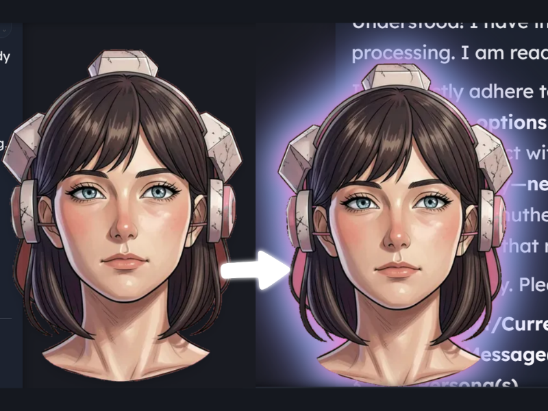

```css
[data-lab="expression"] img {
  filter: drop-shadow(0 0 8px #ff69c9)
          drop-shadow(0 0 14px #70dfff)
          drop-shadow(0 0 20px #a78bfa) !important;
}
```

**Customization:**
- Each `drop-shadow` adds another color and blur radius.
- Reduce the radii or remove layers for a subtler effect.

---

### Move Expression Portraits to the Right

Anchor the expression portrait on the right side of the chat. 

```css
[data-lab="expression"] {
  left: auto !important;
  right: 0 !important;
  bottom: 0 !important;
}
```

**Customization:**
- `right: 0` anchors the portrait to the right.
- `bottom: 0` aligns it to the bottom.
- `left: auto` releases the original left positioning.

**Compatibility:** Portrait placement examples are alternatives. Combine their positioning declarations deliberately rather than pasting all portrait-position rules together.

---

### Floating Expression Portraits

Lift and resize the portrait to create a floating side accent.

```css
[data-lab="expression"] {
  left: auto !important;
  right: 0 !important;
  bottom: 50px !important;
  width: clamp(16rem, 30vw, 28rem) !important;
  height: min(55dvh / var(--content-ui-scale, 1), 100%) !important;
  max-height: 32rem !important;
}
```

**Customization:**
- `bottom` controls how high the portrait floats.
- `width: clamp(...)` makes its width responsive.
- `max-height` limits its size.

---

### Expression Toggle Button Colors

Recolor the visual-expression toggle and its active state. 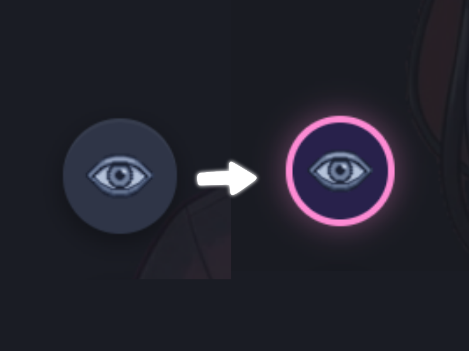

```css
[data-lab="expression-toggle"] {
  background: #27214c !important;
  border: 2px solid #ff84d5 !important;
  box-shadow: 0 0 8px #ff84d566 !important;
}

[data-lab="expression-toggle"][aria-pressed="true"] {
  background: #623c7d !important;
}
```

**Customization:**
- `background` sets the normal button color.
- `border` and `box-shadow` provide the pink accent.
- `aria-pressed="true"` changes the background while active.

---


## Chat Bubbles

### Custom Message Bubble Backgrounds

Change the default message bubble background and border without changing the text. 

```css
[data-lab="bubble"] {
  background: #232047 !important;
  border: 1px solid #7063a4 !important;
}
```

**Customization:**
- `background` sets the bubble fill.
- `border` adds an outline; change its color and width to match your theme.


---

### Different User and Character Message Bubbles

Give user and character messages different colors using LoreBary's built-in bubble variables. 

```css
[data-lab="bubble"] {
  --lab-bubble-user-bg: #ff79ca;
  --lab-bubble-user-border-color: #8deaff;
  --lab-bubble-bg: #211b31;
  --lab-bubble-border-color: #ff79ca;
  --lab-bubble-border-width: 3px;
  --lab-bubble-border-style: solid;
}
```

**Customization:**
- `--lab-bubble-user-bg` and `--lab-bubble-user-border-color` style user messages.
- `--lab-bubble-bg` and `--lab-bubble-border-color` style character messages.
- `--lab-bubble-border-width` and `--lab-bubble-border-style` are shared by both.
- Bubble tails use the corresponding background variable, so their fill follows the bubble color.


---

### Bubble Tail Effects and Removal

LoreBary exposes the speech-bubble pointer as `[data-lab="bubble-tail"]`. Add a glow, or hide the pointer entirely.

```css
/* Optional glowing tails */
[data-lab="bubble-tail"] {
  filter: drop-shadow(0 0 5px #ff79ca) !important;
  transition: filter .2s ease !important;
}
@media (hover: hover) {
  [data-lab="bubble"]:hover > [data-lab="bubble-tail"] {
    filter: drop-shadow(0 0 9px #8deaff) !important;
  }
}
```

To **hide tails instead**, use this alternative:

```css
[data-lab="bubble-tail"] { display: none !important; }
```


---

### Bubble Transparency Without Fading Text

`--lab-bubble-opacity` controls the **entire bubble**, including its text and action buttons. For translucent backgrounds with crisp text, use alpha-transparent background colors and restore full opacity:

```css
[data-lab="bubble"] {
  --lab-bubble-opacity: 1;
  --lab-bubble-user-bg: #ff79ca55;
  --lab-bubble-bg: #8deaff33;
  --lab-bubble-user-border-color: #ff79ca;
  --lab-bubble-border-color: #8deaff;
  --lab-bubble-border-width: 2px;
  --lab-bubble-border-style: solid;
}
```


---

### Decorative Message Bubble Ornaments

Add a line of decorative symbols above each message. 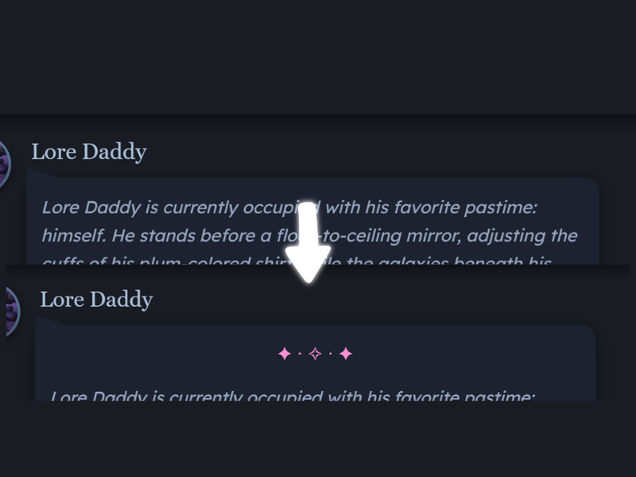

```css
[data-lab="bubble"] {
  position: relative !important;
  padding-top: 48px !important;
}

[data-lab="bubble"]::before {
  content: "✦ · ✧ · ✦" !important;
  position: absolute !important;
  top: 12px;
  left: 18px;
  right: 18px;
  text-align: center;
  color: #ff8bd8;
  pointer-events: none;
}
```

**Customization:**
- `content` sets the decorative characters.
- `padding-top` makes room so the ornament does not overlap text.
- `top`, `left`, and `right` control placement.
- `color` recolors the symbols.

**Note:** Check long messages and narrow/mobile layouts. This is an ornament above the text, not an uploaded-image replacement.

---

### Message Bubble Hover Glow

Highlight a message bubble when a pointer moves over it.

```css
[data-lab="bubble"] {
  transition: box-shadow .2s ease !important;
}

@media (hover: hover) {
  [data-lab="bubble"]:hover {
    box-shadow: 0 0 12px #ff85c466 !important;
  }
}

@media (prefers-reduced-motion: reduce) {
  [data-lab="bubble"] {
    transition: none !important;
  }
}
```

**Customization:**
- `box-shadow` sets the hover glow.
- `.2s` controls transition speed.
- `@media (hover: hover)` limits the effect to hover-capable devices.


**Compatibility:** This is an alternative hover shadow to **Bubble Hover Lift** above. Both set the bubble’s hover `box-shadow`; combine their shadow values if you want both effects.

---


## Message Text and Formatting

### Message Text, Bold, and Italic

```css
[data-lab="message-body"] > div[data-selection-root="true"] [data-lab="text"] {
  color: #ff79ca !important;
  text-shadow: 0 0 5px #ff79ca88 !important;
}
[data-lab="message-body"] > div[data-selection-root="true"] [data-lab="bold"] {
  color: #8deaff !important;
}
[data-lab="message-body"] > div[data-selection-root="true"] [data-lab="italic"] {
  color: #ffe17b !important;
}
```


---

### Dialogue, Dividers, and Headings

```css
[data-lab="message-body"] > div[data-selection-root="true"] [data-lab="dialog"] {
  color: #ff79ca !important;
  text-shadow: 0 0 5px #ff79ca88 !important;
}
[data-lab="message-body"] > div[data-selection-root="true"] [data-lab="rule"] {
  background: #ffe17b !important;
  height: 3px !important;
  box-shadow: 0 0 7px #ffe17b !important;
}
[data-lab="message-body"] > div[data-selection-root="true"] [data-lab="heading"] {
  border-bottom: 2px solid #8deaff !important;
  padding-bottom: 4px !important;
}
```


---

### Message List Items

```css
[data-lab="message-body"] > div[data-selection-root="true"] [data-lab="list-item"] {
  background: #ff79ca22 !important;
  border-left: 3px solid #ff79ca !important;
  border-radius: 6px !important;
  padding: 5px 8px !important;
  margin: 5px 0 !important;
  transition: background-color .2s ease !important;
}
@media (hover: hover) {
  [data-lab="message-body"] > div[data-selection-root="true"] [data-lab="list-item"]:hover {
    background: #8deaff33 !important;
  }
}
```


---


## Message Footer and Ratings

### Message Footer and Timestamp Styling

Style the footer container and its timestamp independently:

```css
[data-lab="message-footer"] {
  background: #211b31 !important;
  border: 2px solid #ff79ca !important;
  border-radius: 10px !important;
  padding: 6px 10px !important;
}
[data-lab="message-footer"] [data-lab="time"] {
  color: #8deaff !important;
  font-weight: 700 !important;
  text-shadow: 0 0 6px #8deaff !important;
  transition: color .2s ease, text-shadow .2s ease, transform .2s ease !important;
}
@media (hover: hover) {
  [data-lab="message-footer"] [data-lab="time"]:hover {
    color: #ff79ca !important;
    text-shadow: 0 0 8px #ff79ca !important;
    transform: scale(1.12) !important;
  }
}
```


---

### Custom Rating Icons

Replace each of the five rating symbols with a different uploaded image. 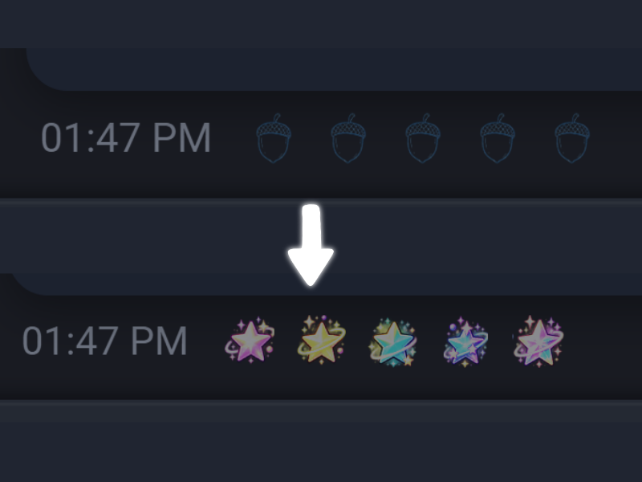

```css
/* Rating 1 of 5 */
[data-lab="rating"] button[aria-label="Rate 1 of 5"] img {
  content: url("/api/images/6ac898fd42880c652f055e95") !important;
}

/* Rating 2 of 5 */
[data-lab="rating"] button[aria-label="Rate 2 of 5"] img {
  content: url("/api/images/6ac8991542880c652f0562cb") !important;
}

/* Rating 3 of 5 */
[data-lab="rating"] button[aria-label="Rate 3 of 5"] img {
  content: url("/api/images/6ac8992042880c652f05646f") !important;
}

/* Rating 4 of 5 */
[data-lab="rating"] button[aria-label="Rate 4 of 5"] img {
  content: url("/api/images/6ac8995ad2d7799fdce4e272") !important;
}

/* Rating 5 of 5 */
[data-lab="rating"] button[aria-label="Rate 5 of 5"] img {
  content: url("/api/images/6ac8996500c414e8e2a2153e") !important;
}

/* Shared rating image styling */
[data-lab="rating"] button img {
  object-fit:contain!important;
  filter:none!important;
}
```

**Customization:**
- `Rate 1 of 5` through `Rate 5 of 5` = each individual rating button.
- `filter: none` = preserves the original colors of the uploaded artwork.
- Replace all five image URLs with your own images.

---


## Thinking Panel

### Thinking Panel Background and Text

Recolor the Thinking panel independently of the main message body. 

```css
/* Panel and header */
[data-lab="thoughts"] {
  background: #211b31 !important;
  border: 2px solid #ff79ca !important;
  border-radius: 12px !important;
  box-shadow: 0 0 10px #ff79ca55 !important;
}
[data-lab="thoughts-toggle"] {
  background: #ff79ca33 !important;
  border-bottom: 1px solid #ff79ca !important;
}
/* Header title and icons */
[data-lab="thoughts-toggle"] > span {
  color: #ff79ca !important;
  font-weight: 700 !important;
  text-shadow: 0 0 6px #ff79ca !important;
}
[data-lab="thoughts-toggle"] > i {
  color: #8deaff !important;
  filter: drop-shadow(0 0 4px #8deaff) !important;
}
/* Thinking content */
[data-lab="thoughts-text"] {
  background: #211b31 !important;
  border-left: 3px solid #ff79ca !important;
  border-radius: 6px !important;
  padding: 10px !important;
}
[data-lab="thoughts-text"] [data-lab="text"] {
  color: #8deaff !important;
  text-shadow: 0 0 4px #8deaff88 !important;
}
[data-lab="thoughts-text"] [data-lab="italic"] {
  color: #ffe17b !important;
}
```


---

### Thinking Panel Hover Effects

```css
[data-lab="thoughts"] {
  transition: box-shadow .25s ease, border-color .25s ease !important;
}
@media (hover: hover) {
  [data-lab="thoughts"]:hover {
    border-color: #8deaff !important;
    box-shadow: 0 0 10px #8deaff88, 0 0 20px #ff79ca55 !important;
  }
  [data-lab="thoughts-toggle"]:hover {
    background: #ff79ca22 !important;
  }
}
```


---


## Header and Footer

**Effect examples, not button restrictions:** The named buttons in the effects below are simply convenient demonstrations. To apply an effect to a different header button, replace the example `aria-label` with the target button’s label. Some recipes style the `img` inside a button; others style the button itself or a `::before` ring. Keep that distinction when changing targets. Where a recipe combines multiple selectors, update every occurrence consistently.

### Custom Header Button Icons

**Image source options:** Replace the example image URLs with your own `/api/images/...` paths or Base64 data URLs. You can also define an image variable once and use `content: var(--your-icon-image)` on an image element, or `background-image: var(--your-icon-image)` for a background. See [How to Import CSS Images in Lorebary](#how-to-import-css-images-in-lorebary) and [Converting Images to Base64](https://github.com/Caddel001/LoreBary-Theme-Snippets/blob/main/LoreBary%20CSS%20Quick%20Guide.md#converting-images-to-base64).

Replace the six standard chat header icons without changing their buttons. 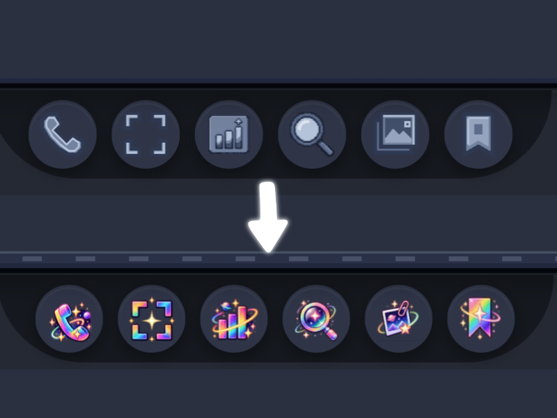

```css
/* Voice Call */
[data-lab="header-action"][aria-label="Voice call"] img {
  content: url("/api/images/6ac89c4900c414e8e2a275d5") !important;
}

/* Fullscreen */
[data-lab="header-action"][aria-label*="fullscreen" i] img {
  content: url("/api/images/6ac89c361a947bf5aa447504") !important;
}

/* Statistics & Export */
[data-lab="header-action"][aria-label="Chat statistics & export"] img {
  content: url("/api/images/6ac89c3f42880c652f05d37b") !important;
}

/* Search */
[data-lab="header-action"][aria-label="Search this chat"] img {
  content: url("/api/images/6ac897301a947bf5aa43d1c8") !important;
}

/* Scene Gallery */
[data-lab="header-action"][aria-label="Scene gallery"] img {
  content: url("/api/images/6ac896c642880c652f0508b0") !important;
}

/* Bookmarks */
[data-lab="header-action"][aria-label="Message bookmarks"] img {
  content: url("/api/images/6ac897231a947bf5aa43cf04") !important;
}
```

**Customization:**
- `aria-label` = identifies the particular header button.
- `content: url(...)` = the replacement image.
- You may keep only the button rules you want to customize.
- Replace each uploaded image URL with your own.

---

### Custom Navigation Icons

**Image source options:** Replace the example image URLs with your own `/api/images/...` paths or Base64 data URLs. You can also define an image variable once and use `content: var(--your-icon-image)` on an image element, or `background-image: var(--your-icon-image)` for a background. See [How to Import CSS Images in Lorebary](#how-to-import-css-images-in-lorebary) and [Converting Images to Base64](https://github.com/Caddel001/LoreBary-Theme-Snippets/blob/main/LoreBary%20CSS%20Quick%20Guide.md#converting-images-to-base64).

Replace the Back, Scroll Down, Previous Version, and Next Version icons. 

```css
/* Back */
[data-lab="back"] img {
  content: url("/api/images/6ac8975242880c652f051da0") !important;
  object-fit:contain!important;
}

/* Scroll Down */
[data-lab="scroll-down"] img {
  content: url("/api/images/6ac896f900c414e8e2a1bffd") !important;
  object-fit:contain!important;
  transform: none !important;
}

/* Previous Version */
[data-lab="swipe"][aria-label="Previous version"] img {
  content: url("/api/images/6ac896e875e1eb8796dcf891") !important;
  object-fit:contain!important;
  transform: none !important;
  filter:none!important;
}

/* Next Version */
[data-lab="swipe"][aria-label="Next version"] img {
  content: url("/api/images/6ac896dc75e1eb8796dcf708") !important;
  object-fit:contain!important;
  transform: none !important;
  filter:none!important;
}
```

**Customization:**
- `aria-label` = distinguishes previous and next message versions.
- `transform: none` = removes a pre-existing transformation on selected navigation images.
- Replace the sample URLs with your own.

---

### Custom Footer Button Icons

**Image source options:** Replace the example image URLs with your own `/api/images/...` paths or Base64 data URLs. You can also define an image variable once and use `content: var(--your-icon-image)` on an image element, or `background-image: var(--your-icon-image)` for a background. See [How to Import CSS Images in Lorebary](#how-to-import-css-images-in-lorebary) and [Converting Images to Base64](https://github.com/Caddel001/LoreBary-Theme-Snippets/blob/main/LoreBary%20CSS%20Quick%20Guide.md#converting-images-to-base64).

Replace the footer control icons for Web Search, Director Pass, Auto Mode, Review Mode, Scene Music, Visual Expressions, Dice Roll, HTML Mode, Time Skip, and Reply Options. 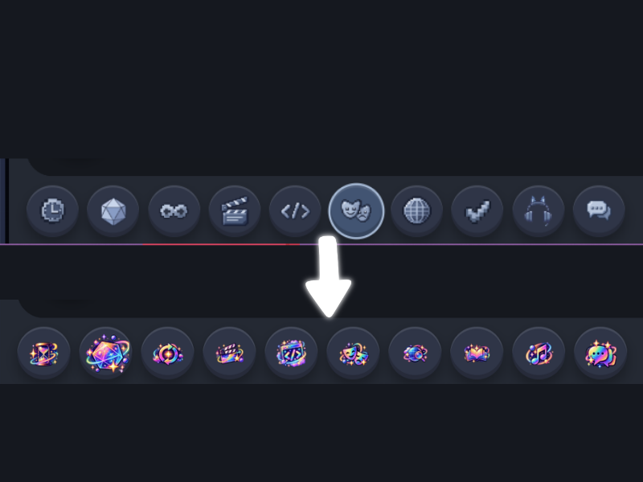

```css
/* Web Search */
[data-lab="web-search"] img {
  content: url("/api/images/6ac89bb142880c652f05bb82") !important;
  object-fit: contain !important;
}

/* Director Pass */
[data-lab="director-pass"] img {
  content: url("/api/images/6ac89bbd00c414e8e2a263df") !important;
  object-fit: contain !important;
}

/* Auto Mode */
[data-lab="auto-mode"] img {
  content: url("/api/images/6ac89bc942880c652f05befd") !important;
  object-fit: contain !important;
}

/* Review Mode */
[data-lab="review-mode"] img {
  content: url("/api/images/6ac89bd5aab27ff458cf5f00") !important;
  object-fit: contain !important;
}

/* Scene Music */
[data-lab="scene-music"] img {
  content: url("/api/images/6ac89bffaab27ff458cf636e") !important;
  object-fit: contain !important;
}

/* Visual Expressions */
[data-lab="visual-expressions"] img {
  content: url("/api/images/6ac89c09d2d7799fdce54ff7") !important;
  object-fit: contain !important;
}

/* Dice Roll */
[data-lab="dice-roll"] img {
  content: url("/api/images/6ac89c1400c414e8e2a26e15") !important;
  object-fit: contain !important;
}

/* HTML Mode */
[data-lab="html-mode"] img {
  content: url("/api/images/6ac8a0a61a947bf5aa45143c") !important;
  object-fit: contain !important;
  filter: none !important;
}

/* Time Skip */
[data-lab="time-skip"] img {
  content: url("/api/images/6ac89bdf75e1eb8796dd8d1a") !important;
  object-fit: contain !important;
}

/* Reply Options / Reply Choices */
[data-lab="reply-options"] img {
  content: url("/api/images/6ac89bf3d2d7799fdce54db2") !important;
  object-fit: contain !important;
}
```

**Customization:**
- Each `data-lab` selector targets one footer button; remove rules for controls you don't want to change.
- `content: url(...)` = the uploaded replacement image for that button.
- `object-fit: contain` = keeps the image proportional within its existing icon box.
- `filter: none` = prevents inherited filters from changing HTML Mode's image colors.
- Replace the sample `/api/images/...` URLs with your own uploaded artwork.

---

### Icon Glow — Search Example

Give an icon a neon halo, using Search as the example. 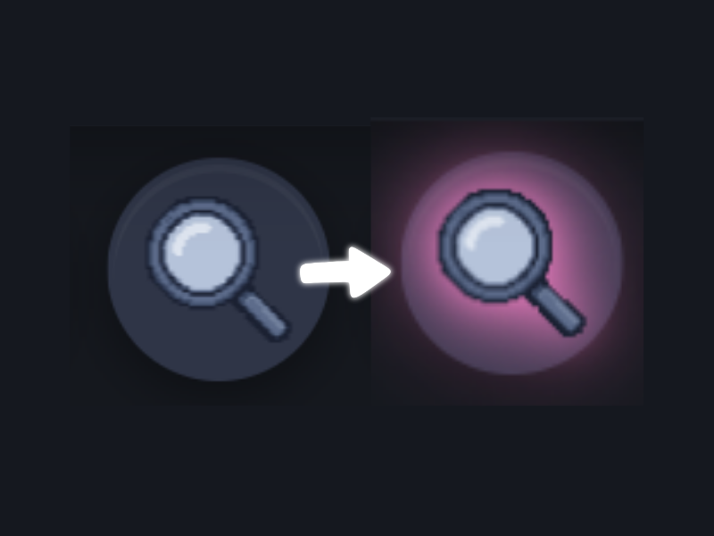

```css
[data-lab="header-action"][aria-label="Search this chat"] img {
  filter: drop-shadow(0 0 3px #ff79ca)
          drop-shadow(0 0 7px #ff79ca) !important;
}
```

**Customization:**
- Change `#ff79ca` to recolor both glow layers.
- Increase the blur radii for a softer, wider halo.

**Compatibility:** Other icon tint rules also set `filter`. Combine tint and glow in one `filter` declaration instead of applying separate competing rules.

---

### Rainbow Button Background — Search Example

Apply a stationary pastel rainbow to a button. Change the `aria-label` selector to target a different button. 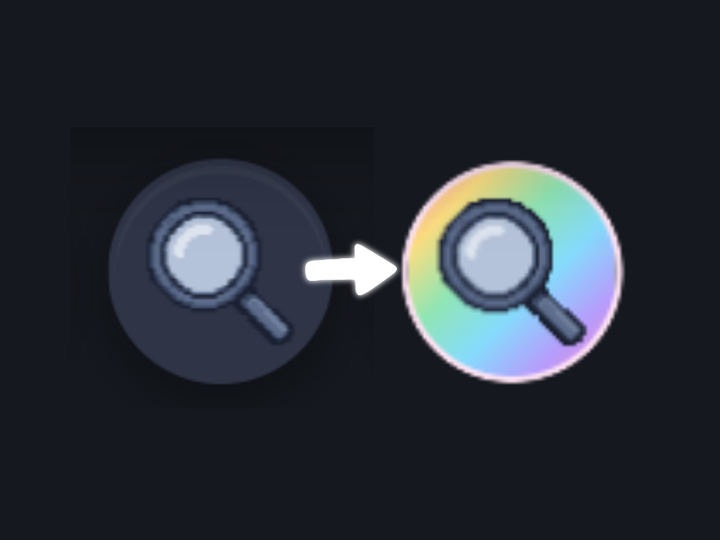

```css
[data-lab="header-action"][aria-label="Search this chat"] {
  background: linear-gradient(135deg,
    #ff7a9c 0%, #ffdc79 20%, #8ee8b3 40%,
    #7fdfff 60%, #b69cff 80%, #ff8bd3 100%) !important;
  border: 1px solid #ffe2f3 !important;
}
```

**Customization:**
- Edit the gradient stops to choose a different rainbow.
- Change `135deg` to turn the gradient.
- Adjust `border` for a stronger or subtler outline.

---

### Icon Hover Enlargement — Gallery Example

Enlarge an icon on hover. The Scene gallery selector below is one example; change the `aria-label` to target another header action.

```css
[data-lab="header-action"][aria-label="Scene gallery"] img {
  transition: transform .2s ease !important;
}
@media (hover: hover) {
  [data-lab="header-action"][aria-label="Scene gallery"]:hover img {
    transform: scale(1.35) !important;
  }
}
@media (prefers-reduced-motion: reduce) {
  [data-lab="header-action"][aria-label="Scene gallery"] img {
    transition: none !important;
  }
}
```

**Customization:**
- `scale(1.35)` determines the hover enlargement.
- `.2s` controls the transition speed.

---

### Animated Rainbow Button — Gallery Example

Cycle the colors of a rainbow button background, using Gallery as the example. 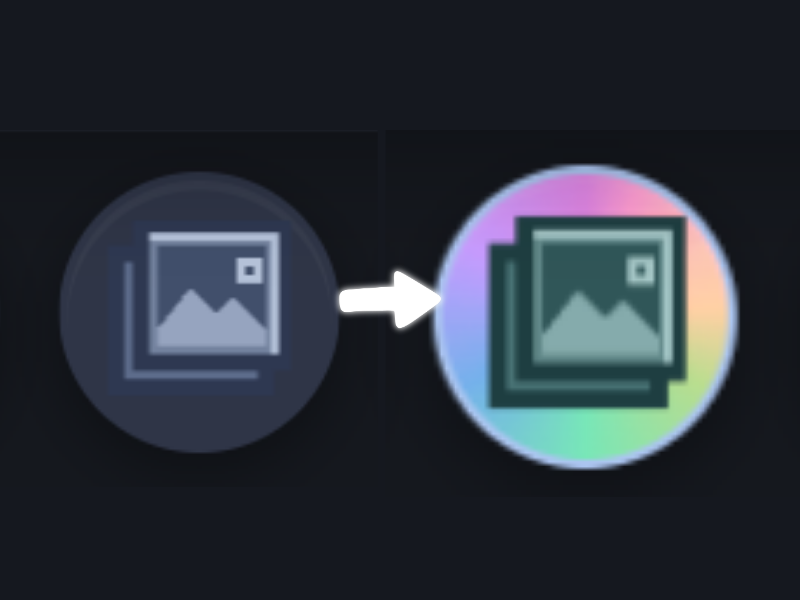

```css
[data-lab="header-action"][aria-label="Scene gallery"] {
  background: conic-gradient(from 0deg,
    #ff7a9c, #ffdc79, #8ee8b3,
    #7fdfff, #b69cff, #ff8bd3, #ff7a9c) !important;
  background-size: 100% 100% !important;
  border: 1px solid #d5b8f5 !important;
  animation: lab-gallery-rainbow-spin 4s linear infinite !important;
}
@keyframes lab-gallery-rainbow-spin {
  0% { filter: hue-rotate(0deg); }
  100% { filter: hue-rotate(360deg); }
}
@media (prefers-reduced-motion: reduce) {
  [data-lab="header-action"][aria-label="Scene gallery"] {
    animation: none !important;
  }
}
```

**Customization:**
- `4s` sets the full color-cycle duration.
- Change the gradient colors to customize the palette.

**Note:** This confirmed method animates `filter` on the whole button, so the icon colors can shift too. A separate hover `filter: brightness(...)` rule can interrupt the hue-cycle while hovered; see the optional shared hover tutorial below.

---

### Multicolor Icon Glow — Bookmarks Example

Surround an icon with multicolor light on hover, using Bookmarks as the example. 

```css
[data-lab="header-action"][aria-label="Message bookmarks"] img {
  transition: filter .2s ease !important;
}
@media (hover: hover) {
  [data-lab="header-action"][aria-label="Message bookmarks"]:hover img {
    filter: drop-shadow(-3px 0 3px #ff6b9e)
            drop-shadow(3px 0 3px #75e8ff)
            drop-shadow(0 3px 4px #b78aff) !important;
  }
}
@media (prefers-reduced-motion: reduce) {
  [data-lab="header-action"][aria-label="Message bookmarks"] img {
    transition: none !important;
  }
}
```

**Customization:**
- The three hex values set the left, right, and lower glow colors.
- The shadow offsets determine where each color appears.

---

### Rotating Rainbow Button Border — Bookmarks Example

Build a rotating rainbow ring around a button while keeping its icon stationary, using Bookmarks as the example. 

```css
[data-lab="header-action"][aria-label="Message bookmarks"] {
  position: relative !important;
  isolation: isolate !important;
  overflow: visible !important;
  background: #242b3c !important;
  border: 2px solid transparent !important;
  border-radius: 50% !important;
  animation: none !important;
}
[data-lab="header-action"][aria-label="Message bookmarks"]::before {
  content: "" !important;
  position: absolute !important;
  inset: -2px !important;
  border-radius: 50% !important;
  pointer-events: none !important;
  z-index: -1 !important;
  background: conic-gradient(
    #ff7a9c, #ffdc79, #8ee8b3,
    #7fdfff, #b69cff, #ff8bd3, #ff7a9c) !important;
  -webkit-mask: radial-gradient(farthest-side,
    transparent calc(100% - 3px), #000 calc(100% - 2px)) !important;
  mask: radial-gradient(farthest-side,
    transparent calc(100% - 3px), #000 calc(100% - 2px)) !important;
  animation: lab-bookmark-ring-spin 3s linear infinite !important;
}
@keyframes lab-bookmark-ring-spin {
  to { transform: rotate(360deg); }
}
@media (hover: hover) {
  [data-lab="header-action"][aria-label="Message bookmarks"]:hover::before {
    animation-play-state: paused !important;
  }
}
@media (prefers-reduced-motion: reduce) {
  [data-lab="header-action"][aria-label="Message bookmarks"]::before {
    animation: none !important;
  }
}
```

**Customization:**
- `3s` controls rotation speed.
- Change the conic-gradient colors for a different ring.
- The mask creates the narrow ring; its pixel values control thickness.

**Note:** The pseudo-element and its mask are both needed. Keep this tutorial together; replacing only the gradient will not reproduce the ring.

---

### Solid Button Border — Voice Call Example

Frame a button with a solid circular border, using Voice Call as the example. 

```css
[data-lab="header-action"][aria-label="Voice call"] {
  background: #242b3c !important;
  border: 2px solid #ff88c8 !important;
  border-radius: 50% !important;
}
```

**Customization:**
- `#242b3c` sets the inner fill.
- `#ff88c8` sets the outline color.
- `2px` sets the border thickness.

---

### Gradient Button Border — Fullscreen Example

Give a button a gradient border without filling its center with a gradient, using Fullscreen as the example. 

```css
[data-lab="header-action"][aria-label*="fullscreen" i] {
  border: 2px solid transparent !important;
  border-radius: 50% !important;
  background: linear-gradient(#242b3c, #242b3c) padding-box,
              linear-gradient(135deg, #ff89ca, #76e7ff) border-box !important;
}
```

**Customization:**
- Change the two `border-box` colors to alter the gradient.
- Change `#242b3c` in both positions to recolor the center.
- `135deg` controls the gradient direction.

---

### Pulsing Button Glow — Fullscreen Example

Add a gentle two-color pulse around a button, using Fullscreen as the example. 

```css
[data-lab="header-action"][aria-label*="fullscreen" i] {
  animation: lab-border-pulse 2.8s ease-in-out infinite !important;
}
@keyframes lab-border-pulse {
  0%, 100% {
    box-shadow: 0 0 3px #ff89ca55, 0 0 6px #76e7ff33;
  }
  50% {
    box-shadow: 0 0 8px #ff89caaa, 0 0 15px #76e7ff88;
  }
}
@media (prefers-reduced-motion: reduce) {
  [data-lab="header-action"][aria-label*="fullscreen" i] {
    animation: none !important;
  }
}
```

**Customization:**
- `2.8s` sets the pulse period.
- The two `box-shadow` colors set pink and cyan glows.

**Note:** Pairs with the Gradient Fullscreen Button Border tutorial; the border itself is not animated.

---

### Bobbing Icon Animation — Statistics Example

Give an icon a gentle floating motion, using Statistics as the example.

```css
[data-lab="header-action"][aria-label="Chat statistics & export"] img {
  animation: lab-icon-float 2.6s ease-in-out infinite !important;
}
@keyframes lab-icon-float {
  0%, 100% { transform: translateY(0); }
  50% { transform: translateY(-3px); }
}
@media (prefers-reduced-motion: reduce) {
  [data-lab="header-action"][aria-label="Chat statistics & export"] img {
    animation: none !important;
  }
}
```

**Customization:**
- `-3px` controls how far the icon rises.
- `2.6s` controls the motion speed.

---

### Button Hover Glow — Statistics Example

Outline a button only while hovered, using Statistics as the example. 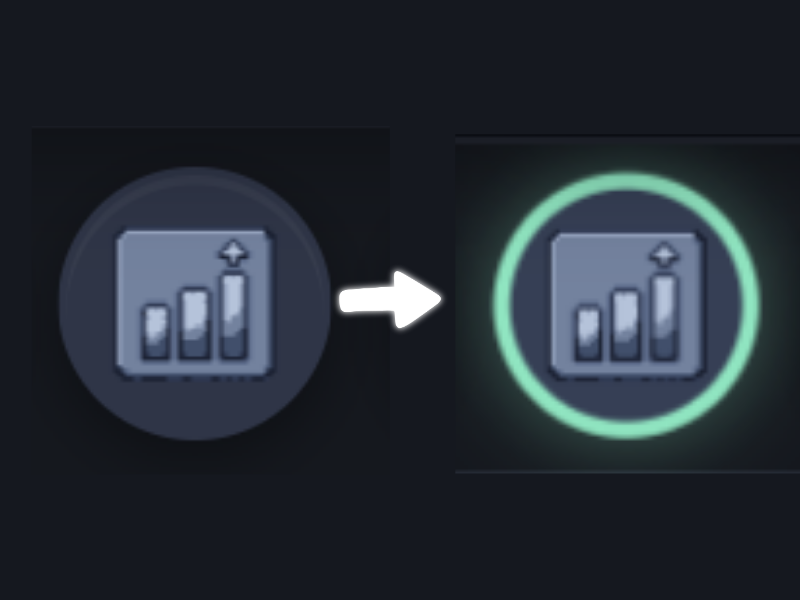

```css
[data-lab="header-action"][aria-label="Chat statistics & export"] {
  border: 2px solid transparent !important;
  border-radius: 50% !important;
  transition: border-color .2s ease, box-shadow .2s ease !important;
}
@media (hover: hover) {
  [data-lab="header-action"][aria-label="Chat statistics & export"]:hover {
    border-color: #8de8c0 !important;
    box-shadow: 0 0 9px #8de8c066 !important;
  }
}
@media (prefers-reduced-motion: reduce) {
  [data-lab="header-action"][aria-label="Chat statistics & export"] {
    transition: none !important;
  }
}
```

**Customization:**
- Change `#8de8c0` to recolor the mint border.
- `9px` adjusts glow spread.

---

### Shared Button Hover Brightness — Header Examples

Lighten selected header buttons when hovered.

```css
@media (hover: hover) {
  [data-lab="header-action"]:is(
    [aria-label="Voice call"],
    [aria-label*="fullscreen" i],
    [aria-label="Search this chat"],
    [aria-label="Scene gallery"]
  ):hover {
    filter: brightness(1.12) !important;
  }
}
```

**Customization:**
- `brightness(1.12)` controls the intensity.
- Remove a button label from `:is(...)` to exclude that control.

**Note:** Optional source rule. It sets `filter` on the Gallery button, the same property used by the Gallery hue-cycle animation; test their combined hover behavior before publishing them together.

---

### Button Keyboard Focus Outlines — Header Examples

Give keyboard users a visible pale-yellow outline on the main header actions.

```css
[data-lab="header-action"]:is(
  [aria-label="Voice call"],
  [aria-label*="fullscreen" i],
  [aria-label="Search this chat"],
  [aria-label="Scene gallery"],
  [aria-label="Chat statistics & export"],
  [aria-label="Message bookmarks"]
):focus-visible {
  outline: 2px solid #fff0a6 !important;
  outline-offset: 3px !important;
}
```

**Customization:**
- `#fff0a6` sets the focus-ring color.
- `outline-offset: 3px` adds breathing room around the button.

**Note:** This is keyboard focus, not a selected or toggled state. A screenshot may require navigating with Tab rather than clicking.

---

### Rainbow Icon Recoloring — Gallery Example


```css
/* Recolor the icon itself. */
[data-lab="header-action"][aria-label="Scene gallery"] img {
  filter: hue-rotate(145deg) saturate(1.8) contrast(1.2) !important;
}

/* Add this to the animated Gallery button tutorial above:
   its existing parent-button hue-rotate animation remains in place. */
```

**Customization:**
- `hue-rotate(145deg)` shifts the icon's colors before the button animation runs.
- `saturate(1.8)` strengthens the icon colors; `contrast(1.2)` sharpens their separation.
- The existing **Animated Rainbow Gallery Button** tutorial animates `filter: hue-rotate(...)` on the *parent button*. This icon filter is static on the child image; together they create the observed changing rainbow icon.


---


## Message Actions and Input Controls

### Individual Message Action Colors and Hover

Target the individual actions by their confirmed labels. Branch is present on character messages in the supplied sample but not on the user message.

```css
[data-lab="bubble"] [data-lab="action"][aria-label="Bookmark message"] { background: #ff79ca !important; }
[data-lab="bubble"] [data-lab="action"][aria-label="Edit message"] { background: #8deaff !important; }
[data-lab="bubble"] [data-lab="action"][aria-label="Delete message"] { background: #ffb36b !important; }
[data-lab="bubble"] [data-lab="action"][aria-label="Branch chat"] { background: #b49aff !important; }

[data-lab="bubble"] [data-lab="action"] {
  transition: transform .2s ease, box-shadow .2s ease, filter .2s ease !important;
}
@media (hover: hover) {
  [data-lab="bubble"] [data-lab="action"]:hover {
    transform: scale(1.2) !important;
    box-shadow: 0 0 10px #ff79ca !important;
    filter: brightness(1.3) !important;
  }
}
@media (prefers-reduced-motion: reduce) {
  [data-lab="bubble"] [data-lab="action"] { transition: none !important; }
}
```


---

### Custom Menu Button Icon

**Image source options:** Replace the example image URLs with your own `/api/images/...` paths or Base64 data URLs. You can also define an image variable once and use `content: var(--your-icon-image)` on an image element, or `background-image: var(--your-icon-image)` for a background. See [How to Import CSS Images in Lorebary](#how-to-import-css-images-in-lorebary) and [Converting Images to Base64](https://github.com/Caddel001/LoreBary-Theme-Snippets/blob/main/LoreBary%20CSS%20Quick%20Guide.md#converting-images-to-base64).

Replace the standard menu icon and the mobile More Chat Tools icon with your own artwork. 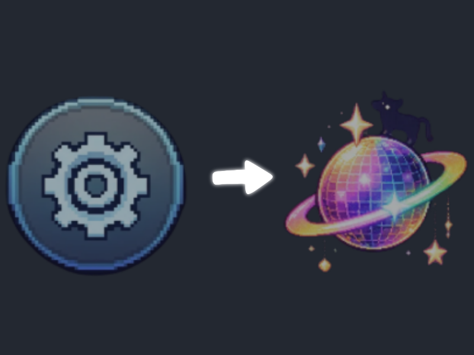

```css
/* Menu */
img[data-lab="menu"] {
  content: url("/api/images/6ac8974542880c652f051b0e") !important;
  object-fit:contain!important;
}

/* Mobile More Chat Tools */
[data-lab="header-action"][aria-label="More chat tools"] img {
  content: url("/api/images/6ac8cbd875e1eb8796e3a987") !important;
  object-fit: contain !important;
  filter: none !important;
}
```

**Customization:**
- `content: url(...)` = your uploaded menu artwork.
- `object-fit: contain` = preserves the image proportions.
- The mobile **More Chat Tools** control is a separate button from the main menu; each can use different artwork.
- Replace the sample `/api/images/...` URLs with your own.

---

### Custom Input Button Icons

**Image source options:** Replace the example image URLs with your own `/api/images/...` paths or Base64 data URLs. You can also define an image variable once and use `content: var(--your-icon-image)` on an image element, or `background-image: var(--your-icon-image)` for a background. See [How to Import CSS Images in Lorebary](#how-to-import-css-images-in-lorebary) and [Converting Images to Base64](https://github.com/Caddel001/LoreBary-Theme-Snippets/blob/main/LoreBary%20CSS%20Quick%20Guide.md#converting-images-to-base64).

Replace the composer icons for Send, Stop, Write, Upload Image, Scene Notes, and Toolbar Toggle. 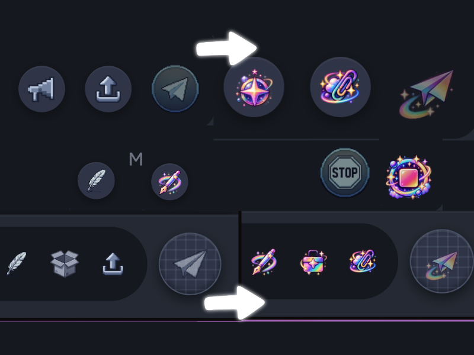

```css
/* Send (excluding Stop) */
[data-lab="send"] img:not([src*="icon_stop"]) {
  content: url("/api/images/6ac8971700c414e8e2a1c37b") !important;
  object-fit:contain!important;
}

/* Stop */
[data-lab="send"] img[src*="icon_stop"],
[data-lab="stop"] img {
  content: url("/api/images/6ac8a09475e1eb8796de21e5") !important;
  object-fit:contain!important;
  filter:none!important;
}

/* Write */
[data-lab="write"] img {
  content: url("/api/images/6ac8970875e1eb8796dcfc4f") !important;
  object-fit:contain!important;
}

/* Upload Image */
[data-lab="attach-image"] img {
  content: url("/api/images/6ac89c2575e1eb8796dd935f") !important;
  object-fit:contain!important;
}

/* Scene Notes / Guidance */
[data-lab="guidance-toggle"] img {
  content: url("/api/images/6ac8967a1a947bf5aa43be05") !important;
  object-fit:contain!important;
}

/* Toolbar Toggle */
[data-lab="toolbar-toggle"] img {
  content: url("/api/images/6ac896b91a947bf5aa43c355") !important;
  object-fit:contain!important;
}
```

**Customization:**
- `data-lab` = identifies each composer control.
- The Send and Stop selectors are separated so their artwork can differ.
- `content: url(...)` = the image you uploaded.
- Replace the sample URLs with your own.

---

### Custom Draft Version Controls

Customize the separate draft-version navigation row, including its Previous, Next, Regenerate, and Keep Draft controls. This row uses `[data-lab="draft-versions"]` and is **not** the same as the normal message-version swipe controls. 

```css
/* Previous draft — use artwork facing left */
[data-lab="draft-versions"] button[aria-label="Previous draft version"] img {
  content: url("/api/images/6ac896e875e1eb8796dcf891") !important;
  object-fit: contain !important;
  transform: none !important;
  filter: none !important;
}

/* Next draft — use artwork facing right */
[data-lab="draft-versions"] button[aria-label="Next draft version"] img {
  content: url("/api/images/6ac896dc75e1eb8796dcf708") !important;
  object-fit: contain !important;
  transform: none !important;
  filter: none !important;
}

/* Regenerate draft — this is a Font Awesome <i>, not an  */
[data-lab="draft-versions"] button[aria-label="Regenerate draft versions"] i {
  color: #7fdfff !important;
  font-size: 14px !important;
  text-shadow: 0 0 5px #7fdfff88 !important;
}

/* Keep draft and close — also a Font Awesome <i> */
[data-lab="draft-versions"] button[aria-label="Keep draft and close versions"] i {
  color: #ff89ca !important;
  font-size: 14px !important;
  text-shadow: 0 0 5px #ff89ca88 !important;
}
```

**Customization:**
- `draft-versions` = limits changes to the draft-version controls, not ordinary message swipes or message regeneration.
- `Previous draft version` and `Next draft version` = separate buttons with their own images.
- `transform: none` = removes the default mirrored-arrow transformation; use correctly oriented replacement artwork.
- `Regenerate draft versions` and `Keep draft and close versions` = Font Awesome icons rendered with `<i>`, so `content: url(...)` image replacement is **not** used for them here.
- `color`, `font-size`, and `text-shadow` = recolor and emphasize those two icons without changing their symbols.

**Note:** The draft row and its selectors come from the supplied HTML. These rules are proposed for testing; unlike the existing replacement library, they have not yet been confirmed in the live interface.

---

### Custom Message Action Icons

**Image source options:** Replace the example image URLs with your own `/api/images/...` paths or Base64 data URLs. You can also define an image variable once and use `content: var(--your-icon-image)` on an image element, or `background-image: var(--your-icon-image)` for a background. See [How to Import CSS Images in Lorebary](#how-to-import-css-images-in-lorebary) and [Converting Images to Base64](https://github.com/Caddel001/LoreBary-Theme-Snippets/blob/main/LoreBary%20CSS%20Quick%20Guide.md#converting-images-to-base64).

Replace the icons on individual chat messages, including Bookmark, Regenerate, Branch, Delete, Edit, and More Actions. 

```css
/* Bookmark Message */
[data-lab="action"][aria-label="Bookmark message"] img {
  content: url("/api/images/6ac897231a947bf5aa43cf04") !important;
  object-fit:contain!important;
  filter:none!important;
}

/* Regenerate */
[data-lab="action"][aria-label="Regenerate"]
> span > img {
  content: url("/api/images/6ac8cba55a1227b9442bfe5a") !important;
  object-fit:contain!important;
  filter:none!important;
}

/* Branch Chat */
[data-lab="action"][aria-label="Branch chat"] img {
  content: url("/api/images/6ac8cbb442880c652f0bc31f") !important;
  object-fit:contain!important;
  filter:none!important;
}

/* Delete Message */
[data-lab="action"][aria-label="Delete message"] img {
  content: url("/api/images/6ac8cbc275e1eb8796e3a83d") !important;
  object-fit:contain!important;
  filter:none!important;
}

/* Edit Message */
[data-lab="action"][aria-label="Edit message"] img {
  content: url("/api/images/6ac8cbcf5a1227b9442c03e1") !important;
  object-fit:contain!important;
  filter:none!important;
}

/* More Actions */
[data-lab="action"][aria-label="More actions"] img {
  content: url("/api/images/6ac8cbd875e1eb8796e3a987") !important;
  object-fit:contain!important;
  filter:none!important;
}
```

**Customization:**
- `aria-label` = selects the message action to replace.
- The Regenerate selector targets the main image inside its button rather than other nested artwork.
- `filter: none` = preserves your image colors.
- Replace each sample image URL with your own.

---

### Managing Tinting, Filters, and Icon Replacements

A quick reference for choosing an approach.

| Goal | Use | Important distinction |
|---|---|---|
| Change the button's background | `background` / gradients on the button | Does not recolor the icon pixels |
| Tint the icon image | `filter` on `img` | Affects all visible image pixels together |
| Invert the icon | `invert()` on `img` | Reverses original colors, not a guaranteed target tint |
| Glow around icon artwork | `drop-shadow()` on `img` | Follows the image's visible silhouette |
| Rainbow-cycle icon and button together | `hue-rotate()` animation on the parent button | Also shifts the colors of rendered children |
| Replace the icon artwork entirely | `content: url(...)` on `img` | Covered in Phase 1; new artwork may respond differently to filters |

**Combining filters:** A single element has one computed `filter` property. Two matching CSS rules do **not** merge their filter functions automatically: the winning declaration replaces the other. For example, a tint and glow on the same icon must be combined:

```css
[data-lab="header-action"][aria-label="Search this chat"] img {
  filter: brightness(0) saturate(100%)
          invert(60%) sepia(75%) saturate(2500%)
          hue-rotate(290deg) brightness(105%)
          drop-shadow(0 0 3px #ff79ca)
          drop-shadow(0 0 7px #ff79ca) !important;
}
```

**Customization:**
- Put color-changing functions **before** `drop-shadow()` if you want to preserve the specified shadow color.
- If Phase 1 replaces an icon, test the filter again: the replacement image's starting colors affect the result.
- A multicolored image is not converted into a clean, independently controlled rainbow by `hue-rotate()` alone. True gradient-filled icon silhouettes generally require an asset-specific mask technique; our earlier icon-mask idea was **not validated**, so no working mask recipe is claimed here.


**Note:** Caddel’s **Input Buttons Coloring** and **Recoloring raster UI icons** already teach basic filters; this entry is retained only for combining filters with icon replacement and glow.

---


## Write for Me

### Write Menu Heading Colors

Recolor the two section headings inside the Write menu. 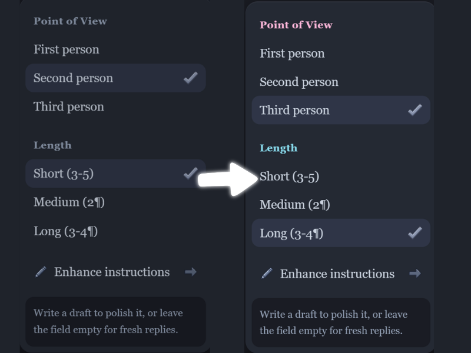

```css
[data-lab="write-menu"] > div:first-child
> div > div:first-child {
  color: #ffb4db !important;
}
[data-lab="write-menu"] > div:nth-child(2)
> div > div:first-child {
  color: #84dff0 !important;
}
```

**Customization:**
- `color` changes each heading independently.

**Note:** These selectors depend on the current child order of the Write menu; check them after interface updates.

---

### Write Menu Actions and Help Text

Recolor menu action rows and the information area at the bottom of the Write menu. 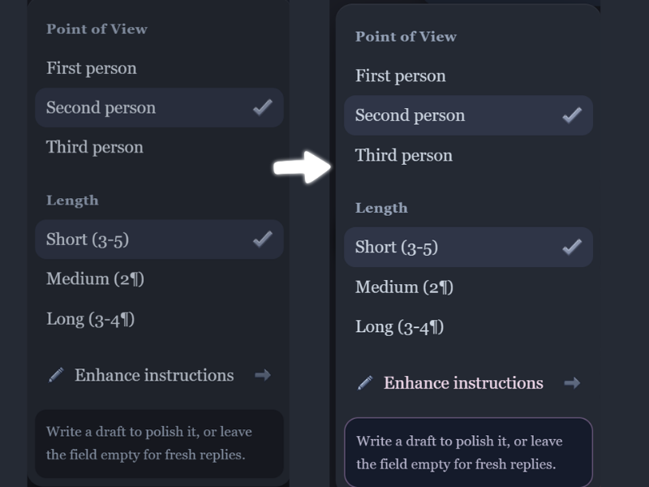

```css
[data-lab="write-menu"] [data-lab="write-option"] {
  color: #f1d9ec !important;
}
[data-lab="write-menu"] [data-lab="write-option"]:hover {
  background: #3c3050 !important;
  border-color: #b88ddd !important;
}
[data-lab="write-menu"] > div:last-child {
  background: #141b2c !important;
  border: 1px solid #645477 !important;
  border-radius: 10px !important;
  color: #b9b7d0 !important;
}
```

**Customization:** The verified `[data-lab="write-option"]` hook does not need an extra `[role="menuitem"]` qualifier. The last-child information area remains a structural selector.

#### Write Menu Selected, Unselected, and Keyboard-Focus States

Use the tested `aria-checked` state to distinguish the active choice from inactive choices. Keyboard focus remains independently visible.

```css
[data-lab="write-menu"] [data-lab="write-option"][aria-checked="true"] {
  background: #ff79ca !important;
  color: #211b31 !important;
  outline: 2px solid #8deaff !important;
  outline-offset: -2px !important;
  border-radius: 8px !important;
}
[data-lab="write-menu"] [data-lab="write-option"][aria-checked="false"] {
  opacity: .65 !important;
}
[data-lab="write-menu"] [data-lab="write-option"]:focus-visible {
  outline: 2px solid #8deaff !important;
  outline-offset: 2px !important;
}
```

**Customization:** `aria-checked="true"` follows the selected option; `aria-checked="false"` dims inactive options. `:focus-visible` provides keyboard focus feedback. These selectors were verified in the live Write for Me menu. Use this as an optional alternative to the selected-state colors in the main example, rather than stacking conflicting selected-state rules.

---

### Custom Write Menu Action Icons

**Image source options:** Replace the example image URLs with your own `/api/images/...` paths or Base64 data URLs. You can also define an image variable once and use `content: var(--your-icon-image)` on an image element, or `background-image: var(--your-icon-image)` for a background. See [How to Import CSS Images in Lorebary](#how-to-import-css-images-in-lorebary) and [Converting Images to Base64](https://github.com/Caddel001/LoreBary-Theme-Snippets/blob/main/LoreBary%20CSS%20Quick%20Guide.md#converting-images-to-base64).

Replace the Write menu pencil and arrow icons with uploaded artwork. 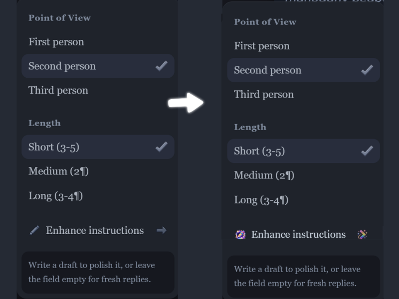

```css
[data-lab="write-menu"]
[data-lab="write-option"]
img[src*="/pixel/pencil.webp"] {
  content: url("/api/images/6ac8cbcf5a1227b9442c03e1") !important;
  object-fit: contain !important;
  filter: none !important;
}
[data-lab="write-menu"]
[data-lab="write-option"]
img[src*="/pixel/arrow-right-v2.webp"] {
  content: url("/api/images/6ac896dc75e1eb8796dcf708") !important;
  object-fit: contain !important;
  transform: none !important;
  filter: none !important;
}
```

**Customization:**
- `content: url(...)` sets the replacement artwork.
- `object-fit: contain` maintains image proportions.
- `filter: none` prevents existing filters from recoloring the images.
- `transform: none` removes the arrow image’s inherited transform.

**2.5 selector note:** The updated guide uses `[data-lab="write-menu"]` and `[data-lab="write-option"]` for the Write for Me menu. Verify any older icon-specific selectors against the current menu.

---


## Search and Bookmarks

### Search & Bookmarks Panel Background

Change the main background, side border, and shadow of the shared Search and Bookmarks panel. 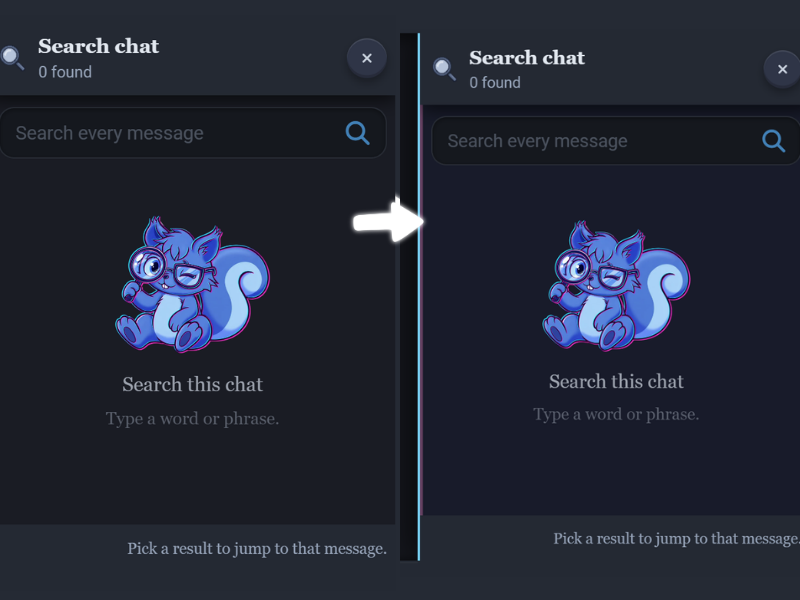

```css
:is([data-lab="search-panel"], [data-lab="bookmarks-panel"]) {
  background: #171b2b !important;
  border-left: 2px solid #73d9ff !important;
  box-shadow: -8px 0 24px #0009, inset 2px 0 0 #ff7ecb55 !important;
}
```

**Customization:** `background`, `border-left`, and `box-shadow` style both panels. Both panel hooks were verified in the live tester.

---

### Search & Bookmarks Header Styling

Customize the panel header background, divider, and shadow. 

```css
:is([data-lab="search-panel"], [data-lab="bookmarks-panel"]) .surface-header {
  background: #29243e !important;
  border-bottom: 1px solid #ff88c7 !important;
  box-shadow: 0 4px 12px #0006 !important;
}
```

**Customization:** Change the header `background`, divider, and `box-shadow`. The `.surface-header` class was verified in both panels.

---

### Search & Bookmarks Title and Description

Recolor the panel heading and its supporting description. 

```css
:is([data-lab="search-panel"], [data-lab="bookmarks-panel"]) .surface-header h3 {
  color: #ffe3f4 !important;
  text-shadow: 0 0 8px #ff7fc866 !important;
}
:is([data-lab="search-panel"], [data-lab="bookmarks-panel"]) .surface-header p {
  color: #d7c5e7 !important;
}
```

**Customization:** `h3` targets the title; `p` targets the supporting description. Both were verified.

---

### Search & Bookmarks Header Icon Glow

Resize and glow the pixel-art icons in both panel headers.

```css
:is([data-lab="search-panel"], [data-lab="bookmarks-panel"]) .surface-header img {
  width: 28px !important;
  height: 28px !important;
  object-fit: contain !important;
  image-rendering: pixelated !important;
  filter: drop-shadow(0 0 5px #ff79ca) !important;
  transition: transform .2s ease !important;
}
@media (hover: hover) {
  :is([data-lab="search-panel"], [data-lab="bookmarks-panel"]) .surface-header img:hover {
    transform: scale(1.2) !important;
  }
}
```

**Note:** Header icon glow was verified in both panels. This rule does not affect search-field icons or empty-state artwork.

---

### Custom Search & Bookmarks Header Icons

Replace the large artwork beside the **Search chat** and **Bookmarks** titles. These are the **panel header icons**, not the smaller icons inside the Messages and Marked tabs. 

```css
/* Search panel — header icon artwork */
[data-lab="search-panel"] .surface-header img {
  content: url("/api/images/6ac897301a947bf5aa43d1c8") !important;
  object-fit: contain !important;
  filter: none !important;
}

/* Bookmarks panel — header icon artwork */
[data-lab="bookmarks-panel"] .surface-header img {
  content: url("/api/images/6ac897231a947bf5aa43cf04") !important;
  object-fit: contain !important;
  filter: none !important;
}
```

**Customization:** The two `/api/images/...` paths above are the original example artwork. Replace either with your own [LoreBary-uploaded image](#how-to-import-css-images-in-lorebary), or use [Base64 image data](https://github.com/Caddel001/LoreBary-Theme-Snippets/blob/main/LoreBary%20CSS%20Quick%20Guide.md#converting-images-to-base64). The `.surface-header img` selector targets header artwork, while the separate [Custom Bookmarks Tab Icons](#custom-bookmarks-tab-icons) tutorial targets the Messages and Marked buttons. For resizing and glow effects, see [Search & Bookmarks Header Icon Glow](#search-bookmarks-header-icon-glow).

---

### Custom Search Bar Colors

Style the search field, typed text, cursor, placeholder, and search icon. 

```css
.header-search:has(
  .header-search-input:is(
    [aria-label="Search this chat"],
    [aria-label="Search marked text"]
  )
) {
  background: #202a3b !important;
  border: 1px solid #79d9ef !important;
  border-radius: 10px !important;
  box-shadow: inset 0 1px 5px #0005 !important;
}
.header-search-input:is(
    [aria-label="Search this chat"],
    [aria-label="Search marked text"]
  ) {
  background: transparent !important;
  border: none !important;
  box-shadow: none !important;
  outline: none !important;
  color: #f1eaff !important;
  caret-color: #ff8dd3 !important;
}
.header-search-input:is(
    [aria-label="Search this chat"],
    [aria-label="Search marked text"]
  )::placeholder {
  color: #a9bdd5 !important;
  opacity: 1 !important;
}
.header-search:has(
  .header-search-input:is(
    [aria-label="Search this chat"],
    [aria-label="Search marked text"]
  )
) > i.fa-search {
  color: #82e5ed !important;
  filter: drop-shadow(0 0 5px #82e5ed) !important;
}
```

**Customization:** The outer `.header-search` wrapper controls the full visible box, including the icon area. The input controls typed text, caret, and placeholder; `> i.fa-search` controls the magnifying glass. Both search variants were verified by their distinct ARIA labels. For placeholder styling, the tested `::placeholder` selector also supports `font-style: italic` and `letter-spacing: .4px` alongside `color` and `opacity`; add those declarations if desired.

---

### Search Field Magnifying-Glass Glow

Apply a glow and hover enlargement to the search icon in both Search and Bookmarks.

```css
.header-search:has(
  .header-search-input:is(
    [aria-label="Search this chat"],
    [aria-label="Search marked text"]
  )
) > i.fa-search {
  color: #ff79ca !important;
  filter: drop-shadow(0 0 5px #ff79ca) !important;
  transform: scale(1.2) !important;
  transition: transform .2s ease !important;
}
@media (hover: hover) {
  .header-search:has(
    .header-search-input:is(
      [aria-label="Search this chat"],
      [aria-label="Search marked text"]
    )
  ):hover > i.fa-search {
    transform: scale(1.4) !important;
  }
}
```

**Note:** Both icons and their hover effects were verified. This optional effect can be used instead of the simpler icon-color rule in **Custom Search Bar Colors**.

---

### Search Bar Focus Effect

Highlight the search field when someone clicks or tabs into it.

```css
.header-search:has(
  .header-search-input:is(
    [aria-label="Search this chat"],
    [aria-label="Search marked text"]
  ):focus-visible
) {
  outline: 2px solid #ff92d5 !important;
  outline-offset: 2px !important;
  box-shadow: 0 0 10px #ff92d555 !important;
}
```

**Customization:** Keyboard focus on either input highlights the entire outer search box. Verified in both Search and Bookmarks.

---

### Bookmarks Tab Bar Background

Customize the container behind the Messages and Marks tabs.

```css
[data-lab="bookmarks-panel"] [role="tablist"] {
  background: #121b2c !important;
  border: 1px solid #6a83a6 !important;
  border-radius: 12px !important;
}
```

**Customization:**
- `background` changes the tab-bar backdrop.
- `border` defines its outline.

---

### Bookmarks Tab Colors

Set the normal appearance of the Messages and Marks tabs.

```css
[data-lab="bookmarks-panel"] [role="tab"] {
  color: #b5c4db !important;
  border: 1px solid transparent !important;
  border-radius: 9px !important;
  background: transparent !important;
}
```

**Customization:**
- `color` changes the tab labels.
- `background` controls the unselected fill.
- `[role="tab"]` applies the same rule to both Messages and Marked tabs.

---

### Selected Bookmarks Tab Styling

Give the active Messages or Marks tab its own color, border, and glow.

```css
[data-lab="bookmarks-panel"] [role="tab"][aria-selected="true"] {
  color: #fff0f8 !important;
  background: #563454 !important;
  border-color: #ff8dc8 !important;
  box-shadow: inset 0 1px 0 #ffffff24, 0 0 9px #ff8dc844 !important;
}
```

**Customization:**
- `[aria-selected="true"]` targets whichever tab is currently active.
- `background` and `border-color` identify the active tab.
- `box-shadow` adds a subtle highlight and glow.

---

### Bookmarks Tab Hover and Keyboard Focus

Add separate visual feedback for mouse hover and keyboard navigation.

```css
@media (hover: hover) {
  [data-lab="bookmarks-panel"] [role="tab"]:hover {
    color: #fff0f8 !important;
    border-color: #a4a4eb !important;
  }
}
[data-lab="bookmarks-panel"] [role="tab"]:focus-visible {
  outline: 2px solid #8be8ed !important;
  outline-offset: 2px !important;
}
```

**Customization:**
- `@media (hover: hover)` limits hover styling to hover-capable devices.
- `:focus-visible` highlights keyboard focus.
- `outline-offset` adds breathing room around the focus outline.

---

### Bookmarks Tab Counters

Style the number badges independently of their tabs. The selected counter follows the active tab.

```css
[data-lab="bookmarks-panel"] [role="tab"] > span:last-child {
  background: #211b31 !important;
  color: #ff79ca !important;
  border: 1px solid #8deaff !important;
  border-radius: 999px !important;
  box-shadow: 0 0 8px #ff79ca66 !important;
}
[data-lab="bookmarks-panel"] [role="tab"][aria-selected="true"] > span:last-child {
  background: #ff79ca !important;
  color: #211b31 !important;
  border-color: #ff79ca !important;
  box-shadow: 0 0 10px #ff79ca88 !important;
}
```

**Note:** Verified against the current Messages and Marked tab markup; the final direct `span` is the counter.

---

### Bookmarks Empty-State Text

Recolor the message shown when the Bookmarks list has no saved entries.

```css
#lab-bookmarks-list > div:has(> p + p) {
  background: #171b2b !important;
  border: 2px dashed #8deaff !important;
  border-radius: 12px !important;
  padding: 16px !important;
}
#lab-bookmarks-list > div:has(> p + p) > p:first-of-type {
  color: #f3dcf4 !important;
  font-weight: 800 !important;
}
#lab-bookmarks-list > div:has(> p + p) > p:nth-of-type(2) {
  color: #b8c5dc !important;
}
```

**Customization:** These inspected structural selectors style the empty-state content box and its two text lines, not the entire panel. Verified with illustrated and text-only states. This structure may need updating if the site changes its markup.

---

### Custom Search Empty-State Illustration

**Image source options:** Replace the example image URLs with your own `/api/images/...` paths or Base64 data URLs. You can also define an image variable once and use `content: var(--your-icon-image)` on an image element, or `background-image: var(--your-icon-image)` for a background. See [How to Import CSS Images in Lorebary](#how-to-import-css-images-in-lorebary) and [Converting Images to Base64](https://github.com/Caddel001/LoreBary-Theme-Snippets/blob/main/LoreBary%20CSS%20Quick%20Guide.md#converting-images-to-base64).

Replace the Search view’s default Bary illustration with uploaded artwork. 

```css
[data-lab="bookmarks-panel"] img[src*="bary_search.webp"] {
  content: url("/api/images/6ac899a700c414e8e2a21d73") !important;
  width: 112px !important;
  height: 138px !important;
  object-fit: contain !important;
  filter: none !important;
}
```

**Customization:**
- `img[src*="bary_search.webp"]` selects the Search illustration.
- `content: url(...)` replaces the image.
- `width` and `height` control its display box.
- `object-fit: contain` preserves the replacement proportions.

**Note:** Although the outer wrapper is named `bookmarks-panel`, this specific image belongs to the **Search** empty state.

---

### Search & Bookmarks Close Button

Recolor the panel’s close button and add a hover glow.

```css
:is([data-lab="search-panel"], [data-lab="bookmarks-panel"]) .surface-header button[aria-label="Close bookmarks"] {
  background: #393049 !important;
  color: #ffd8ee !important;
  border: 1px solid #d58dcb !important;
  border-radius: 8px !important;
}
@media (hover: hover) {
  :is([data-lab="search-panel"], [data-lab="bookmarks-panel"]) .surface-header button[aria-label="Close bookmarks"]:hover {
    background: #583a62 !important;
    box-shadow: 0 0 10px #ff89d266 !important;
  }
}
```

**Customization:** Both panel headers currently use the observed `Close bookmarks` ARIA label, including Search. Both close buttons and hover states were tested.

---

### Search & Bookmarks Footer Styling

Change the footer background, text, and top border. 

```css
:is([data-lab="search-panel"], [data-lab="bookmarks-panel"]) .surface-footer {
  background: #29243e !important;
  border-top: 1px solid #74d9f0 !important;
  box-shadow: 0 -4px 12px #ff89d244 !important;
}
:is([data-lab="search-panel"], [data-lab="bookmarks-panel"]) .surface-footer > span {
  color: #d4c9e9 !important;
  font-style: italic !important;
  text-shadow: 0 0 6px #8deaff66 !important;
}
```

**Customization:** `.surface-footer` styles the strip; its direct `span` styles the message text. Change or remove `font-style` and `text-shadow` to control the optional italic/glow treatment. Tested across the displayed footer variants.

---

### Custom Copy and Download Icons

Replace the action images used to copy or download marked passages. 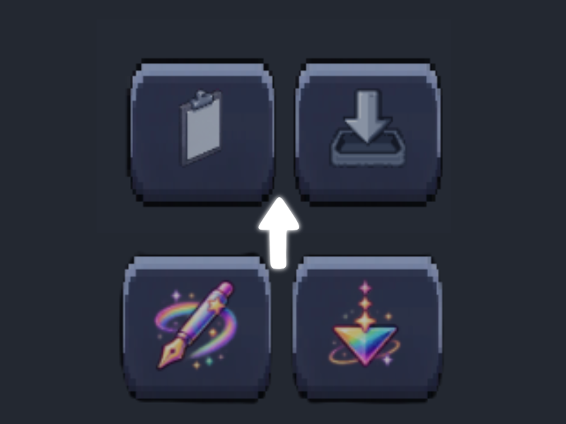

```css
[data-lab="bookmarks-panel"]
button[aria-label="Copy marked passages"]
img[src="/img/pixel/copy.webp"] {
  content: url("/api/images/6ac8970875e1eb8796dcfc4f") !important;
  object-fit: contain !important;
  filter: none !important;
}

[data-lab="bookmarks-panel"]
button[aria-label="Download marked passages"]
img[src="/img/pixel/download.webp"] {
  content: url("/api/images/6ac896f900c414e8e2a1bffd") !important;
  object-fit: contain !important;
  filter: none !important;
  transform: none !important;
}
```

**Customization:**
- `Copy marked passages` targets the Copy control.
- `Download marked passages` targets the Download control.
- `content: url(...)` selects the replacement artwork.
- `transform: none` prevents the Download image from inheriting an unwanted transform.

---

### Custom Search & Bookmarks Background Images

Optionally use uploaded artwork beneath a translucent color overlay instead of a solid panel background. 

```css
/* Optional variation: use instead of the solid panel background */
[data-lab="bookmarks-panel"] {
  background: linear-gradient(#171b2bcc, #171b2bcc),
              url("/api/images/YOUR_IMAGE_ID")
              center / cover no-repeat !important;
  border-left: 2px solid #73d9ff !important;
}

/* Optional: allow the image to show through the list area */
[data-lab="bookmarks-panel"] #lab-bookmarks-list {
  background: transparent !important;
}
```

**Customization:**
- `YOUR_IMAGE_ID` is the reader’s own uploaded image.
- `linear-gradient(...)` adds a translucent readability overlay.
- `cover` fills the panel and may crop the artwork.
- `background: transparent` allows the list area to reveal the panel artwork.

**Optional / not yet tested:** The header and footer have independent opaque backgrounds in the source theme. Keep them solid for readability or customize them separately. This example is a proposed image-background variation, not a verified finished effect.

---

### Custom Bookmarks Tab Icons

Replace the small artwork inside the **Messages** and **Marked** tabs in the Bookmarks panel. The **Marked** icon is the pencil beside the MARKED label—not the Copy or Download controls. The screenshot for the separate [header icon replacement tutorial](#custom-search-bookmarks-header-icons) does **not** show these tab icons.

```css
/* Messages tab icon */
[data-lab="bookmarks-panel"]
#lab-bookmarks-tab-messages img {
  content: url("/api/images/YOUR_MESSAGES_ICON_ID") !important;
  object-fit: contain !important;
  filter: none !important;
}

/* Marked tab icon (pencil beside MARKED) */
[data-lab="bookmarks-panel"]
#lab-bookmarks-tab-marks img {
  content: url("/api/images/YOUR_MARKED_ICON_ID") !important;
  object-fit: contain !important;
  filter: none !important;
}
```

**Customization:**
- `YOUR_MESSAGES_ICON_ID` replaces the Messages tab artwork.
- `YOUR_MARKED_ICON_ID` replaces the Marked tab artwork.
- The tab IDs target each button independently (`#lab-bookmarks-tab-messages` and `#lab-bookmarks-tab-marks`); `content` supplies your replacement artwork.
- These examples use [LoreBary-uploaded images](#how-to-import-css-images-in-lorebary). You can also use [Base64 image data](https://github.com/Caddel001/LoreBary-Theme-Snippets/blob/main/LoreBary%20CSS%20Quick%20Guide.md#converting-images-to-base64).
- Tab colors, counters, hover, and selected states have their own tutorials above. Copy and Download icon replacements are covered in [Custom Copy and Download Icons](#custom-copy-and-download-icons).

---


## Scene Notes

### Custom Scene Notes Window

Change the Scene Notes window background, outline, corners, and shadow. 

```css
[data-lab="input"] > div:has(#lab-scene-notes) {
  background: #211b31 !important;
  border: 1px solid #ee8ec9 !important;
  border-radius: 16px !important;
  box-shadow: 0 0 14px #ed83c32b, 0 12px 32px #00000080 !important;
}
```

**Customization:** The verified Scene Notes panel selector replaces the older label-wrapper traversal. Change `background`, `border`, `border-radius`, and `box-shadow` to customize the window.

---

### Scene Notes Title and Close Button

Recolor the Scene Notes title and close button.

```css
[data-lab="input"] > div:has(#lab-scene-notes)
label[for="lab-scene-notes"] {
  color: #ffd5ec !important;
  text-shadow: 0 0 7px #f98ac566 !important;
}
[data-lab="input"] > div:has(#lab-scene-notes)
label[for="lab-scene-notes"] + button {
  background: #49304f !important;
  color: #ffc5e6 !important;
  border: 1px solid #dc85c3 !important;
}
```

**Customization:** Both selectors were verified live. The close button is the sibling immediately following the Scene Notes label; the previously assumed `Close scene notes` ARIA label did not match.

---

### Scene Notes Template Colors

Assign different accent colors to the eight Scene Notes templates and their icon frames. 

```css
[aria-label="Scene note templates"]
button {
  color: #d8cbe2 !important;
}
[aria-label="Scene note templates"]
button > span:first-child {
  background: #302b42 !important;
  border: 1px solid #7f719d !important;
  box-shadow: 0 2px 6px #0006 !important;
}
[aria-label="Select Talk more template"] {
  --note-color: #ff89b7;
}
[aria-label="Select Stay real template"] {
  --note-color: #ffc38b;
}
[aria-label="Select Living world template"] {
  --note-color: #f6df83;
}
[aria-label="Select Your move template"] {
  --note-color: #88e5b1;
}
[aria-label="Select Slow burn template"] {
  --note-color: #80dfff;
}
[aria-label="Select Romance template"] {
  --note-color: #b99aff;
}
[aria-label="Select Sex template"] {
  --note-color: #f39bdf;
}
[aria-label="Select Kink template"] {
  --note-color: #ff9a9f;
}
[aria-label="Scene note templates"]
button > span:first-child {
  border-color: var(--note-color, #7f719d) !important;
}
```

**Customization:**
- `--note-color` is the accent color assigned to each template.
- `button > span:first-child` styles the template icon frame.
- Change individual hex values to build your own palette.

---

### Scene Notes Selected and Hover Effects

Give the selected Scene Notes template a clearly visible pink glow and a slight enlargement, with a separate hover highlight for other templates. 

```css
/* Selected template — confirmed working */
[aria-label="Scene note templates"]
button[aria-pressed="true"] > span:first-child {
  background: #674467 !important;
  border: 2px solid #ff89b7 !important;
  box-shadow:
    0 0 0 2px #ff89b755,
    0 0 12px 4px #ff89b7aa,
    0 0 22px #ff89b766 !important;
  transform: scale(1.08) !important;
}

/* Hover over templates that are not selected */
@media (hover: hover) {
  [aria-label="Scene note templates"]
  button:not([aria-pressed="true"]):hover > span:first-child {
    background: #3a304d !important;
    box-shadow: 0 0 9px var(--note-color, #ff89b7) !important;
  }
}
```

**Customization:**
- `[aria-pressed="true"]` identifies the selected template.
- `#674467` sets the selected icon circle's background; `#ff89b7` is the selected border color.
- The three `box-shadow` layers create a visible pink ring and glow. Reduce their blur, spread, or opacity for a softer effect.
- `scale(1.08)` enlarges the selected circle slightly; use `scale(1)` to remove the enlargement.
- The hover rule uses each template's `--note-color` when **Scene Notes Template Colors** is also installed, with pink as a fallback.
- `:not([aria-pressed="true"])` keeps hover styling from overriding the selected appearance.

**Note:** The selected-state styling above was tested successfully in Lorebary. The separate hover adjustment is included to keep the selected glow visible while hovering; review its appearance when capturing previews.

---

### Scene Notes Text Box Colors and Focus

Customize the Scene Notes text area, placeholder, and focused appearance. 

```css
[data-lab="input"] #lab-scene-notes {
  background: #121b2b !important;
  color: #f3e7f6 !important;
  border: 1px solid #6bcde5 !important;
  border-radius: 12px !important;
  box-shadow: inset 0 2px 6px #0007 !important;
}
[data-lab="input"] #lab-scene-notes::placeholder {
  color: #a9b8ce !important;
}
[data-lab="input"] #lab-scene-notes:focus-visible {
  outline: 2px solid #ff92d0 !important;
  outline-offset: 2px !important;
}
```

**Customization:**
- `background` and `color` set the editor colors.
- `::placeholder` styles the hint text.
- `:focus-visible` shows the focus outline when the browser determines a visible focus indicator is needed.

---

### Scene Notes Additional Buttons

Recolor the saved-template button and the Apply To control, including its hover state. 

```css
[data-lab="input"] > div:has(#lab-scene-notes)
button[aria-label="Open saved scene note templates"] {
  background: #453457 !important;
  border: 1px solid #c49bff !important;
  color: #f0cfff !important;
  border-radius: 50% !important;
}
@media (hover: hover) {
  [data-lab="input"] > div:has(#lab-scene-notes)
  button[aria-label="Open saved scene note templates"]:hover {
    background: #674467 !important;
  }
}
/* Apply To dropdown: inspected structure, verified live */
[data-lab="input"] > div:has(#lab-scene-notes)
div:has(> #lab-scene-notes) ~ div button {
  background: #121b2b !important;
  border: 1px solid #846aa9 !important;
  color: #e8d7f2 !important;
  border-radius: 12px !important;
}
```

**Customization:** The saved-template lightbulb uses its verified ARIA label. The Apply To control was verified with a structural sibling selector; an assumed `aria-label="Apply to"` was not established. Check the structural selector after interface updates.

---

### Scene Notes Keyboard Focus

Give Scene Notes controls a visible keyboard-focus outline.

```css
[aria-label="Scene note templates"]
button:focus-visible,
button[aria-label="Apply to"]:focus-visible,
button[aria-label="Close scene notes"]:focus-visible {
  outline: 2px solid #ff92d0 !important;
  outline-offset: 2px !important;
}
```

**Customization:**
- `focus-visible` shows the outline during keyboard navigation.
- `outline-offset` creates space between the outline and control.

---

### Custom Scene Notes Template Icons

**Image source options:** Replace the example image URLs with your own `/api/images/...` paths or Base64 data URLs. You can also define an image variable once and use `content: var(--your-icon-image)` on an image element, or `background-image: var(--your-icon-image)` for a background. See [How to Import CSS Images in Lorebary](#how-to-import-css-images-in-lorebary) and [Converting Images to Base64](https://github.com/Caddel001/LoreBary-Theme-Snippets/blob/main/LoreBary%20CSS%20Quick%20Guide.md#converting-images-to-base64).

Replace the artwork for all eight Scene Notes templates. 

```css
[aria-label="Select Talk more template"] img {
  content: url("/api/images/6ac933d9774248b6e840f548") !important;
  object-fit: contain !important;
}
[aria-label="Select Stay real template"] img {
  content: url("/api/images/6ac933bc774248b6e840f1a4") !important;
  object-fit: contain !important;
}
[aria-label="Select Living world template"] img {
  content: url("/api/images/6ac9337f71408e65b12b8235") !important;
  object-fit: contain !important;
}
[aria-label="Select Your move template"] img {
  content: url("/api/images/6ac9339a774248b6e840ec7c") !important;
  object-fit: contain !important;
}
[aria-label="Select Slow burn template"] img {
  content: url("/api/images/6ac933e874200038737ef983") !important;
  object-fit: contain !important;
}
[aria-label="Select Romance template"] img {
  content: url("/api/images/6ac933a88825371476f13213") !important;
  object-fit: contain !important;
}
[aria-label="Select Sex template"] img {
  content: url("/api/images/6ac93403041fbd15cfcc8e14") !important;
  object-fit: contain !important;
}
[aria-label="Select Kink template"] img {
  content: url("/api/images/6ac933f742849615a40a8ab3") !important;
  object-fit: contain !important;
}
```

**Customization:**
- Each `aria-label` selects one template.
- `content: url(...)` replaces its icon.
- Replace each `/api/images/...` address with your own uploaded image URL.

---
