# LoreBary Profile CSS — Complementary Additions

## Contents

- [Profile Theme Structure and Palette](#profile-theme-structure-and-palette)
  - [Additional Banner and Identity Targets](#additional-banner-and-identity-targets)
  - [Identity Rows and Individual Surface Treatments](#identity-rows-and-individual-surface-treatments)
  - [Level and Navigation Notches](#level-and-navigation-notches)
  - [Member-Since Artwork and Followers/Following Counts](#member-since-artwork-and-followersfollowing-counts)
  - [Profile View-State Targets](#profile-view-state-targets)
- [Fonts and Typography](#fonts-and-typography)
  - [Display Name, Username, and Quote Treatments](#display-name-username-and-quote-treatments)
  - [Inherited and Explicit Text Colors](#inherited-and-explicit-text-colors)
- [Profile Avatar Frame](#profile-avatar-frame)
  - [Change-Avatar Overlay and Upload Artwork](#change-avatar-overlay-and-upload-artwork)
  - [Streak and Badge Artwork](#streak-and-badge-artwork)
- [Stickers and Decorative Images](#stickers-and-decorative-images)
  - [Native Decorations and Layer Choice](#native-decorations-and-layer-choice)
- [Main Profile Tabs and About Tabs](#main-profile-tabs-and-about-tabs)
  - [Individual Main Tabs and Their Artwork](#individual-main-tabs-and-their-artwork)
  - [Individual About Subtabs and Paper Artwork](#individual-about-subtabs-and-paper-artwork)
  - [Main Navigation Scroll Arrows](#main-navigation-scroll-arrows)
  - [About Chain Decorations](#about-chain-decorations)
- [Moving and Framing a Status Block](#moving-and-framing-a-status-block)
  - [About Header, Biography, and Overview Details](#about-header-biography-and-overview-details)
  - [About Information Cards](#about-information-cards)
  - [About Me Editor](#about-me-editor)
- [Write a Post](#write-a-post)
  - [Additional Composer Placement, Artwork, and Placeholder Targets](#additional-composer-placement-artwork-and-placeholder-targets)
  - [Individual Formatting Buttons and Font Icons](#individual-formatting-buttons-and-font-icons)
  - [Privacy Labels and Both Notify Followers Layouts](#privacy-labels-and-both-notify-followers-layouts)
  - [Footer Text, Submit Artwork, and Disabled State](#footer-text-submit-artwork-and-disabled-state)
  - [Composer Bary Artwork: Recolor or Hide](#composer-bary-artwork-recolor-or-hide)
  - [Poll Composer, Answers, End Date, and Submission](#poll-composer-answers-end-date-and-submission)
- [SEE ALL and Gallery](#see-all-and-gallery)
  - [Gallery Preview and Full Gallery](#gallery-preview-and-full-gallery)
  - [Gallery Folder Toolbar](#gallery-folder-toolbar)
  - [Selected Gallery Folder](#selected-gallery-folder)
  - [Empty Gallery Folder](#empty-gallery-folder)
  - [Gallery Action Controls](#gallery-action-controls)
- [Comment, Share, and Like Buttons](#comment-share-and-like-buttons)
- [Profile Background and Layout](#profile-background-and-layout)
  - [Background Size, Position, and Tint](#background-size-position-and-tint)
  - [Body and Grid Spacing](#body-and-grid-spacing)
  - [Scrollable Screen Assets](#scrollable-screen-assets)
- [Profile Actions](#profile-actions)
  - [Letter, Wave, Follow, and Alerts](#letter-wave-follow-and-alerts)
- [Content Sections](#content-sections)
  - [Content Panels, Headers, and Counts](#content-panels-headers-and-counts)
  - [Section Search, Filter, and Sort](#section-search-filter-and-sort)
  - [Search Results: Card, Header, Empty State, and Result Groups](#search-results-card-header-empty-state-and-result-groups)
  - [Section Grids, Scrolling, Empty States, and Footer](#section-grids-scrolling-empty-states-and-footer)
  - [Individual Sections and Card-Type Targets](#individual-sections-and-card-type-targets)
  - [Featured Creator Rail](#featured-creator-rail)
- [Content Cards](#content-cards)
  - [Card Layers, Frames, Covers, and Overlays](#card-layers-frames-covers-and-overlays)
  - [Card Text, Tags, Statistics, and Ratings](#card-text-tags-statistics-and-ratings)
  - [Vines, Featured Artwork, and Fallbacks](#vines-featured-artwork-and-fallbacks)
  - [Profile-Style Preview Cards](#profile-style-preview-cards)
  - [Bundle Cards Without Standard Hooks](#bundle-cards-without-standard-hooks)
- [Published Posts, Polls, and Media](#published-posts-polls-and-media)
  - [Post Structure, Author, Body, and Privacy](#post-structure-author-body-and-privacy)
  - [Pinned Tape and Post Options](#pinned-tape-and-post-options)
  - [Featured Creator Links](#featured-creator-links)
  - [Level Up, Relationship, and Glorp Events](#level-up-relationship-and-glorp-events)
  - [Published and Updated Content Embeds](#published-and-updated-content-embeds)
  - [Bary Is Dead Embed](#bary-is-dead-embed)
  - [Post Media, Reveal Wrappers, and Native Artwork](#post-media-reveal-wrappers-and-native-artwork)
  - [Published Polls, Results, and Tape](#published-polls-results-and-tape)
- [Rich Text and Dividers](#rich-text-and-dividers)
  - [Rich-Text Scope and Text Colors](#rich-text-scope-and-text-colors)
  - [Blockquotes](#blockquotes)
  - [Collapsible Sections](#collapsible-sections)
  - [Spoilers](#spoilers)
  - [Tables](#tables)
  - [Solid, Dotted, and Paw Dividers](#solid-dotted-and-paw-dividers)
- [HTML Profile Options](#html-profile-options)
  - [Content Warning Across the Profile](https://github.com/Caddel001/LoreBary-Theme-Snippets/blob/main/LoreBary%20CSS%20Quick%20Guide.md#content-warning-across-the-profile)
  - [Combination Lock](https://github.com/Caddel001/LoreBary-Theme-Snippets/blob/main/LoreBary%20CSS%20Quick%20Guide.md#combination-lock)
  - [HTML Image Setup](https://github.com/Caddel001/LoreBary-Theme-Snippets/blob/main/LoreBary%20CSS%20Quick%20Guide.md#html-image-setup)
  - [Featured Creators & Friends](https://github.com/Caddel001/LoreBary-Theme-Snippets/blob/main/LoreBary%20CSS%20Quick%20Guide.md#featured-creators--friends)
  - [Clickable CSS Button — LIVE / OFFLINE](https://github.com/Caddel001/LoreBary-Theme-Snippets/blob/main/LoreBary%20CSS%20Quick%20Guide.md#clickable-css-button--live--offline)
  - [Palette Toggle](https://github.com/Caddel001/LoreBary-Theme-Snippets/blob/main/LoreBary%20CSS%20Quick%20Guide.md#palette-toggle)
  - [Dollhouse Doors — Reveal Half the Profile](https://github.com/Caddel001/LoreBary-Theme-Snippets/blob/main/LoreBary%20CSS%20Quick%20Guide.md#dollhouse-doors--reveal-half-the-profile)
- [Profile Dialogs and Mobile Panels](#profile-dialogs-and-mobile-panels)
  - [Shared Dialog Selectors](#shared-dialog-selectors)
  - [Mobile Gallery Panel](#mobile-gallery-panel)
  - [New Folder Dialog](#new-folder-dialog)
  - [Folder Color and Privacy Choices](#folder-color-and-privacy-choices)
  - [Mobile Post and Comments Sheet](#mobile-post-and-comments-sheet)
  - [Comment Reactions and Reply Controls](#comment-reactions-and-reply-controls)
  - [Comment Rows, Replies, and List States](#comment-rows-replies-and-list-states)
  - [Mobile Comment Composer Preview](#mobile-comment-composer-preview)
  - [Mobile About Me Editor](#mobile-about-me-editor)
  - [Mobile Profile Details](#mobile-profile-details)
  - [Followers and Following Dialogs](#followers-and-following-dialogs)
  - [Followers and Following Close Button](#followers-and-following-close-button)
  - [Send a Wave](#send-a-wave)
  - [Section Dialogs](#section-dialogs)
- [Common Fixes](#common-fixes)
  - [Raise Avatar Controls](#raise-avatar-controls)
  - [Fix Editor Toolbox Color Flood](#fix-editor-toolbox-color-flood)
  - [About Me “View All”](#about-me-view-all)
  - [Scrolling on Content Cards](#scrolling-on-content-cards)
  - [Compact Content View — Banner on the Left or Right](#compact-content-view--banner-on-the-left-or-right)
- [Profile Selector Quick Reference](#profile-selector-quick-reference)
  - [Additional Component and State Selectors](#additional-component-and-state-selectors)
  - [Current Mobile and Rail Selectors](#current-mobile-and-rail-selectors)
  - [Native Artwork Paths and Reuse](#native-artwork-paths-and-reuse)
---

## Profile Theme Structure and Palette

### Additional Banner and Identity Targets

Keep the shared palette and component map as the starting point. These targets distinguish the nested banner and identity layers when you want to style one layer without changing its neighbours.

Style the banner frame, image, and readability overlay independently while keeping its nested layout.

**Banner Layers: Frame, Hero, Content, and Row**

The banner has four nested containers. This example gives each a different color so you can see their boundaries.

| Selector | Targets |
| --- | --- |
| `[data-profile="hero-frame"]` | Outer wrapper around the banner |
| `[data-profile="hero"]` | Banner panel containing the artwork and content |
| `[data-profile="hero-content"]` | Content area above the banner artwork |
| `[data-profile="hero-row"]` | Layout row containing the avatar and identity area |

**Outer hero frame**

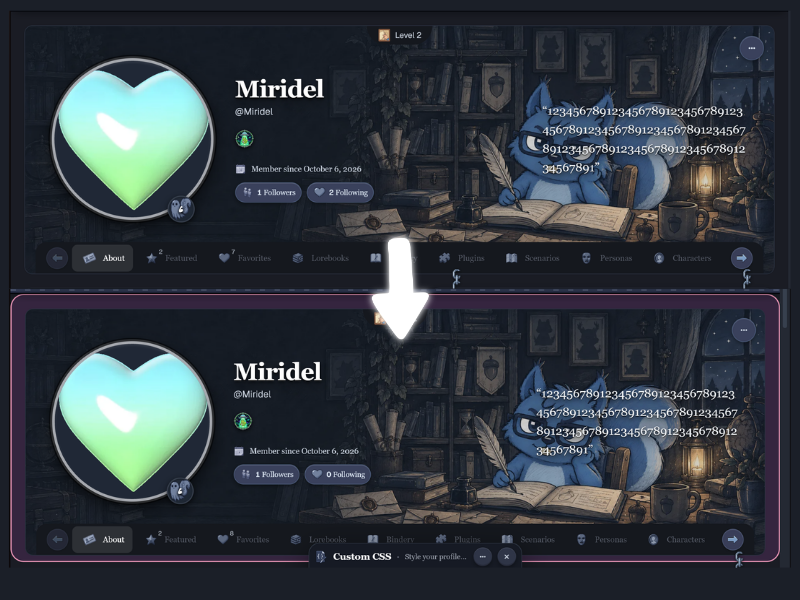

```css
/* Outer wrapper: pink background, border, and rounding. */
[data-profile="hero-frame"] {
  background: #352440 ;
  border: 2px solid #ed91b7 ;
  border-radius: 20px ;
}
```

**Hero panel**

The background color sits beneath the banner artwork, so the image may cover it.

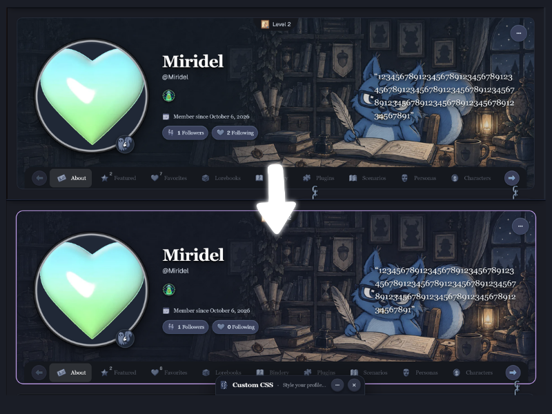

```css
/* Banner panel: purple surface, border, rounding, and shadow. */
[data-profile="hero"] {
  background-color: #251c35 ;
  border: 2px solid #bd9bea !important;
  border-radius: 16px ;
  clip-path: inset(0 round 16px) ;
  box-shadow: 0 6px 20px #120b2099 ;
}
```

**Hero content**

A translucent blue background shows the content area while letting some artwork remain visible.

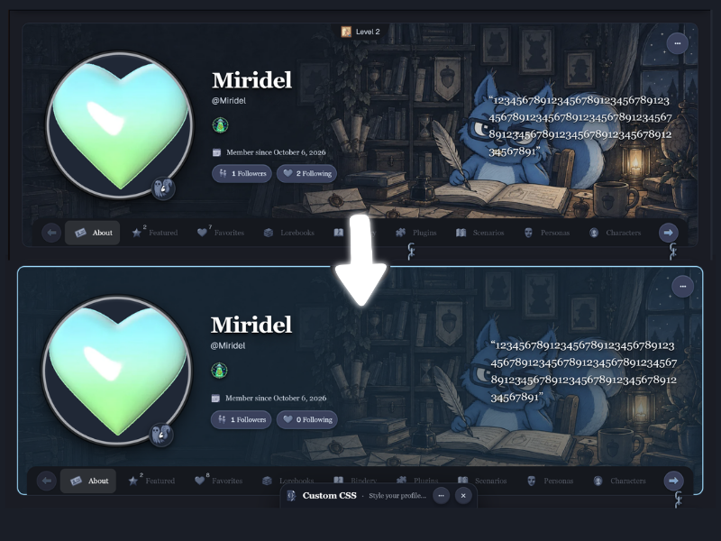

```css
/* Banner content area: blue surface and border. */
[data-profile="hero-content"] {
  background: rgba(25, 52, 70, 0.45) ;
  border: 2px solid #91cfed ;
  border-radius: 12px ;
}
```

**Hero row**

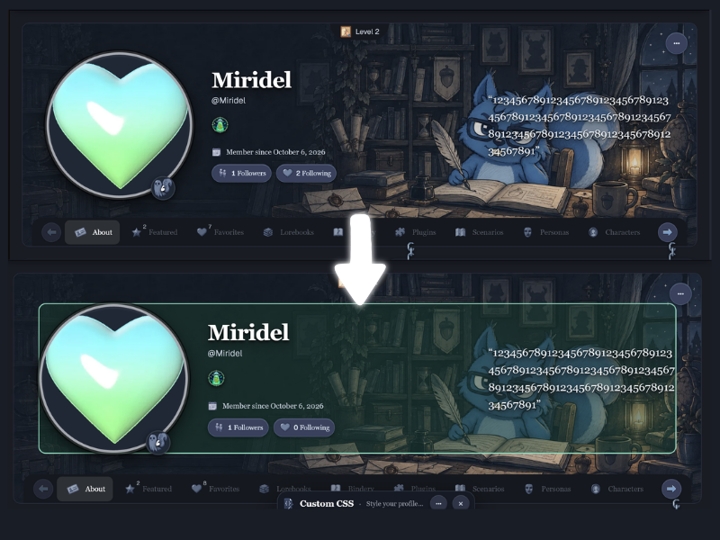

```css
/* Avatar and identity layout row: green surface and border. */
[data-profile="hero-row"] {
  background: rgba(25, 65, 48, 0.45) ;
  border: 2px solid #8fd8bb ;
  border-radius: 12px ;
}
```

**Customization:** Change each layer independently. `background` changes its surface, `border` marks its edge, `border-radius` rounds its corners, and `box-shadow` adds depth. Keep the hero’s `clip-path` rounding equal to its `border-radius`.

These containers are nested, so translucent backgrounds overlap. Use `background: transparent` on the content or row if you want its border without the colored surface.

**Compact and expanded selector note**

**Layout/state variants; not screen-size selectors.**

| Selector inside the profile | Targets |
| --- | --- |
| `[data-profile="hero"][data-compact="false"]` | Expanded hero |
| `[data-profile="hero"][data-compact="true"]` | Compact hero |

LoreBary controls the state; these selectors let you style each layout separately. Compact/expanded is not a direct mobile/desktop selector.

**Banner Image Layer and Readability Tint**

The **banner artwork** and **readability tint** are separate layers. Style each independently to keep the content at full opacity.

| Target | Selector inside the profile |
| --- | --- |
| Banner artwork | `[data-profile="hero"] > div[style*="background-image"]` |
| Readability tint | `[data-profile="hero-tint"]` |

**Banner artwork**

The captured artwork layer has no dedicated `data-profile` label. This selector finds the direct child of the hero whose inline style contains `background-image`.

```css
/* Banner artwork: sizing, alignment */
[data-profile="hero"] > div[style*="background-image"] {
  background-size: cover;
  background-position: center top !important;
}
```

**Customization:** Change `background-position` to move the artwork within its frame. Set `opacity` to `1` for full-strength artwork or lower it to reveal more of the hero’s background color. This fades only the image layer.

**Readability tint**

**Requires a selected banner:** The readability-tint example works when LoreBary renders its tint layer. In the captured default-banner state, that layer is absent, so the rule has no visible effect. The banner-image sizing and positioning example still applies.

This example uses strong pink to make the tint easy to see. The mask rules remove the existing directional fade from this layer.

```css
/* Banner tint: strong pink for a visible test. */
[data-profile="hero-tint"] {
  background: rgba(255, 0, 120, 0.8);
  opacity: 1;
  -webkit-mask-image: none;
  pointer-events: none;
}
```

- `255, 0, 120` sets the tint color.
- `0.8` sets its strength. Lower it for a softer tint.
- Use `background: transparent` to remove this tint.
- Remove mask declarations to retain LoreBary’s existing fade.

### Identity Rows and Individual Surface Treatments

Style the identity card and its inner rows, then choose a solid or gradient surface treatment.

**Identity Card, Column, and Row**

These three containers sit inside the hero row. Give each a separate style to see what it surrounds.

| Selector | Targets |
| --- | --- |
| `[data-profile="identity-card"]` | Outer identity area beside the avatar |
| `[data-profile="identity-col"]` | Column containing the name, handle, badges, and metadata |
| `[data-profile="identity"]` | Display-name row |

**Identity card**

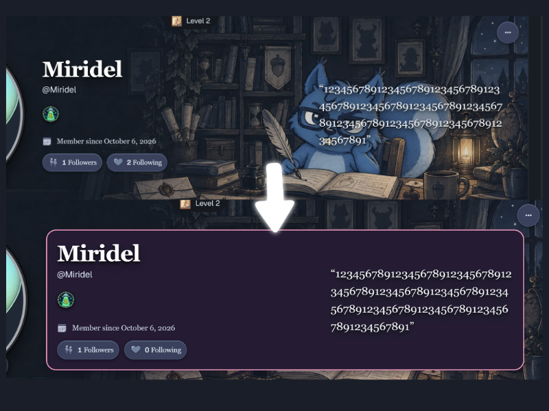

```css
/* Outer identity area: purple panel with a pink border. */
[data-profile="identity-card"] {
  background: #251c35;
  border: 2px solid #ed91b7;
  border-radius: 16px;
  padding: 16px;
  box-shadow: 0 4px 14px #120b2080
}
```

**Identity column**

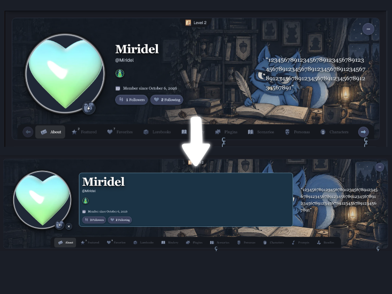

```css
/* Name and metadata column: blue panel. */
[data-profile="identity-col"] {
  background: #193446;
  border: 1px solid #91cfed;
  border-radius: 12px;
  padding: 12px;
}
```

**Identity row**

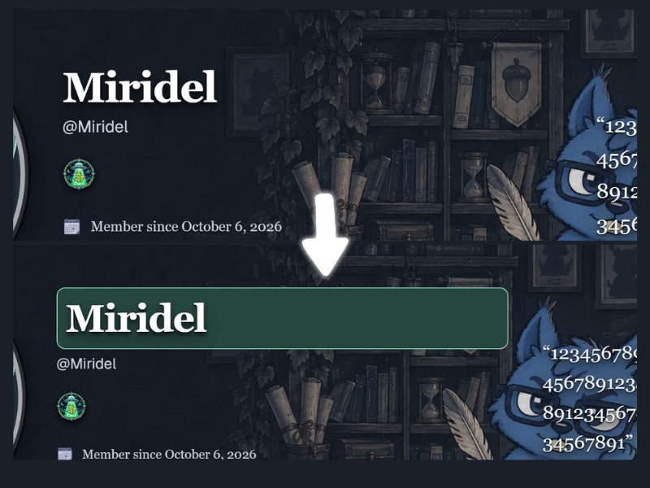

```css
/* Display-name row: green panel. */
[data-profile="identity"] {
  background: #24483e;
  border: 1px solid #8fd8bb;
  border-radius: 8px;
  padding: 8px;
}
```

**Customization:** Change each background, border, rounding, and padding independently. These containers are nested, so their padding adds together.

The examples style the **containers**. Name text, badges, and individual controls keep their existing styles.

**Panel Backgrounds, Borders, Rounding, and Shadows**

Use these four properties to change a panel’s appearance. This example targets only the **outer identity card** beside the avatar.

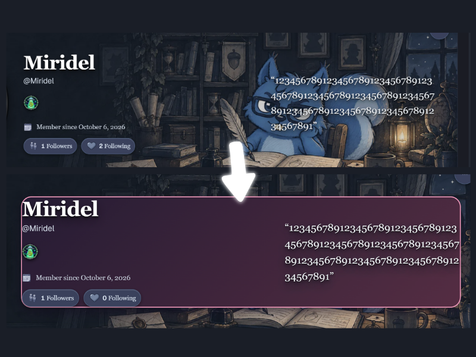

```css
/* Outer identity card: gradient, border, rounded corners, and shadow. */
[data-profile="identity-card"] {
  background: linear-gradient(135deg, #251c35, #562b43);
  border: 2px solid #ed91b7;
  border-radius: 18px;
  box-shadow: 0 8px 20px 0 rgba(18, 11, 32, 0.55);
}
```

If you used the previous identity tutorial, replace its outer-card appearance rules with these. Keep its `padding` if you like that spacing.

**Customize the surface**

| Property | Try | Effect |
| --- | --- | --- |
| `background` | `#251c35` | Solid purple surface |
| `background` | `transparent` | Shows the layers behind the panel |
| `border` | `3px dashed #8fd8bb` | Thicker dashed mint outline |
| `border` | `none` | Removes the outline |
| `border-radius` | `0` | Square corners |
| `border-radius` | `24px` | Rounder corners |
| `box-shadow` | `0 0 16px #ed91b780` | Pink glow around the panel |
| `box-shadow` | `inset 0 0 12px #120b2080` | Shadow inside the panel |
| `box-shadow` | `none` | Removes the shadow |

**Choose a different panel**

Replace `[data-profile="identity-card"]` in the example with one target below.

| Target | Selector |
| --- | --- |
| Identity column | `[data-profile="identity-col"]` |
| Display-name row | `[data-profile="identity"]` |
| Banner content area | `[data-profile="hero-content"]` |

**Preview note:** Colored child panels can cover parts of the outer card’s background. Set the child backgrounds to `transparent` if you want the outer gradient to show through. Shadows extending beyond a clipping ancestor may be cut off.

### Level and Navigation Notches

Style the level notch and navigation notch independently from the banner panels around them.

**Level Notch and Navigation Notch**

The **level notch** sits at the top of the hero. The **navigation notch** holds the profile-section tabs at the bottom.

| Selector | Targets |
| --- | --- |
| `[data-profile="level-notch"]` | Level panel’s outer surface |
| `[data-profile="level-text"]` | Level label |
| `[data-profile="level-icon"]` | Current level’s image icon |
| `[data-profile="tab-notch"]` | Navigation panel’s outer surface |

**Level notch**

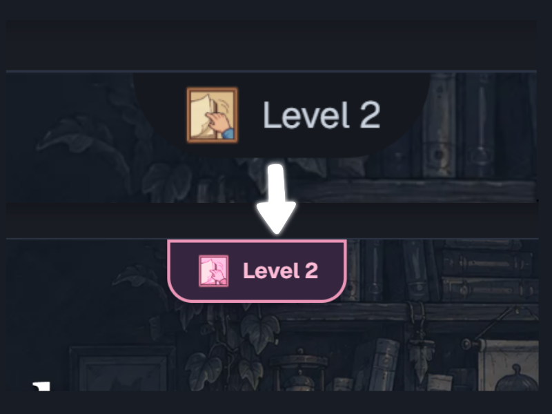

```css
/* Level panel: purple surface with a pink border. */
[data-profile="level-notch"] {
  background: #352440;
  border: 2px solid #ed91b7;
  border-radius: 0 0 14px 14px;
  padding: 6px 14px;
  box-shadow: 0 3px 8px #120b2080;
}

/* Level label only. */
[data-profile="level-text"] {
  color: #ffb8d6;
  font-weight: bold;
}

/* Current level icon: tint the artwork. */
[data-profile="level-icon"] {
  filter: sepia(1) saturate(2) hue-rotate(285deg);
}
```

The icon selector works with whichever level image is displayed; it does not depend on a particular level filename. Its tint depends on the original artwork.

**Navigation notch**

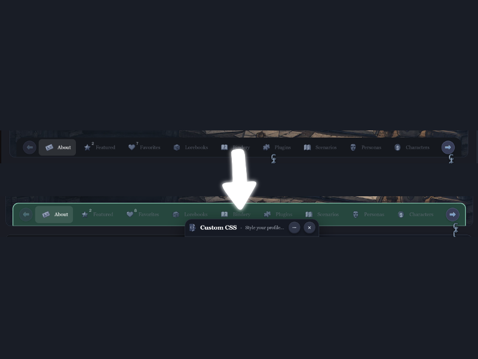

```css
/* Profile navigation panel: green surface with a mint border. */
[data-profile="tab-notch"] {
  background: #24483e;
  border: 2px solid #8fd8bb;
  border-radius: 14px 14px 0 0;
  padding: 6px 14px;
  box-shadow: 0 -3px 8px #120b2080;
}
```

This styles the navigation panel around the tabs. Individual tab buttons, labels, counts, and icons retain their existing styles.

**Customization:** Change the background, border, padding, and shadow separately. The four `border-radius` values follow top-left, top-right, bottom-right, bottom-left: the level notch rounds its bottom corners, and the navigation notch rounds its top corners.

Shadows may be cut off by the hero’s clipping.

### Member-Since Artwork and Followers/Following Counts

Target the calendar icon, membership text, follower buttons, and count labels separately.

**Member-Since Icon and Text**

Style the calendar icon and membership text independently.

| Selector | Targets |
| --- | --- |
| `[data-profile="member-since-icon"]` | Calendar image |
| `[data-profile="member-since-text"]` | Full “Member since…” line, including the date |

**Calendar icon**

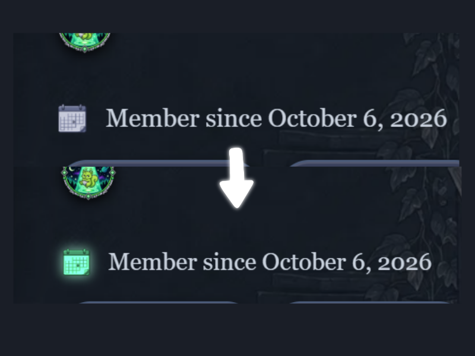

```css
/* Member-since calendar: mint tint and a soft glow. */
[data-profile="member-since-icon"] {
  filter: sepia(1) saturate(2) hue-rotate(95deg)
    drop-shadow(0 0 3px #8fd8bb);
}
```

The calendar is an image, so `color` does not recolor it. `filter` tints its artwork; `drop-shadow` adds the glow. The tint depends on the original image.

**Membership text**

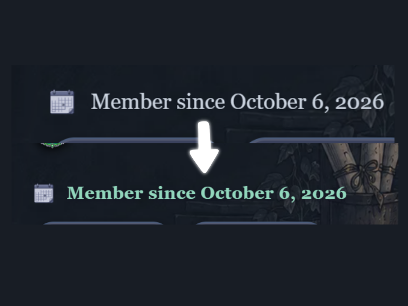

```css
/* Member-since text only: mint with a soft shadow. */
[data-profile="member-since-text"] {
  color: #8fd8bb !important;
  font-weight: 600 ;
  letter-spacing: 0.02em ;
  text-shadow: 0 1px 3px rgba(18, 11, 32, 0.6) ;
}
```

**Customization:** Change the text’s `color`, `font-weight`, and `letter-spacing` directly. Use `text-shadow: none` to remove its shadow. Remove `drop-shadow(...)` from the icon filter for a tint without glow, or use `filter: none` for the original artwork.

The label and date share one text element in this layout, so this selector styles them together.

**Followers and Following Count Buttons**

These are the two count buttons beneath the profile metadata. Each has its own selector, separate from the Follow action button.

| Selector | Targets |
| --- | --- |
| `[data-profile="count-followers"]` | Followers count button |
| `[data-profile="count-following"]` | Following count button |
| `[data-profile="count-value"]` | Numeric count inside either button |

**Followers button**

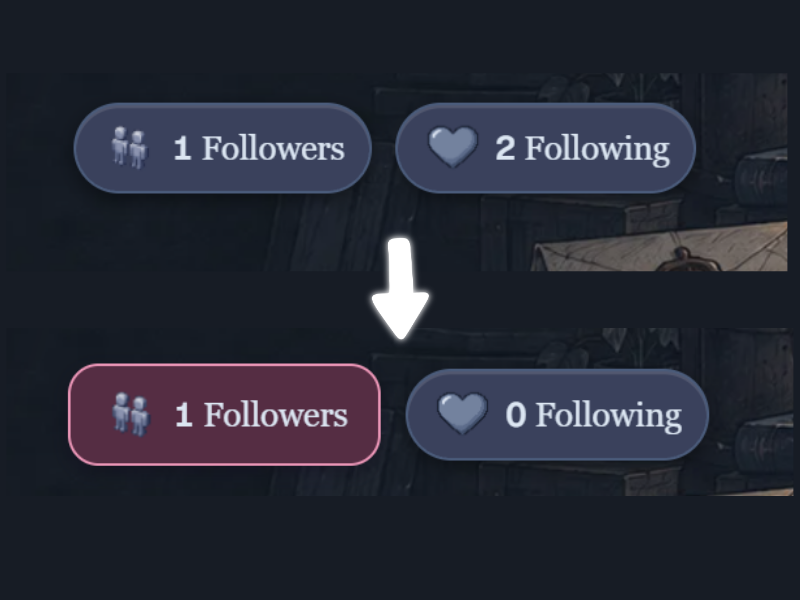

```css
/* Followers button: rose surface and pink border. */
[data-profile="count-followers"] {
  background: #562b43 ;
  border: 1px solid #ed91b7 ;
  border-radius: 10px ;
  padding: 6px 10px ;
  box-shadow: 0 2px 6px rgba(18, 11, 32, 0.4) ;
}

/* Followers button: brighter surface on hover. */
[data-profile="count-followers"]:hover {
  background: #713953 ;
}
```

**Following button**

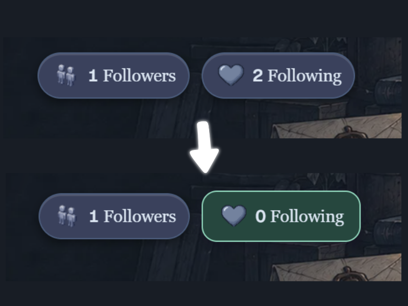

```css
/* Following button: green surface and mint border. */
[data-profile="count-following"] {
  background: #24483e ;
  border: 1px solid #8fd8bb ;
  border-radius: 10px ;
  padding: 6px 10px ;
  box-shadow: 0 2px 6px rgba(18, 11, 32, 0.4) ;
}

/* Following button: brighter surface on hover. */
[data-profile="count-following"]:hover {
  background: #306052 ;
}
```

**Customization:** Change each background and border independently. Increase `border-radius` for rounder corners, adjust `padding` for button spacing, or use `box-shadow: none` to remove the shadow.

**Button icons**

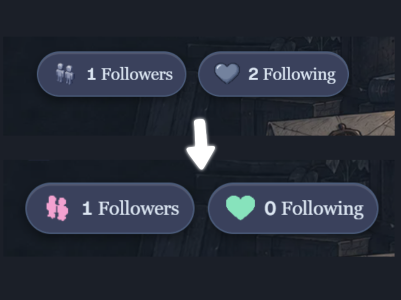

```css
/* Followers icon only: pink recolor. */
[data-profile="count-followers"]
img[src="/img/pixel/rel_friends.webp"] {
  filter: brightness(0) saturate(100%) invert(75%) sepia(24%)
    saturate(850%) hue-rotate(290deg) brightness(101%) contrast(91%) ;
}

/* Following heart icon only: mint recolor. */
[data-profile="count-following"]
img[src="/img/pixel/heart.webp"] {
  filter: brightness(0) saturate(100%) invert(84%) sepia(20%)
    saturate(650%) hue-rotate(100deg) brightness(96%) contrast(90%) ;
}
```

These filters replace the icons’ original colors with approximately pink and mint silhouettes. Use `filter: none` to restore the artwork’s original colors.

**Numbers and labels**

In “2 Following,” the number has its own `count-value` element. The word is text inside the surrounding span. Style that span for the label, then give the number its own color.

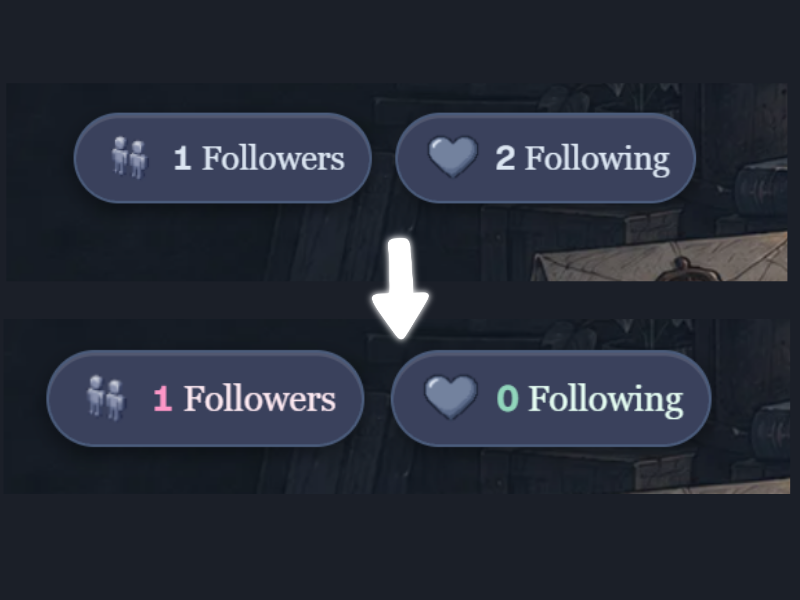

```css
/* Followers label: pale pink. */
[data-profile="count-followers"]
> span:has(> [data-profile="count-value"]) {
  color: #ffe9f2 ;
}

/* Followers number only: bright pink and bold. */
[data-profile="count-followers"]
[data-profile="count-value"] {
  color: #ff91c8 ;
  font-weight: 700 ;
}

/* Following label: pale mint. */
[data-profile="count-following"]
> span:has(> [data-profile="count-value"]) {
  color: #e5fff3 ;
}

/* Following number only: bright mint and bold. */
[data-profile="count-following"]
[data-profile="count-value"] {
  color: #8fd8bb ;
  font-weight: 700 ;
}
```

**Customization:** Change the label and number colors independently. `font-weight` changes the number’s weight.

The label selector follows the supplied HTML: `> span:has(> [data-profile="count-value"])` selects the button’s direct child span containing the number. The number’s separate rule overrides the color it would otherwise inherit from that span.

The buttons keep their existing click behavior and focus styling.

### Profile View-State Targets

**About and content view states**

The root also carries `data-profile-view`, which LoreBary updates when you navigate.

| Selector | Applies when |
| --- | --- |
| `[data-profile="scope"][data-profile-view="about"]` | The About view is open |
| `[data-profile="scope"][data-profile-view="content"]` | A content view is open |

Keep these attributes together with **no space**: they describe the same root element. A space before another selector targets something inside it.

## Fonts and Typography

### Display Name, Username, and Quote Treatments

Give the display name, username, and header quote their own text treatments while retaining the existing font setup.

**Display Name: Color, Shadow, and Gradient**

The **display-name** element is the heading; **name-text** is the text inside it.

| Selector | Targets |
| --- | --- |
| `[data-profile="display-name"]` | Display-name heading |
| `[data-profile="name-text"]` | Name text inside the heading |

**Heading weight and shadow**

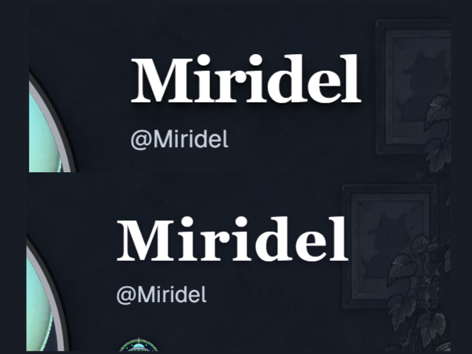

```css
/* Display-name heading: weight, letter spacing, and shadow. */
[data-profile="display-name"] {
  font-weight: 700 ;
  letter-spacing: 0.03em ;
  text-shadow: 0 2px 4px rgba(18, 11, 32, 0.65) ;
}
```

**Solid name color**

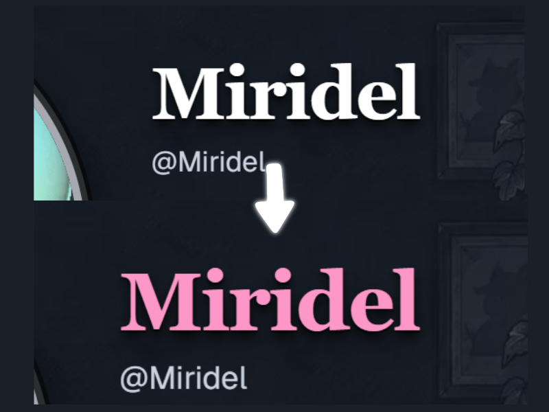

```css
/* Name text only: bright pink. */
[data-profile="name-text"] {
  color: #ff91c8;
}
```

**Customization:** Change `color` for the name, `letter-spacing` for the distance between letters, and `text-shadow` for its shadow. Use `text-shadow: none` to remove it.

**Optional gradient name**

Replace the solid name-color block with this alternative. It paints the letters with a gradient rather than adding a rectangular background.

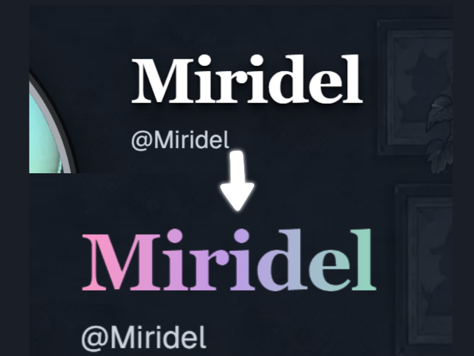

```css
/* Name text only: pink, lavender, and mint gradient. */
[data-profile="name-text"] {
  background: linear-gradient(90deg, #ff91c8, #bd9bea, #8fd8bb) ;
  background-clip: text ;
  -webkit-background-clip: text ;
  color: transparent ;
  -webkit-text-fill-color: transparent ;
  text-shadow: none ;
}
```

**Customization:** Change the three colors or the gradient angle (`90deg`). Use one name-color treatment at a time. To return to solid text, remove the gradient block and restore the solid-color block.

**Username Text**

The captured username (`@handle`) has no dedicated `data-profile` label. It is a paragraph immediately after the display-name row inside the identity column.

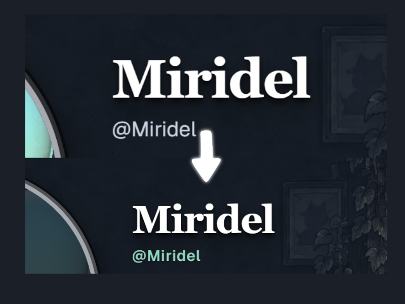

```css
/* Username paragraph directly after the identity row. */
[data-profile="identity-col"]
> [data-profile="identity"] + p {
  color: #8fd8bb !important;
  font-weight: 600 ;
  letter-spacing: 0.04em ;
  text-shadow: 0 1px 3px rgba(18, 11, 32, 0.6) ;
}
```

**Read the selector**

| Part | Meaning |
| --- | --- |
| `[data-profile="identity-col"]` | Find the identity column |
| `> [data-profile="identity"]` | Find its direct child display-name row |
| `+ p` | Select the paragraph immediately after that row |

**Customization:** Change `color` for the handle, `font-weight` for its weight, and `letter-spacing` for spacing between letters. Use `text-shadow: none` to remove the shadow.

**Quote Container and Quote Text**

Style the quote’s panel and its text separately.

| Selector | Targets |
| --- | --- |
| `[data-profile="quote"]` | Outer quote container |
| `[data-profile="quote-text"]` | Quote text button inside it |

**Quote container**

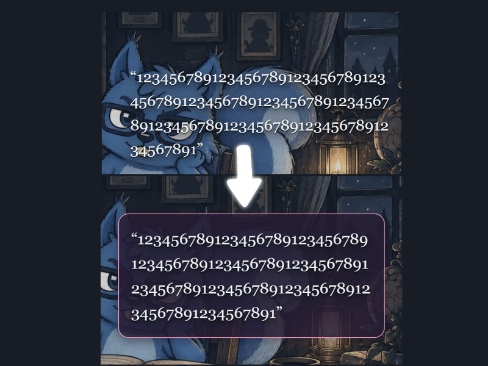

```css
/* Quote panel: purple surface, pink border, and rounded corners. */
[data-profile="quote"] {
  background: rgba(37, 28, 53, 0.85) ;
  border: 1px solid #ed91b7 ;
  border-radius: 12px ;
  padding: 14px ;
  box-shadow: 0 4px 12px rgba(18, 11, 32, 0.45) ;
}
```

**Quote text**

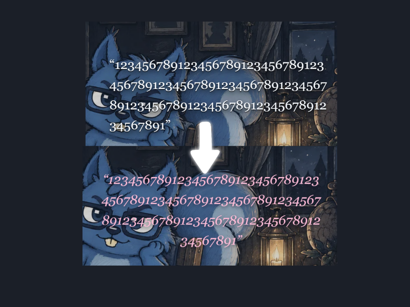

```css
/* Quote text only: pink, italic, and centered. */
[data-profile="quote-text"] {
  color: #ffb8d6 ;
  font-style: italic ;
  text-align: center ;
  text-shadow: 0 2px 4px rgba(18, 11, 32, 0.6) ;
}
```

**Customization:** Change `background`, `border`, and `padding` for the panel. Change `color`, `font-style`, `text-align`, and `text-shadow` for the text. Use `font-style: normal` for upright lettering or `text-shadow: none` to remove the shadow.

The captured quote text is a button. Add a quote in LoreBary if the quote area is absent.

### Inherited and Explicit Text Colors

Use the existing font setup for body and title fonts. For component colors, a child span with its own `color` does not inherit the parent’s color—even if the parent declaration is important.

Target nested text only when you intend to replace its author-selected color. Keep optional nested paragraph/span overrides separate from a component’s base surface styling.

## Profile Avatar Frame

### Change-Avatar Overlay and Upload Artwork

Keep the existing frame, portrait-inset, and stacking examples. The upload overlay and its icon can receive their own treatment within those layers.

**Change-Avatar Overlay and Upload Icon**

The upload control appears on your own editable avatar. Its overlay, title, hint, and image icon can be styled separately.

The captured upload label has no dedicated `data-profile` hook. `label:has(> input[aria-label="Change avatar"])` finds the label containing that upload input.

**Overlay surface**

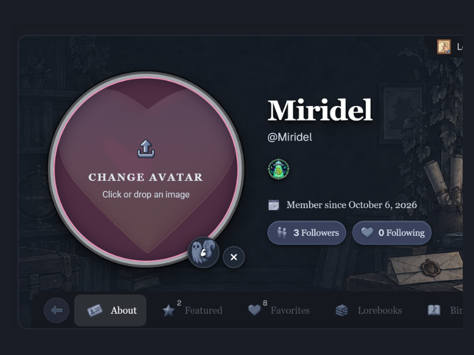

```css
/* Change-avatar overlay: rose tint inside the portrait. */
[data-profile="avatar"]
label:has(> input[aria-label="Change avatar"]) > span {
  background: rgba(86, 43, 67, 0.88) ;
  border: 2px solid #ed91b7 ;
  border-radius: inherit ;
  box-shadow: inset 0 0 18px rgba(18, 11, 32, 0.55) ;
}
```

Hover over the avatar or focus its upload input to see the overlay. These rules keep its existing reveal behavior.

**Title and hint**

In the supplied overlay, the second child span contains “Change avatar” and the third contains “Click or drop an image.”

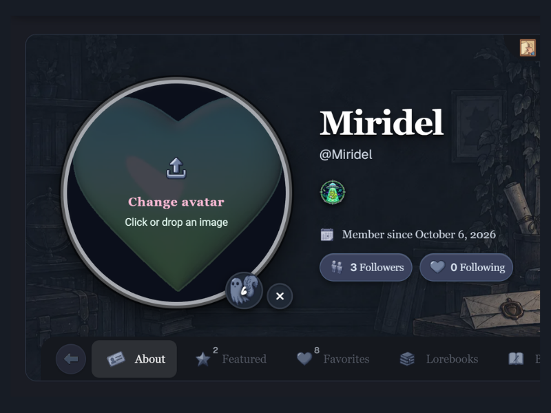

```css
/* Change-avatar title only. */
[data-profile="avatar"]
label:has(> input[aria-label="Change avatar"])
> span > span:nth-child(2) {
  color: #ffb8d6 ;
  text-transform: none ;
  letter-spacing: 0.04em ;
}

/* Upload hint only. */
[data-profile="avatar"]
label:has(> input[aria-label="Change avatar"])
> span > span:nth-child(3) {
  color: #e5fff3 ;
}
```

These text selectors follow the captured child order; they may need updating if LoreBary rearranges the overlay.

**Upload icon**

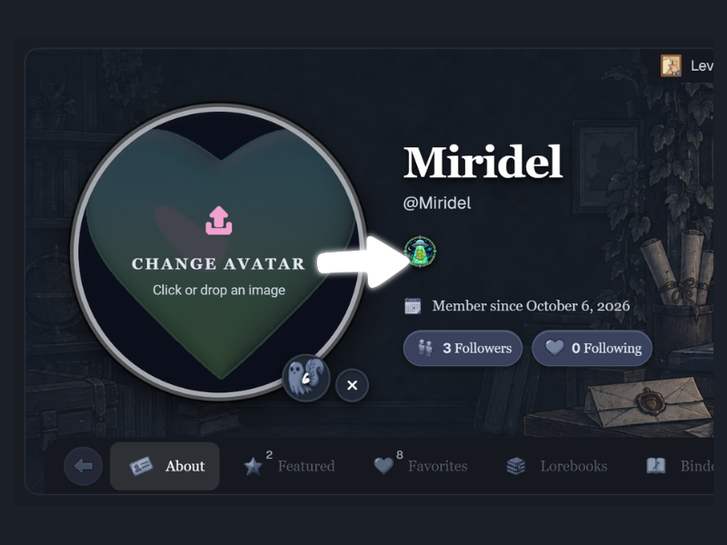

```css
/* Upload image icon only: pink recolor. */
[data-profile="avatar"]
label:has(> input[aria-label="Change avatar"])
img[src="/img/pixel/expression-upload.webp"] {
  filter: brightness(0) saturate(100%) invert(75%) sepia(24%)
    saturate(850%) hue-rotate(290deg) brightness(101%) contrast(91%) ;
}
```

**Customization:** Change the overlay’s background transparency, border, and inner shadow independently. Change each text color directly. The filter produces an approximate pink silhouette; use `filter: none` to restore the original icon.

The upload overlay may be absent when viewing another user’s profile.

### Streak and Badge Artwork

Style the streak counter and native badge artwork independently from the portrait and frame.

**Streak Artwork and Count**

The streak beside the avatar has an outer badge, an image, and a number over the image. Give each its own style.

| Selector | Targets |
| --- | --- |
| `[data-profile="streak"]` | Outer streak badge |
| `[data-profile="streak-icon"]` | Streak artwork |
| `[data-profile="streak-count"]` | Number over the artwork |

**Streak badge**

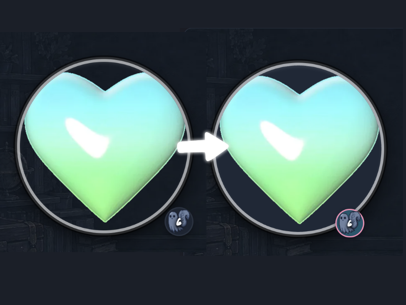

```css
/* Outer streak badge: blue surface and pink border. */
[data-profile="streak"] {
  background: #27576b ;
  border: 2px solid #ed91b7 ;
  border-radius: 50% ;
  box-shadow: 0 2px 6px rgba(18, 11, 32, 0.5) ;
}
```

The pink shape inside the badge is the filtered image itself. Changing the badge background changes the surface behind that artwork, not the pink pixels.

**Streak artwork**

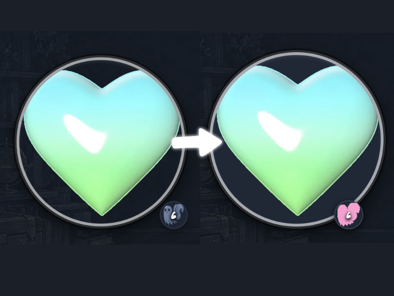

```css
/* Streak artwork only: pink recolor. */
[data-profile="streak-icon"] {
  filter: brightness(0) saturate(100%) invert(75%) sepia(24%)
    saturate(850%) hue-rotate(290deg) brightness(101%) contrast(91%) ;
}
```

This recolors whichever streak image LoreBary displays. It produces an approximate pink silhouette; use `filter: none` to retain the original colors and shading.

**Streak count**

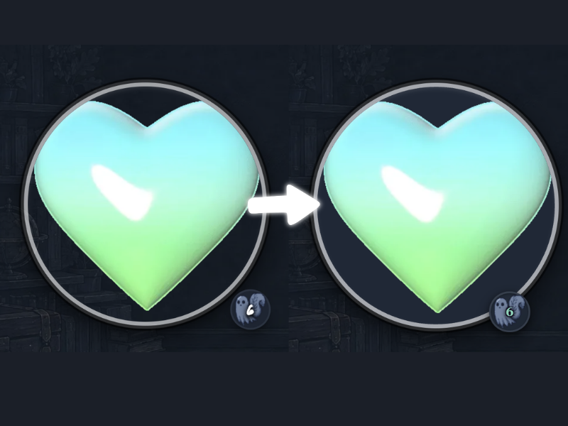

```css
/* Number over the artwork: mint with a dark outline. */
[data-profile="streak-count"] {
  color: #8fd8bb ;
  font-family: Georgia, serif !important;
  font-weight: 700 ;
  text-shadow:
    -1px -1px 0 #120b20,
     1px -1px 0 #120b20,
    -1px  1px 0 #120b20,
     1px  1px 0 #120b20 !important;
}
```

**Customization:** Change the badge’s background and border, the image filter, and the number’s color independently. The four shadows outline the number for contrast; use `text-shadow: none` to remove them.

They change its appearance, not its value.

**Badge List and Individual Badge Targets**

The identity badge list sits beneath the profile name and username. Style its container, badge artwork, or one badge independently.

| Selector | Targets |
| --- | --- |
| `[data-profile="badge-list"]` | Badge-list container |
| `[data-profile="author-badge"]` | Individual badge button |
| `[data-profile="author-badge"][data-badge="glorp"]` | Glorp badge button |

Every example below includes `[data-profile="identity-card"]` so it targets the header’s identity badges.

**Badge-list surface**

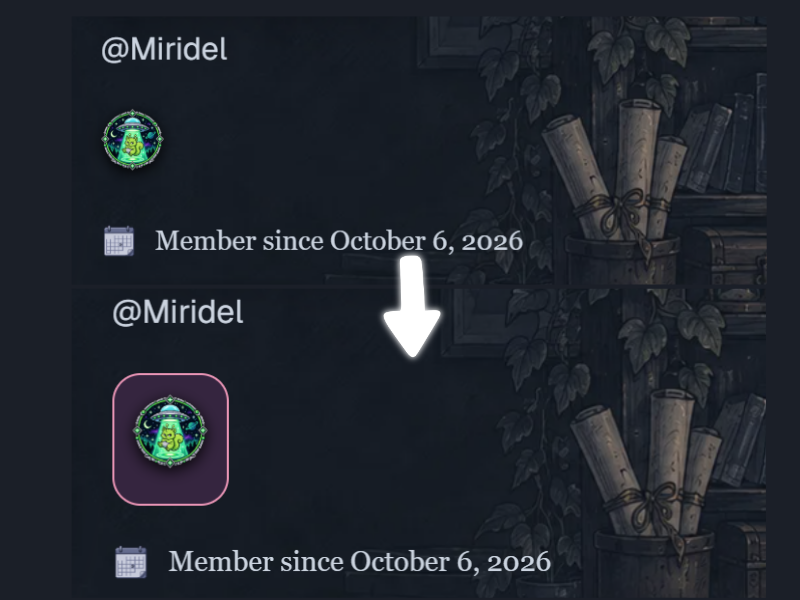

```css
/* Identity badge list: purple surface and pink border. */
[data-profile="badge-list"] {
  display: inline-block ;
  background: #352440 ;
  border: 1px solid #ed91b7 ;
  border-radius: 12px ;
  padding: 8px ;
}

/* Identity badge artwork: consistent size. */
[data-profile="badge-list"] [data-profile="author-badge"] img {
  width: 32px !important;
  height: 32px !important;
}
```

**One badge: Glorp**

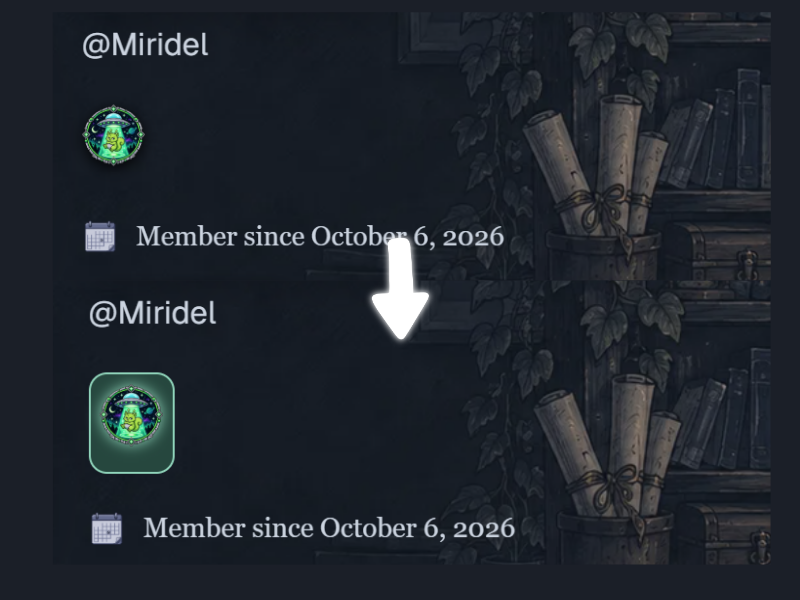

```css
/* Glorp button only: green tile behind the artwork. */
[data-badge="glorp"] {
  background: #24483e ;
  border: 1px solid #8fd8bb ;
  border-radius: 8px ;
  padding: 4px ;
}

/* Glorp artwork only: mint glow, preserving original colors. */
[data-badge="glorp"] img {
  filter: drop-shadow(0 0 3px #8fd8bb) ;
}
```

**Customization:** Change the list’s surface independently from the individual badge tile. Change `width` and `height` to resize artwork. The Glorp image filter adds a glow; it does not recolor the badge. Use `filter: none` to remove that glow.

**Target another badge**

Replace `glorp` in the individual-badge rules with a captured value below. Keep the spelling and capitalization exactly as shown.

| Badge | `data-badge` value |
| --- | --- |
| Glorp | `glorp` |
| Featured Creator | `featured` |
| Keeper of the Flame | `donatorMonthly` |
| Spark of Kindness | `donatorSingle` |
| Tripartite Trails | `rmq326` |
| Resident Ghost | `residentGhost` |
| The Vanguard | `eraVanguard` |
| The Breaker | `eraBreaker` |
| Academy Graduate | `academyGraduate` |
| The Painter | `title:theme` |
| Guest Emblem in the supplied capture | `event:37185a8d-4528-4de8-968b-b89a4c7b4295` |

These values were found in this layout. The event value identifies that captured emblem; other event badges can have different values.

**The same badge in different places**

Badge artwork can repeat across the page. Select its surrounding area before selecting the image to keep the effect local.

| Location | Selector for the Glorp image |
| --- | --- |
| Profile identity | `[data-profile="scope"] [data-profile="identity-card"] [data-profile="author-badge"][data-badge="glorp"] img` |
| Post author header | `[data-profile="scope"] [data-profile="post"] [data-profile="post-header"] img[src="/img/Badges/badge_glorp.webp"]` |
| Creation cards | `[data-profile="scope"] [data-profile="card"] img[src="/img/Badges/badge_glorp.webp"]` |

The post selector includes `post-header` so it targets the author badge rather than Glorp artwork in the post body. The card selector targets matching artwork inside creation cards.

**Dialog rows:** Followers/Following badges sit inside `[data-profile="modal-list"]` in the captured dialogs. Those dialogs were confirmed outside `[data-profile="scope"]`, so the profile-scoped examples above do not reach them. Keep dialog badge styling for the experimental dialog section.

A filename-only rule such as `img[src="/img/Badges/badge_glorp.webp"]` can affect every matching image within the CSS’s reach. The location selector is what separates these uses.

**Hide badges beside post author names**

```css
/* Hide the entire badge group beside post author names. */
[data-profile="post-author"] + div {
  display: none !important;
}
```

`+ div` selects the badge-group container immediately after the author link. Hiding the group removes all its badge images and any backgrounds, borders, and padding on elements inside it.

Use this exact tested selector, without adding `[data-profile="scope"]`. The scope-prefixed versions did not work in the user’s test; this version did. The supplied post layout places the badge group immediately after the author link.

This leaves profile identity badges and artwork in post bodies visible. Remove the rule to restore the post-header badge group.

## Stickers and Decorative Images

### Native Decorations and Layer Choice

The sticker examples already explain anchoring, positioning, and click-through layers. Native Bary images, chain backgrounds, and card vines are separate targets: use their component lessons rather than replacing the sticker’s positioning rules.

A filter on an image does not recolor a separate masked pseudo-element. If the same component already has a decorative replacement, edit that layer or select a different available anchor before adding another decoration. Keep user portraits and gallery images outside native-artwork filters.

## Main Profile Tabs and About Tabs

### Individual Main Tabs and Their Artwork

Use the shared tab styling first. Add a data-tab condition when only one tab should differ; use an exact native image path when only its artwork should change.

| Main tab | data-tab | Native heading icon |
| --- | --- | --- |
| About | about | /img/pixel/idcard.webp |
| Featured | featured | /img/pixel/star.webp |
| Favorites | favorites | /img/pixel/heart.webp |
| Lorebooks | lorebooks | /img/pixel/lorebooks.webp |
| Plugins | plugins | /img/pixel/plugins.webp |
| Scenarios | scenarios | /img/pixel/scenarios.webp |
| Personas | personas | /img/pixel/personas.webp |
| Characters | characters | /img/pixel/characters.webp |
| Prompts | prompts | /img/pixel/prompts.webp |
| Bundles | bundles | /img/pixel/templates.webp |
| Bindery | binderies | /img/pixel/bindery.webp |

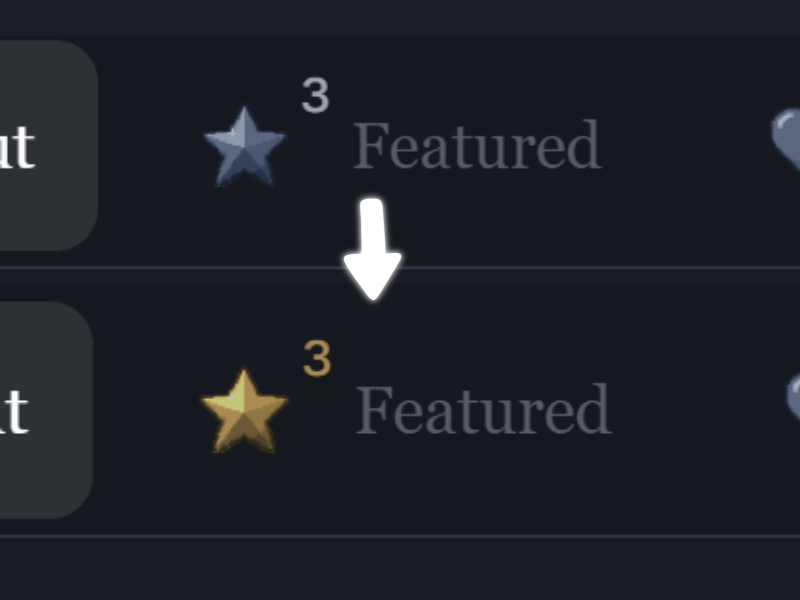

```css
/* Featured artwork and its existing counter. */
[data-tab="featured"] img[src="/img/pixel/star.webp"] {
  filter: sepia(1) saturate(2) brightness(1.15) ;
}

[data-tab="featured"] [data-profile="tab-count"] {
  color: var(--theme-accent, #d7ad63) !important;
  text-shadow: 0 1px 3px #20180e ;
}
```

The supplied Featured button has both aria-selected=true and data-active=true. Keep its counter’s absolute positioning inside the relative star wrapper. About has no counter; count styling only affects a tab that actually contains tab-count.

### Individual About Subtabs and Paper Artwork

The shared About-tab example provides the overall surface and selected state. To distinguish an individual subtab, add its captured accessible label.

| Subtab aria-label | Native foreground image |
| --- | --- |
| About me | /img/pixel/idcard.webp |
| Personal | /img/pixel/brain.webp |
| Roleplay | /img/pixel/script.webp |
| Relationships | /img/pixel/heart.webp |
| Links & socials | /img/pixel/chain_link.webp |

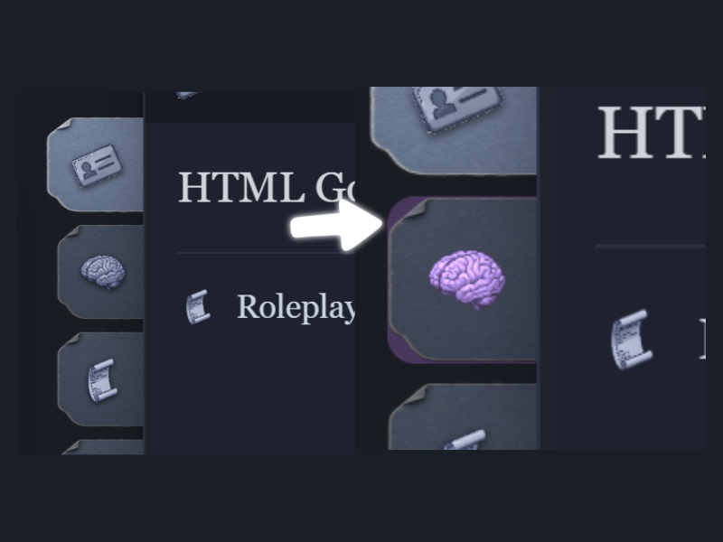

```css
/* Personal subtab only; the shared tab example supplies the other styling. */
[role="tab"][aria-label="Personal"] {
  background: #49365e ;
  border-color: #bd9bea ;
}
[role="tab"][aria-label="Personal"] img[src="/img/pixel/brain.webp"] {
  filter: sepia(1) saturate(2) hue-rotate(220deg) ;
}
[role=tablist][aria-label="About me sections"]
> button[aria-label="Personal"] > img[src$="/paper-tab.webp"] {
  display: none ;
}
```

The paper-tab.webp backing and foreground icon are separate images. Keep the existing paper-hide treatment when the button surface should show. As an optional paper treatment, remove your paper-hide rule before applying display:block, opacity:1, and a filter to the backing image itself. Opaque backing artwork can cover the button background.

The shared display panel has about-card and role=tabpanel in the captured navigation view. The About editing variant has about-card without that role. Keep hidden biography wrappers hidden when other subtabs are active.

### Main Navigation Scroll Arrows

The arrows scroll the main profile-tab strip. Each direction has its own accessible label.

| Target | Identifier |
| --- | --- |
| Left arrow button | `button[aria-label="Scroll Profile sections left"]` |
| Right arrow button | `button[aria-label="Scroll Profile sections right"]` |
| Native artwork for both | `/img/Icons/pixel_arrow.webp` |
| Enabled / disabled states | `:enabled` / `:disabled` |

**Left arrow**

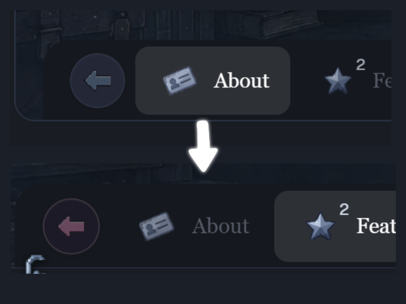

```css
/* Left arrow surface. */
button[aria-label="Scroll Profile sections left"] {
  background: #562b43 ;
  border: 1px solid #ed91b7 ;
  border-radius: 50% ;
  opacity: 1 ;
}

/* Left arrow artwork: pink tint. */
button[aria-label="Scroll Profile sections left"] img {
  filter: sepia(1) saturate(2) hue-rotate(285deg) ;
}

/* Enabled left arrow on hover. */
button[aria-label="Scroll Profile sections left"]:enabled:hover {
  background: #713953 ;
}

/* Disabled left arrow. */
button[aria-label="Scroll Profile sections left"]:disabled {
  background: #251c35 ;
  border-color: #806477 ;
  opacity: 0.35 ;
  cursor: default ;
}
```

**Right arrow**

```css
/* Right arrow surface. */
button[aria-label="Scroll Profile sections right"] {
  background: #24483e ;
  border: 1px solid #8fd8bb ;
  border-radius: 50% ;
  opacity: 1 ;
}

/* Right arrow artwork: mint tint. */
button[aria-label="Scroll Profile sections right"] img {
  filter: sepia(1) saturate(2) hue-rotate(95deg) ;
}

/* Enabled right arrow on hover. */
button[aria-label="Scroll Profile sections right"]:enabled:hover {
  background: #306052 ;
}

/* Disabled right arrow. */
button[aria-label="Scroll Profile sections right"]:disabled {
  background: #251c35 ;
  border-color: #647c72 ;
  opacity: 0.35 ;
  cursor: default ;
}
```

**Customization:** Change each surface and icon tint independently. Disabled `opacity` fades the whole arrow button, including its icon. Use `filter: none` to restore the artwork’s original colors.

Both directions use the same image; LoreBary flips the left image. Hover backgrounds apply only while enabled.

LoreBary controls the `disabled` attribute; CSS only changes its appearance. If an arrow is not rendered, its rules have no visible effect.

### About Chain Decorations

The two chains above the About card are separate decorative elements. Both use `/img/nav/break_link.webp` as a background image. This can also be applied to the 'content' page chains.

| Selector | Targets |
| --- | --- |
| `[data-profile="about-chain-left"]` | Left chain |
| `[data-profile="about-chain-right"]` | Right chain |

**Left chain**

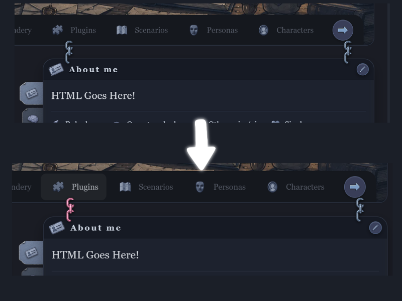

```css
/* Left chain: pink tint and independent placement. */
[data-profile="about-chain-left"] {
  top: -28px ;
  left: 32px ;
  width: 18px ;
  height: 36px ;
  background-size: 100% 100% ;
  filter: sepia(1) saturate(2) hue-rotate(285deg)
    drop-shadow(0 1px 2px rgba(0, 0, 0, 0.55)) !important;
}
```

**Right chain**

```css
/* Right chain: mint tint and independent placement. */
[data-profile="about-chain-right"] {
  top: -28px ;
  right: 32px ;
  width: 18px ;
  height: 36px ;
  background-size: 100% 100% ;
  filter: sepia(1) saturate(2) hue-rotate(95deg)
    drop-shadow(0 1px 2px rgba(0, 0, 0, 0.55)) !important;
}
```

- `top` moves a chain vertically; negative values extend it above its positioning container.
- `left` or `right` changes its distance from that container’s edge.
- `width` and `height` resize the background artwork. Keep a 1:2 ratio to preserve the captured proportions.
- `filter` tints the artwork; `drop-shadow` adds depth.
- `[data-profile=content-chain-x] ` for the content chains.

The example uses the captured dimensions and offsets, so the tint is the main visible change. For a shadow without tint, use `filter: drop-shadow(0 1px 2px rgba(0, 0, 0, 0.55)) !important;`.

**Hide either chain**

Use these alternatives instead of the styling rules when you want to remove the decorations.

```css
/* Hide the left chain. */
[data-profile="about-chain-left"] {
  display: none ;
}

/* Hide the right chain. */
[data-profile="about-chain-right"] {
  display: none ;
}
```

Keep either hiding rule on its own to remove only that chain.

## Moving and Framing a Status Block

### About Header, Biography, and Overview Details

Use the existing native-card framing example for the panel surface and placement. The following additions address its direct header, biography, overview metadata, and named edit control.

**Direct About header**

The direct-header signature confines these additions to the About card’s own header.

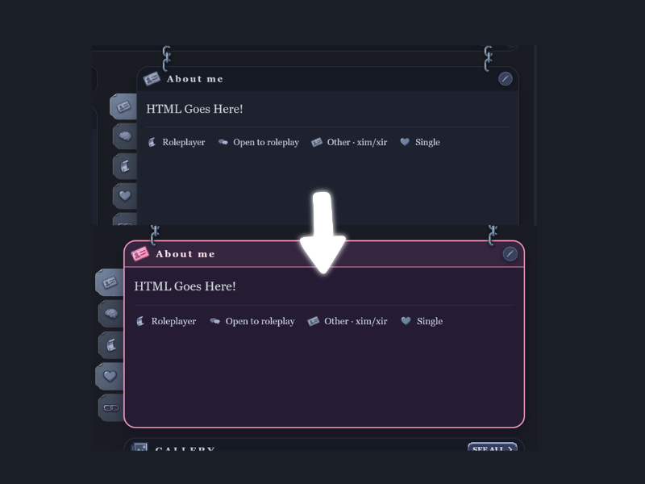

```css
/* Entire About panel, including its header. */
[data-profile="about"]
section:has([data-profile="about-card"]) {
  background: #251c35 ;
  border: 2px solid #ed91b7 !important;
  border-radius: 16px ;
  box-shadow: 0 6px 20px #120b2099 ;
}

/* Header background and dividing line. */
[data-profile="about"]
section:has([data-profile="about-card"]) > header.surface-header {
  background: #352440 ;
  border-bottom: 1px solid #ed91b7 ;
}

/* “About me” heading. */
[data-profile="about"]
section:has([data-profile="about-card"]) > header.surface-header h2 {
  color: #ffe4f0 ;
}

/* ID-card icon in the header only. */
[data-profile="about"]
section:has([data-profile="about-card"]) > header.surface-header img[src="/img/pixel/idcard.webp"] {
  filter: sepia(1) saturate(2) hue-rotate(285deg) ;
}
```

**Biography**

The text is bright pink so the change is easy to see. Custom HTML elements with their own colors may need separate selectors.

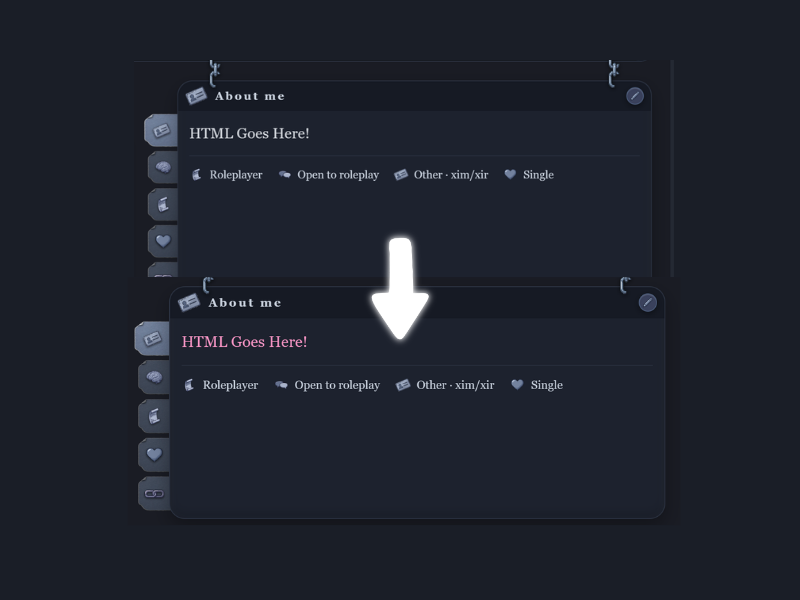

```css
/* Links inside the biography. */
[data-profile="scope"] [data-profile="about-bio"] a {
  color: #ed91b7 !important;
}

/* Biography text. */
[data-profile="scope"] [data-profile="about-bio"] .rich-text-content {
  color: #ff91c8 !important;
}
```

**Overview status row**

These rules target the Role, Availability, Gender/Identity, and Relationship summary shown beneath the biography. The captured Gender/Identity item uses `title="Gender"` and the native idcard artwork.

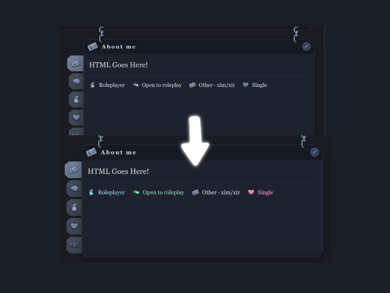

```css
/* Overview: Role text. */
[data-profile="about-card"]
[data-profile="additional-info"] > span[title="Role"] {
  color: #91cfed ;
}

/* Overview: Role icon. */
[data-profile="about-card"]
span[title="Role"] img {
  filter: sepia(1) saturate(2) hue-rotate(155deg) ;
}

/* Overview: Availability text. */
[data-profile="about-card"]
[data-profile="additional-info"] > span[title="Availability"] {
  color: #8fd8bb ;
}

/* Overview: Availability icon. */
[data-profile="about-card"]
span[title="Availability"] img {
  filter: sepia(1) saturate(2) hue-rotate(95deg) ;
}

/* Overview: Gender/Identity text. */
[data-profile="about-card"]
[data-profile="additional-info"] > span[title="Gender"] {
  color: #e0c7ff ;
}

/* Overview: Gender/Identity icon only. */
[data-profile="about-card"]
[data-profile="additional-info"] > span[title="Gender"]
img[src="/img/pixel/idcard.webp"] {
  filter: sepia(1) saturate(2) hue-rotate(220deg) ;
}

/* Overview: Relationship text. */
[data-profile="about-card"]
[data-profile="additional-info"] > span[title="Relationship"] {
  color: #ff91c8 ;
}

/* Overview: Relationship icon. */
[data-profile="about-card"]
span[title="Relationship"] img {
  filter: sepia(1) saturate(2) hue-rotate(285deg) ;
}
```

**Edit button**

Style the button surface and its pencil icon separately.

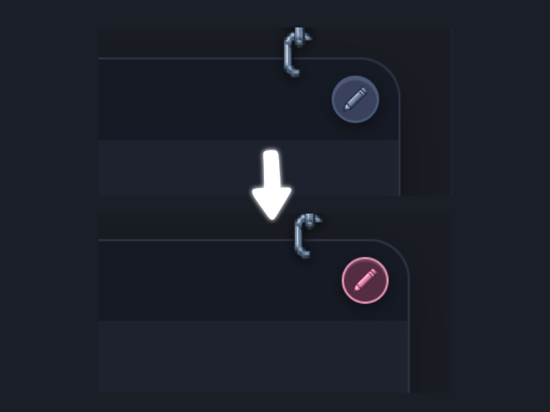

```css
/* Edit button background and border. */
[data-profile="about-edit"] {
  background: #562b43 ;
  border: 1px solid #ed91b7 ;
}

/* Edit button’s pencil icon. */
[data-profile="about-edit"]
img[src="/img/pixel/pencil.webp"] {
  filter: sepia(1) saturate(2) hue-rotate(285deg) ;
}
```

About-subtab styling is covered in [About Navigation and Content](#individual-about-subtabs-and-paper-artwork), including each tab’s surface, paper backing, icon, and selected state.

### About Information Cards

Give each About information group its own palette, including its heading, token backing, field labels, and values.

**About You**

The **About you** group uses `data-info="about"`. This is an inner information card, separate from the whole About area.

| Target | Selector |
| --- | --- |
| Group panel | `[data-profile="info-group"][data-info="about"]` |
| Heading | `[data-info="about"] h3` |
| Heading token | `[data-profile="info-group"][data-info="about"] > div > span` |
| Heading icon | `[data-info="about"] img[src="/img/sketch/user.webp"]` |
| Field labels / values | `[data-info="about"] dt` / `[data-info="about"] dd` |

**Group panel and heading**

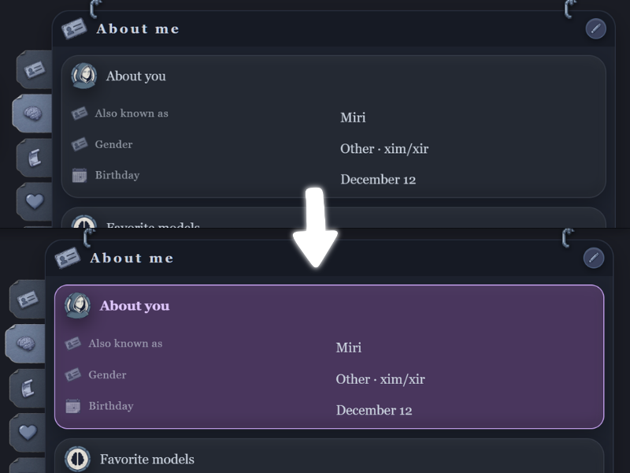

```css
/* About-you panel only. */
[data-info="about"] {
  background: #49365e ;
  border: 1px solid #bd9bea ;
  border-radius: 12px ;
}

/* About-you heading only. */
[data-info="about"] h3 {
  color: #e0c7ff ;
  font-weight: 700 ;
}
```

**Token background and heading icon**

The heading’s circular token is background artwork. The user icon is a separate image inside it. Tint the token with a translucent background layer, then style the icon independently.

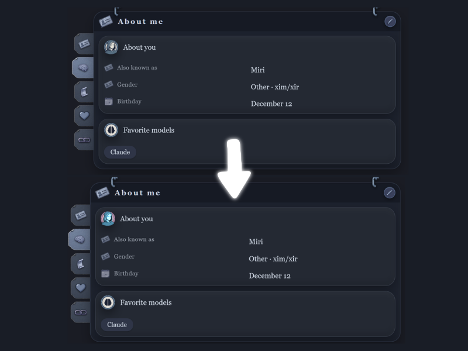

```css
/* Heading token: pink overlay on the native token artwork. */
[data-profile="info-group"][data-info="about"] > div > span {
  background-image:
    linear-gradient(rgba(237, 145, 183, 0.5), rgba(237, 145, 183, 0.5)),
    url("/img/sketch/token.webp") !important;
}

/* User heading icon only: blue tint. */
[data-info="about"] img[src="/img/sketch/user.webp"] {
  filter: sepia(1) saturate(2) hue-rotate(155deg) ;
}
```

The token rule follows the supplied group header’s structure. Changing its background layers does not tint the foreground icon.

**Field labels and values**

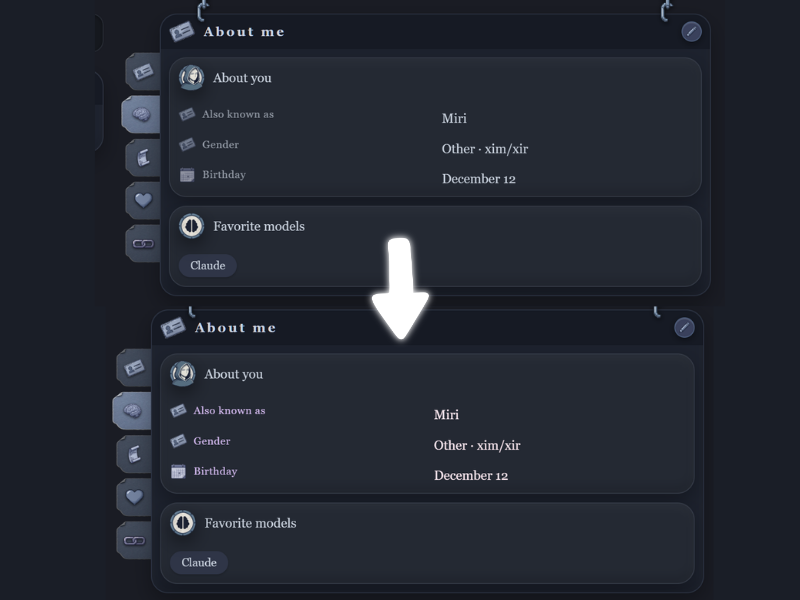

```css
/* About-you field labels: pale lavender. */
[data-info="about"] dt {
  color: #d2b8f0 ;
  opacity: 1 ;
}

/* About-you field values: pale pink. */
[data-info="about"] dd {
  color: #ffe9f2 ;
}
```

`dt` is the label, such as “Birthday”; `dd` is its value, such as “May 20.” These rules only affect fields inside this group.

**Field-label icons**

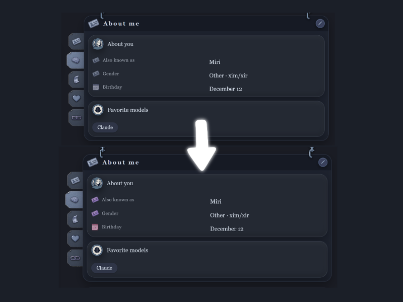

```css
/* Also-known-as and Gender label icons. */
[data-info="about"] dt img[src="/img/pixel/idcard.webp"] {
  filter: sepia(1) saturate(2) hue-rotate(220deg) ;
}

/* Birthday label icon only. */
[data-info="about"] dt img[src="/img/pixel/calendar.webp"] {
  filter: sepia(1) saturate(2) hue-rotate(285deg) ;
}
```

**Customization:** Change the panel, heading, token overlay, foreground icon, labels, and values independently. The overlay’s final number (`0.5`) controls its strength. Use `filter: none` to restore an image’s original colors.

These are raster image icons, so their artwork uses `filter`, while text uses `color`. The rules apply when the About-you group is rendered in the Personal subtab.

**Roleplay**

The Roleplay group uses `data-info="roleplay"`. Its heading icon is `/img/sketch/dialogue.webp`.

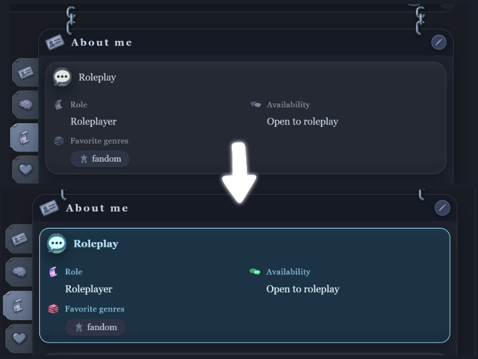

```css
/* Roleplay panel. */
[data-profile="info-group"][data-info="roleplay"] {
  background: #193446 ;
  border: 1px solid #91cfed ;
  border-radius: 12px ;
}

/* Roleplay heading text. */
[data-info="roleplay"] h3 {
  color: #b9e6ff ;
  font-weight: 700 ;
}

/* Heading token: mint overlay on native artwork. */
[data-profile="info-group"][data-info="roleplay"] > div > span {
  background-image:
    linear-gradient(rgba(143, 216, 187, 0.5), rgba(143, 216, 187, 0.5)),
    url("/img/sketch/token.webp") !important;
}

/* Dialogue heading image: blue tint. */
[data-info="roleplay"] img[src="/img/sketch/dialogue.webp"] {
  filter: sepia(1) saturate(2) hue-rotate(155deg) ;
}

/* Field labels: Role, Availability, and Favorite genres. */
[data-info="roleplay"] dt {
  color: #91cfed ;
  opacity: 1 ;
}

/* Field values. */
[data-info="roleplay"] dd {
  color: #e2f4ff ;
}

/* Role label icon. */
[data-info="roleplay"] dt img[src="/img/pixel/script.webp"] {
  filter: sepia(1) saturate(2) hue-rotate(220deg) ;
}

/* Availability label icon. */
[data-info="roleplay"] dt img[src="/img/pixel/dialogue.webp"] {
  filter: sepia(1) saturate(2) hue-rotate(95deg) ;
}

/* Favorite-genres label icon. */
[data-info="roleplay"] dt img[src="/img/pixel/lorebooks.webp"] {
  filter: sepia(1) saturate(2) hue-rotate(285deg) ;
}
```

**Customization:** The panel, heading, token, heading icon, labels, values, and each field icon have separate rules. Genre pills have separate rules below.

**Genre/tag pills**

The tags under Favorite genres are separate pills. Their own colors can override the surrounding field value color.

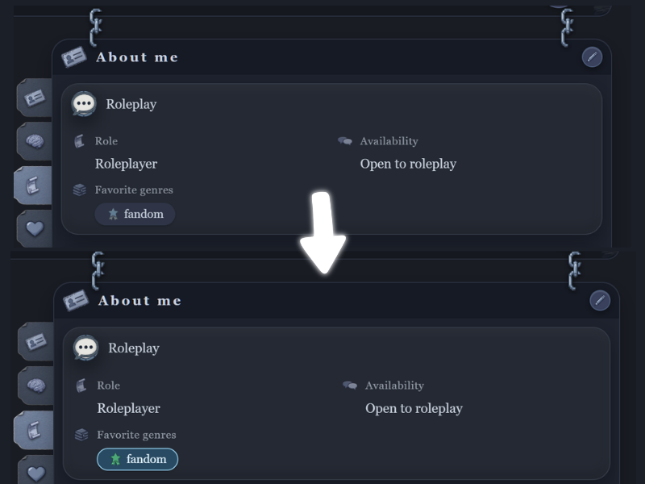

```css
/* Roleplay genre/tag pill surfaces. */
[data-info="roleplay"] .group\/pill {
  background: #254b63 ;
  border: 1px solid #91cfed ;
  border-radius: 999px ;
}

/* Text inside each genre/tag pill. */
[data-info="roleplay"] .group\/pill > span {
  color: #e2f4ff ;
}

/* Genre/tag pill hover surface. */
[data-info="roleplay"] .group\/pill:hover {
  background: #306078 ;
}

/* Tag image icons, when present. */
[data-info="roleplay"] .group\/pill img {
  filter: sepia(1) saturate(2) hue-rotate(95deg) ;
}
```

**Customization:** Change each pill’s surface and text separately. The backslash in `.group\/pill` escapes the slash in LoreBary’s class name; keep it in the selector. Text-only tags such as the captured “IDK” pill do not have an image icon to recolor.

**Preferences**

The Preferences group uses `data-info="preferences"`. Its heading uses a Font Awesome sliders icon, not an image.

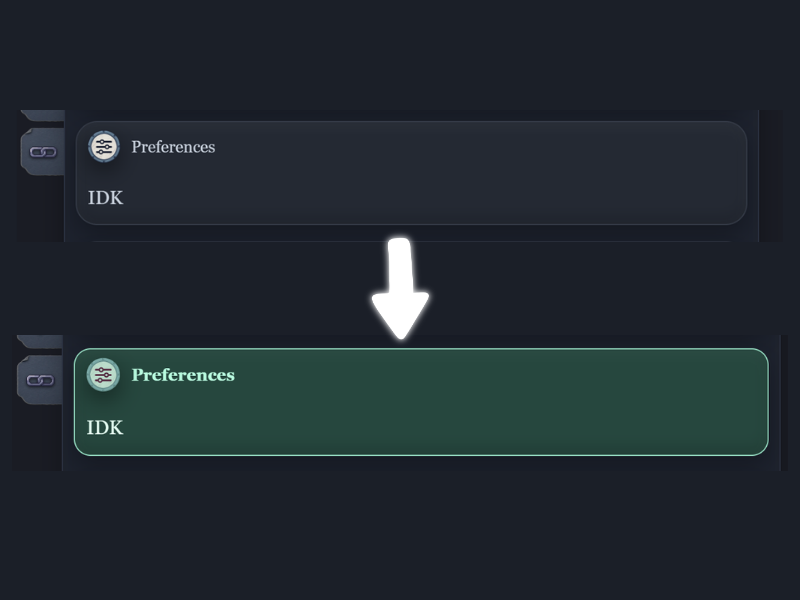

```css
/* Preferences panel. */
[data-profile="info-group"][data-info="preferences"] {
  background: #24483e ;
  border: 1px solid #8fd8bb ;
  border-radius: 12px ;
}

/* Preferences heading text. */
[data-info="preferences"] h3 {
  color: #b8ffe0 ;
  font-weight: 700 ;
}

/* Heading token: mint overlay on native artwork. */
[data-profile="info-group"][data-info="preferences"] > div > span {
  background-image:
    linear-gradient(rgba(143, 216, 187, 0.5), rgba(143, 216, 187, 0.5)),
    url("/img/sketch/token.webp") !important;
}

/* Sliders font icon only. */
[data-info="preferences"] .fa-sliders {
  color: #562b43 ;
}

/* Written preferences only. */
[data-info="preferences"] dd {
  color: #e5fff3 ;
}
```

**Customization:** Change the panel, heading, token background, sliders color, and written text independently.

Image artwork uses `filter`; Font Awesome icons and text use `color`. The token overlay’s `0.5` controls its strength. Use `filter: none` to restore an image’s original colors.

**Boundaries**

The Boundaries group uses `data-info="boundaries"`. Its heading icon is the Font Awesome lock.

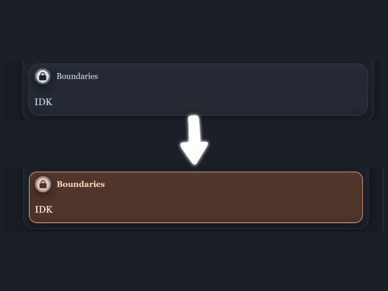

```css
/* Boundaries panel. */
[data-profile="info-group"][data-info="boundaries"] {
  background: #513329 ;
  border: 1px solid #edb091 ;
  border-radius: 12px ;
}

/* Heading text. */
[data-info="boundaries"] h3 {
  color: #ffd0b8 ;
  font-weight: 700 ;
}

/* Token background: peach overlay. */
[data-profile="info-group"][data-info="boundaries"] > div > span {
  background-image:
    linear-gradient(rgba(237, 176, 145, 0.5), rgba(237, 176, 145, 0.5)),
    url("/img/sketch/token.webp") !important;
}

/* Lock font icon. */
[data-info="boundaries"] .fa-lock {
  color: #513329 ;
}

/* Written boundaries. */
[data-info="boundaries"] dd {
  color: #ffeadf ;
}
```

**Customization:** Change the panel, heading, token overlay, lock color, and written text independently.

**Relationships**

The Relationships group uses `data-info="relationships"`. Its heading uses a Font Awesome heart; field labels use heart images.

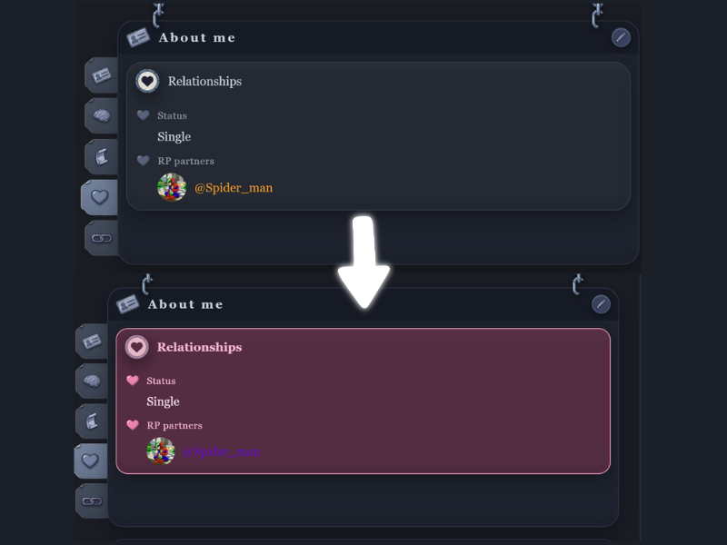

```css
/* Relationships panel. */
[data-profile="info-group"][data-info="relationships"] {
  background: #562b43 ;
  border: 1px solid #ed91b7 ;
  border-radius: 12px ;
}

/* Heading text. */
[data-info="relationships"] h3 {
  color: #ffb8d6 ;
  font-weight: 700 ;
}

/* Token background: pink overlay. */
[data-profile="info-group"][data-info="relationships"] > div > span {
  background-image:
    linear-gradient(rgba(237, 145, 183, 0.5), rgba(237, 145, 183, 0.5)),
    url("/img/sketch/token.webp") !important;
}

/* Heading heart: font icon. */
[data-info="relationships"] .fa-heart {
  color: #562b43 ;
}

/* Status and RP-partners field labels. */
[data-info="relationships"] dt {
  color: #ffb8d6 ;
  opacity: 1 ;
}

/* Field values. */
[data-info="relationships"] dd {
  color: #ffe9f2 ;
}

/* Field-label hearts: image icons. */
[data-info="relationships"] dt img[src="/img/pixel/heart.webp"] {
  filter: sepia(1) saturate(2) hue-rotate(285deg) ;
}
```

**RP partner links and avatars**

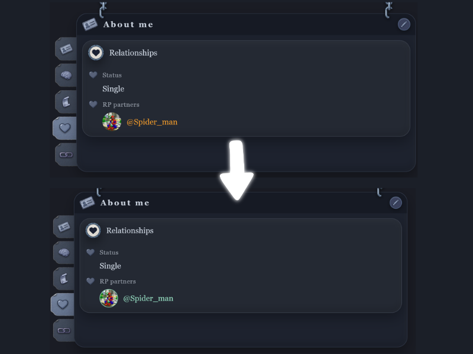

```css
/* RP partner links. */
[data-info="relationships"] dd a {
  color: #8fd8bb ;
}

/* RP partner links on hover. */
[data-info="relationships"] dd a:hover {
  color: #b8ffe0 ;
}

/* Partner portrait images only. */
[data-info="relationships"] dd a img {
  border: 1px solid #8fd8bb ;
  border-radius: 50% ;
  object-fit: cover ;
}
```

**Customization:** Change the label and value colors separately from the partner links and portrait borders.

Font Awesome heading icons use `color`; raster field icons use `filter`. The token overlay’s `0.5` controls its strength. These rules style existing partner entries without changing their links or creating missing entries.

**Links & Socials**

The visible heading is **Links & socials**, but the group’s exact `data-info` value is **socials**. Its heading uses a Font Awesome link icon; the captured Website field uses a chain-link image.

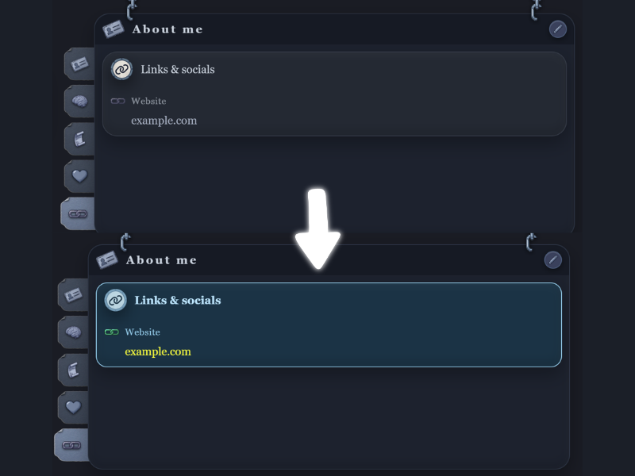

```css
/* Links & socials panel. */
[data-profile="info-group"][data-info="socials"] {
  background: #193446 ;
  border: 1px solid #91cfed ;
  border-radius: 12px ;
}

/* Heading text. */
[data-info="socials"] h3 {
  color: #b9e6ff ;
  font-weight: 700 ;
}

/* Heading token: blue overlay on native artwork. */
[data-profile="info-group"][data-info="socials"] > div > span {
  background-image:
    linear-gradient(rgba(145, 207, 237, 0.5), rgba(145, 207, 237, 0.5)),
    url("/img/sketch/token.webp") !important;
}

/* Heading link: font icon. */
[data-info="socials"] .fa-link {
  color: #193446 ;
}

/* Field labels, such as Website. */
[data-info="socials"] dt {
  color: #91cfed ;
  opacity: 1 ;
}

/* Field values. */
[data-info="socials"] dd {
  color: #e2f4ff ;
}

/* Website field’s chain-link image only. */
[data-info="socials"] dt img[src="/img/pixel/chain_link.webp"] {
  filter: sepia(1) saturate(2) hue-rotate(95deg) ;
}
```

**Website and social links**

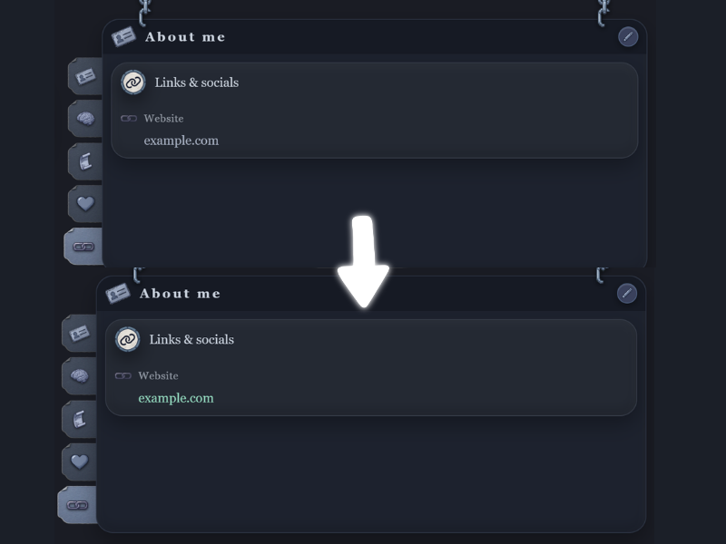

```css
/* Links inside field values. */
[data-info="socials"] dd a {
  color: #8fd8bb ;
  text-decoration: underline ;
  text-decoration-color: #8fd8bb ;
  text-underline-offset: 4px ;
}

/* Link hover color. */
[data-info="socials"] dd a:hover {
  color: #b8ffe0 ;
  text-decoration-color: #b8ffe0 ;
}
```

**Customization:** Change the panel, heading, token overlay, heading icon, labels, values, field icon, and links independently. Font icons use `color`; image artwork uses `filter`. Use `filter: none` for the chain-link image’s original colors.

The link rules apply to existing Website and social anchors inside this group. A separate link color overrides the surrounding `dd` value color.

**Favorite models: information-card addition**

**Updated card CSS**

Favorite models uses the captured `data-info="models"` target.


```css
/* Favorite models card. */
[data-profile="about"]
[data-profile="info-group"][data-info="models"] {
  background: #493f25 ;
  border: 1px solid #e3ca86 ;
  border-radius: 12px ;
  color: #fff3ce ;
}
```

**Captured component notes**

**Model pills need their own styling.** The card-surface rule above does not recolor the pills. The optional code below styles the pill surface, border, text, and hover, along with the heading and its brain icon.

| Part | Target within the models card | Evidence |
| --- | --- | --- |
| Card | `[data-profile="info-group"][data-info="models"]` | Exact named hook |
| Heading | `> div > h3` | Favorite models; title attribute is explanatory text |
| Token backing | `> div > span` | Inline background-image using `/img/sketch/token.webp` |
| Heading icon | `> div > span > i.fa-brain` | Font Awesome glyph, not an image |
| Model pills | `dd > span > span[translate="no"]` | Nested pill span; captured label Claude |
| Pill label | `dd > span > span[translate="no"] > span` | Nested text span |

Card color is inherited only where descendants have no own color. The captured model pills explicitly set their surface and text colors, so the card rule alone does not recolor them. Optional matching heading/icon/pill styling:


```css
[data-profile="about"]
[data-profile="info-group"][data-info="models"] > div > h3 {
  color: #fff3ce ;
}

[data-profile="about"]
[data-profile="info-group"][data-info="models"] > div > span > i.fa-brain {
  color: #493f25 ;
}

[data-profile="about"]
[data-profile="info-group"][data-info="models"] dd > span > span[translate="no"] {
  background: #61522e ;
  border-color: #e3ca86 ;
  color: #fff3ce ;
}

[data-profile="about"]
[data-profile="info-group"][data-info="models"] dd > span > span[translate="no"]:hover {
  background: #756238 ;
}
```

**Small-screen behavior — native max-md classes:** The captured model-pill row stops wrapping and scrolls horizontally below the compiled md breakpoint. Keep those classes and the hidden dt label intact. The capture adds no new native image path: token.webp is reused, and the brain is a font icon.

### About Me Editor

Style the About Me editing controls through their captured toolbar class, named textbox, and footer structure.

**What changes**

| Component | Captured difference | Documentation update |
| --- | --- | --- |
| About card | Has `data-profile="about-card"` but no `role="tabpanel"` in this editing view | Keep role-qualified navigation selectors for their captured display view. Add a separate editing-view target. |
| Toolbar | `.rich-text-editor-toolbar`, without `data-profile="composer-toolbar"` | Use the About card plus the class for this variant. |
| Editable content | `contenteditable="true"`, `role="textbox"`, `aria-label="Tell us about yourself..."`; no `composer-editor` | Use the exact textbox signature inside the About card. |
| Formatting controls | Reuses `composer-btn`, `data-btn`, and `icon` hooks | A rule targeting only composer-toolbar misses these. A broad composer-btn rule can affect both editors. |
| Insert Link | `composer-btn`, `data-btn="insert-link"`; glyph `data-icon="link"` | Add the captured button and glyph mapping. |
| Insert Image | Exact `aria-label="Insert Image"`; no composer-btn hook | Target the button by its label. Its glyph is `data-icon="upload"`. |
| Text-color bar | `span[data-btn="text-color-bar"]`, with inline background color | Document separately from the font glyph. Recoloring it can misrepresent the selected author text color. |
| Character counter | Direct `about-card > p`, containing `span.tabular-nums`; captured `15/1000` | Style the counter without changing its content or treating this limit as universal. |
| Footer | Direct About-card div containing Save and Cancel buttons | These are ordinary buttons, not composer-submit or pixel-plate buttons. |

**Narrow editing-view targets**


```css
/* Only the captured About card containing this editable textbox. */
[data-profile="about-card"]:has(
  [contenteditable="true"][role="textbox"][aria-label="Tell us about yourself..."]
) {
  background: #202332 ;
  color: #eee7f6 ;
}

[data-profile="about-card"]
  > .relative > .rich-text-editor-toolbar {
  background: #30263e ;
  border-color: #9675ae ;
}

[data-profile="about-card"]
  .rich-text-editor-toolbar button {
  background: #40304f ;
  border-color: #9675ae ;
  color: #eee7f6 ;
}

[data-profile="about-card"]
  .rich-text-editor-toolbar [data-profile="icon"] {
  color: inherit ;
}

[data-profile="about-card"]
  .rich-text-editor-toolbar button[aria-pressed="true"] {
  background: #715087 ;
  border-color: #d8b5ec ;
}

[data-profile="about-card"]
  [contenteditable="true"][role="textbox"][aria-label="Tell us about yourself..."] {
  background: #202332 ;
  border-color: #9675ae ;
  color: #eee7f6 ;
  caret-color: #f4c3ec ;
}

[data-profile="about-card"]:has(
  [contenteditable="true"][role="textbox"][aria-label="Tell us about yourself..."]
) > p {
  color: #bfa9ce ;
}

/* Captured footer signature: Save contains a direct check glyph. */
[data-profile="about-card"]
  > div:has(> button > i[data-profile="icon"][data-icon="check"]) {
  border-color: #9675ae ;
}

[data-profile="about-card"]
  > div:has(> button > i[data-profile="icon"][data-icon="check"]) > button {
  background: #40304f ;
  border-color: #9675ae ;
  color: #eee7f6 ;
}
```

These rules assume Profile-scope ancestry. The fragment does not include its ancestors, so it cannot establish whether that ancestor exists. This capture is not evidence of another outside-Profile exception. Keep the agreed Experimental dialog exceptions separate.

**Exact control references**

Within `[data-profile="scope"] [data-profile="about-card"] .rich-text-editor-toolbar`:

| Control | Target | Glyph |
| --- | --- | --- |
| Insert Link | `[data-profile="composer-btn"][data-btn="insert-link"]` | `[data-profile="icon"][data-icon="link"]` |
| Insert Image | `button[aria-label="Insert Image"]` | `[data-profile="icon"][data-icon="upload"]` |
| Insert | `button[aria-label="Insert"]` | `[data-profile="icon"][data-icon="plus"]` |
| Text background | `button[aria-label="Text background"]` | `[data-profile="icon"][data-icon="highlighter"]` |
| Edit as HTML | `button[aria-label="Edit as HTML"]` | `[data-profile="icon"][data-icon="code"]` |
| Text Color | `[data-profile="composer-btn"][data-btn="text-color"]` | `[data-profile="icon"][data-icon="font"]` |
| Text-color indicator | `[data-btn="text-color"] > span[data-btn="text-color-bar"]` | CSS background, not an image |

Save can be selected through the captured check glyph:

```css
[data-profile="about-card"]
  > div > button:has(> i[data-profile="icon"][data-icon="check"]) {
  background: #715087 ;
}
```

Cancel has no named hook or aria-label in this capture. Shared footer-button styling is supported. An independent Cancel rule would rely on the captured two-button order and should be documented as structural, not a stable named selector. CSS cannot select a button by visible text alone.

The Edit profile details control also lacks `about-edit` and a dedicated aria-label in this capture. Its observed structural target is:

```css
[data-profile="about-card"]
  > div:has(> button > span > img[src="/img/pixel/idcard.webp"]) > button {
  background: #30263e ;
  border-radius: 10px ;
}
```

This selects the observed About-card action structure. Keep it distinct from the existing named About edit control. The surrounding section header also uses idcard.webp, so a filename-only rule would affect both images.

**Captured states and limits**

- Bold, Italic, Underline, Heading, Bullet List, and Numbered List are explicitly unpressed in this capture. Normal and alignment buttons lack aria-pressed; absence does not mean false.
- Insert has aria-haspopup="menu" and aria-expanded="false". Menu contents are not captured.
- Edit as HTML is unpressed. This capture establishes the rich-text editing view, not the HTML-mode textarea.
- The textbox holds text and has data-placeholder on that same element. Empty-state markup and the actual placeholder rendering mechanism remain pending. Do not copy the composer-editor placeholder selector to this editor unchanged.
- The textbox’s inline limits are min-height:100px and max-height:300px, with vertical scrolling and horizontal overflow hidden. Toolbar controls use clamp sizing and --content-ui-scale. Preserve those behaviors unless demonstrating an intentional change.
- Insert Image is followed by a hidden file input accepting JPEG, PNG, WEBP, and GIF. Keep native upload behavior intact.
- No new native image path is introduced. idcard.webp is reused; the toolbar and Save artwork are font icons.
- Keep the generated `_r_ue_-panel` ID out of reusable selectors.
- Editor-rich-text rules currently scoped only to composer-editor do not cover this About textbox. Extend them explicitly when documenting About editing; do not assume every editor shares the published post-decoration hooks.

## Write a Post

### Additional Composer Placement, Artwork, and Placeholder Targets

The existing composer example supplies the shared surfaces and text colors. These additions distinguish its captured placement, native header artwork, avatar, and same-element placeholder.

**Outer Card Through the Observed Structure**

The captured composer sits directly inside `feed-list`. Its `.surface-post` shell contains an inner div, which holds `composer-header`.


```css
/* Outer composer card in the captured feed layout. */
[data-profile="feed-list"]
> .surface-post:has(> div > [data-profile="composer-header"]) {
  background: #193446 ;
  border: 1px solid #91cfed !important;
  border-radius: 14px ;
  box-shadow: 0 4px 12px rgba(0, 0, 0, 0.35) ;
}
```

**Customization:** Change the shell’s background, border, rounding, and shadow independently. Header, body, toolbar, editor, and footer have their own surfaces, so their backgrounds can cover parts of this shell.

`:has(> div > [data-profile="composer-header"])` identifies the composer by its inner structure. This keeps the rule separate from ordinary posts that also use `.surface-post`.

**Captured placement:** The existing composer-slot example uses `[data-profile="composer-slot"] > .surface-post`. That targets a composer inside its dedicated slot. This placement variant covers the supplied feed layout, where the shell appears directly beneath `feed-list`.

Use the placement signature matching your composer. If you are also styling Poke Bary, keep enough overflow space for its artwork above the shell.

**Header Artwork and Status Text**

The header surface, title, native writing icon, and captured status text have separate targets.

```css
/* Write a Post title. */
[data-profile="composer-header"] > h3 {
  color: #e0c7ff ;
  text-shadow: 0 1px 3px #24182f ;
}

/* Native writing artwork. */
[data-profile="composer-header"]
> img[src="/img/pixel/lab-write.webp"] {
  filter: sepia(1) saturate(2) hue-rotate(220deg) ;
}

/* Captured Followers only status text. */
[data-profile="composer-header"] > span {
  color: #ffb8d6 ;
}
```

**Customization:** Adjust the native header icon and status text separately from the existing header treatment. Direct-child selectors follow the captured layout.

The writing icon is inside the header. The Poke Bary decoration sits outside it and remains a separate target.

The supplied header contains a Followers only status span. Another supplied layout places privacy and notification buttons here instead; the span rule applies only where that direct status element exists. Individual controls receive their own examples later.

**Composer Avatar**

The body wraps a row containing the avatar image and editor column. The avatar has no dedicated composer-avatar hook in the captured markup.


```css
/* Avatar border and shadow. */
[data-profile="composer-body"] > div > img {
  border: 2px solid #8fd8bb ;
  border-radius: 50% ;
  box-shadow: 0 0 6px rgba(143, 216, 187, 0.35) ;
  box-sizing: border-box ;
}

/* Avatar image crop. */
[data-profile="composer-body"] > div > img {
  object-fit: cover ;
  object-position: center ;
}
```

**Customization:** Adjust the avatar border, shadow, and crop.

`> div > img` follows body → row → avatar image. It avoids images nested deeper inside the editor or formatting controls, and works without matching a username or uploaded image ID. The captured default avatar uses `/img/bary/default-avatar.webp`; the structural selector also accommodates an uploaded portrait.

The toolbar and editor have their own backgrounds, so changing the body surface does not necessarily recolor those inner areas.

**Same-Element Placeholder**

The captured editable div carries both `composer-editor` and `data-placeholder`. Target the placeholder pseudo-element on that same element.

```css
/* Placeholder on the editor itself. */
[data-profile="composer-editor"][data-placeholder]::before {
  color: #91cfed ;
  opacity: 1 ;
  text-shadow: none ;
}
```

**Customization:** Adjust the placeholder color and shadow independently from typed text. Explicit colors applied to rich-text spans can override inherited base text color.

There is no space between `[data-profile="composer-editor"]` and `[data-placeholder]`: both attributes belong to the same captured div. This same-element form applies when the attribute is on the editable div itself.

The contributor’s existing descendant-placeholder example remains useful where the placeholder belongs to an inner element. Keep the placement explanation beside this additional same-element example.

### Individual Formatting Buttons and Font Icons

The shared toolbar example supplies its general button treatment. Use the additional hooks below to distinguish individual buttons and font glyphs, including controls without composer-btn.

Some buttons sit inside small wrappers. Toolbar gap controls spacing between its direct children, including those wrappers. Keep the native overflow so popovers can extend beyond the strip.

**Individual Formatting Buttons**

Captured formatting buttons use `data-profile="composer-btn"` and a separate `data-btn` value.

```css
/* Bold only. */
[data-btn="bold"] {
  background: #49365e ;
  border-color: #bd9bea ;
  color: #e0c7ff ;
}

/* Attach only: surface. */
[data-btn="attach"] {
  background: #193446 ;
  border-color: #91cfed ;
}
```

**Customization:** Use the shared rule for a consistent base, then change `bold` or `attach` to a captured value below to style one control. Individual examples follow the shared rules and take priority where specificity is equal.

| Control | Exact data-btn value |
| --- | --- |
| Bold | `bold` |
| Italic | `italic` |
| Underline | `underline` |
| Heading | `heading` |
| Normal | `normal` |
| Bullet List | `bullet-list` |
| Numbered List | `numbered-list` |
| Left Align | `left-align` |
| Center | `center` |
| Right Align | `right-align` |
| Justify | `justify` |
| Text Color | `text-color` |
| Attach | `attach` |
| GIFs & Stickers | `gifs-stickers` |

Button color recolors font icons through inheritance unless an icon has its own explicit color. Raster images need their own artwork rule; changing color does not tint them.

`text-color-bar` belongs to the color indicator inside Text Color, not a separate formatting button. Its appearance represents the selected text color, so leave it separate from the button theme.

Insert, Text background, and Edit as HTML lack composer-btn and data-btn in this layout. The shared base and hover rules include their exact aria-label values so all captured controls receive the same treatment. Their individual examples follow later, along with pressed-state examples.

**Font-Icon Targets**

Toolbar icons are font glyphs on `[data-profile="icon"]` elements. Use color rather than an image filter.


```css
/* All captured toolbar font icons. */
[data-profile="composer-toolbar"] [data-profile="icon"] {
  color: #b8ffe0 ;
  text-shadow: 0 0 4px rgba(143, 216, 187, 0.35) ;
}

/* Bold glyph only. */
[data-profile="composer-toolbar"] [data-profile="icon"][data-icon="bold"] {
  color: #e0c7ff ;
}

/* Attach glyph only. */
[data-profile="composer-toolbar"] [data-profile="icon"][data-icon="paperclip"] {
  color: #91cfed ;
}
```

**Customization:** Change glyph color and glow independently from the button surface. Explicit icon colors override inherited button colors, including hover and pressed colors. For icons to follow the button instead, use `color: inherit !important` in the shared icon rule and remove individual icon-color rules.

| Control | Exact data-icon value |
| --- | --- |
| Bold | `bold` |
| Italic | `italic` |
| Underline | `underline` |
| Heading | `heading` |
| Normal | `paragraph` |
| Bullet List | `list-ul` |
| Numbered List | `list-ol` |
| Left Align | `align-left` |
| Center | `align-center` |
| Right Align | `align-right` |
| Justify | `align-justify` |
| Insert | `plus` |
| Text Color | `font` |
| Text background | `highlighter` |
| Attach | `paperclip` |
| GIFs & Stickers | `smile` |
| Edit as HTML | `code` |

**Pressed and Unpressed Controls**

Some captured toolbar buttons expose `aria-pressed="false"`. These rules distinguish that state from true when LoreBary updates the attribute.

```css
/* Controls explicitly marked unpressed. */
[data-profile="composer-toolbar"] button[aria-pressed="false"] {
  background: #24483e ;
  border-color: #8fd8bb ;
  color: #b8ffe0 ;
}

/* Font glyph inside a pressed control. */
[data-profile="composer-toolbar"] button[aria-pressed="true"]
[data-profile="icon"] {
  color: #ffd580 ;
  text-shadow: 0 0 4px rgba(255, 213, 128, 0.35) ;
}
```

**Customization:** Change pressed and unpressed colors independently. Place these after shared button, individual-button, hover, and icon rules. Earlier rules with greater specificity can still win; edit conflicting theme rules if needed.

The supplied toolbar exposes aria-pressed on Bold, Italic, Underline, Heading, Bullet List, Numbered List, Insert, GIFs & Stickers, and Edit as HTML. Other captured buttons lack it and match neither state rule.

An absent attribute does not equal false. These selectors style attributes; they do not set a formatting state. `aria-expanded` describes a popup’s open state and is separate from aria-pressed. The supplied toolbar capture shows false values, so true-state rules are conditional examples.

### Privacy Labels and Both Notify Followers Layouts

Style privacy separately from notification state. Notify supports both its header button and footer checkbox representation.
**Privacy Controls**

Style the Public and Private toggle in the composer footer. The Public button contains the globe artwork. The Private button contains the lock artwork and carries `aria-pressed`.


```css
/* Shared footer privacy button surface. */
[data-profile=composer-footer]
button:is(
  :has(> img[src$="/universes.webp"]),
  [aria-pressed]:has(> img[src$="/lock.webp"])
) {
  background: #24483e !important;
  border: 1px solid #8fd8bb !important;
  border-radius: 999px !important;
  color: #b8ffe0;
}

/* Private button surface. */
[data-profile=composer-footer]
button[aria-pressed]:has(> img[src$="/lock.webp"]) {
  background: #49365e !important;
  border-color: #bd9bea !important;
  color: #e0c7ff !important;
}

/* Public globe. */
[data-profile=composer-footer]
button > img[src$="/universes.webp"] {
  filter: sepia(1) saturate(2) hue-rotate(95deg);
}

/* Private lock. */
[data-profile=composer-footer]
button[aria-pressed] > img[src$="/lock.webp"] {
  filter: sepia(1) saturate(2) hue-rotate(220deg);
}
```

**Customization.** Edit the Public and Private surfaces separately. Adjust each `filter` to recolor its icon. The Notify Followers examples below cover that control’s header and footer placements.

**Notify Followers: Header Button and Footer Switch**

**Layout variants; screen-width trigger unconfirmed.**

Notify followers has two captured representations. The existing footer-switch example provides its base track and thumb. Here, the header uses a pill-shaped button whose state is `aria-pressed`; the footer uses a checkbox switch whose state is `:checked`. Each rule applies only to its matching layout.

| Representation | Off state | On state |
| --- | --- | --- |
| Header button | `button[aria-pressed="false"]` | `button[aria-pressed="true"]` |
| Footer switch | `input:not(:checked) + div` | `input:checked + div` |

The footer label contains a visually hidden checkbox followed immediately by a div. That div draws the track; its ::after pseudo-element draws the thumb. The button rule cannot style this switch, even though both controls are named Notify followers.

| Part | Captured target |
| --- | --- |
| State and accessible control | `input[type="checkbox"][aria-label="Notify followers"]` |
| Visual track | That input followed by `+ div` |
| Thumb | The track’s `::after` |


```css
/* Notify followers when rendered as a header button. */
[data-profile="composer-header"] button[aria-label="Notify followers"] {
  background: #193446 ;
  border: 1px solid #91cfed ;
  border-radius: 999px ;
  color: #b9e6ff ;
}

/* Header button: notifications enabled (pressed). */
[data-profile="composer-header"]
button[aria-label="Notify followers"][aria-pressed="true"] {
  background: #24483e ;
  border-color: #8fd8bb ;
  color: #b8ffe0 ;
}

/* Checked thumb. */
[data-profile="composer-footer"]
input[type="checkbox"][aria-label="Notify followers"]:checked + div::after {
  background: #b8ffe0 ;
}

/* Keyboard-focus outline on the visible track. */
[data-profile="composer-footer"]
input[type="checkbox"][aria-label="Notify followers"]:focus-visible + div {
  outline: 2px solid #ffd580 ;
  outline-offset: 2px ;
}

/* Text row containing the captured switch label. */
[data-profile="composer-footer"]
> div:has(> label > input[type="checkbox"][aria-label="Notify followers"]) {
  color: #b9e6ff ;
}
```

**Customization:** The header button and footer track share blue off-state and green on-state palettes. Change the button text separately from the switch thumb. The final rule recolors the Notify followers text in its captured footer row.

`+ div` means the immediately following sibling, not a child of the input. `:checked` reads the live checkbox state; it does not require a checked attribute in copied HTML.

Keep the native input, label, track dimensions, and thumb movement.

### Footer Text, Submit Artwork, and Disabled State

Style the footer row and Post button, including the backing plate and native disabled appearance.

**Footer and Submit Button**

The footer contains the terms paragraph, privacy/notification controls, and Submit button.

```css
/* Terms paragraph. */
[data-profile="composer-footer"] > p {
  color: #91cfed ;
}

/* Terms and Community Guidelines links. */
[data-profile="composer-footer"] > p > a {
  color: #b8ffe0 ;
  text-decoration-color: #8fd8bb ;
}

/* Terms-link hover. */
[data-profile="composer-footer"] > p > a:hover {
  color: #ffd580 ;
}

/* Submit-button shell. */
[data-profile="composer-footer"] [data-profile="composer-submit"] {
  background: #193446 ;
  border: 1px solid #8fd8bb ;
  border-radius: 10px ;
}

/* Foreground Post label. */
[data-profile="composer-submit"] > span {
  color: #b8ffe0 ;
  text-shadow: 0 1px 3px #10251e ;
}

/* Enabled Submit hover: label. */
[data-profile="composer-submit"]:enabled:hover > span {
  color: #ffd580 ;
}

```

**Customization:** Change the footer surface, spacing, terms text, links, button shell, and label separately.

The image plate covers most of the button background. Change that image’s filter in the next example to alter the visible plate. The border-radius rule affects the shell; it does not reshape the native plate artwork.

**Submit Artwork and Disabled State**

The captured Submit button uses one background plate and a foreground text span. There is no separate foreground Submit icon in this supplied example.


```css
/* Submit background plate. */
[data-profile="composer-submit"]
> img[src="/img/Icons/btn_pixel_plate_24.webp"] {
  filter: sepia(1) saturate(2) hue-rotate(95deg) ;
}

/* Enabled plate hover. */
[data-profile="composer-submit"]:enabled:hover
> img[src="/img/Icons/btn_pixel_plate_24.webp"] {
  filter: sepia(1) saturate(2) hue-rotate(95deg) brightness(1.15) ;
}

/* Disabled button: keep visibly subdued. */
[data-profile="composer-submit"]:disabled {
  opacity: 0.5 ;
  filter: grayscale(1) ;
  cursor: not-allowed ;
}

/* Disabled label. */
[data-profile="composer-submit"]:disabled > span {
  color: #a8b3bd ;
  text-shadow: none ;
}
```

**Customization:** Change the plate tint, enabled hover brightness, disabled opacity, and disabled label independently.

The supplied button has a native disabled attribute and pointer-events-none class. CSS does not enable publishing; LoreBary controls when the button becomes available.

The disabled grayscale filter applies to the entire button, including the tinted plate and label. When enabled, the native disabled styling stops applying and the colored plate can show again. Keep disabled selectors after the base Submit rules.

Because the captured disabled button ignores pointer events, its not-allowed cursor may not appear on hover. This example does not change pointer-events merely to expose the cursor.

### Composer Bary Artwork: Recolor or Hide

Recolor or hide the native Bary decorations above the composer using their separate image and control targets.

**Cheeky Bary and Peeking Ears Above the Composer**

The captured decoration is button[aria-label="Poke Bary"] inside the composer’s inner relative wrapper, alongside composer-header. Its supplied image is /img/Icons/feed_bary_peeking_ears.webp. No dedicated recolor/hide tutorial was previously included.

Target the Poke Bary image rather than one source filename so the same treatment continues if the image inside that button changes to another Bary expression. This covers expression variants rendered within that control; a separately placed Cheeky Bary element would need its own captured target.

**Recolor while retaining the Poke action**


```css
img[src$="/feed_bary_cheeky_paw.webp"], img:is([src$="/feed_bary_peeking_ears.webp"], [src$="/feed_bary_cheeky_paw.webp"]) {
  filter: sepia(1) saturate(2) hue-rotate(220deg)
    drop-shadow(0 0 4px #bd9bea) ;
}
```

**Customization:** Change the filter hue and glow. This tints rather than exactly replaces every source color.

The selector follows composer shell → inner wrapper containing the header → Poke Bary button → image. It avoids Wave animation frames, dialog sketches, and unrelated Bary artwork.

Pseudo-element replacements are separate targets.

**Hide the decoration and its clickable control**

```css
/* Hide the whole Poke Bary button, including its hit area. */
.surface-post > .relative:has(> [data-profile="composer-header"])
> button[aria-label="Poke Bary"] {
  display: none ;
}
```

**Customization:** Use this instead of the recolor rule when you want no Bary above the editor. Hiding only the image can leave an invisible clickable button; hiding the button removes both the artwork and Poke action.

The captured button is absolutely positioned, so hiding it does not itself close the composer’s existing top spacing. This example does not change composer margins or hide adjacent effect containers whose purpose/state is not established.

The native peeking-ears path and control structure are confirmed by supplied HTML. A later supplied stylesheet identifies the Cheeky paw path; the next entry provides its exact-path rules separately.

**Cheeky Paw: Supplied Native Path**

The additional stylesheet reference identifies /img/Icons/feed_bary_cheeky_paw.webp. Unlike the captured ears image, its placement inside Poke Bary is not established by this source rule, so target the supplied exact path within Profile scope.

**Recolor the Cheeky paw**

```css

img[src="/img/Icons/feed_bary_cheeky_paw.webp"] {
  filter: grayscale(1) sepia(1) saturate(8) hue-rotate(105deg)
    brightness(1.3) drop-shadow(0 0 3px #65ffc788) ;
}
```

**Customization:** This is the supplied green recolor. Change hue-rotate and the shadow color for another tint. It targets every occurrence of that exact image inside Profile scope; the reference does not establish a composer-only parent.

**Hide the Cheeky paw image**

```css

img[src="/img/Icons/feed_bary_cheeky_paw.webp"] {
  display: none ;
}
```

Hiding the image leaves its parent intact. If that parent is interactive, this rule does not remove its hit area. Keep the existing whole-button hide example for the separately captured Poke Bary ears control; do not assume the Cheeky paw has the same parent.

**Separate Profile actions button**

The other supplied selector targets [data-profile="customize"] > button[aria-label="Profile actions"]. It styles the customization action button, not Bary artwork. No parent relationship between that button and the Cheeky paw is established by two adjacent CSS rules.

The path is confirmed by the supplied stylesheet reference; its exact HTML placement and visual outcome remain to be checked.

### Poll Composer, Answers, End Date, and Submission

Style the nested poll card, its fields, answer controls, end-date switch, and date caption. Keep submission targeting on the outer composer.

**Poll Composer: Card, Header, Fields, and Controls**

**Evidence:** The subsequent composer HTML confirms the fields and header structure. The root now requires the direct poll-card structure so it does not also match the surrounding post composer. Exact captured controls and their artwork are documented in Section 18.2. HTML matching does not establish a visual demonstration.

**Outer card and header**


```css
/* Composer card identified by its question input. */
.surface-post:has(> .relative > div > fieldset > input[aria-label="Poll question"]) {
  background: #193446 ;
  border: 1px solid #91cfed ;
  box-shadow: 0 4px 12px rgba(0, 0, 0, 0.35) ;
}

/* Header through the supplied structural selector. */
.surface-post:has(> .relative > div > fieldset > input[aria-label="Poll question"])
> .relative > .surface-header {
  background: #49365e ;
  border-bottom: 1px solid #bd9bea ;
}

/* Header title. */
.surface-post:has(> .relative > div > fieldset > input[aria-label="Poll question"])
> .relative > .surface-header h3 {
  color: #e0c7ff ;
}
```

**Customization:** Change card surface, border, shadow, header, and title independently. :has() selects a surface-post containing the question input. The direct-child header sequence follows the supplied stylesheet; a different nesting structure would need its own selector.

This identifies a composer rather than a published poll. Because it uses a descendant question-field signature, any nested surface-post ancestors containing that field could also match; verify which shell receives the rule when the composer markup is accessible.

**Question and answer fields**


```css
/* Question field. */
.surface-post:has(> .relative > div > fieldset > input[aria-label="Poll question"]) input[aria-label="Poll question"] {
  background: #122b39 ;
  border: 1px solid #91cfed ;
  color: #e2f4ff ;
  caret-color: #ffd580 ;
}

/* Answer fields. */
.surface-post:has(> .relative > div > fieldset > input[aria-label="Poll question"]) input[aria-label^="Answer "] {
  background: #173a30 ;
  border: 1px solid #8fd8bb ;
  color: #b8ffe0 ;
  caret-color: #ffd580 ;
}

/* Placeholders in those fields. */
.surface-post:has(> .relative > div > fieldset > input[aria-label="Poll question"])
input:is([aria-label="Poll question"], [aria-label^="Answer "])::placeholder {
  color: #91cfed ;
  opacity: 1 ;
}

/* Field focus. */
.surface-post:has(> .relative > div > fieldset > input[aria-label="Poll question"])
input:is([aria-label="Poll question"], [aria-label^="Answer "]):focus {
  border-color: #ffd580 ;
  outline: 1px solid #ffd580 ;
  outline-offset: 1px ;
}
```

**Customization:** Give the question and answers different surfaces or use the same palette for both. The Answer prefix includes a trailing space and accommodates numbered answer labels without assuming the count.

These examples change appearance without changing field values, limits, answer order, or input behavior. No global font sizes are set.

**Answer controls**

See the next entry for the captured Add answer and Remove poll targets. The former broad shared-button example has been replaced with exact component rules. Individual remove-answer controls remain uncaptured.

**Poll Composer: Labels, End-Date Switch, Date Controls, and Submission**

The supplied composer HTML includes the question and numbered answer fields, the nested poll card, End date/No time limit spans, the helper paragraph, Add answer and Remove poll controls, the unchecked end-date switch, and the disabled main Post button.

The poll card sits inside the outer post composer. Keep the question-field signature on the inner card; the main Post button belongs to the outer composer.

**Labels and helper text**


```css
/* End date label and adjacent No time limit text. */
.surface-post:has(> .relative > div > fieldset > input[aria-label="Poll question"])
fieldset > div:has(> label > input[aria-label="Set end date"]) > span {
  color: #91cfed ;
}

/* Helper below the answer fieldset. */
.surface-post:has(> .relative > div > fieldset > input[aria-label="Poll question"])
fieldset + div > p {
  color: #b8ffe0 ;
}
```

**Customization:** Change the date-row text and voting helper independently. The helper says One answer each. Votes can be changed. The question and answer names are accessible input labels, not separate visible label elements.

No composer error or live-feedback element is present in this capture. Its selector and styling remain pending; these helper-text rules are not validation-feedback coverage.

**Captured answer controls and artwork**


```css
/* Remove poll: explicit label. */
.surface-post:has(> .relative > div > fieldset > input[aria-label="Poll question"])
button[aria-label="Remove poll"] {
  background: #49365e ;
  color: #e0c7ff ;
}

/* Add answer: identified by its native artwork. */
.surface-post:has(> .relative > div > fieldset > input[aria-label="Poll question"])
fieldset + div > button:has(img[src="/img/pixel/plus_squirrel.webp"]) {
  background: #24483e ;
  color: #b8ffe0 ;
}

/* Remove poll artwork. */
.surface-post:has(> .relative > div > fieldset > input[aria-label="Poll question"])
button[aria-label="Remove poll"] img[src="/img/pixel/trash.webp"] {
  filter: sepia(1) saturate(2) hue-rotate(285deg) ;
}

/* Add answer artwork. */
.surface-post:has(> .relative > div > fieldset > input[aria-label="Poll question"])
fieldset + div > button img[src="/img/pixel/plus_squirrel.webp"] {
  filter: sepia(1) saturate(2) hue-rotate(95deg) ;
}
```

**Customization:** These exact captured targets replace the earlier broad shared-button example. Remove poll deletes the whole poll; it is not a remove-answer button. No individual remove-answer control appears beside the two captured answer fields.

**End-date checkbox, track, and thumb**


```css
/* Unchecked track. */
.surface-post:has(> .relative > div > fieldset > input[aria-label="Poll question"])
input[type="checkbox"][aria-label="Set end date"] + div {
  background: #122b39 ;
  border-color: #416b80 ;
}

/* Unchecked thumb. */
.surface-post:has(> .relative > div > fieldset > input[aria-label="Poll question"])
input[type="checkbox"][aria-label="Set end date"] + div::after {
  background: #91cfed ;
}

/* Checked track. */
.surface-post:has(> .relative > div > fieldset > input[aria-label="Poll question"])
input[type="checkbox"][aria-label="Set end date"]:checked + div {
  background: #24483e ;
  border-color: #8fd8bb ;
}

/* Checked thumb. */
.surface-post:has(> .relative > div > fieldset > input[aria-label="Poll question"])
input[type="checkbox"][aria-label="Set end date"]:checked + div::after {
  background: #b8ffe0 ;
}

/* Focus on the visible track. */
.surface-post:has(> .relative > div > fieldset > input[aria-label="Poll question"])
input[type="checkbox"][aria-label="Set end date"]:focus-visible + div {
  outline: 2px solid #ffd580 ;
  outline-offset: 2px ;
}
```

**Customization:** The checkbox owns the state, the immediately following div draws the track, and ::after draws the thumb. Keep native dimensions, input hiding, label interaction, and thumb movement. The checked rules apply when the live input becomes checked; only the unchecked layout is supplied.

**Date controls where captured**

The original composer capture displays No time limit with the switch unchecked. A subsequent snippet confirms input[type="datetime-local"][aria-label="Poll end date"] and its following timezone paragraph; see the next tutorial. Native picker-popup markup remains uncaptured.

**Poll submission and enabled/disabled states**

The poll is submitted with the outer composer’s ordinary Post button. No separate poll-submit button appears. Scope it to the outer composer containing a poll:


```css
/* Main Post label when this composer contains a poll. */
.surface-post:has(> .relative > [data-profile="composer-header"]):has(input[aria-label="Poll question"])
[data-profile="composer-submit"] > span {
  color: #b8ffe0 ;
}

/* Enabled hover. */
.surface-post:has(> .relative > [data-profile="composer-header"]):has(input[aria-label="Poll question"])
[data-profile="composer-submit"]:enabled:hover > span {
  color: #ffd580 ;
}

/* Disabled appearance. */
.surface-post:has(> .relative > [data-profile="composer-header"]):has(input[aria-label="Poll question"])
[data-profile="composer-submit"]:disabled {
  opacity: 0.5 ;
  filter: grayscale(1) ;
}

/* Disabled label. */
.surface-post:has(> .relative > [data-profile="composer-header"]):has(input[aria-label="Poll question"])
[data-profile="composer-submit"]:disabled > span {
  color: #a8b3bd ;
}
```

**Customization:** Keep the existing Submit plate tutorial for artwork styling. The capture has disabled on the Post button; enabled hover is conditional when LoreBary enables it.

**Poll Composer: End-Date Field and Timezone Caption**

The supplied additional markup confirms a datetime-local input labelled Poll end date, followed by a paragraph displaying America/Los_Angeles.


```css
/* End-date field surface, text, and caret. */
.surface-post:has(> .relative > div > fieldset > input[aria-label="Poll question"])
input[type="datetime-local"][aria-label="Poll end date"] {
  background: #122b39 ;
  border: 1px solid #91cfed ;
  border-radius: 8px ;
  color: #e2f4ff ;
  caret-color: #ffd580 ;
  color-scheme: dark;
}

/* End-date field focus. */
.surface-post:has(> .relative > div > fieldset > input[aria-label="Poll question"])
input[type="datetime-local"][aria-label="Poll end date"]:focus {
  border-color: #ffd580 ;
  outline: 1px solid #ffd580 ;
  outline-offset: 1px ;
}

/* Timezone caption immediately following the field. */
.surface-post:has(> .relative > div > fieldset > input[aria-label="Poll question"])
input[type="datetime-local"][aria-label="Poll end date"] + p {
  color: #91cfed ;
}
```

**Customization:** Change the field surface, border, rounding, text, caret, focus outline, and timezone caption independently. Keep this block after earlier field rules.

The input’s exact type and label distinguish it from the question and numbered answers. + p selects the immediately following timezone paragraph without matching its text or hard-coding a timezone.

color-scheme: dark requests a dark native control appearance where supported. The browser controls the date/time segments, picker icon, and picker popup; this captured HTML does not provide a separate popup root or native icon element. Browser-specific picker customization remains outside this example.

The added snippet does not include the checkbox or its ancestors. It confirms the date field itself; the surrounding poll-card scope follows the earlier composer structure and should be checked with the full enabled-date layout.

They do not convert timezones or set a deadline. The state and visual outcome still need checking; markup alone is not a styling demonstration.

## SEE ALL and Gallery

### Gallery Preview and Full Gallery

Style the preview and full Gallery separately, including their grids and image wrappers.

**Gallery Preview**

The captured `gallery-preview` hook belongs to an outer div. Its direct section child draws the preview card.


```css
/* Preview wrapper: space above the card. */
[data-profile="gallery-preview"] {
  margin-top: 16px ;
}

/* Preview card surface. */
[data-profile="gallery-preview"] > section {
  background: #193446 ;
  border: 1px solid #91cfed ;
  border-radius: 14px ;
  box-shadow: 0 4px 12px rgba(0, 0, 0, 0.35) ;
}

/* Preview header. */
[data-profile="gallery-preview"] > section > header {
  background: #49365e ;
  border-bottom: 1px solid #bd9bea ;
  border-radius: 13px 13px 0 0 ;
}

/* Gallery heading. */
[data-profile="gallery-preview"] > section > header h2 {
  color: #e0c7ff ;
  text-shadow: 0 1px 3px #24182f ;
}

/* Native header artwork. */
[data-profile="gallery-preview"] > section > header
img[src="/img/pixel/lab-gallery.webp"] {
  filter: sepia(1) saturate(2) hue-rotate(220deg) ;
}
```

**Customization:** Change wrapper spacing, card surface, header, heading, and native icon independently.

The card background belongs on `> section`, rather than only on the outer preview wrapper. The header is a separate surface and can cover the card background.

Every example begins with `gallery-preview`, limiting it to descendants of the preview wrapper. An image dialog rendered outside that wrapper is not selected. Full Gallery coverage follows separately.

The exact header-artwork path avoids recoloring uploaded gallery images.

**Gallery Grid and Image Wrappers**

Scope the grid to gallery-preview to style the preview thumbnails separately from the full Gallery section.


```css
/* Preview grid spacing. */
[data-profile="gallery-preview"] [data-profile="gallery-grid"] {
  column-gap: 10px !important;
  row-gap: 12px !important;
}

/* Square thumbnail frame. */
[data-profile="gallery-preview"] [data-profile="gallery-grid"] > div > div {
  background: #122b39 !important;
  border: 1px solid #91cfed !important;
  border-radius: 14px !important;
  box-shadow: 0 3px 8px rgba(0, 0, 0, 0.35) !important;
}

/* Image-opening wrapper inside the frame. */
[data-profile="gallery-preview"] [data-profile="gallery-grid"]
> div > div > [role="button"][aria-label="View image"] {
  border-radius: 10px !important;
}

/* Keyboard focus on the image-opening wrapper. */
[data-profile="gallery-preview"] [data-profile="gallery-grid"]
> div > div > [role="button"][aria-label="View image"]:focus-visible {
  outline: 2px solid #ffd580 !important;
  outline-offset: -2px !important;
}
```

**Customization:** Change grid gaps, frame background, border, rounding, shadow, and inner wrapper rounding independently. The uploaded image may cover most of the frame background.

The structure is grid → outer div → square frame div → image-opening div → media-reveal wrapper → image. The opener uses role=button and tabindex=0 rather than a native button element.

These rules keep the captured four-column preview, square proportions, image crop, reveal behavior, and opening interaction. They do not recolor uploaded images.

**Gallery**

Gallery uses `data-section="gallery"` and the heading image `/img/pixel/lab-gallery.webp`.


```css
/* Gallery panel. */
[data-section="gallery"] {
  background: #193446 ;
  border: 1px solid #91cfed ;
  border-radius: 16px ;
}

/* Header surface. */
[data-section="gallery"] [data-profile="content-header"] {
  background: #254b63 ;
  border-bottom: 1px solid #91cfed ;
}

/* Heading text. */
[data-section="gallery"] [data-profile="content-title"] {
  color: #b9e6ff ;
}

/* Heading image only. */
[data-section="gallery"] [data-profile="content-header"]
img[src="/img/pixel/lab-gallery.webp"] {
  filter: sepia(1) saturate(2) hue-rotate(155deg) ;
}

/* Heading count, when present. */
[data-section="gallery"] [data-profile="content-count"] {
  color: #ffd580 ;
}

/* Gallery grid spacing. */
[data-section="gallery"] [data-profile="gallery-grid"] {
  column-gap: 12px ;
  row-gap: 20px ;
}

/* Square tile surfaces in the captured gallery structure. */
[data-section="gallery"] [data-profile="gallery-grid"] > div > div {
  background: #122b39 ;
  border: 1px solid #91cfed ;
  border-radius: 16px ;
  box-shadow: 0 3px 8px rgba(0, 0, 0, 0.35) ;
}
```

**Customization:** Change the panel, header, title, heading-icon tint, count, grid gaps, and tile frame independently. The tile selector follows the supplied grid’s two wrapper levels.

Gallery uses `data-profile="gallery-grid"`, not the ordinary `grid` hook. Its captured tiles are image-view controls and have no `data-card="gallery"` attribute.

Use `gallery` with the shared content-section examples’s shared search, body, scroll, fades, and footer examples. The captured header has search but no filter or sort trigger.

**Preview versus full-section scope**

The full Gallery panel uses content-panel with data-section=gallery. It is distinct from gallery-preview.

| Area | Scope |
| --- | --- |
| Gallery preview | `[data-profile="gallery-preview"]` |
| Full Gallery panel | `[data-profile="content-panel"][data-section="gallery"]` |
| Grid shared by both layouts | `[data-profile="gallery-grid"]` |

An unscoped gallery-grid rule can affect both layouts. Add the appropriate scope when they need different styling. Gallery images are not standard content cards; no data-card=gallery hook was captured.

The full-section rules above include the heading artwork, count, grid gaps, and tile frames. Use the shared section controls for the remaining panel elements.

### Gallery Folder Toolbar

Style the strip and folder controls without changing horizontal scrolling.

**Coverage:** Surface styling tested; added icon recolors pending review.

```css
/* Folder toolbar and scroll fades */
[data-section=gallery] [aria-label="Folders"] {
  background: #193446 ;
  border: 1px solid #91cfed ;
  --scroll-shade-rgb: 25, 52, 70;
}

/* All folders and Create new folder */
[data-section=gallery] [aria-label="Folders"]
button:is(:has(img[src$="/folder_all.webp"]), [aria-label="Create new folder"]) {
  background: #49365e !important;
  border: 1px solid #bd9bea ;
  color: #e0c7ff ;
}

/* Named folder chips and their labels */
[data-section=gallery] [aria-label="Folders"] [data-folder-chip=true] > button {
  border-color: #91cfed ;
  color: #b9e6ff ;
}

[data-section=gallery] [aria-label="Folders"] [data-folder-chip=true] > button .truncate {
  color: #b9e6ff ;
}

[data-section=gallery] [aria-label="Folders"] [aria-label="Folder options"] {
  color: #ffd580 ;
}

[data-section=gallery] [aria-label="Folders"] button:focus-visible {
  outline: 2px solid #ffd580 ;
  outline-offset: 2px ;
}

/* Folder artwork and button glyphs */
[data-section=gallery] [aria-label="Folders"]
img:is([src$="/folder_all.webp"], [src$="/folder.webp"], [src$="/folder_open.webp"], [src$="/lock.webp"], [src$="/rel_friends.webp"]) {
  filter: grayscale(1) sepia(1) saturate(2.5) hue-rotate(155deg) brightness(1.15) ;
}

[data-section=gallery] [aria-label="Folders"] :is(.fa-plus, .fa-ellipsis-h) {
  color: #b9e6ff ;
}
```

**Customization:** The All treatment here is a fixed demo style, not a selected-state selector.

### Selected Gallery Folder

Identify the selected named folder through its recorded open-folder artwork.

**Coverage:** Surface styling tested; added icon recolors pending review.

```css
/* Selected named folder */
[data-section=gallery] [aria-label="Folders"]
[data-folder-chip=true] > button:has(img[src$="/folder_open.webp"]) {
  background: #49365e !important;
  border: 1px solid #bd9bea !important;
  color: #e0c7ff !important;
}

/* Selected folder name */
[data-section=gallery] [aria-label="Folders"]
[data-folder-chip=true] > button:has(img[src$="/folder_open.webp"]) .truncate {
  color: #ffe2a6 !important;
}

/* Open folder icon */
[data-section=gallery] [aria-label="Folders"]
[data-folder-chip=true] > button img[src$="/folder_open.webp"] {
  filter: grayscale(1) sepia(1) saturate(2.5)
    hue-rotate(155deg) brightness(1.15) !important;
}
```

**Customization:** Artwork-based structural signature, confirmed in the supplied selected capture. All does not have an equivalent semantic selected attribute established here. Place selected-folder rules after the general folder-button rules when combining these examples.

### Empty Gallery Folder

Style the empty-state wrapper, illustration, and its two messages.

**Coverage:** Surface styling tested; added icon recolors pending review.

```css
/* Empty folder card */
[data-section=gallery] [data-profile=content-scroll]
div:has(> img[src$="/photo_frame.webp"]) {
  background: #193446 ;
  border: 1px solid #91cfed ;
  border-radius: 14px ;
}

/* Empty folder illustration */
[data-section=gallery] [data-profile=content-scroll]
img[src$="/photo_frame.webp"] {
  filter: sepia(1) saturate(2) hue-rotate(155deg) ;
}

/* Empty folder heading and helper text */
[data-section=gallery] [data-profile=content-scroll]
div:has(> img[src$="/photo_frame.webp"]) > p:first-of-type {
  color: #e0c7ff ;
}

[data-section=gallery] [data-profile=content-scroll]
div:has(> img[src$="/photo_frame.webp"]) > p:nth-of-type(2) {
  color: #b9e6ff ;
}
```

**Customization:** The signature uses the direct native illustration child, not message text or a folder name. The Upload trigger receives its own example in lesson 5.

### Gallery Action Controls

Cover the two Upload trigger placements, Select, and thumbnail options.

**Coverage:** Surface styling tested; added icon recolors pending review.

```css
/* Upload, multi-select, and image options buttons */
[data-section=gallery]
button:is(
  [aria-label="Upload images"],
  [aria-label="Select multiple images to move or delete"],
  [aria-label="Image options"]
) {
  background: #49365e ;
  border: 1px solid #bd9bea ;
  color: #e0c7ff ;
}

[data-section=gallery]
button:is(
  [aria-label="Upload images"],
  [aria-label="Select multiple images to move or delete"],
  [aria-label="Image options"]
):focus-visible {
  outline: 2px solid #ffd580 ;
  outline-offset: 2px ;
}

/* Upload artwork */
[data-section=gallery]
button[aria-label="Upload images"] img[src$="/expression-upload.webp"] {
  filter: sepia(1) saturate(2) hue-rotate(220deg) ;
}

/* Gallery grid icons and close glyph */
[data-section=gallery] [data-profile=gallery-grid]
:is(i[data-profile=icon], button[aria-label="Close"] > i) {
  color: #b9e6ff ;
}
```

**Customization:** Gallery Upload itself is excluded: only its existing trigger buttons are styled.  Opened menus and multi-select mode require separate captures.

## Comment, Share, and Like Buttons

The existing engagement example supplies button surfaces, raster recolors, and the pressed Like state. Add these targets when the number, Share backing, or foreground icon should differ from that shared treatment.

```css
/* Existing reaction number only. */
[data-profile="post-likes"] > span.tabular-nums {
  color: var(--theme-accent, #d7ad63) ;
  font-weight: 700 ;
}

```


```css
/* Existing comment count. */
[data-profile="post-comment-count"] {
  color:#d7ad63 ;
}

```


```css
/* Share foreground artwork, separately from its backing plate. */
[data-profile="post-engagement"]
button[aria-label="Share"] img[src="/img/Icons/feed_action_share.webp"] {
  filter: sepia(1) saturate(2) hue-rotate(95deg) ;
}

[data-profile="post-engagement"]
button[aria-label="Share"] img[src="/img/Icons/btn_pixel_plate_24.webp"] {
  filter: sepia(1) saturate(2) hue-rotate(220deg) ;
}
```

Use the exact backing filename present in the button. btn_pixel_plate.webp and btn_pixel_plate_24.webp are distinct paths. Keep the foreground image and label above the backing. The rules style existing numbers; they do not change reaction totals.

An expanded control uses aria-expanded; a pressed toggle uses aria-pressed. Match only the state actually present on the control. Missing aria-pressed is not false.

## Profile Background and Layout

### Background Size, Position, and Tint

Adjust the size, position, repetition, and readability tint of artwork selected in the native Profile settings.

**Page Background: Size, Position, and Repetition**

Use `[data-profile="page-background"]` to style the page’s background artwork.

These examples adjust the background selected in LoreBary’s native settings. They do not assign an uploaded image URL. Future background layout examples should likewise omit uploaded-image background declarations.

**Full-image test**

`cover` fills the background area while keeping the image’s proportions. Some artwork may be cropped.

```css
/* Background image: repeat a 240px-wide tile. */
[data-profile="page-background"] {
  background-size: 240px auto !important;
  background-position: left top !important;
  background-repeat: repeat ;
}
```

**Seeing no change is normal:** If the same image is already centered and filling the area, this test can look identical. Try `contain` or `240px auto` to make the sizing change easier to see.

**Change the image size**

Replace the `background-size` value in the test.

| Value | Effect |
| --- | --- |
| `cover` | Fills the area; may crop the image |
| `contain` | Fits the entire image; may leave uncovered space |
| `600px auto` | Sets the image width to 600px and preserves its proportions |
| `50% auto` | Sets the image width to half the background area |

**Change the image position**

Replace the `background-position` value. Position controls where the artwork sits and which part remains visible when cropped.

| Value | Position |
| --- | --- |
| `center center` | Middle |
| `center top` | Top middle |
| `left center` | Left middle |
| `right bottom` | Bottom right |
| `65% 30%` | Custom horizontal and vertical alignment |

A position change may be subtle when the image already fits the area closely.

**Repeating-image test**

Replace the full-image block with this one. A smaller image size makes more copies visible.

```css
/* Background image: repeat a 240px-wide tile. */
[data-profile="page-background"] {
  background-size: 240px auto !important;
  background-position: left top !important;
  background-repeat: repeat !important;
}
```

| Value | Repetition |
| --- | --- |
| `no-repeat` | One image |
| `repeat` | Across and down |
| `repeat-x` | Across only |
| `repeat-y` | Down only |

The image repeats in this test; whether its edges join seamlessly depends on the artwork.

**Customization:** Use one test block at a time. Change `background-size`, `background-position`, and `background-repeat` directly. Remove the test block to return to your previous styling.

**Page Tint Without Fading Text and Controls**

The **page tint** sits over the background artwork. Target this layer to change the tint while keeping text and controls at full opacity.

```css
/* Page tint: translucent purple over the background. */
[data-profile="page-tint"] {
  background: rgba(65, 25, 90, 0.45) !important;
  opacity: 1 !important;
  pointer-events: none !important;
}
```

- `65, 25, 90` sets the tint’s RGB color.
- `0.45` sets its strength: `0` is transparent; `1` is solid.
- `pointer-events: none` lets clicks pass through the tint.

Try these backgrounds in the same rule:

| Value | Effect |
| --- | --- |
| `rgba(0, 0, 0, 0.25)` | Light darkening |
| `rgba(0, 0, 0, 0.65)` | Strong darkening |
| `rgba(90, 25, 55, 0.4)` | Rose tint |
| `transparent` | Removes the tint |

**Keep opacity off the profile root:** Applying `opacity` to `[data-profile="scope"]` fades everything inside it, including text and buttons. Adjust the tint’s background transparency instead.

### Body and Grid Spacing

Change outer body padding and the gaps between inner-grid sections without changing spacing inside their cards.

**Body and Inner-Body Spacing**

The **body** wraps the area below the profile header. The **inner body** is the grid holding its main sections.

| Selector | Targets |
| --- | --- |
| `[data-profile="body"]` | Outer body wrapper |
| `[data-profile="body-inner"]` | Inner layout grid |

**Outer body spacing**

Add space between the body’s edges and the layout inside it.

```css
/* Body: space inside the outer wrapper. */
[data-profile="body"] {
  padding: 12px ;
}
```

**Inner layout spacing**

Adjust the grid’s inner padding and the space between its direct sections.

```css
/* Inner body: space around and between grid sections. */
[data-profile="body-inner"] {
  padding: 16px ;
  column-gap: 24px ;
  row-gap: 24px ;
}
```

| Property | Changes |
| --- | --- |
| `padding` | Space inside the selected container |
| `column-gap` | Space between grid columns |
| `row-gap` | Space between grid rows |

The two containers are nested, so their padding **adds together**. Set either container’s padding to `0` if you want only the other to provide that space.

For different vertical and horizontal padding:

```css
/* Inner body: 12px top/bottom, 24px left/right. */
[data-profile="body-inner"] {
  padding: 12px 24px ;
}
```

**Gap note:** These rules space the grid’s direct sections. They do not change spacing inside individual cards.

## Scrollable Screen Assets

Use the Profile’s page-tint layer for foreground artwork that follows visitors as they scroll. This example puts matching artwork in the upper corners and repeats a decorative strip along the bottom. Clicks and taps pass through to the profile controls.

Paste this block into **Profile CSS** and replace the two image URLs. If you installed the earlier Scrollable Screen Assets example, replace that whole block with this one.

```css
[data-profile=page-tint] {
  --screen-corner: url("/api/images/YOUR_CORNER_IMAGE_ID");
  --screen-border: url("/api/images/YOUR_BORDER_IMAGE_ID");
  --screen-top: 75px;
  --screen-corner-width: 200px;
  --screen-border-height: 30px;

  /* Start below the header and let the artwork extend past the strip. */
  position: sticky !important;
  inset: auto !important;
  top: var(--screen-top) !important;
  margin-top: -120svh !important;
  width: 100% !important;
  height: 120px !important;
  overflow: visible !important;
  background: transparent !important;
  transform: none !important;
  opacity: 1 !important;
  pointer-events: none !important;
  z-index: 80 !important;
}

/* Both layers reach from the header clearance to the visible bottom edge. */
[data-profile=page-tint]::before,
[data-profile=page-tint]::after {
  content: "";
  display: block;
  position: absolute;
  inset: 0 0 auto;
  height: calc(100dvh - var(--screen-top));
  pointer-events: none;
  animation: none;
}

/* Upper-left corner and a repeating strip along the bottom. */
[data-profile=page-tint]::before {
  background:
    var(--screen-corner) left top / var(--screen-corner-width) auto no-repeat,
    var(--screen-border) left bottom / auto var(--screen-border-height) repeat-x;
}

/* Mirror the corner artwork on the right. */
[data-profile=page-tint]::after {
  background: var(--screen-corner) left top / var(--screen-corner-width) auto no-repeat;
  transform: scaleX(-1);
}

@media (max-width: 780px) {
  [data-profile=page-tint] {
    --screen-top: 12px;
    --screen-corner-width: 76px;
    --screen-border-height: 20px;
  }
}
```

Adjust `--screen-top` if the upper corners overlap your header. The decoration height accounts for that same offset, so the bottom strip still reaches the visible bottom edge. For bottom artwork only, set `--screen-corner: none;`.

## Profile Actions

### Letter, Wave, Follow, and Alerts

Style the action row, button surfaces, text, and native artwork. Follow/Following uses the captured accessible labels.

**Action-Bar Wrappers**

The action bar contains two groups: Letter and Wave on one side, and Follow/Following with Alerts on the other.

| Selector | Targets |
| --- | --- |
| `[data-profile="action-bar"]` | Whole action bar |
| `[data-profile="actions"]` | Letter and Wave group |
| `[data-profile="actions-right"]` | Follow/Following and available Alerts group |

**Whole action bar**


```css
/* Action bar: purple surface around both groups. */
[data-profile="action-bar"] {
  background: #251c35 ;
  border: 1px solid #bd9bea ;
  border-radius: 12px ;
  padding: 6px ;
  gap: 8px ;
}
```

**Letter and Wave group**

The captured inner wrappers use `display: contents`, which gives them no visible box. Changing them to `inline-flex` lets their backgrounds, borders, and padding appear.


```css
/* Letter and Wave wrapper: rose group surface. */
[data-profile="action-bar"]
[data-profile="actions"] {
  display: inline-flex ;
  flex-wrap: wrap ;
  align-items: center ;
  gap: 6px ;
  background: #562b43 ;
  border: 1px solid #ed91b7 ;
  border-radius: 8px ;
  padding: 6px ;
}
```

**Follow and Alerts group**


```css
/* Follow and Alerts wrapper: green group surface. */
[data-profile="actions-right"] {
  display: inline-flex ;
  flex-wrap: wrap ;
  align-items: center ;
  gap: 6px ;
  margin-left: auto ;
  background: #24483e ;
  border: 1px solid #8fd8bb ;
  border-radius: 8px ;
  padding: 6px ;
}
```

**Customization:** The action bar’s `gap` separates the groups; each inner wrapper’s `gap` separates its buttons. `margin-left: auto` pushes the right group toward the available right edge. Grouping the wrappers can change how the buttons wrap when space is limited.

These rules style the wrappers, leaving button surfaces, text, and icons for their individual examples. A wrapper can only show the actions LoreBary currently renders.

**Letter Button and Letterbox Icon**

Style the Letter button’s surface, label, and image icon independently.

**Button surface**


```css
/* Letter button: rose surface and pink border. */
[data-profile="action-letter"] {
  background: #562b43 ;
  border: 1px solid #ed91b7 ;
  border-radius: 10px ;
  padding: 6px 10px ;
  box-shadow: 0 2px 6px rgba(18, 11, 32, 0.4) ;
}

/* Letter button: brighter surface on hover. */
[data-profile="action-letter"]:hover {
  background: #713953 ;
}
```

**Letter label**

The captured label is the button’s second direct child span; the first holds its icon.


```css
/* Letter label only. */
[data-profile="action-letter"]
> span:nth-child(2) {
  color: #ffe9f2 ;
  font-weight: 600 ;
}
```

**Letterbox icon**


```css
/* Letterbox image only: pink recolor. */
[data-profile="action-letter"]
img[src="/img/pixel/letterbox.webp"] {
  filter: brightness(0) saturate(100%) invert(75%) sepia(24%)
    saturate(850%) hue-rotate(290deg) brightness(101%) contrast(91%) ;
}
```

**Customization:** Change the surface background and border separately from the label color. Adjust `border-radius` for rounding and `padding` for button spacing. The image filter creates an approximate pink silhouette; use `filter: none` to restore the original artwork.

The label selector follows the supplied child order; it may need updating if LoreBary changes that structure. The example applies when the Letter action is present.

**Wave Button and Wave Icon**

Style the Wave button’s surface, label, and image icon independently.

**Button surface**

```css
/* Wave button: green surface and mint border. */
[data-profile="action-wave"] {
  background: #24483e ;
  border: 1px solid #8fd8bb ;
  border-radius: 10px ;
  padding: 6px 10px ;
  box-shadow: 0 2px 6px rgba(18, 11, 32, 0.4) ;
}

/* Wave button: brighter surface on hover. */
[data-profile="action-wave"]:hover {
  background: #306052 ;
}
```

**Wave label**

The captured label is the button’s second direct child span; the first holds its icon.

```css
/* Wave label only. */
[data-profile="action-wave"]
> span:nth-child(2) {
  color: #e5fff3 ;
  font-weight: 600 ;
}
```

**Wave icon**

```css
/* Wave image only: mint recolor. */
[data-profile="action-wave"]
img[src="/img/pixel/wave.webp"] {
  filter: brightness(0) saturate(100%) invert(84%) sepia(20%)
    saturate(650%) hue-rotate(100deg) brightness(96%) contrast(90%) ;
}
```

**Customization:** Change the surface background and border separately from the label color. Adjust `border-radius` for rounding and `padding` for button spacing. The image filter creates an approximate mint silhouette; use `filter: none` to restore the original artwork.

They style the Wave button, not the window it opens. The label selector follows the supplied child order. The example applies when the Wave action is present.

**Follow and Following Button States**

Both states use the same `action-follow` button. Its `aria-label` changes from `Follow` to `Following`, and its image changes from a heart to a check.

| Selector | Targets |
| --- | --- |
| `[data-profile="action-follow"][aria-label="Follow"]` | Follow state |
| `[data-profile="action-follow"][aria-label="Following"]` | Following state |

**Follow state**


```css
/* Follow surface: rose background and pink border. */

[data-profile="action-follow"][aria-label="Follow"] {
  background: #562b43 ;
  border: 1px solid #ed91b7 ;
  border-radius: 10px ;
  padding: 6px 10px ;
  box-shadow: 0 2px 6px rgba(18, 11, 32, 0.4) ;
}

/* Follow surface on hover. */

[data-profile="action-follow"][aria-label="Follow"]:hover {
  background: #713953 ;
}

/* Follow label only. */

[data-profile="action-follow"][aria-label="Follow"]
> span:nth-child(2) {
  color: #ffe9f2 ;
  font-weight: 600 ;
}

/* Follow heart icon only: pink recolor. */

[data-profile="action-follow"][aria-label="Follow"]
img[src="/img/pixel/heart.webp"] {
  filter: brightness(0) saturate(100%) invert(75%) sepia(24%)
    saturate(850%) hue-rotate(290deg) brightness(101%) contrast(91%) ;
}
```

**Following state**


```css
/* Following surface: green background and mint border. */

[data-profile="action-follow"][aria-label="Following"] {
  background: #24483e ;
  border: 1px solid #8fd8bb ;
  border-radius: 10px ;
  padding: 6px 10px ;
  box-shadow: 0 2px 6px rgba(18, 11, 32, 0.4) ;
}

/* Following surface on hover. */

[data-profile="action-follow"][aria-label="Following"]:hover {
  background: #306052 ;
}

/* Following label only. */

[data-profile="action-follow"][aria-label="Following"]
> span:nth-child(2) {
  color: #e5fff3 ;
  font-weight: 600 ;
}

/* Following check icon only: mint recolor. */

[data-profile="action-follow"][aria-label="Following"]
img[src="/img/pixel/check.webp"] {
  filter: brightness(0) saturate(100%) invert(84%) sepia(20%)
    saturate(650%) hue-rotate(100deg) brightness(96%) contrast(90%) ;
}
```

**Customization:** Change each state’s background, border, label color, and icon filter independently. Adjust `border-radius` and `padding` for shape and spacing. Use `filter: none` to restore an icon’s original artwork.

Use both blocks together. LoreBary controls the follow state and heart-to-check change; the CSS styles whichever state is present. Keep `data-profile` and `aria-label` together without a space because they describe the same button.

The label is the second direct child span in the supplied buttons.

**Alerts Button and Bell Icon**

The Alerts action uses `action-bell`. In the supplied HTML, its label reads “Alerts too?” and its accessible label is “Get a notification when they post.”

**Button surface**


```css
/* Alerts button: purple surface and lavender border. */
[data-profile="action-bell"] {
  background: #49365e ;
  border: 1px solid #bd9bea ;
  border-radius: 10px ;
  padding: 6px 10px ;
  box-shadow: 0 2px 6px rgba(18, 11, 32, 0.4) ;
}

/* Alerts button: brighter surface on hover. */
[data-profile="action-bell"]:hover {
  background: #604778 ;
}
```

**Alerts label**

```css
/* Alerts label only. */
[data-profile="action-bell"]
> span:nth-child(2) {
  color: #f0e3ff ;
  font-weight: 600 ;
}
```

The label is the second direct child span in the supplied button; the first holds its icon.

**Bell icon**

```css
/* Bell image only: pink recolor. */
[data-profile="action-bell"]
img[src="/img/pixel/bell.webp"] {
  filter: brightness(0) saturate(100%) invert(75%) sepia(24%)
    saturate(850%) hue-rotate(290deg) brightness(101%) contrast(91%) ;
}
```

**Customization:** Change the surface, label, and icon independently. Adjust `border-radius` for rounding and `padding` for spacing. Use `filter: none` to restore the bell’s original artwork.

**Available state:** The Alerts button disappears after activation in the observed behavior. These rules style it while present; there is no captured visible activated state to style. CSS does not bring back an absent button.

This example follows the supplied button structure and has not been previewed in the current test.

## Content Sections

### Content Panels, Headers, and Counts

Style a content section’s outer panel, header, count, artwork, and chains as separate layers.

**Section Container and data-section**

Each content panel uses `data-profile="content-panel"`. Its `data-section` value identifies which section it belongs to.

| Section | Exact panel selector |
| --- | --- |
| Favorites | `[data-profile="content-panel"][data-section="favorites"]` |
| Lorebooks | `[data-profile="content-panel"][data-section="lorebooks"]` |
| Plugins | `[data-profile="content-panel"][data-section="plugins"]` |
| Scenarios | `[data-profile="content-panel"][data-section="scenarios"]` |
| Personas | `[data-profile="content-panel"][data-section="personas"]` |
| Characters | `[data-profile="content-panel"][data-section="characters"]` |
| Prompts | `[data-profile="content-panel"][data-section="prompts"]` |
| Bundles | `[data-profile="content-panel"][data-section="bundles"]` |

The table includes Favorites alongside the section-container values used by the other captured panels. Main navigation buttons use `data-tab`; content panels use `data-section`.

**Style one section container**


```css
/* Favorites panel: outer surface only. */
[data-section="favorites"] {
  background: #193446 ;
  border: 1px solid #91cfed ;
  border-radius: 16px ;
  box-shadow: 0 6px 18px rgba(0, 0, 0, 0.35) ;
}
```

**Customization:** Change `favorites` to another value from the table to style that section. Copy the rule with another value to give different sections their own surfaces.

The header and footer have their own backgrounds. This rule styles the outer panel; their separate rules come next in this chapter.

**Shared parts inside the panel**

| Part | Hook |
| --- | --- |
| Header | `[data-profile="content-header"]` |
| Title | `[data-profile="content-title"]` |
| Actions | `[data-profile="content-actions"]` |
| Search wrapper | `[data-profile="search"]` |
| Sort wrapper | `[data-profile="content-sort"]` |
| Body | `[data-profile="content-body"]` |
| Scroll region | `[data-profile="content-scroll"]` |
| Footer | `[data-profile="content-footer"]` |

Place the section-container selector before a part’s selector to limit a later rule to that section. The captured Bundles panel has a search field but no sort trigger.

**Heading, Title, and Count**

This example styles the Favorites header, title, heading image, and little number beside that image separately.


```css
/* Header surface. */
[data-section="favorites"] [data-profile="content-header"] {
  background: #24483e ;
  border-bottom: 1px solid #8fd8bb ;
  border-radius: 16px 16px 0 0 ;
}

/* Title text. */
[data-section="favorites"] [data-profile="content-title"] {
  color: #b8ffe0 ;
  text-shadow: 0 1px 3px #10251e ;
}

/* Favorites heading image only. */
[data-section="favorites"] [data-profile="content-header"]
img[src="/img/pixel/heart.webp"] {
  filter: sepia(1) saturate(2) hue-rotate(95deg) ;
}

/* Number beside the heading image, when present. */
[data-section="favorites"] [data-profile="content-count"] {
  color: #ffd580 ;
  font-weight: 700 ;
  text-shadow: 0 1px 3px #10251e ;
}
```

**Customization:** Change the section value and heading image path to target another section. `content-count` styles an existing number; it does not add one. It is separate from the navigation’s `tab-count`.

| Section value | Heading image |
| --- | --- |
| `favorites` | `/img/pixel/heart.webp` |
| `plugins` | `/img/pixel/plugins.webp` |
| `scenarios` | `/img/pixel/scenarios.webp` |
| `personas` | `/img/pixel/personas.webp` |
| `characters` | `/img/pixel/characters.webp` |
| `prompts` | `/img/pixel/prompts.webp` |
| `bundles` | `/img/pixel/templates.webp` |

The exact image selector recolors the heading artwork without recoloring the sort artwork. Set `filter: none` to restore its original colors.

**Chains and Background Artwork**

Content chains use background artwork, not `` elements. Both use `/img/nav/break_link.webp`.

| Target | Hook |
| --- | --- |
| Wrapper around chains and panel | `[data-profile="content-chain-frame"]` |
| Left chain | `[data-profile="content-chain-left"]` |
| Right chain | `[data-profile="content-chain-right"]` |


```css
/* Left content chain: artwork, size, and position. */
[data-profile="content-chain-left"] {
  background-image: url("/img/nav/break_link.webp") ;
  filter: sepia(1) saturate(2) hue-rotate(95deg)
    drop-shadow(0 1px 2px rgba(0, 0, 0, 0.55)) !important;
}

/* Right content chain: independent tint and position. */
[data-profile="content-chain-right"] {
  background-image: url("/img/nav/break_link.webp") ;
  filter: sepia(1) saturate(2) hue-rotate(285deg)
    drop-shadow(0 1px 2px rgba(0, 0, 0, 0.55)) !important;
}
```

**Customization:** Change `left` or `right` to move a chain inward; change `top` to move it vertically. Change `width` and `height` together to resize it. Replace the background URL with your own uploaded artwork if desired.

These rules target content chains across sections. The chains sit beside the panel inside `content-chain-frame`, so a `data-section` selector followed by a chain selector will not reach them. About chains have separate hooks and remain separate targets.

To restore the original artwork colors while keeping its shadow, replace the filter with `drop-shadow(0 1px 2px rgba(0, 0, 0, 0.55))`.

### Section Search, Filter, and Sort

Style the search field and the captured Filter and Sort triggers without changing their native actions.

**Search Field and Icon**

The search box uses `[data-profile="search"]`. Inside it, `.header-search` is the surface, `.header-search-input` is the input, and `.fa-search` is the magnifying-glass font icon.


```css
/* Favorites search box: surface and border. */
 [data-profile="search"] .header-search {
  background: #193446 ;
  border: 1px solid #91cfed ;
  border-radius: 12px ;
}

/* Typed text and typing cursor. */
 [data-profile="search"] .header-search-input {
  background: transparent ;
  color: #e2f4ff ;
  caret-color: #8fd8bb ;
}

/* Placeholder text shown before typing. */
 [data-profile="search"]
.header-search-input::placeholder {
  color: #91cfed ;
  opacity: 1 ;
}

/* Magnifying-glass font icon only. */
 [data-profile="search"] .fa-search {
  color: #8fd8bb ;
}

/* Search box border while its input has focus. */
 [data-profile="search"] .header-search:focus-within {
  border-color: #8fd8bb ;
}
```

**Customization:** Change `favorites` to another section value to target its search box. Change the surface, border, typed text, placeholder, cursor, and icon independently.

The magnifying glass is a Font Awesome icon, so it uses `color`, not an image filter.

**Filter Trigger Button**

The captured Favorites filter uses `data-profile="content-type-filter"`. Its button is labeled “Filter favorites by type.”


```css
/* Filter button surface. */
[data-profile="content-type-filter"] button {
  background: #24483e ;
  border: 1px solid #8fd8bb ;
  border-radius: 12px ;
}

/* Selected filter label, such as All Types. */
[data-profile="content-type-filter"] button > span {
  color: #b8ffe0 ;
}

/* Filter artwork inside the button. */
[data-profile="content-type-filter"] button > img {
  filter: sepia(1) saturate(2) hue-rotate(95deg) ;
}

/* Dropdown chevron: font icon. */
[data-profile="content-type-filter"] button > .fa-chevron-down {
  color: #8fd8bb ;
}

/* Filter button hover surface. */
[data-profile="content-type-filter"] button:hover {
  background: #306052 ;
}
```

**Customization:** Change the surface, label, artwork, and chevron independently. The captured All Types image is `/img/pixel/folder_all.webp`. The image rule follows whichever artwork the button displays.

This entry styles the trigger button only. Dropdown menu contents remain outside this guide’s scope.

**Sort Trigger Button**

The sort control uses `data-profile="content-sort"`. Its button is labeled “Sort items.”


```css
/* Sort button surface. */
[data-profile="content-sort"] button {
  background: #49365e ;
  border: 1px solid #bd9bea ;
  border-radius: 12px ;
}

/* Selected sort label. */
[data-profile="content-sort"] button > span {
  color: #e0c7ff ;
}

/* Sort artwork inside the button. */
[data-profile="content-sort"] button > img {
  filter: sepia(1) saturate(2) hue-rotate(220deg) ;
}

/* Dropdown chevron: font icon. */
[data-profile="content-sort"] button > .fa-chevron-down {
  color: #bd9bea ;
}

/* Sort button hover surface. */
[data-profile="content-sort"] button:hover {
  background: #604778 ;
}
```

**Customization:** These rules style existing sort triggers across sections. Add `[data-section="favorites"]` before a selector to limit that rule to Favorites.

| Captured button label | Native image |
| --- | --- |
| All Types — filter | `/img/pixel/folder_all.webp` |
| Newest — sort | `/img/pixel/calendar.webp` |
| Recently updated — sort | `/img/pixel/clock.webp` |

The image rule follows either captured sort artwork; the chevron uses `color` because it is a font icon. Use `filter: none` to restore image colors. The captured Bundles panel has no sort trigger.

These rules style the button without changing its selection or native chevron movement. Dropdown menu contents remain excluded.

### Search Results: Card, Header, Empty State, and Result Groups

Style the separate Search results card in the captured main-page and Favorites content-page placements. The same card structure is used for empty and populated results; its placement inside the page is a separate distinction.

This example gives the card a blue edge, its header a purple surface, the empty message a purple background, and populated group headings mint text with gold counts. Existing post and content-card tutorials continue to style the returned items.


```css
/* Search-results card: blue surface and edge. */
.surface-post:has(> div > .surface-header + div > [aria-live="polite"][aria-busy]) {
  background: #193446 ;
  border: 1px solid #91cfed ;
  border-radius: 14px ;
  box-shadow: 0 4px 12px #09182380 ;
}

/* Results header: purple surface. */
 .surface-header:has(+ div > [aria-live="polite"][aria-busy]) {
  background: #49365e ;
  border-bottom: 1px solid #bd9bea ;
}

/* Search results title. */
 .surface-header:has(+ div > [aria-live="polite"][aria-busy]) > h3 {
  color: #e0c7ff ;
  text-shadow: none ;
}

/* Matches for… caption; query text stays native. */
 .surface-header:has(+ div > [aria-live="polite"][aria-busy]) > span {
  color: #e2f4ff ;
}

/* Live results body: shared by empty and populated results. */
 .surface-header + div > [aria-live="polite"][aria-busy] {
  background: #122b39 ;
}

/* Empty state: direct message only. */
 .surface-header + div > [aria-live="polite"][aria-busy] > p {
  background: #352440 ;
  color: #f0e3ff ;
  padding: 14px ;
  margin: 0 ;
}

/* Populated state: result-group surface and spacing. */
 .surface-header + div > [aria-live="polite"][aria-busy] > section {
  background: #193446 ;
  padding: 10px ;
}

/* Group heading, such as Posts. */
 .surface-header + div > [aria-live="polite"][aria-busy] > section > h4 {
  color: #8fd8bb ;
  padding-bottom: 8px ;
}

/* Existing result count, not post metadata. */
 .surface-header + div > [aria-live="polite"][aria-busy] > section > h4 > span.tabular-nums {
  color: #ffd580 ;
}
```

**Customization:** Change the card surface and border, header surface, title, query caption, empty-message palette, group surface, and heading/count colors independently. These rules leave native search behavior, query wording, result counts, and scrolling intact.

**How the targets work:** The results card has no dedicated search-results data-profile hook in this layout. The structural signature follows card → inner div → header → next div → live results body. The live body carries both aria-live="polite" and aria-busy. Requiring this relationship separates it from the nested poll’s header and live-feedback area. Generated IDs and search-query text are not used as selectors.

The empty message is a direct paragraph under the live results body. Populated results are grouped in direct section elements, with an h4 heading and count. Direct-child selectors avoid recoloring headings, paragraphs, or counts inside returned posts and polls. No filter is applied to results, uploaded artwork, or avatars.

The shared structural targets cover the captured main-page and Favorites content-page placements. Clearing the query returns to the normal content view; these rules leave that view and its existing search-field styling intact.

### Section Grids, Scrolling, Empty States, and Footer

Style the grid, scroll region, fades, empty message, and footer while retaining native scrolling behavior.

**Body, Scroll Region, and Grid**

These are three separate layers: the body holds the content, the scroll region moves it, and the grid arranges the cards.

| Layer | Favorites selector |
| --- | --- |
| Body | `[data-section="favorites"] [data-profile="content-body"]` |
| Scroll region | `[data-section="favorites"] [data-profile="content-scroll"]` |
| Card grid | `[data-profile="grid"][data-section="favorites"]` |


```css
/* Body: background and space around the scrolling area. */
[data-profile="content-body"] {
  background: #193446 ;
  padding: 12px ;
}

/* Scroll region: inner surface and space around its content. */
[data-profile="content-scroll"] {
  background: #122b39 ;
  border: 1px solid #416b80 ;
  border-radius: 12px ;
  padding: 16px ;
}

/* Card grid: spacing between columns and rows. */
[data-profile="grid"] {
  column-gap: 16px ;
  row-gap: 24px ;
}
```

**Customization:** Change `favorites` to another section value. Body padding adds space outside the scroll region; scroll padding adds space inside it. Grid gaps change the space between cards.

The grid hook is `data-profile="grid"`, not `content-grid`. It also carries its own `data-section` value. The gap example keeps LoreBary’s existing column layout and scrolling behavior. An empty section may have no card grid to style.

**Optional: change the number of columns**

Add this rule if you also want to change card sizing and how many fit in each row.

```css
/* Fit as many columns as the available width allows. */
[data-profile="grid"] {
  grid-template-columns: repeat(auto-fill, minmax(min(100%, 140px), 1fr)) ;
}
```

**Customization:** Increase `140px` for wider cards and fewer columns, or decrease it for narrower cards and more columns. Remove this optional rule to restore the native column layout.

**Empty-State Text**

Empty sections show messages such as “No lorebooks found.” In the supplied HTML, this paragraph sits inside a centered wrapper directly within the scroll region.


```css
/* Favorites empty-state message only. */
[data-profile="content-scroll"]
> div.text-center > p {
  color: #b8ffe0 ;
  font-weight: 700 ;
  text-shadow: 0 1px 3px #10251e ;
}
```

**Customization:** Change `favorites` to another captured section value, such as `plugins` or `bundles`. Change the message’s color, weight, and shadow independently.

This targets the captured empty-message structure rather than every paragraph in the scroll region. The message appears when the section has no matching items; the rule styles its existing wording without replacing it.

**Top and Bottom Fades**

These overlays soften the top and bottom edges of the scrolling content. They have separate hooks and opposite gradient directions.

```css
/* Top edge: mint fading downward. */
[data-profile="content-fade-top"] {
  background: linear-gradient(180deg, rgba(143, 216, 187, 0.85), rgba(143, 216, 187, 0)) !important;
  height: 24px ;
}

/* Bottom edge: pink fading upward. */
[data-profile="content-fade-bottom"] {
  background: linear-gradient(0deg, rgba(237, 145, 183, 0.85), rgba(237, 145, 183, 0)) !important;
  height: 24px ;
}
```

**Customization:** Change the RGB colors, the starting opacity (`0.85`), and the fade height. For a subtle blend, match the RGB color to your scroll-region background. Replace `favorites` to target another section.

The rules style existing fade elements. They may only be rendered at applicable scroll positions.

**Footer**

The footer uses `data-profile="content-footer"`. Its surface and text have separate rules.


```css
/* Favorites footer surface. */
[data-profile="content-footer"] {
  background: #24483e ;
  border-top: 1px solid #8fd8bb ;
  box-shadow: 0 -3px 8px rgba(0, 0, 0, 0.25) ;
}

/* Standard footer text: section name and username. */
[data-profile="content-footer"] > span {
  color: #b8ffe0 ;
}

/* Footer-tip text in the captured alternate layout. */
[data-profile="content-footer"]
[data-modal-footer-tip] {
  color: #b8ffe0 ;
}
```

**Customization:** Replace `favorites` to target another section. Change the surface, upper border, shadow, and text colors independently. Each text rule applies to its matching captured layout.

**Back to Top**

The captured button appears in two places: floating at the lower-right of the content body, or within the content footer. Both use `.back-to-top-button` and the image `/img/sketch/arrow_up.webp`.


```css
/* Button surface in either content-panel placement. */
[data-profile="content-panel"] .back-to-top-button button {
  background: #24483e ;
  border: 1px solid #8fd8bb ;
  border-radius: 50% ;
  box-shadow: 0 3px 8px rgba(0, 0, 0, 0.35) ;
}

/* Up-arrow artwork in either placement. */
[data-profile="content-panel"] .back-to-top-button
img[src="/img/sketch/arrow_up.webp"] {
  filter: sepia(1) saturate(2) hue-rotate(95deg) ;
}

/* Enabled button hover. */
[data-profile="content-panel"] .back-to-top-button button:enabled:hover {
  background: #306052 ;
}

/* Floating placement: distance from the body’s lower-right corner. */
[data-profile="content-body"] .back-to-top-button {
  bottom: 20px ;
  right: 20px ;
}

/* Floating placement: button size. */
[data-profile="content-body"] .back-to-top-button button {
  width: 40px ;
  height: 40px ;
}

/* Footer placement: independently sized button. */
[data-profile="content-footer"] .back-to-top-button button {
  width: 32px ;
  height: 32px ;
}
```

**Customization:** Change the button surface and arrow tint separately. Floating offsets apply to the body placement; the footer button stays in its native row. Adjust each placement’s button size independently.

LoreBary controls when the button appears and becomes available. Scroll down to see it when applicable.

### Individual Sections and Card-Type Targets

Use section targets for panel styling and card-type targets for items inside mixed collections.

**Favorites**

Favorites is one section containing several card types. Use `data-section="favorites"` for the section and `data-card` for a card’s type.

Use the shared content-panel example above with `data-section="favorites"` for its shell, heading, icon, and count.

**Customization:** Change the panel, header, heading, heart tint, and count independently. For the shared search, filter, sort, body, scroll, grid, and footer examples in the shared content-section examples, use `favorites` as the section value.

**Mixed card types**

All seven of these card types appeared in the captured Favorites grid.

| Card type | Target inside Favorites |
| --- | --- |
| Characters | `[data-section="favorites"] [data-profile="card"][data-card="characters"]` |
| Lorebooks | `[data-section="favorites"] [data-profile="card"][data-card="lorebooks"]` |
| Plugins | `[data-section="favorites"] [data-profile="card"][data-card="plugins"]` |
| Scenarios | `[data-section="favorites"] [data-profile="card"][data-card="scenarios"]` |
| Personas | `[data-section="favorites"] [data-profile="card"][data-card="personas"]` |
| Prompts | `[data-section="favorites"] [data-profile="card"][data-card="prompts"]` |
| Bundles | `[data-section="favorites"] [data-profile="card"][data-card="bundles"]` |

Try these two rules to see the difference between card types:


```css
/* Character cards inside Favorites: pink outline. */
[data-card="characters"] {
  outline: 2px solid #ed91b7 ;
  outline-offset: 3px ;
}

/* Lorebook cards inside Favorites: mint outline. */
[data-card="lorebooks"] {
  outline: 2px solid #8fd8bb ;
  outline-offset: 3px ;
}
```

**Customization:** Change `data-card` to another value from the table to outline that type. These are card-wrapper examples; the artwork and inner card parts have their own targets.

`[data-section="lorebooks"]` selects a Lorebooks section or grid. `[data-card="lorebooks"]` selects lorebook-type cards. Combining the Favorites section with that card type reaches lorebooks saved in Favorites, without styling the separate Lorebooks section.

The filter’s selected type determines which cards are currently visible; CSS styles the cards that are rendered.

**Use the shared panel tutorial for other sections**

The panel/header/title/count structure is the same in these captured sections. In the shared examples, replace the section value and use the heading-image path from the icon table below. Change the palette values independently rather than copying another full panel lesson.

| Section | data-section / data-card value | Panel | Header | Border | Heading text |
| --- | --- | --- | --- | --- | --- |
| Lorebooks | `lorebooks` | `#193446` | `#254b63` | `#91cfed` | `#b9e6ff` |
| Plugins | `plugins` | `#24483e` | `#306052` | `#8fd8bb` | `#b8ffe0` |
| Scenarios | `scenarios` | `#513329` | `#694234` | `#edb091` | `#ffd0b8` |
| Personas | `personas` | `#49365e` | `#604778` | `#bd9bea` | `#e0c7ff` |
| Characters | `characters` | `#562b43` | `#703b57` | `#ed91b7` | `#ffb8d6` |
| Prompts | `prompts` | `#193446` | `#254b63` | `#91cfed` | `#b9e6ff` |

Keep the heading count color separate. Standard card hooks still depend on card type; the table below and Bundle lesson describe the structural exceptions.

**Bundles**

The exact section value is `bundles`. Its heading uses `/img/pixel/templates.webp`.

```css
/* Bundles panel. */
[data-profile="content-panel"][data-section="bundles"] {
  background: #513329 ;
  border: 1px solid #edb091 ;
  border-radius: 16px ;
}

/* Header surface. */
[data-section="bundles"] [data-profile="content-header"] {
  background: #694234 ;
  border-bottom: 1px solid #edb091 ;
}

/* Heading text. */
[data-section="bundles"] [data-profile="content-title"] {
  color: #ffd0b8 ;
}

/* Heading image. */
[data-section="bundles"] [data-profile="content-header"]
img[src="/img/pixel/templates.webp"] {
  filter: sepia(1) saturate(2) hue-rotate(335deg) ;
}

/* Heading count, when present. */
[data-section="bundles"] [data-profile="content-count"] {
  color: #ffd580 ;
}

/* Card wrappers inside this section. */
[data-section="bundles"] [data-profile="card"][data-card="bundles"] {
  outline: 2px solid #edb091 ;
  outline-offset: 3px ;
}
```

**Customization:** Change each surface, heading, icon tint, count, and card outline independently. Remove the outline rule if you do not want it.

**Distinct bundle-card layout**

The captured Bundles section still uses `[data-profile="grid"][data-section="bundles"]`. Its cards have a separate title strip, a preview window, and a description/tag area, using `/img/content/frame_library_bundles_v2.webp` as their frame.

```css
/* Bundle-card title strip only. */
[data-card="bundles"] [data-profile="card-header"] {
  background: #694234 ;
}

/* Bundle-card title text only. */
[data-card="bundles"]
[data-profile="card-header"] [data-profile="card-tip"] > span {
  color: #ffd0b8 ;
}

/* Bundle-card description text only. */
[data-card="bundles"] [data-profile="card-tip"] > p {
  color: #ffeadf ;
}
```
**Customization:** Style the card title strip and description separately from the section heading.

The captured header includes search but no sort trigger. Use `bundles` with the shared body, scroll, grid, empty-state, and footer examples in the shared content-section examples. The heading image is `templates.webp`, despite the section being named Bundles.

**Bindery**

The exact section value is `binderies`. Its heading uses `/img/pixel/bindery.webp`.

```css
/* Bindery panel. */
[data-profile="content-panel"][data-section="binderies"] {
  background: #49365e ;
  border: 1px solid #bd9bea ;
  border-radius: 16px ;
}

/* Header surface. */
[data-section="binderies"] [data-profile="content-header"] {
  background: #604778 ;
  border-bottom: 1px solid #bd9bea ;
}

/* Heading text. */
[data-section="binderies"] [data-profile="content-title"] {
  color: #e0c7ff ;
}

/* Heading image. */
[data-section="binderies"] [data-profile="content-header"]
img[src="/img/pixel/bindery.webp"] {
  filter: sepia(1) saturate(2) hue-rotate(220deg) ;
}

/* Heading count, when present. */
[data-section="binderies"] [data-profile="content-count"] {
  color: #ffd580 ;
}

/* Card wrappers inside this section. */
[data-section="binderies"] [data-profile="card"][data-card="binderies"] {
  outline: 2px solid #bd9bea ;
  outline-offset: 3px ;
}
```

**Customization:** Change each surface, heading, icon tint, count, and card outline independently. Remove the outline rule if you do not want it.

**Observed contents**

The visible heading is **Bindery**, but both the section and card type use **`binderies`**.

| Captured part | Value or artwork |
| --- | --- |
| Section | `data-section="binderies"` |
| Grid | `[data-profile="grid"][data-section="binderies"]` |
| Card type | `data-card="binderies"` |
| Heading icon | `/img/pixel/bindery.webp` |
| Card frame | `/img/content/frame_library_lorebooks.webp` |
| Cover images | `/api/bindery/cover/...` |
| Card destinations | `/bindery/...` |

The captured grid contains bindery cards with cover artwork, titles, author details, and lower card metadata. It shares the lorebook frame artwork, but its cards are still `binderies` cards. Select them by `data-card`, rather than using that shared frame image to identify their type.

The captured header includes search and sort. Use `binderies` with the shared content-section examples’s shared content examples. For the sort trigger, place `[data-section="binderies"]` before its selector if you want to style this section alone.

**Section-to-Heading-Icon Reference**

These are the exact section values and native heading images captured in this layout.

| Visible section | `data-section` | Heading image |
| --- | --- | --- |
| Favorites | `favorites` | `/img/pixel/heart.webp` |
| Lorebooks | `lorebooks` | `/img/pixel/lorebooks.webp` |
| Plugins | `plugins` | `/img/pixel/plugins.webp` |
| Scenarios | `scenarios` | `/img/pixel/scenarios.webp` |
| Personas | `personas` | `/img/pixel/personas.webp` |
| Characters | `characters` | `/img/pixel/characters.webp` |
| Prompts | `prompts` | `/img/pixel/prompts.webp` |
| Bundles | `bundles` | `/img/pixel/templates.webp` |
| Bindery | `binderies` |
| Profile-style previews | `profileStyles` | `/img/pixel/bindery.webp` |
| Gallery | `gallery` | `/img/pixel/lab-gallery.webp` |

Use the section value with `[data-profile="content-panel"]` for the panel. For a heading-image rule, target the image inside that section’s `[data-profile="content-header"]` so other images stay separate.

**Section Versus Card Type**

A section identifies **where content appears**. A card type identifies **what kind of content it is**.

| Selection | Exact example |
| --- | --- |
| Entire Lorebooks panel | `[data-profile="content-panel"][data-section="lorebooks"]` |
| Lorebooks grid | `[data-profile="grid"][data-section="lorebooks"]` |
| Lorebook cards wherever rendered | `[data-profile="card"][data-card="lorebooks"]` |
| Lorebook cards inside Favorites | `[data-section="favorites"] [data-profile="card"][data-card="lorebooks"]` |
| Lorebook cards inside Lorebooks | `[data-section="lorebooks"] [data-profile="card"][data-card="lorebooks"]` |

Favorites contains multiple card types, so its section and card-type values often differ. Bindery uses `binderies` for both. Gallery uses `gallery-grid` and image-view tiles; no gallery card-type selector was captured.

**Remember:** `data-tab` selects a navigation button, `data-section` identifies a content section or grid, and `data-card` identifies a card type.

### Featured Creator Rail

Style card layers, named navigation controls and edge fade.

**Coverage:** Surface styling tested; added icon recolors pending review.

```css
[data-profile="scope"] [data-profile="featured-rail"] {
  --scroll-shade-rgb: 25, 52, 70;
  --carousel-fade-width: 3rem;
}

[data-profile="featured-rail"] [data-profile="creator-card"] > span > span:first-child {
  background: #193446 !important;
}

[data-profile="featured-rail"] [data-profile="creator-card"] > span > img[src="/img/marketplace/frame-rising-creator.webp"] {
  filter: sepia(1) saturate(2) hue-rotate(155deg) 
}

[data-profile="featured-rail"] [data-profile="creator-card"] > span > span[aria-hidden="true"] {
  background-color: #91cfed !important;
}

[data-profile="featured-rail"] [data-profile="creator-card"] > span > span:last-child > img {
  border-color: #bd9bea !important;
}

[data-profile="featured-rail"] button:is([aria-label="Scroll featured work left"],[aria-label="Scroll featured work right"]) {
  background: #49365e ;
  border: 1px solid #bd9bea ;
  color: #e0c7ff ;
}

[data-profile="featured-rail"] [data-profile="creator-card"]:focus-visible {
  outline: 2px solid #ffd580 ;
  outline-offset: 2px
}

[data-profile="featured-rail"] button:is([aria-label="Scroll featured work left"],[aria-label="Scroll featured work right"]) img:is([src="/img/Icons/pixel_arrow.webp"]) {
  filter: grayscale(1) sepia(1) saturate(2.5) hue-rotate(155deg) brightness(1.15) ;
}
```

**Customization:** Cards retain their 3:1 ratio, clamped width, and shrink-0 behavior. Preserve arrow transforms and conditional visibility. Edge controls extend beyond the viewport; do not clip their parent. The card layer selectors follow the supplied direct-child structure.

## Content Cards

### Card Layers, Frames, Covers, and Overlays

Work through the card from shell to cover. The frame and cover are different images, and overlay filters can change their final appearance.

**Card Type Reference**

Use `[data-profile="card"][data-card="TYPE"]` to select a card type. These values were captured:

| Type | `data-card` |
| --- | --- |
| Lorebooks | `lorebooks` |
| Plugins | `plugins` |
| Scenarios | `scenarios` |
| Personas | `personas` |
| Characters | `characters` |
| Prompts | `prompts` |
| Bundles | `bundles` |
| Bindery | `binderies` |

Card-type rules can reach that type in its own section and in Favorites. Add a section selector first if you only want one location. Gallery has its own `gallery-grid` and image-view tiles, with no captured `data-card="gallery"` hook.

**Shell and Lift Layer**

The **shell** is the clickable wrapper that sets the card’s size. The **lift layer** sits inside it and carries the frame and inner artwork; LoreBary moves this layer for its native hover lift.

| Layer | Lorebook-card selector |
| --- | --- |
| Shell | `[data-card="lorebooks"] [data-profile="card-shell"]` |
| Lift layer | `[data-card="lorebooks"] [data-profile="card-lift"]` |


```css
/* Shell: pink outline around the clickable card area. */
[data-card="lorebooks"] [data-profile="card-shell"] {
  outline: 2px solid #ed91b7 ;
  outline-offset: 4px ;
  border-radius: 16px ;
}

/* Lift layer: mint glow following its rendered artwork. */
[data-card="lorebooks"] [data-profile="card-lift"] {
  filter: drop-shadow(0 0 5px #8fd8bb)
    drop-shadow(0 4px 10px rgba(0, 0, 0, 0.4)) ;
}

/* Stronger lift-layer glow while hovering the shell. */
[data-card="lorebooks"] [data-profile="card-shell"]:hover
[data-profile="card-lift"] {
  filter: drop-shadow(0 0 8px #b8ffe0)
    drop-shadow(0 6px 14px rgba(0, 0, 0, 0.45)) ;
}
```

**Customization:** Change `lorebooks` to another captured card type. The pink outline marks the shell; the mint glow applies to the lift layer. Adjust outline spacing and shadow strength independently.

Rounding the shell’s outline does not reshape the frame artwork inside it. The lift rule replaces that layer’s existing filter, so its normal shadow is included alongside the new glow.

To limit a rule to lorebook cards in Favorites, put `[data-section="favorites"]` before its selector. Remove the outline rule when you no longer want the shell marked.

**Frame Artwork**

The frame is a separate image directly inside `card-lift`. Target that image to recolor the frame without filtering the cover or card text.


```css
/* Lorebook frame artwork only. */
[data-card="lorebooks"] [data-profile="card-lift"]
> img[src="/img/content/frame_library_lorebooks.webp"] {
  filter: sepia(1) saturate(2) hue-rotate(285deg)
    drop-shadow(0 0 3px #ed91b7) ;
}
```

**Customization:** Change the hue and glow color. Set `filter: none` to restore the frame image’s original colors. This rule changes the image, while the separate `card-tint` overlay can still influence its final appearance.

| Captured card type | Frame artwork in these examples |
| --- | --- |
| Lorebooks | `/img/content/frame_library_lorebooks.webp` |
| Bindery (`binderies`) | `/img/content/frame_library_lorebooks.webp` |
| Characters | `/img/content/frame_library.webp` |
| Bundles | `/img/content/frame_library_bundles_v2.webp` |

Change both the `data-card` value and image path to target another frame. The direct-child `> img` keeps the selector away from nested cover images. Bindery shares the lorebook frame image, so retain the card-type selector to distinguish them.

These are captured frame examples; normal/featured frame differences have their own later entry.

**Cover Container and Image**

The **cover container** holds and clips the cover area. The **cover image** is the artwork inside it. Their hooks are `card-cover` and `card-cover-img`.


```css
/* Lorebook cover container: surface, border, and clipping shape. */
[data-card="lorebooks"] [data-profile="card-cover"] {
  background: #352440 ;
  border: 2px solid #ed91b7 ;
  border-radius: 10px ;
  box-sizing: border-box ;
}

/* Lorebook cover image: crop position and artwork treatment. */
[data-card="lorebooks"] [data-profile="card-cover-img"] {
  object-fit: cover ;
  object-position: 50% 35% ;
  filter: brightness(1.1) saturate(1.3) ;
}
```

**Customization:** Change the container’s background, border, and rounding separately from the image’s crop and color treatment. The background is visible where the image is transparent or leaves space. `object-position` moves the artwork within its existing crop; it does not move the card.

The container keeps its captured position and dimensions. Its existing overflow clipping makes the rounded corners crop the content. Other overlays inside the cover can still affect the finished appearance.

**Optional: show the entire cover image**

Use this in place of the crop rule if you want the whole image visible.


```css
/* Full cover image, with empty space where its proportions differ. */
[data-card="lorebooks"] [data-profile="card-cover-img"] {
  object-fit: contain ;
  object-position: center ;
}
```

**Customization:** `cover` fills the area and may crop the artwork; `contain` shows the full image and may reveal the container background. Set `filter: none` to remove the image’s color treatment.

Change `lorebooks` to another card type only when that card has these hooks. The captured Bundle cards use a different preview-window structure and lack both standard cover hooks; those elements are covered separately in the Bundle card lesson.

**Tint, Wash, and Fade Overlays**

These are separate overlay elements. The captured character card has all three, making it a useful example.

| Hook | Captured purpose |
| --- | --- |
| `card-tint` | Color layer masked to the frame, using color blending |
| `card-wash` | Gradient layer masked to the frame, using multiply blending |
| `card-fade` | Gradient over the cover that improves lower-text readability |


```css
/* Cover fade: clear at the top, dark toward the bottom. */
[data-profile="card-fade"] {
  background: linear-gradient(
    180deg,
    rgba(25, 52, 70, 0) 30%,
    rgba(25, 52, 70, 0.7) 60%,
    rgba(25, 52, 70, 0.95) 100%
  ) !important;
}
```

**Customization:** Change each overlay independently. Tint and wash opacity affect those layers, not the whole card. Adjust the fade’s RGB color, opacity, and percentage stops to control where it darkens the cover.

Try one rule at a time to see each layer’s effect. Remove earlier rules that hide these hooks before testing.

Not every card has every overlay. The supplied Lorebook and Bindery cards have tint and fade; Bundle, Plugin, Scenario, and Prompt cards have tint but no captured `card-wash` or `card-fade` hooks. These rules style existing elements rather than creating missing layers.

### Card Text, Tags, Statistics, and Ratings

Style card regions and their contents without changing the native values, truncation, or rating state.

**Header, Body, and Footer**

Some card types expose separate structural regions. Plugins has all three captured hooks, so this example styles their surfaces independently.


```css
/* Plugin card header surface. */
[data-card="plugins"] [data-profile="card-header"] {
  background: #49365e ;
  border-radius: 5px ;
}

/* Plugin card body surface. */
[data-card="plugins"] [data-profile="card-body"] {
  background: #193446 ;
  border-radius: 5px ;
}

/* Plugin card footer surface and divider. */
[data-card="plugins"] [data-profile="card-footer"] {
  background: #24483e ;
  border-top: 1px solid #8fd8bb ;
}
```

**Customization:** Change each region’s background separately. These examples keep the captured positions, sizes, spacing, and clipping. Title, description, and statistics text have their own targets in the following entries.

| Captured card type | Header hook | Body hook | Footer hook |
| --- | --- | --- | --- |
| Plugins | Yes | Yes | Yes |
| Scenarios | Yes | Yes | Yes |
| Prompts | Yes | Yes | Yes |
| Profile-style previews (`profileStyles`) | Yes | Yes | Yes |
| Bundles | Yes | Not captured | Not captured |
| Characters | Not captured | Not captured | Yes |
| Personas | Not captured | Not captured | Yes |
| Lorebooks | Not captured | Not captured | Not captured |
| Bindery (`binderies`) | Not captured | Not captured | Not captured |

“Not captured” means no matching hook was present in the supplied examples, even when a card had similar visible content. Bundle description and statistics areas use other elements; their selectors are covered separately.

Change `plugins` to another type only where the matching hook exists. These are card regions, separate from the section-level `content-header`, `content-body`, and `content-footer`.

**Title and Description Wrappers**

`card-tip` is reused for titles, descriptions, and tags. Give it surrounding context so a rule reaches only the intended wrapper. This example uses captured Plugin cards.


```css
/* Title wrapper inside the card header. */
[data-card="plugins"] [data-profile="card-header"] [data-profile="card-tip"] {
  background: #49365e ;
  border-radius: 4px ;
}

/* Title text only. */
[data-card="plugins"] [data-profile="card-header"] [data-profile="card-tip"] > span {
  color: #e0c7ff ;
  text-shadow: 0 1px 3px #24182f ;
}

/* Wrapper containing the captured description span. */
[data-card="plugins"] [data-profile="card-body"]
[data-profile="card-tip"]:has(> span[translate="yes"]) {
  background: #193446 ;
  border-radius: 4px ;
}

/* Description text only. */
[data-card="plugins"] [data-profile="card-body"]
[data-profile="card-tip"] > span[translate="yes"] {
  color: #e2f4ff ;
  text-shadow: none ;
}
```

**Customization:** Change wrapper backgrounds separately from text colors and shadows. The title stays in its native truncated area, and the description keeps its existing line clamp.

The description selector uses the captured `translate="yes"` attribute to distinguish it from the tag row. `:has(...)` selects the wrapper containing that description span. Other card layouts can use different elements, such as the Bundle description’s `<p>`; use their captured structure rather than changing the type value blindly.

**Tags and Additional-Tag Count**

Captured Plugin cards have bordered tag pills inside a `card-tip` row. The additional-tag count has its own hook: `card-tags-more`.


```css
/* Tag pill surfaces only. */
[data-card="plugins"] [data-profile="card-tip"] > span > span.border {
  background: #24483e !important;
  border: 1px solid #8fd8bb !important;
  border-radius: 6px !important;
}

/* Text inside each tag pill. */
[data-card="plugins"] [data-profile="card-tip"] > span > span.border > span {
  color: #b8ffe0 ;
}

/* Tag images, when present. */
[data-card="plugins"] [data-profile="card-tip"] > span > span.border > img {
  filter: sepia(1) saturate(2) hue-rotate(95deg) ;
}

/* Tag pill hover surface. */
[data-card="plugins"] [data-profile="card-tip"] > span > span.border:hover {
  background: #306052 ;
}

/* Additional-tag count, such as +4. */
[data-card="plugins"] [data-profile="card-tags-more"] {
  color: #ffd580 ;
  font-weight: 700 ;
  text-shadow: 0 1px 3px #24182f ;
}
```

**Customization:** Change pill surfaces, text, image tint, and the additional-tag number independently. Text-only tags have no image to recolor. The count rule styles LoreBary’s existing number; it does not add a count or reveal hidden tags.

The supplied pills lack a dedicated tag hook, so the selector follows their wrapper structure and `.border` class. These selectors stay inside `card-tip` and the chosen card type.

Use another card type only when its captured tag structure matches. These are content-card tags, separate from Roleplay information-group genre pills.

**Views, Downloads, and Pieces**

Each captured statistic has a `data-stat` value. The number is a child `<span>`; its artwork is a separate `card-stat-icon` image.

| Statistic | Hook | Native image |
| --- | --- | --- |
| Views | `data-stat="views"` | `/img/pixel/eye.webp` |
| Downloads | `data-stat="downloads"` | `/img/pixel/download.webp` |
| Bundle pieces | `data-stat="pieces"` | `/img/pixel/templates.webp` |


```css
/* Views number only. */
[data-profile="card"] [data-stat="views"] > span {
  color: #91cfed ;
  font-weight: 700 ;
}

/* Views image only. */
[data-profile="card"] [data-stat="views"] [data-profile="card-stat-icon"] {
  filter: sepia(1) saturate(2) hue-rotate(155deg) ;
  opacity: 1 ;
}

/* Downloads number only. */
[data-profile="card"] [data-stat="downloads"] > span {
  color: #ffb8d6 ;
  font-weight: 700 ;
}

/* Downloads image only. */
[data-profile="card"] [data-stat="downloads"] [data-profile="card-stat-icon"] {
  filter: sepia(1) saturate(2) hue-rotate(285deg) ;
  opacity: 1 ;
}

/* Bundle pieces number only. */
[data-profile="card"] [data-stat="pieces"] > span {
  color: #ffd580 ;
  font-weight: 700 ;
}

/* Bundle pieces image only. */
[data-profile="card"] [data-stat="pieces"] [data-profile="card-stat-icon"] {
  filter: sepia(1) saturate(2) hue-rotate(335deg) ;
  opacity: 1 ;
}
```

**Customization:** Change each number and image tint independently. These rules reach existing matching statistics across card types, including Bundle pieces even though their container lacks a standard `card-footer` hook.

To limit a rule to one type, replace `[data-profile="card"]` with `[data-profile="card"][data-card="plugins"]`, or the corresponding type. To limit it to one location, add a section selector first.

CSS styles the existing values without changing their numbers or adding missing statistics. Set an image’s `filter` to `none` for its original colors.

**Rating Artwork**

Ratings use the `card-rating` wrapper. The captured markers are acorn images with separate filled and empty filenames.

| Marker | Native artwork |
| --- | --- |
| Filled | `/img/Icons/icon_acon.png` |
| Empty | `/img/Icons/icon_acon_emtpy.webp` |


```css
/* Filled rating artwork: mint tint. */
[data-profile="card-rating"] img[src="/img/Icons/icon_acon.png"] {
  filter: sepia(1) saturate(2) hue-rotate(95deg) !important;
}

/* Empty rating artwork: softer pink tint. */
[data-profile="card-rating"] img[src="/img/Icons/icon_acon_emtpy.webp"] {
  filter: brightness(0) invert(0.7) sepia(1) saturate(2) hue-rotate(285deg) !important;
  opacity: 0.6 ;
}
```

**Customization:** Change filled and empty artwork independently. Keep the exact filename spelling, including `acon` and `emtpy`. These are image icons, so their artwork uses `filter`.

They recolor the markers without changing their filled/empty state or rating value. A rule has no visible effect when that marker is not rendered.

Add `[data-card="plugins"]` before either selector to limit rating styling to Plugin cards. The captured Bundle statistics do not include a `card-rating` hook.

### Vines, Featured Artwork, and Fallbacks

Style the card’s native decorative artwork separately from its cover, title, and other content.

**Vine Decorations**

Vines use `data-profile="card-vine"`. The two captured images have separate filenames, so each can be styled independently.


```css
/* Vine A wrapper: size only. */
[data-card="characters"] [data-profile="card-vine"]:has(> img[src="/img/content/vine_corner_a.webp"]) {
  width: 32% !important;
}

/* Vine A artwork: mint tint. */
[data-card="characters"] [data-profile="card-vine"]
> img[src="/img/content/vine_corner_a.webp"] {
  filter: sepia(1) saturate(2) hue-rotate(95deg) ;
}

/* Vine B wrapper: independent size. */
[data-card="characters"] [data-profile="card-vine"]:has(> img[src="/img/content/vine_corner_b.webp"]) {
  width: 28% !important;
}

/* Vine B artwork: pink tint. */
[data-card="characters"] [data-profile="card-vine"]
> img[src="/img/content/vine_corner_b.webp"] {
  filter: sepia(1) saturate(2) hue-rotate(285deg) ;
}

```

**Customization:** Change each vine’s width and image tint separately. `:has(...)` selects the wrapper containing that particular image. These examples keep native corner positions, flips, and stacking.

A captured vine can include a masked color overlay beside its image; that overlay still mixes with the image’s tint. Vines only change where the decoration exists. Change the card type only when the target card has these elements.

**Featured Stickers and Ribbons**

The Featured sticker is an image. The corner ribbon is a rotated text element; the captured ribbons include labels such as Featured, Updated, and Shared.


```css
/* Featured sticker artwork only. */
[data-profile="card"] img[src="/img/content/featured_sticker.webp"] {
  filter: sepia(1) saturate(2) hue-rotate(285deg)
    drop-shadow(0 2px 4px rgba(0, 0, 0, 0.6)) ;
}

/* Corner ribbon surface in the captured cover structure. */
[data-profile="card"] [data-profile="card-cover"] .rotate-45 {
  background: #24483e ;
  box-shadow: inset 0 1px 0 rgba(255, 255, 255, 0.15) !important;
}

/* Corner ribbon text separately. */
[data-profile="card"] [data-profile="card-cover"] .rotate-45 {
  color: #b8ffe0 !important;
  text-shadow: none !important;
}

/* Distinct ribbon surface on cards with a Featured sticker. */
[data-profile="card"]:has(img[src="/img/content/featured_sticker.webp"])
[data-profile="card-cover"] .rotate-45 {
  background: #49365e !important;
}
```

**Customization:** Change the sticker image tint separately from the ribbon’s background and text. The last rule gives sticker-bearing cards a different ribbon surface; remove it to use the shared surface everywhere.

The ribbon has no dedicated hook in the supplied markup, so the selector uses its captured `.rotate-45` class inside `card-cover`. The Featured-specific rule detects the captured sticker, rather than assuming that every ribbon says Featured.

These rules style existing decorations without adding stickers or changing featured status. Add a card-type selector if you want one type only. Featured frame artwork has a separate entry next.

**Normal and Featured Frames**

Normal and featured cards can use different frame images. Match the exact filename to style one without changing the other.


```css
/* Normal Character frame: mint tint. */
[data-card="characters"] [data-profile="card-lift"]
> img[src="/img/content/frame_library.webp"] {
  filter: sepia(1) saturate(2) hue-rotate(95deg) 
}

/* Featured Character frame: pink tint and glow. */
[data-card="characters"] [data-profile="card-lift"]
> img[src="/img/content/frame_library_featured.webp"] {
  filter: sepia(1) saturate(2) hue-rotate(285deg)
    drop-shadow(0 0 4px #ed91b7) 
}
```

**Customization:** Change each frame treatment separately.  Existing tint/wash overlays may still influence the final color.

All filenames below are under `/img/content/`.

| Card type | Normal/captured frame | Featured frame captured |
| --- | --- | --- |
| Characters / Personas | `frame_library.webp` | `frame_library_featured.webp` |
| Plugins | `frame_library_plugins.webp` | `frame_library_plugins_featured.webp` |
| Scenarios | `frame_library_scenarios.webp` | `frame_library_scenarios_featured.webp` |
| Prompts | `frame_library_prompts.webp` | `frame_library_prompts_featured.webp` |
| Lorebooks / Bindery | `frame_library_lorebooks.webp` | Not captured |
| Bundles | `frame_library_bundles_v2.webp` | Not captured |
| Profile-style previews | `frame_library_themes_portrait.webp` | Not captured |

Change both the card type and frame path to use the examples for another type. “Not captured” means no separate featured filename was present in the supplied examples.

**Native Fallback Covers**

A fallback cover is native artwork displayed in place of an uploaded cover. The supplied cards confirm one exact fallback path: `/img/content/fallback_plugins.webp`.

```css
/* Native Plugin fallback artwork only. */
[data-card="plugins"]
[data-profile="card-cover-img"][src="/img/content/fallback_plugins.webp"] {
  filter: sepia(1) saturate(2) hue-rotate(95deg) ;
  object-fit: contain ;
  object-position: center ;
}
```

**Customization:** Change its tint and fit separately. `contain` shows the full fallback artwork; use `cover` to fill the cover area. Set `filter: none` for original colors.

The exact path leaves uploaded Plugin covers separate. This rule only applies while the native fallback is being displayed; it does not select or replace the cover. Other fallback filenames were not captured, so they are not guessed here.

### Profile-Style Preview Cards

These preview cards use the exact, case-sensitive value `data-card="profileStyles"`. The captured examples appear in Favorites and have their own portrait frame and preview image.


```css
/* Profile-style card wrapper. */
[data-profile="card"][data-card="profileStyles"] {
  outline: 2px solid #bd9bea ;
  outline-offset: 3px ;
}

/* Portrait frame artwork only. */
[data-card="profileStyles"] [data-profile="card-lift"]
> img[src="/img/content/frame_library_themes_portrait.webp"] {
  filter: sepia(1) saturate(2) hue-rotate(220deg) ;
}

/* Card title strip. */
[data-card="profileStyles"] [data-profile="card-header"] {
  background: #49365e ;
}

/* Card title text. */
[data-card="profileStyles"] [data-profile="card-header"]
[data-profile="card-tip"] > span {
  color: #e0c7ff ;
}

/* Preview-image container. */
[data-card="profileStyles"] [data-profile="card-cover"] {
  background: #24182f ;
  border: 1px solid #bd9bea ;
  box-sizing: border-box ;
}

/* Preview image: keep the whole screenshot visible. */
[data-card="profileStyles"] [data-profile="card-cover-img"] {
  object-fit: contain ;
  object-position: center ;
}

/* Downloads number. */
[data-card="profileStyles"] [data-stat="downloads"] > span {
  color: #ffd580 ;
}

/* Preview caption and its arrow. */
[data-card="profileStyles"] [data-profile="card-footer"] > span:not([data-stat]) {
  color: #b8ffe0 ;
}
```

**Customization:** Change the wrapper, frame tint, title strip/text, preview surface, download number, and Preview caption independently. Remove the outline rule if you do not want it.

The captured cover images use `/api/favorites/profile-style-cover/...`. `profileStyles` is a card type, not a captured section value.

Add `[data-section="favorites"]` before a selector if you want to limit it to Favorites. The shared card-body and card-footer surface examples can also use this type where their hooks exist.

### Bundle Cards Without Standard Hooks

Captured Bundle cards have no `card-cover`, `card-cover-img`, `card-body`, or `card-footer` hooks. Their preview window has `data-card-window`, and nearby elements can be selected through the supplied structure.

| Bundle part | Captured target |
| --- | --- |
| Preview container | `[data-card="bundles"] [data-card-window]` |
| Preview image | `[data-card="bundles"] [data-card-window] > img` |
| Creator caption | `[data-card="bundles"] [data-card-window] > span` |
| Description/tag area | `[data-card="bundles"] [data-card-window] + div` |
| Statistics row | `[data-card="bundles"] [data-profile="card-lift"] > div:has(> [data-stat="pieces"])` |


```css
/* Preview window: surface and border. */
[data-card="bundles"] [data-card-window] {
  background: #352440 !important;
  border: 1px solid #ed91b7 !important;
  box-sizing: border-box !important;
}

/* Preview image: show the entire assembled cover. */
[data-card="bundles"] [data-card-window] > img {
  object-fit: contain !important;
  object-position: center !important;
}

/* Creator caption over the preview. */
[data-card="bundles"] [data-card-window] > span {
  color: #ffb8d6 !important;
  text-shadow: 0 1px 3px #24182f !important;
}

/* Description and tag area: the next sibling after the preview. */
[data-card="bundles"] [data-card-window] + div {
  background: #193446 !important;
  border-radius: 4px !important;
}

/* Description text only. */
[data-card="bundles"] [data-profile="card-tip"] > p {
  color: #e2f4ff !important;
}

/* Statistics-row surface: identified by its pieces statistic. */
[data-card="bundles"] [data-profile="card-lift"]
> div:has(> [data-stat="pieces"]) {
  background: #24483e !important;
}

/* Pieces number only. */
[data-card="bundles"] [data-stat="pieces"] > span {
  color: #ffd580 !important;
}

/* Date text beside the pieces statistic. */
[data-card="bundles"] [data-profile="card-lift"]
> div:has(> [data-stat="pieces"]) > span:not([data-stat]) {
  color: #b8ffe0 !important;
}
```

**Customization:** Change the preview surface, image fit, creator caption, description surface/text, statistics surface, pieces number, and date independently. The captured preview image uses `object-fit: fill`; remove the image-fit rule to restore that native treatment. `contain` may leave space showing the preview background.

`+ div` means the next sibling after the preview window. `:has(> [data-stat="pieces"])` selects the row containing the pieces statistic. These selectors follow the captured Bundle structure without changing its positions, dimensions, or opening behavior.

Bundle cards still have `card-header`, `card-tip`, `card-tags-more`, and `card-stat-icon`. The earlier title, tag-pill, additional-tag-count, and pieces-icon examples can use `bundles` where their captured selectors match. The creator caption here is plain text rather than a user link.

These rules apply to Bundle cards wherever they appear. Add `[data-section="bundles"]` or `[data-section="favorites"]` first to limit them to one section.

## Published Posts, Polls, and Media

### Post Structure, Author, Body, and Privacy

Style the feed and published post from its outer container through the author row, body, and followers-only indicator.

**Feed and Continuation Wrapper**

The feed, its item list, and its continuation control have separate hooks.

| Target | Hook |
| --- | --- |
| Feed container | `[data-profile="feed"]` |
| Feed item list | `[data-profile="feed-list"]` |
| Continuation wrapper | `[data-profile="feed-more"]` |


```css
/* Feed container: surrounding surface and spacing. */
[data-profile="feed"] {
  background: #193446 ;
  border: 1px solid #91cfed ;
  border-radius: 16px ;
  padding: 8px ;
}

/* Item list: inner spacing. */
[data-profile="feed-list"] {
  padding: 4px ;
}

/* Continuation wrapper: space above Load more posts. */
[data-profile="feed-more"] {
  padding-top: 16px ;
}

/* Load more posts button surface. */
[data-profile="feed-more"] button {
  background: #24483e ;
  border: 1px solid #8fd8bb ;
  border-radius: 999px ;
}

/* Load more posts label. */
[data-profile="feed-more"] button > span:last-child {
  color: #b8ffe0 ;
}

/* Dialogue image inside Load more posts. */
[data-profile="feed-more"] img[src="/img/pixel/dialogue.webp"] {
  filter: sepia(1) saturate(2) hue-rotate(95deg) ;
}

/* Enabled continuation button hover. */
[data-profile="feed-more"] button:enabled:hover {
  background: #306052 ;
}
```

**Customization:** Change the surrounding feed surface, list padding, continuation spacing, button surface, label, and icon independently. The feed background appears around its items; individual posts keep their own surfaces.

The supplied continuation button says “Load more posts” and uses `/img/pixel/dialogue.webp`. It only changes where that control is rendered.

**Post Container**

`data-profile="post"` selects the outer post surface.


```css
/* Post surface, border, rounding, spacing, and shadow. */
[data-profile="post"] {
  background: #193446 ;
  border: 1px solid #91cfed ;
  border-radius: 16px ;
  padding: 16px ;
  box-shadow: 0 5px 14px rgba(0, 0, 0, 0.35) ;
}

/* Post hover border. */
[data-profile="post"]:hover {
  border-color: #b9e6ff ;
}
```

**Customization:** Change each surface property independently. These rules target post containers wherever that hook is rendered, including event posts that share it. Author information, body text, and action controls have separate targets.

**Author Row, Avatar, Name, and Metadata Pill**

The post header holds the avatar, author information, and options trigger. The author-name row is the element containing `post-author` as a direct child.


```css
/* Author-name row: its own surface and spacing. */
[data-profile="post-header"] div:has(> [data-profile="post-author"]) {
  background: #24483e ;
  border-radius: 8px ;
  padding: 4px 6px ;
}

/* Avatar wrapper: surface and border. */
[data-profile="post-avatar"] {
  background: #24483e ;
  border: 2px solid #8fd8bb ;
  border-radius: 50% ;
  box-sizing: border-box ;
}

/* Avatar image: crop and position. */
[data-profile="post-avatar"] > img {
  object-fit: cover ;
  object-position: center ;
}

/* Author display name. */
[data-profile="post-author"] {
  color: #b8ffe0 ;
  text-shadow: 0 1px 3px #10251e ;
}

/* Author display name on hover. */
[data-profile="post-author"]:hover {
  color: #ffd580 ;
}

/* Username beneath the name row in the captured header. */
[data-profile="post-header"] p[translate="no"] {
  color: #91cfed ;
}

/* Metadata pill surface, such as Posted · 6d. */
[data-profile="post-pill"] {
  background: #49365e ;
  border: 1px solid #bd9bea ;
  border-radius: 999px ;
}

/* Metadata pill text. */
[data-profile="post-pill"] {
  color: #e0c7ff ;
}

/* Metadata pill hover surface. */
[data-profile="post-pill"]:hover {
  background: #604778 ;
}
```

**Customization:** Change the name-row surface, avatar frame, portrait crop, display name, username, and metadata pill independently. These selectors do not depend on a particular username or post ID.

`:has(> [data-profile="post-author"])` selects the row containing the author link. The username rule follows the supplied header’s non-translated paragraph.

The portrait rule keeps native dimensions and original image colors. Name and metadata links keep their existing behavior, and the row rule leaves the separate Post options trigger untouched.

**Post Body and Rich Text**

`post-body` is the content container. `.rich-text-content` holds the written post inside it.


```css
/* Post-body surface and spacing. */
[data-profile="post-body"] {
  background: #122b39 ;
  border: 1px solid #416b80 ;
  border-radius: 12px ;
  padding: 12px ;
}

/* Base rich-text color and line spacing. */
[data-profile="post-body"] .rich-text-content {
  color: #e2f4ff ;
  line-height: 1.6 ;
}

/* Paragraph text. */
[data-profile="post-body"] .rich-text-content p {
  color: #e2f4ff ;
}

/* List-item text. */
[data-profile="post-body"] .rich-text-content li {
  color: #b8ffe0 ;
}

/* Links inside the written post. */
[data-profile="post-body"] .rich-text-content a {
  color: #ffd580 ;
  text-decoration: underline ;
}

/* Link hover color. */
[data-profile="post-body"] .rich-text-content a:hover {
  color: #ffb8d6 ;
}
```

**Customization:** Change the body surface separately from base text, paragraphs, list items, and links. The selectors stay inside post content, leaving author names and action labels separate.

Nested text with its own explicit color can retain that color; this example does not blanket-recolor every element inside authored HTML.

**Private-Post Indicator**

The published indicator is a span with a lock image and visible Followers only text in the latest capture. Two aria-label variants are recorded: `Private post, followers only` and `Visible to followers only`. Use the label matching the rendered indicator; both captured variants are included below. Its title describes the audience; avoid selectors tied to a particular profile name.


```css
/* Published private-post indicator: both captured labels. */
[data-profile="scope"] [data-profile="post-header"]
span:is(
  [aria-label="Private post, followers only"],
  [aria-label="Visible to followers only"]
) {
  background: #49365e !important;
  border: 1px solid #bd9bea !important;
  border-radius: 999px !important;
  color: #e0c7ff !important;
  text-shadow: none !important;
}

/* Direct-child lock artwork. */
[data-profile="scope"] [data-profile="post-header"]
span:is(
  [aria-label="Private post, followers only"],
  [aria-label="Visible to followers only"]
) > img[src="/img/pixel/lock.webp"] {
  filter: sepia(1) saturate(2) hue-rotate(220deg) !important;
}
```

**Customization:** Change surface, border, visible text, and image tint independently. The captured span has an inline text-shadow, which the important text-shadow rule overrides. This targets an already-published followers-only post; it does not change its audience or style the composer privacy button. The latest HTML confirms the label correction; a successful visual retest has not yet been reported.

### Pinned Tape and Post Options

Style pinned-post tape independently from the post’s action trigger.

**Pinned Decoration**

The captured pinned post has `/img/sketch/tape_plain.webp` as a direct child of its post container. Its hidden “Pinned post” label is a separate element.


```css
/* Pinned-post tape artwork only. */
[data-profile="post"] > img[src="/img/sketch/tape_plain.webp"] {
  width: 64px ;
  height: auto ;
  rotate: -8deg ;
  filter: sepia(1) saturate(2) hue-rotate(285deg)
    drop-shadow(0 2px 3px rgba(0, 0, 0, 0.35)) ;
  pointer-events: none ;
}
```

**Customization:** Change the tape width, angle, tint, and shadow. The native top-center placement and translation stay intact.

The direct-child `>` matters: the supplied page also uses this tape image deeper inside post content. This rule only reaches the captured pin decoration. It keeps the hidden accessibility label and styles existing pinned artwork without pinning another post.

**Post Options Trigger**

The options wrapper is `post-actions`. Its button is labeled “Post options” and contains the `ellipsis-h` font icon.


```css
/* Post options button surface. */
[data-profile="post-actions"] button[aria-label="Post options"] {
  background: #49365e ;
  border: 1px solid #bd9bea ;
  border-radius: 50% ;
  box-shadow: 0 2px 6px rgba(0, 0, 0, 0.35) ;
}

/* Ellipsis font icon. */
[data-profile="post-actions"] [data-icon="ellipsis-h"] {
  color: #e0c7ff ;
}

/* Enabled trigger hover surface. */
[data-profile="post-actions"] button[aria-label="Post options"]:enabled:hover {
  background: #604778 ;
}
```

**Customization:** Change the button surface and ellipsis color independently. The ellipsis is a font icon and uses `color`. Only the trigger is covered; menu contents remain excluded.

### Featured Creator Links

Captured featured-author links have `data-featured-link="true"`. Use that marker alongside `post-author`, rather than targeting a username or profile URL.

```css
/* Featured post-author name: solid gold instead of native gradient text. */
[data-profile="post-author"][data-featured-link="true"] {
  background: none !important;
  color: #ffd580 !important;
  -webkit-text-fill-color: #ffd580 !important;
  text-shadow: 0 1px 3px #352440 !important;
}

/* Featured post-author hover. */
[data-profile="post-author"][data-featured-link="true"]:hover {
  color: #b8ffe0 !important;
  -webkit-text-fill-color: #b8ffe0 !important;
}
```

**Customization:** Change the solid name and hover colors independently. Clearing the native text background and setting text fill lets the solid color show through an existing gradient treatment.

These rules follow the featured marker across authors. Place them after general `post-author` rules. The `post-author` hook limits the treatment to post names, leaving featured links in content cards separate. Styling does not grant featured status or change the link destination.

### Level Up, Relationship, and Glorp Events

Distinguish event posts through their captured artwork signatures, then style the outer post and inner event panel separately.

**Level Up**

The captured Level Up event contains a native Level image with the `.aspect-square` class. Together, the image path and class distinguish this event artwork from smaller Level icons elsewhere.


```css
/* Whole post containing the captured Level Up signature. */
[data-profile="post"]:has(img[src^="/img/Level/"].aspect-square) {
  background: #352440 ;
  border: 1px solid #ffd580 ;
  border-radius: 16px ;
}

/* Inner event panel: the element containing the image row. */
[data-profile="post"] div:has(> div > img[src^="/img/Level/"].aspect-square) {
  background: #193446 ;
  border: 1px solid #91cfed ;
  border-radius: 12px ;
}

/* Level artwork tile: surface, border, and glow. */
[data-profile="post"] img[src^="/img/Level/"].aspect-square {
  background: #49365e !important;
  border: 1px solid #bd9bea ;
  border-radius: 12px ;
  filter: drop-shadow(0 0 4px #bd9bea) ;
}

/* Reached Level title beside the artwork. */
[data-profile="post"] img[src^="/img/Level/"].aspect-square + div > p {
  color: #ffd580 ;
  text-shadow: 0 1px 3px #24182f ;
}

/* Event subtitle beneath the title. */
[data-profile="post"] img[src^="/img/Level/"].aspect-square + div > div {
  color: #b9e6ff ;
}
```

**Customization:** Change the whole post, inner panel, artwork tile, title, and subtitle independently. The artwork’s drop shadow adds glow while preserving its original colors.

`src^="/img/Level/"` matches the native Level folder, without hard-coding the captured `lvl17.webp` filename. `.aspect-square` narrows it to the captured event image. `:has(...)` selects the post or panel containing that image; it does not select the image itself.

The inner-panel rule follows the supplied layout: panel → image row → Level image. Author information and engagement controls remain separate targets, and no username or post ID is needed.

**Relationship and Marriage Events**

The captured RP-partner, relationship, and marriage events share `/img/pixel/heart.webp` with `.aspect-square`. This signature styles all three layouts together.


```css
/* Whole relationship-family post. */
[data-profile="post"]:has(img[src="/img/pixel/heart.webp"].aspect-square) {
  background: #352440 ;
  border: 1px solid #ed91b7 ;
  border-radius: 16px ;
}

/* Inner event panel. */
[data-profile="post"] div:has(> div > img[src="/img/pixel/heart.webp"].aspect-square) {
  background: #562b43 ;
  border: 1px solid #ed91b7 ;
  border-radius: 12px ;
}

/* Heart artwork tile. */
[data-profile="post"] img[src="/img/pixel/heart.webp"].aspect-square {
  background: #49365e !important;
  border: 1px solid #bd9bea ;
  border-radius: 12px ;
  filter: drop-shadow(0 0 4px #ed91b7) ;
}

/* Event title: RP partners, In a relationship, or Married. */
[data-profile="post"] img[src="/img/pixel/heart.webp"].aspect-square + div > p {
  color: #ffb8d6 ;
  text-shadow: 0 1px 3px #24182f ;
}

/* Description paragraph beneath the event title. */
[data-profile="post"] img[src="/img/pixel/heart.webp"].aspect-square + div
.rich-text-content p {
  color: #ffe9f2 ;
}

/* Participant links inside the event description. */
[data-profile="post"] img[src="/img/pixel/heart.webp"].aspect-square + div
.rich-text-content a {
  color: #8fd8bb ;
}

/* Participant-link hover. */
[data-profile="post"] img[src="/img/pixel/heart.webp"].aspect-square + div
.rich-text-content a:hover {
  color: #b8ffe0 ;
}
```

**Customization:** Change the outer post, inner panel, heart tile, title, description, and participant links independently. The glow preserves the heart’s original colors.

The supplied events share the same image signature, so this example does not distinguish marriage from other relationship events.

The `.aspect-square` qualifier keeps the event image separate from smaller heart icons used elsewhere. The inner-panel rule follows the captured panel → image-row → heart structure.

**Glorp Event**

The captured Glorp event uses `/img/Badges/badge_glorp.webp` with `.aspect-square`. The same file also appears as a small author badge, so the class qualifier is essential.


```css
/* Whole Glorp event post. */
[data-profile="post"]:has(img[src="/img/Badges/badge_glorp.webp"].aspect-square) {
  background: #193446 !important;
  border: 1px solid #8fd8bb !important;
  border-radius: 16px !important;
}

/* Inner event panel. */
[data-profile="post"] div:has(> div > img[src="/img/Badges/badge_glorp.webp"].aspect-square) {
  background: #24483e !important;
  border: 1px solid #8fd8bb !important;
  border-radius: 12px !important;
}

/* Glorp artwork tile. */
[data-profile="post"] img[src="/img/Badges/badge_glorp.webp"].aspect-square {
  background: #193446 !important;
  border: 1px solid #91cfed !important;
  border-radius: 12px !important;
  filter: drop-shadow(0 0 4px #8fd8bb) !important;
}

/* Glorp event title. */
[data-profile="post"] img[src="/img/Badges/badge_glorp.webp"].aspect-square + div > p {
  color: #b8ffe0 !important;
  text-shadow: 0 1px 3px #10251e !important;
}

/* Event subtitle. */
[data-profile="post"] img[src="/img/Badges/badge_glorp.webp"].aspect-square + div > div {
  color: #b9e6ff !important;
}
```

**Customization:** Change each surface and text area independently. The artwork tile’s glow leaves its original colors intact.

A selector matching every post containing `badge_glorp.webp` would also match ordinary posts by authors wearing Glorp. Adding `.aspect-square` narrows it to the captured event artwork. The author-row badge lacks that class, so it remains separate.

These selectors distinguish the whole event post from its inner panel and image.

**Event Image Versus Author Icon**

An image filename identifies the artwork, not its role. LoreBary can use the same Glorp image in an event and beside an author’s name.

| Captured use | Structure |
| --- | --- |
| Glorp event artwork | `img[src="/img/Badges/badge_glorp.webp"].aspect-square` inside the event panel |
| Glorp author badge | Small image in the author row, without `.aspect-square` |

A post selector that checks only for `badge_glorp.webp` would also match ordinary posts whose authors wear the badge. The captured event signature adds `.aspect-square`:

```css
/* Select a post containing the captured Glorp event artwork. */
[data-profile="post"]:has(img[src="/img/Badges/badge_glorp.webp"].aspect-square) {
  border-color: #8fd8bb !important;
}
```

**Remember:** Here `.aspect-square` is a captured class on the event image. The selector checks that class, not the image’s measured size or shape. It is absent from the supplied author-row badge.

**Inner Panel Versus Whole Post**

The whole post includes its author header, event content, and engagement controls. The inner event panel is the bordered box around the event artwork and text.

```css
/* Whole Glorp event post: surrounding surface. */
[data-profile="post"]:has(img[src="/img/Badges/badge_glorp.webp"].aspect-square) {
  background: #352440 !important;
  border: 1px solid #ed91b7 !important;
}

/* Inner Glorp event panel: its own surface. */
[data-profile="post"] div:has(> div > img[src="/img/Badges/badge_glorp.webp"].aspect-square) {
  background: #24483e !important;
  border: 1px solid #8fd8bb !important;
}
```

**Customization:** Change either surface independently. The outer rule styles the post container. The inner rule styles the captured panel containing the image row, leaving the author header and engagement controls outside that target.

In the inner selector, `> div > img` follows panel → image row → event image. In both rules, `:has(...)` identifies a container by what it contains. Artwork, titles, and subtitles retain their separate rules from the event tutorials.

### Published and Updated Content Embeds

Style the two embed variants and their shared card/title structure, using each native corner image only in its intended component.

**Published-Content Embeds**

The exact wrapper is `[data-profile="post-embed"][data-embed="published"]`. This identifies the embed type without matching a title, username, or cover image.

```css
/* Published embed-card surface. */
[data-embed="published"] [data-profile="embed-card"] {
  background: #24483e ;
  border: 1px solid #8fd8bb ;
  border-radius: 12px ;
  box-shadow: 0 4px 12px rgba(0, 0, 0, 0.35) ;
}

/* Embedded content title. */
[data-embed="published"] [data-profile="embed-title"] {
  color: #b8ffe0 ;
  text-shadow: 0 1px 3px #10251e ;
}

/* Native corner artwork, separate from the content cover. */
[data-embed="published"] [data-profile="embed-card"]
> img[src="/img/Icons/icon_action_create_clean.svg"] {
  filter: sepia(1) saturate(2) hue-rotate(95deg) !important;
  opacity: 0.65 ;
}

/* Published corner-ribbon surface and text. */
[data-embed="published"] [data-profile="embed-card"] .rotate-45 {
  background: #24483e !important;
  color: #b8ffe0 !important;
  text-shadow: none ;
}

/* Description paragraph in the captured text column. */
[data-embed="published"] [data-profile="embed-card"]
> div > p {
  color: #e2f4ff ;
}
```

**Customization:** Change the embed surface, title, corner artwork, ribbon, and description independently. The native corner image is `/img/Icons/icon_action_create_clean.svg`. Its filter does not touch the nested content-cover image.

These rules style the embedded card, leaving the outer post, author header, and engagement controls separate.

Published embeds use `data-embed="published"`; Updated embeds use `data-embed="updated"`. They share `embed-card` and `embed-title` hooks, so the type wrapper keeps their styling independent.

**Updated-Content Embeds**

The exact wrapper is `[data-profile="post-embed"][data-embed="updated"]`. This identifies the embed type without matching a title, username, or cover image.

```css
/* Updated embed-card surface. */
[data-embed="updated"] [data-profile="embed-card"] {
  background: #193446 ;
  border: 1px solid #91cfed ;
  border-radius: 12px ;
  box-shadow: 0 4px 12px rgba(0, 0, 0, 0.35) ;
}

/* Embedded content title. */
[data-embed="updated"] [data-profile="embed-title"] {
  color: #b9e6ff ;
  text-shadow: 0 1px 3px #10251e ;
}

/* Native corner artwork, separate from the content cover. */
[data-embed="updated"] [data-profile="embed-card"]
> img[src="/img/Icons/feed_filter_updates.webp"] {
  filter: sepia(1) saturate(2) hue-rotate(155deg) ;
  opacity: 0.65 ;
}

/* Updated corner-ribbon surface and text. */
[data-embed="updated"] [data-profile="embed-card"] .rotate-45 {
  background: #193446 !important;
  color: #b9e6ff !important;
  text-shadow: none ;
}

/* Description paragraph in the captured text column. */
[data-embed="updated"] [data-profile="embed-card"]
> div > p {
  color: #e2f4ff ;
}
```

**Customization:** Change the embed surface, title, corner artwork, ribbon, and description independently. The native corner image is `/img/Icons/feed_filter_updates.webp`. Its filter does not touch the nested content-cover image.

These rules style the embedded card, leaving the outer post, author header, and engagement controls separate.

**Embed Card and Title**

These shared hooks style both Published and Updated embeds.

```css
/* Shared embed-card surface. */
[data-profile="post-embed"] [data-profile="embed-card"] {
  background: #193446 ;
  border: 1px solid #91cfed ;
  border-radius: 12px ;
  box-shadow: 0 4px 12px rgba(0, 0, 0, 0.35) ;
}

/* Embedded title text. */
[data-profile="post-embed"] [data-profile="embed-title"] {
  color: #b9e6ff ;
  text-shadow: 0 1px 3px #10251e ;
}

/* Title when its button is hovered. */
[data-profile="post-embed"] button:hover > [data-profile="embed-title"] {
  color: #ffd580 ;
}
```

**Customization:** Change the card surface and title independently.

Use these as a shared base. Earlier selectors containing `[data-embed="published"]` or `[data-embed="updated"]` are more specific and take priority for overlapping properties.

#### Bary Is Dead Embed

The Bary embed uses `[data-embed=bary]`. Its card surface is the direct child `div`. The title and detail text use the captured inner structure, and the acorn button has an accessible label that starts with `Give an acorn`.

```css
/* Card surface and accent edge. */
[data-embed=bary] > div {
  background: #193446 ;
  border: 1px solid #91cfed ;
  border-inline-start: 3px solid #bd9bea ;
}

/* Title and detail text. */
[data-embed=bary] > div > div > div > p {
  color: #e0c7ff ;
}

[data-embed=bary] > div > div > div > div {
  color: #b9e6ff ;
}

/* Acorn button. */
[data-embed=bary] button[aria-label^="Give an acorn"] {
  background: #49365e ;
  border-color: #bd9bea ;
  color: #e0c7ff ;
}

/* Empty acorn artwork, when rendered. The native filename is spelled "emtpy". */
[data-embed=bary] img[src$="/icon_acon_emtpy.webp"] {
  filter: grayscale(1) brightness(1.2);
}

/* Filled acorn. */
[data-embed=bary] img[src$="/icon_acon.png"] {
  filter: sepia(1) saturate(2) hue-rotate(220deg);
}
```

**Customization.** Edit the accent edge, text colors, and acorn button independently. The `data-embed=bary` qualifier limits these rules to the Bary embed.


### Post Media, Reveal Wrappers, and Native Artwork

**Post-Media Container and Grid**

`post-media` wraps the attachment area. `post-media-grid` controls the arrangement inside it.


```css
/* Outer media container. */
[data-profile="post-media"] {
  background: #122b39 !important;
  border: 1px solid #416b80 !important;
  border-radius: 14px !important;
  padding: 8px !important;
  margin-bottom: 16px !important;
  box-sizing: border-box !important;
}

/* Grid surface and spacing between attachments. */
[data-profile="post-media"] [data-profile="post-media-grid"] {
  background: #193446 !important;
  border-radius: 10px !important;
  gap: 10px !important;
}
```

**Customization:** Change the outer background, border, padding, bottom spacing, and grid gap independently. The captured single-image grid has one column; gap becomes visible when multiple items occupy separate grid cells.

They target the containers without applying filters to uploaded media or changing reveal controls.

**Media-Reveal Wrapper**

The captured media area has two reveal layers: an outer wrapper around the grid, and individual wrappers inside it.


```css
/* Outer reveal wrapper. */
[data-profile="post-media"] > [data-profile="media-reveal"] {
  border: 1px solid #91cfed !important;
  border-radius: 14px !important;
}

/* Individual attachment wrappers. */
[data-profile="post-media-grid"] > [data-profile="media-reveal"] {
  background: #24483e !important;
  border: 1px solid #8fd8bb !important;
  border-radius: 12px !important;
  box-shadow: 0 3px 10px rgba(0, 0, 0, 0.3) !important;
}
```

**Customization:** Change the outer border and each attachment’s surface independently. The direct-child `>` distinguishes the two layers.

**Keep User Media Distinct from Native Interface Artwork**

Scope artwork rules to its interface location and exact native filename.

```css
/* Native Share icon only. */
[data-profile="post-engagement"] button[aria-label="Share"]
img[src="/img/Icons/feed_action_share.webp"] {
  filter: sepia(1) saturate(2) hue-rotate(285deg) ;
}

/* Uploaded attachment button surface. */
[data-profile="post-media-grid"]
button[aria-label^="Open image "] {
  background: #122b39 ;
  border-radius: 10px ;
}

/* Visible attachment image: rounded corners. */
[data-profile="post-media-grid"]
button[aria-label^="Open image "] > img {
  border-radius: 10px ;
}
```

**Customization:** Tint native icons through their exact paths. Style attachment frames through media hooks without recoloring the uploaded image.

The captured attachment uses the same uploaded image twice: once as a blurred background fill, and once inside the opening button. Targeting the button’s direct image selects the visible attachment without changing that background copy.

Avoid broad rules such as `[data-profile="post"] img { filter: ... }`: they also reach avatars, covers, badges, event artwork, and user uploads.

### Published Polls, Results, and Tape

The supplied open and ended poll HTML both contain a header and nested answer buttons with aria-pressed. The open capture has End poll and vote-saved feedback. The ended capture has a time badge, disabled answer buttons, and final-results feedback.

**Captured card signature**

`.surface-post:has(> .relative > .surface-header):has(> .relative > div > div > button[aria-pressed])`

The shared signature requires a direct header structure and the captured nested answer-row structure. It identifies the inner poll card in both supplied layouts without requiring End poll. The earlier End poll signature remains useful only for the open capture where that control exists.

**Coverage:** This is a structural selector verified against the two supplied poll layouts, not a dedicated universal poll hook. Other viewer or future layouts remain unverified.

**Card, header, voting rows, results, feedback, and End poll**


```css
/* Captured inner poll card. */
.surface-post:has(> .relative > .surface-header):has(> .relative > div > div > button[aria-pressed]) {
  background: #193446 ;
  border: 1px solid #91cfed ;
  box-shadow: 0 4px 12px rgba(0, 0, 0, 0.35) ;
}

/* Header surface. */
.surface-post:has(> .relative > .surface-header):has(> .relative > div > div > button[aria-pressed]) > .relative > .surface-header {
  background: #49365e ;
  border-bottom: 1px solid #bd9bea ;
}

/* Question: title wrapper and nested text. */
.surface-post:has(> .relative > .surface-header):has(> .relative > div > div > button[aria-pressed]) > .relative > .surface-header h3,
.surface-post:has(> .relative > .surface-header):has(> .relative > div > div > button[aria-pressed]) > .relative > .surface-header h3 > span {
  color: #e0c7ff ;
}

/* Header vote count in the captured metadata row. */
.surface-post:has(> .relative > .surface-header):has(> .relative > div > div > button[aria-pressed]) > .relative > .surface-header > div > span.tabular-nums {
  color: #ffd580 ;
}

/* Voting rows: shared text and separators. */
.surface-post:has(> .relative > .surface-header):has(> .relative > div > div > button[aria-pressed]) button[aria-pressed] {
  color: #e2f4ff ;
  border-bottom: 1px solid #416b80 ;
}

/* Unselected rows. */
.surface-post:has(> .relative > .surface-header):has(> .relative > div > div > button[aria-pressed]) button[aria-pressed="false"] {
  background: #122b39 ;
}

/* Enabled unselected hover. */
.surface-post:has(> .relative > .surface-header):has(> .relative > div > div > button[aria-pressed]) button[aria-pressed="false"]:enabled:hover {
  background: #254b63 ;
}

/* Selected rows. */
.surface-post:has(> .relative > .surface-header):has(> .relative > div > div > button[aria-pressed]) button[aria-pressed="true"] {
  background: #24483e ;
  box-shadow: inset 3px 0 0 #8fd8bb ;
}

/* Answer text, including its inner span. */
.surface-post:has(> .relative > .surface-header):has(> .relative > div > div > button[aria-pressed]) button[aria-pressed] > span:first-child,
.surface-post:has(> .relative > .surface-header):has(> .relative > div > div > button[aria-pressed]) button[aria-pressed] > span:first-child > span {
  color: #e2f4ff ;
}

/* Selected answer text. */
.surface-post:has(> .relative > .surface-header):has(> .relative > div > div > button[aria-pressed]) button[aria-pressed="true"] > span:first-child,
.surface-post:has(> .relative > .surface-header):has(> .relative > div > div > button[aria-pressed]) button[aria-pressed="true"] > span:first-child > span {
  color: #b8ffe0 ;
}

/* Combined result count and percentage. */
.surface-post:has(> .relative > .surface-header):has(> .relative > div > div > button[aria-pressed]) button[aria-pressed] > span.tabular-nums {
  color: #ffd580 ;
}

/* Live feedback surface and text. */
.surface-post:has(> .relative > .surface-header):has(> .relative > div > div > button[aria-pressed]) [aria-live="polite"] {
  background: #122b39 ;
  border-top: 1px solid #416b80 ;
  color: #91cfed ;
}
.surface-post:has(> .relative > .surface-header):has(> .relative > div > div > button[aria-pressed]) [aria-live="polite"] > span {
  color: #91cfed ;
}

/* End poll button. */
.surface-post:has(> .relative > .surface-header):has(> .relative > div > div > button[aria-pressed]) button[aria-label="End poll"] {
  background: #49365e ;
  border: 1px solid #bd9bea ;
  color: #e0c7ff ;
}

/* Native lock artwork. */
.surface-post:has(> .relative > .surface-header):has(> .relative > div > div > button[aria-pressed]) button[aria-label="End poll"]
img[src="/img/pixel/lock.webp"] {
  filter: sepia(1) saturate(2) hue-rotate(220deg) ;
}

/* End poll enabled hover. */
.surface-post:has(> .relative > .surface-header):has(> .relative > div > div > button[aria-pressed]) button[aria-label="End poll"]:enabled:hover {
  background: #604778 ;
}

/* Retain subdued disabled controls when LoreBary sets disabled. */
.surface-post:has(> .relative > .surface-header):has(> .relative > div > div > button[aria-pressed]) button:disabled {
  opacity: 0.5 ;
}

```

**Customization:** Change each surface, answer color, result color, and artwork tint independently. Put these component rules after earlier broad surface-post or button treatments. Existing theme rules with greater specificity may still need editing.

**Question, vote count, and metadata**

The question is inside header h3 > span. The total vote count is a direct span in the adjacent header metadata div. The selector targets its tabular-nums class without depending on the current vote value.

The ended capture adds a time[datetime] badge in the header metadata row. Its value and caption stay native. A scheduled future-deadline layout remains uncaptured. Keep this metadata separate from the outer post author/date pill.

**Selected and unselected answers**

The captured voting buttons use aria-pressed=true and false. The nested first span contains answer text; a separate direct span.tabular-nums contains results. These rules distinguish their colors rather than recoloring every span indiscriminately.

Hover applies to enabled unselected answers; selected answers retain their selected appearance. CSS reads state but does not cast a vote or change selection.

**Results, counts, percentages, and progress artwork**

Each result is a combined text node, such as 1 · 100%, inside span.tabular-nums. Count and percentage therefore recolor together. No separate progress bar, meter, or progress artwork is present in the supplied poll; those examples remain pending.

Do not use nth-child as a proxy for vote count, percentage, or selection.

**Live feedback area**

The open capture reports Vote saved. Choose another answer to change it. The ended capture reports Poll ended. Results are final. Both messages use the same aria-live=polite div and child span, so the shared rules style either without matching message text.

Keep native message updates and live announcements. Styling does not replace the feedback text.

**Open/ended and owner/viewer variations**

| Evidence | Status |
| --- | --- |
| Selected and unselected answer rows | Captured |
| Combined counts and percentages | Captured |
| Vote-saved live feedback | Captured |
| End poll control with lock artwork | Captured |
| Disabled voting rows | Captured in the ended poll |
| Disabled End poll control | Not captured |
| Ended-poll layout, time badge, and final feedback | Captured |
| Ended layout without End poll | Captured |
| Separate viewer variation | Pending |
| Future deadline metadata or progress bar | Not present in supplied captures |

**Poll Tape and Ended-Time Badge**


```css
/* Tape immediately before a card with the captured poll structure. */
div:has(> .surface-post > .relative > .surface-header):has(
  > .surface-post > .relative > div > div > button[aria-pressed]
) > img[src="/img/sketch/tape_plain.webp"] {
  width: 56px!important;
  height: auto!important;
  rotate: -5deg ;
  filter: sepia(1) saturate(2) hue-rotate(285deg)
    drop-shadow(0 2px 3px rgba(0, 0, 0, 0.35)) ;
  pointer-events: none ;
}

/* Time badge in the poll header metadata. */
.surface-post:has(> .relative > .surface-header):has(> .relative > div > div > button[aria-pressed])
> .relative > .surface-header > div > time[datetime] {
  background: #49365e ;
  border: 1px solid #bd9bea ;
  border-radius: 999px ;
  color: #e0c7ff ;
}
```

**Customization:** Change tape width, angle, tint, and shadow independently from the ended-time badge. Tape retains its native placement and translation. It stays click-through.

The outer wrapper is selected through sibling :has() conditions following its direct poll card structure. Its direct tape image is then selected. No :has() is nested inside another. This distinguishes the poll tape from pinned-post tape and covers both supplied layouts.

The ended capture replaces End poll with time[datetime]. Its two answer buttons retain true/false aria-pressed values and both have disabled. The same result and feedback rules therefore still apply. Enabled-only hover does not activate on those disabled rows.

Do not infer the poll ended from one selected answer or a particular timestamp. The supplied ended layout establishes the combination of its time badge, disabled answers, absent End poll, and final-results feedback. No CSS rule changes those states.

HTML matching is confirmed for these supplied structures; visual styling still requires checking.

## Rich Text and Dividers

### Rich-Text Scope and Text Colors

The composer and published posts use different roots. Pair them only when the same treatment should apply in both places.

| Context | Scope |
| --- | --- |
| Editable composer content | `[data-profile="composer-editor"]` |
| Published post text | `[data-profile="post-body"] .rich-text-content` |
| Profile header quote | `[data-profile="quote"]` and `[data-profile="quote-text"]` |

**Composer versus published content**

```css
/* Shared base text and line spacing. */
:is(
  [data-profile="composer-editor"],
  [data-profile="post-body"] .rich-text-content
) {
  color: #e2f4ff ;
  line-height: 1.6 ;
}

/* Editable paragraph treatment. */
[data-profile="composer-editor"] p {
  color: #e2f4ff ;
}

/* Published paragraph treatment. */
[data-profile="post-body"] .rich-text-content p {
  color: #e2f4ff ;
}
```

**Customization:** Use :is() for a shared treatment, or separate the scopes when editing and reading need different appearances. No Profile-scope prefix is required by these examples.

The composer root carries the editable content directly; do not assume it contains .rich-text-content. Published content is inside that rich-text wrapper beneath post-body.

These scopes do not include poll cards outside post-body, interface labels, or the profile header quote.

**Supplied post-decoration hooks**

The supplied published HTML confirms these targets:

| Block | Captured published selector inside the rich-text scope |
| --- | --- |
| Quote | `blockquote[data-profile="post-decoration"][data-decoration="quote"]` |
| Collapsible section | `details.editor-details[data-profile="post-decoration"][data-decoration="collapsible"]` |
| Spoiler | `.spoiler-text[data-profile="post-decoration"][data-decoration="spoiler"]` |
| Table | `table` — no post-decoration hook supplied |

Do not assume these published hooks appear in the editor. Use captured editor elements/classes for editing examples and the dedicated hooks for published examples where available.

```css
/* Published quote: scoped hook, not every site blockquote. */
[data-profile="post-body"] .rich-text-content
blockquote[data-profile="post-decoration"][data-decoration="quote"] {
  border-left: 4px solid #8fd8bb !important;
}

/* Published collapsible: outer border only. */
[data-profile="post-body"] .rich-text-content
details[data-profile="post-decoration"][data-decoration="collapsible"] {
  border: 1px solid #91cfed !important;
}

/* Published spoiler: decoration without revealing text. */
[data-profile="post-body"] .rich-text-content
[data-profile="post-decoration"][data-decoration="spoiler"] {
  border: 1px dashed #bd9bea !important;
}
```

**Customization:** These are targeting examples. Dedicated block tutorials follow for full surfaces and states. Avoid one blanket rule for every post-decoration: that hook covers blocks with different behavior. Published spoilers deliberately receive no forced text color, background, opacity, or visibility here.

**Keep post quotes separate from the header quote**

```css
/* Quotes while editing. */
[data-profile="composer-editor"] blockquote {
  border-left: 4px solid #8fd8bb !important;
}

/* Quotes in published post content. */
[data-profile="post-body"] .rich-text-content
blockquote[data-decoration="quote"] {
  border-left: 4px solid #8fd8bb !important;
}
```

**Customization:** These examples never select the profile header’s blockquote. A global blockquote rule would reach both the profile quote and post quotes, so keep the content scopes.

**Inherited text color versus explicit nested colors**

Color on a parent supplies an inherited value only where a descendant has no color declaration of its own. A parent’s !important does not make its inherited color override a child’s explicit color.

```css
/* Optional: make paragraphs and spans inside published quotes inherit. */
[data-profile="post-body"] .rich-text-content
blockquote[data-decoration="quote"] :is(p, span) {
  color: inherit !important;
}
```

**Customization:** Use this optional rule only when you want a uniform quote color. It replaces explicit colors on those paragraphs/spans, including author-selected inline colors unless a stronger important rule wins. Omit it to preserve individual formatting.

Avoid blanket descendant rules such as .rich-text-content * { color: ... !important; }: they can flatten link colors and alter spoiler concealment or other state-based styling.

Do not filter the whole editor or rich-text wrapper to recolor it; filters also affect embedded user artwork.

The published hooks are confirmed in this layout. Composer-specific rich-text block markup and visual outcomes should be checked as those examples become available.

### Blockquotes

The previous entry established the scopes. These examples supply the full quote appearance, pairing the stylesheet’s editor blockquote target with the dedicated published hook.


```css
/* Quote surface, border, accent, spacing, and shadow. */
:is([data-profile="composer-editor"] blockquote, [data-profile="post-body"] .rich-text-content blockquote[data-profile="post-decoration"][data-decoration="quote"]) {
  margin: 12px 0 !important;
  padding: 12px 16px !important;
  background: #122b39 !important;
  border: 1px solid #416b80 !important;
  border-left: 4px solid #8fd8bb !important;
  border-radius: 4px 10px 10px 4px !important;
  color: #e2f4ff !important;
  box-shadow: inset 0 1px 0 rgba(255,255,255,0.06),
    0 3px 9px rgba(0,0,0,0.2) !important;
}

/* Optional uniform nested quote text. */
:is([data-profile="composer-editor"] blockquote, [data-profile="post-body"] .rich-text-content blockquote[data-profile="post-decoration"][data-decoration="quote"]) :is(p, span) {
  color: inherit !important;
}
```

**Customization:** Change the surface, border, accent edge, spacing, shadow, and base text independently. The optional nested-text rule forces paragraphs/spans to inherit and can override author-selected colors; omit it when preserving those colors is preferred.

The published selector is confirmed by supplied HTML. The editor element target comes from the supplied stylesheet and needs checking with quote content in the editor. Neither scope selects the profile header quote.

### Collapsible Sections

Published HTML confirms details.editor-details with data-profile=post-decoration and data-decoration=collapsible. Its summary is the native disclosure control. The paired editor class target comes from the supplied CSS reference.


```css
/* Details container. */
:is([data-profile="composer-editor"] details.editor-details, [data-profile="post-body"] .rich-text-content details[data-profile="post-decoration"][data-decoration="collapsible"]) {
  background: #122b39 !important;
  border: 1px solid #91cfed !important;
  border-radius: 12px !important;
  color: #e2f4ff !important;
}

/* Summary surface and title. */
:is([data-profile="composer-editor"] details.editor-details, [data-profile="post-body"] .rich-text-content details[data-profile="post-decoration"][data-decoration="collapsible"]) > summary {
  background: #49365e !important;
  color: #e0c7ff !important;
  padding: 10px 14px !important;
  border-radius: 11px !important;
}

/* Native disclosure marker color. */
:is([data-profile="composer-editor"] details.editor-details, [data-profile="post-body"] .rich-text-content details[data-profile="post-decoration"][data-decoration="collapsible"]) > summary::marker {
  color: #ffd580 !important;
}

/* Open summary: separate it from the content. */
:is([data-profile="composer-editor"] details.editor-details, [data-profile="post-body"] .rich-text-content details[data-profile="post-decoration"][data-decoration="collapsible"])[open] > summary {
  border-bottom: 1px solid #91cfed !important;
  border-radius: 11px 11px 0 0 !important;
}

/* Direct content blocks, excluding summary and editor delete control. */
:is([data-profile="composer-editor"] details.editor-details, [data-profile="post-body"] .rich-text-content details[data-profile="post-decoration"][data-decoration="collapsible"]) > :not(summary):not(.block-delete-btn) {
  color: #e2f4ff !important;
  margin: 10px 14px !important;
}
```

**Customization:** Change container, summary, marker, and content treatment independently. The direct content rule styles paragraphs in the supplied example; nested content with its own colors or margins can retain them. It does not establish a separate inner-body hook.

::marker styles the native marker if one is displayed. It does not invent a marker or replace an existing custom indicator. Do not force hidden content to display.

The supplied published examples are open. The base summary rule also supplies the closed appearance when open is absent, but a closed-layout screenshot is not established here.

**Editor-only delete control**

```css
/* Reference-based editor delete-control appearance, where present. */
[data-profile="composer-editor"] details.editor-details .block-delete-btn {
  background: #49365e !important;
  border: 1px solid #bd9bea !important;
  border-radius: 6px !important;
  color: #e0c7ff !important;
}
```

The supplied CSS references block-delete-btn, but the editor details block’s exact markup has not been captured. Keep this example conditional and scoped to the editor. Do not add or expose delete controls in published posts.

### Spoilers

Published HTML confirms an inline span with spoiler-text, post-decoration, and data-decoration=spoiler. Treat composer appearance separately from published click-to-reveal behavior.

**Composer concealment and editing interaction**

```css
/* Editor spoiler: reference-based concealment. */
[data-profile="composer-editor"] .spoiler-text {
  background: #49365e !important;
  color: transparent !important;
  border: 1px dashed #bd9bea !important;
  border-radius: 5px !important;
  padding: 1px 5px !important;
}

/* Editor-only text visibility while interacting. */
[data-profile="composer-editor"] .spoiler-text:is(:hover, :focus, :focus-within) {
  background: #193446 !important;
  color: #e2f4ff !important;
}
```

**Customization:** These editing-only interactions follow the supplied CSS reference; they are not confirmed published reveal-state selectors. A span is not necessarily focusable, so focus only applies if its actual markup permits it. Explicit child colors can also override inherited concealment; test nested colored text before claiming the editor treatment conceals every case.

**Published spoiler decoration**

```css
/* Border and multi-line decoration only. */
[data-profile="post-body"] .rich-text-content
.spoiler-text[data-profile="post-decoration"][data-decoration="spoiler"] {
  border: 1px dashed #bd9bea !important;
  border-radius: 5px !important;
  padding: 1px 5px !important;
  box-decoration-break: clone;
  -webkit-box-decoration-break: clone;
}
```

**Customization:** Change the border, rounding, and inset spacing without assigning text color, background, opacity, visibility, or pointer-events. clone requests decoration around each wrapped fragment.

No explicit hidden/revealed attribute or state class is supplied for the published spoiler. Do not invent one, use hover as a replacement for click-to-reveal, or copy the editor color overrides into published content.

Keep native concealment and reveal handling. Earlier blanket paragraph/span color rules may still interfere and should be checked separately.

These tutorials supplement the shared targeting reference. Markup evidence and reference-based editor selectors are distinguished from visual demonstration.

### Tables

The supplied published HTML contains table, thead, th, tbody, tr, and td. No dedicated table-decoration hook or table-only overflow wrapper is captured. Editor table selectors come from the supplied CSS reference.


```css
/* Table surface and border model. */
:is([data-profile="composer-editor"], [data-profile="post-body"] .rich-text-content) table {
  width: 100% !important;
  background: #122b39 !important;
  border-collapse: separate !important;
  border-spacing: 0 !important;
  border: 1px solid #91cfed !important;
  border-radius: 12px !important;
  color: #e2f4ff !important;
}

/* Header cells and text. */
:is([data-profile="composer-editor"], [data-profile="post-body"] .rich-text-content) table th {
  background: #49365e !important;
  color: #e0c7ff !important;
  border: 0 !important;
  padding: 10px 12px !important;
}

/* Body cells and text. */
:is([data-profile="composer-editor"], [data-profile="post-body"] .rich-text-content) table td {
  background: #193446 !important;
  color: #e2f4ff !important;
  border: 0 !important;
  border-top: 1px solid #416b80 !important;
  padding: 9px 12px !important;
}

/* Separators between cells. */
:is([data-profile="composer-editor"], [data-profile="post-body"] .rich-text-content) table :is(th, td) + :is(th, td) {
  border-left: 1px solid #416b80 !important;
}

/* Alternating body rows. */
:is([data-profile="composer-editor"], [data-profile="post-body"] .rich-text-content) table tbody > tr:nth-child(even) > td {
  background: #122b39 !important;
}

/* Rounded header corners for the captured thead structure. */
:is([data-profile="composer-editor"], [data-profile="post-body"] .rich-text-content) table > thead > tr:first-child > th:first-child {
  border-top-left-radius: 11px !important;
}
:is([data-profile="composer-editor"], [data-profile="post-body"] .rich-text-content) table > thead > tr:first-child > th:last-child {
  border-top-right-radius: 11px !important;
}

/* Rounded lower body corners for the captured tbody structure. */
:is([data-profile="composer-editor"], [data-profile="post-body"] .rich-text-content) table > tbody > tr:last-child > td:first-child {
  border-bottom-left-radius: 11px !important;
}
:is([data-profile="composer-editor"], [data-profile="post-body"] .rich-text-content) table > tbody > tr:last-child > td:last-child {
  border-bottom-right-radius: 11px !important;
}
```

**Customization:** Change table background, outer border, header/body colors, separators, alternating rows, and cell padding independently. Separate borders with zero spacing keep the outer frame and cell separators distinct.

Cell backgrounds can cover the table background. The explicit corner-cell rules give the captured table visible rounded corners without relying on overflow hidden to clip a native table. Tables lacking thead/tbody or using different corner-cell types need matching corner rules.

**Nested content and explicit colors**

Cell color inherits into text without its own declaration. Nested paragraphs, spans, and links with explicit colors can keep them.

```css
/* Optional: uniform paragraph/span colors inside cells. */
:is([data-profile="composer-editor"], [data-profile="post-body"] .rich-text-content) table :is(th, td) :is(p, span) {
  color: inherit !important;
}
```

**Customization:** Omit this optional rule to preserve individually colored content. It can override author-selected paragraph/span colors and may affect spoilers nested inside cells; exclude or remove it where those native states must remain intact. Links retain their separate declarations unless affected by nested span overrides.

Place table-specific styles after earlier shared paragraph styles when uniform table text is intended. Do not set every table descendant to one color indiscriminately.

**Wide-table overflow**

The captured published table is directly inside rich-text-content; no table-only scroll wrapper is supplied. Its enclosing post preview has its own clipping/height behavior, which is not evidence of a dedicated horizontal table scroller.

Do not invent a wrapper hook or change the entire post’s overflow to create table scrolling. Wide-table wrapper styling remains pending until its markup is captured. The width example alone does not guarantee every long word or wide table will fit.

**Composer versus published targets**

The shared :is() scope applies to editor tables and published post tables. Split it into [data-profile="composer-editor"] table or [data-profile="post-body"] .rich-text-content table when their appearance should differ.

Published table markup is confirmed; composer table markup and visual outcomes remain to be checked.

### Solid, Dotted, and Paw Dividers

The supplied HTML includes hr.editor-divider, its editor-divider-dotted variant, and the published post-decoration values divider, divider-dotted, and paws.


```css
/* Solid line in composer and published content. */
:is([data-profile="composer-editor"], [data-profile="post-body"] .rich-text-content)
hr.editor-divider:not(.editor-divider-dotted) {
  border: 0 !important;
  border-top: 1px solid #91cfed !important;
  margin: 14px 0 !important;
}

/* Dotted line. */
:is([data-profile="composer-editor"], [data-profile="post-body"] .rich-text-content)
hr.editor-divider.editor-divider-dotted {
  border: 0 !important;
  border-top: 2px dotted #bd9bea !important;
  margin: 14px 0 !important;
}

/* Published paw divider: pink artwork, retaining native centering. */
[data-profile="scope"] [data-profile="post-body"] .rich-text-content
.editor-divider-paws[data-profile="post-decoration"][data-decoration="paws"] {
  margin: 14px auto !important;
  filter: brightness(0) saturate(100%)
    invert(79%) sepia(24%) saturate(800%)
    hue-rotate(290deg) brightness(100%) contrast(95%) !important;
  opacity: 1 !important;
}
```

**Customization:** Change line color, thickness, style, and vertical spacing independently. The solid and dotted rules are mutually exclusive.

The supplied native CSS now establishes that div.editor-divider-paws draws `/img/pixel/paw.webp` as a repeated background. It is not an img or a mask. Native dimensions are height:16px and width:112px, with background-size:16px 16px, background-repeat:space, margin:14px auto, image-rendering:pixelated, and opacity:.75.

The example filters only this dedicated divider, preserving paw size, repetition, and native pixel rendering. It does not filter its post parent or user artwork. Set opacity back to .75 for native softness; filter:none restores original artwork colors. The filter changes the rendered divider artwork; adjust its hue and opacity to suit your palette.

---

## HTML Profile Options

Open the HTML editor from your profile's customization menu to add a standalone HTML block.


Paste your markup into the HTML editor and put any matching styles in **Custom CSS**. Save both and preview your profile to see how the block appears.

### Content Warning Across the Profile

This entrance shows a warning and the native visitor action buttons before the rest of the profile. Clicking **Enter** reveals the profile. Clicking **Show warning again** brings the warning back.


#### Profile HTML

Paste this into a standalone **Profile HTML block**. Edit the heading and warning text to match your profile.

```html
<div data-warning>
<div data-warning-copy>
<h2>Content Warning</h2>
<p>This profile contains flashing images and mature themes.</p>
</div>
<details data-cw>
<summary>
<span data-enter>I understand — Enter</span>
<span data-back>Show warning again</span>
</summary></details>
</div>
```

#### Profile CSS

Paste this complete block at the end of your **Profile CSS**.

```css
/* Take over the profile while the warning is closed. */
[data-profile=scope]:has([data-cw]:not([open])) {
  display: block !important;
  padding: 12px;
  background: #17141c;
}

[data-profile=scope]:has([data-cw]:not([open]))
:not(
  :has([data-cw]),
  [data-warning], [data-warning] *,
  [data-profile^=action], [data-profile^=action] *,
  [data-profile^=staff], [data-profile^=staff] *,
  [data-profile=customize], [data-profile=customize] *,
  :has([data-profile^=action], [data-profile^=staff], [data-profile=customize])
) {
  visibility: hidden;
  height: 0;
  min-height: 0;
  max-height: 0;
  margin: 0;
  padding: 0;
  border: 0;
  overflow: hidden;
}

[data-profile=scope]:has([data-cw]:not([open]))
:has([data-cw]):not([data-warning]) {
  all: unset;
  display: block;
  min-width: 0;
  min-height: 0;
  visibility: visible;
}

[data-profile=scope]:has([data-cw]:not([open]))::before,
[data-profile=scope]:has([data-cw]:not([open]))::after,
[data-profile=scope]:has([data-cw]:not([open])) *::before,
[data-profile=scope]:has([data-cw]:not([open])) *::after {
  content: none !important;
}

/* The HTML block and the native action branch share this parent. */
[data-profile=about]:has(> [data-profile=html-block] [data-cw]:not([open])) {
  display: grid !important;
  grid-template-columns: minmax(0, 1fr) !important;
  gap: 0;
}

[data-profile=about]:has(> [data-profile=html-block] [data-cw]:not([open]))
> [data-profile=html-block] {
  grid-area: 1 / 1;
  min-width: 0;
  margin: 0 !important;
}

/* Let the action bar join the grid without its card and header boxes. */
[data-profile=about]:has(> [data-profile=html-block] [data-cw]:not([open]))
> :has([data-profile=action-bar]),
[data-profile=about]:has(> [data-profile=html-block] [data-cw]:not([open]))
> :has([data-profile=action-bar]) :has([data-profile=action-bar]) {
  display: contents !important;
}

[data-profile=about]:has(> [data-profile=html-block] [data-cw]:not([open]))
> :has([data-profile=action-bar])
:not([data-profile=action-bar], [data-profile=action-bar] *, :has([data-profile=action-bar])) {
  display: none !important;
}

/* Native Wave, Letter, Alerts, and Follow row. */
[data-profile=about]:has(> [data-profile=html-block] [data-cw]:not([open]))
[data-profile=action-bar] {
  grid-area: 2 / 1;
  display: flex !important;
  justify-content: center !important;
  flex-wrap: wrap !important;
  gap: 8px;
  width: 100%;
  padding: 0 0 12px;
}

[data-profile=about]:has(> [data-profile=html-block] [data-cw]:not([open]))
[data-profile=action-bar] button[data-profile^=action-] {
  min-height: 44px;
  padding: 8px 14px;
  border: 1px solid #857391;
  border-radius: 999px;
  background: #272031;
  color: #fff;
  box-shadow: none;
}

/* Warning panel and entrance button. */
[data-warning] {
  box-sizing: border-box;
  width: 100%;
  max-width: 40rem;
  margin: 2rem auto 1rem;
  padding: 1.5rem;
  border: 1px solid #857391;
  border-radius: 1rem;
  background: #272031;
  color: #fff;
  text-align: center;
}

[data-warning] h2 { margin: 0 0 .5rem; }
[data-warning] p { margin: 0 0 1rem; }

[data-warning] summary {
  display: inline-block;
  padding: .65rem 1rem;
  border-radius: .5rem;
  background: #ead6fb;
  color: #271631;
  cursor: pointer;
  font-weight: 700;
  list-style: none;
}

[data-warning] summary::-webkit-details-marker {
  display: none;
}

[data-warning] summary:focus-visible,
[data-profile=scope]:has([data-cw]:not([open]))
[data-profile=action-bar] button:focus-visible {
  outline: 2px solid #ead6fb;
  outline-offset: 3px;
}

/* After entry, leave the button that brings the warning back. */
[data-warning] [data-back],
[data-warning] [data-cw][open] [data-enter],
[data-warning]:has([data-cw][open]) [data-warning-copy] {
  display: none;
}

[data-warning] [data-cw][open] [data-back] {
  display: inline;
}

[data-warning]:has([data-cw][open]) {
  width: auto;
}
```

#### How it works

The standalone HTML block and the branch containing the native action bar share a parent. While `<details data-cw>` is closed, the CSS places the warning in the first row and the action bar in the second. Wave, Letter, Alerts, and Follow use LoreBary’s native controls whenever they’re available to the visitor.

Opening `<details>` restores the regular profile layout. This is a visual entrance. Content already loaded on the page remains inspectable, and views that omit the warning block can bypass it.

**Preview as a visitor on desktop and mobile.** Check that the action buttons appear beneath the warning and wrap on narrow screens. Then test both **Enter** and **Show warning again**.

### Combination Lock

This entrance asks visitors to select the correct numbers before **Enter** appears. The native visitor action buttons stay beneath the lock.


#### Profile HTML

Paste this into a standalone **Profile HTML block**. The default combination is **1, 2, 4, and 8**, in any order.

```html
<div data-warning data-lock>
  <div data-warning-copy>
    <h2>Content Warning</h2>
    <p>This profile contains flashing images and mature themes.</p>
    <p>Find the correct pattern to enter.</p>

    <div data-lock-keys>
      <details data-key="1" data-on><summary>1</summary></details>
      <details data-key="2" data-on><summary>2</summary></details>
      <details data-key="3"><summary>3</summary></details>
      <details data-key="4" data-on><summary>4</summary></details>
      <details data-key="5"><summary>5</summary></details>
      <details data-key="6"><summary>6</summary></details>
      <details data-key="7"><summary>7</summary></details>
      <details data-key="8" data-on><summary>8</summary></details>
    </div>
  </div>

  <details data-cw>
    <summary>
      <span data-enter>I understand — Enter</span>
      <span data-back>Show combination lock again</span>
    </summary>
  </details>
</div>
```

#### Profile CSS

Paste this complete block at the end of your **Profile CSS**. If you already have a warning or lock installed, replace its HTML and CSS with this pair. Use one entrance per profile.

```css
/* Take over the profile while the entrance is closed. */
[data-profile=scope]:has([data-cw]:not([open])) {
  display: block !important;
  padding: 12px;
  background: #17141c;
}

[data-profile=scope]:has([data-cw]:not([open]))
:not(
  :has([data-cw]),
  [data-warning], [data-warning] *,
  [data-profile^=action], [data-profile^=action] *,
  [data-profile^=staff], [data-profile^=staff] *,
  [data-profile=customize], [data-profile=customize] *,
  :has([data-profile^=action], [data-profile^=staff], [data-profile=customize])
) {
  visibility: hidden;
  height: 0;
  min-height: 0;
  max-height: 0;
  margin: 0;
  padding: 0;
  border: 0;
  overflow: hidden;
}

[data-profile=scope]:has([data-cw]:not([open]))
:has([data-cw]):not([data-warning]) {
  all: unset;
  display: block;
  min-width: 0;
  min-height: 0;
  visibility: visible;
}

[data-profile=scope]:has([data-cw]:not([open]))::before,
[data-profile=scope]:has([data-cw]:not([open]))::after,
[data-profile=scope]:has([data-cw]:not([open])) *::before,
[data-profile=scope]:has([data-cw]:not([open])) *::after {
  content: none !important;
}

/* The HTML block and the native action branch share this parent. */
[data-profile=about]:has(> [data-profile=html-block] [data-cw]:not([open])) {
  display: grid !important;
  grid-template-columns: minmax(0, 1fr) !important;
}

[data-profile=about]:has(> [data-profile=html-block] [data-cw]:not([open]))
> [data-profile=html-block] {
  grid-area: 1 / 1;
  min-width: 0;
  margin: 0 !important;
}

/* Let the action bar join the grid without its card and header boxes. */
[data-profile=about]:has(> [data-profile=html-block] [data-cw]:not([open]))
> :has([data-profile=action-bar]),
[data-profile=about]:has(> [data-profile=html-block] [data-cw]:not([open]))
> :has([data-profile=action-bar]) :has([data-profile=action-bar]) {
  display: contents !important;
}

[data-profile=about]:has(> [data-profile=html-block] [data-cw]:not([open]))
> :has([data-profile=action-bar])
:not([data-profile=action-bar], [data-profile=action-bar] *, :has([data-profile=action-bar])) {
  display: none !important;
}

/* Native Wave, Letter, Alerts, and Follow row. */
[data-profile=about]:has(> [data-profile=html-block] [data-cw]:not([open]))
[data-profile=action-bar] {
  grid-area: 2 / 1;
  display: flex !important;
  justify-content: center !important;
  flex-wrap: wrap !important;
  gap: 8px;
  width: 100%;
  padding: 0 0 12px;
}

[data-profile=about]:has(> [data-profile=html-block] [data-cw]:not([open]))
[data-profile=action-bar] button[data-profile^=action-] {
  min-height: 44px;
  padding: 8px 14px;
  border: 1px solid #857391;
  border-radius: 999px;
  background: #272031;
  color: #fff;
  box-shadow: none;
}

/* Lock panel and keypad. */
[data-lock] {
  box-sizing: border-box;
  width: 100%;
  max-width: 40rem;
  margin: 2rem auto 1rem;
  padding: 1.5rem;
  border: 1px solid #857391;
  border-radius: 1rem;
  background: #272031;
  color: #fff;
  text-align: center;
}

[data-lock] h2 { margin: 0 0 .5rem; }
[data-lock] p { margin: 0 0 1rem; }

[data-lock-keys] {
  display: grid;
  grid-template-columns: repeat(4, minmax(0, 1fr));
  gap: 8px;
  max-width: 18rem;
  margin: 0 auto;
}

[data-lock] :is([data-key], [data-cw]) {
  min-width: 0;
  margin: 0;
  padding: 0;
  border: 0;
  background: none;
}

[data-lock] summary {
  cursor: pointer;
  font-weight: 700;
  list-style: none;
}

[data-lock] summary::-webkit-details-marker {
  display: none;
}

[data-lock] [data-key] > summary {
  box-sizing: border-box;
  display: grid;
  place-items: center;
  min-height: 44px;
  border: 1px solid #857391;
  border-radius: .5rem;
  background: #392d46;
  color: #fff;
}

[data-lock] [data-key][open] > summary {
  border-color: #ead6fb;
  background: #ead6fb;
  color: #271631;
}

[data-lock] [data-cw] > summary {
  display: inline-block;
  padding: .65rem 1rem;
  border-radius: .5rem;
  background: #ead6fb;
  color: #271631;
}

[data-lock] summary:focus-visible,
[data-profile=scope]:has([data-cw]:not([open]))
[data-profile=action-bar] button:focus-visible {
  outline: 2px solid #ead6fb;
  outline-offset: 3px;
}

/* Hide Enter until all marked keys are on and all other keys are off. */
[data-lock] > [data-cw]:not([open]) {
  display: none !important;
}

[data-lock]:has([data-key][data-on]):not(:has([data-key][data-on]:not([open]), [data-key]:not([data-on])[open]))
> [data-cw]:not([open]) {
  display: block !important;
  margin-top: 1rem;
}

/* After entry, show the return button and hide the keypad. */
[data-lock] [data-back],
[data-lock] [data-cw][open] [data-enter],
[data-lock]:has(> [data-cw][open]) > [data-warning-copy] {
  display: none;
}

[data-lock] [data-cw][open] [data-back] {
  display: inline;
}

[data-lock]:has(> [data-cw][open]) {
  width: auto;
}
```

#### Change the combination

Add `data-on` to every digit in the combination and remove it from every other digit. Keep at least one marked digit. An extra selected digit keeps **Enter** hidden.

Keep `:has(...)` and `:not(...)` adjacent in the unlock selector. Whitespace between them makes the rule check a descendant and prevents **Enter** from appearing.

#### Test the entrance

Preview as a visitor. Select the correct combination plus one extra digit, then switch the extra digit off. **Enter** should appear beneath the keypad. Click **Enter** to reveal the profile, then click **Show combination lock again** to close it. The keypad keeps its current selections.

The answer is visible in the HTML, and views that omit the standalone HTML block can bypass the entrance.

### HTML Image Setup

Add an image to a standalone Profile HTML block and control its size and alignment. The image keeps its original proportions and shrinks to fit on mobile.

#### Profile HTML

Paste this into a standalone **Profile HTML block**.

```html
<div data-dollhouse-image data-align="center">
  
</div>
```

#### Profile CSS

Paste this at the end of your **Profile CSS**.

```css
[data-dollhouse-image] {
  --dollhouse-image-width: 18rem;

  width: min(100%, var(--dollhouse-image-width));
  margin: 0.75rem auto;
}

[data-dollhouse-image][data-align="left"] {
  margin-left: 0;
}

[data-dollhouse-image][data-align="right"] {
  margin-right: 0;
}

[data-dollhouse-image] > img {
  display: block;
  width: 100%;
  height: auto;
  margin: 0;
}
```

#### Customize the image

- **Image path.** Replace `src` with your uploaded image path. If you copied the path from a CSS `url(...)` value, paste just the path inside the `src` quotes.
- **Alignment.** Set `data-align` to `left`, `center`, or `right` to position the image within its HTML block.
- **Size.** Change `--dollhouse-image-width` to set the maximum width. Try `8rem` for a small decoration or `24rem` for a room illustration.
- **Alt text.** Describe the image in `alt`, or use `alt=""` if the image is purely decorative.

### Featured Creators & Friends

Make a row of clickable profile cards for creators or friends you want to feature. Each card has an image, a display name, and an optional note. Clicking anywhere on the card opens the linked profile.


#### Profile HTML

Paste this into a standalone **Profile HTML block**.

```html
<div data-friend-links>
  <h2>Featured Creators &amp; Friends</h2>

  <div data-friend-list>
    <a data-friend-card href="FRIEND_PROFILE_URL">
      
      <span data-friend-text>
        <strong>Friend’s Display Name</strong>
        <span>My favorite person to build worlds with.</span>
      </span>
    </a>
  </div>
</div>
```

#### Profile CSS

Paste this at the end of your **Profile CSS**.

```css
[data-friend-links] {
  --friend-bg: #281827;
  --friend-border: #99547e;
  --friend-text: #ffe6f4;
  --friend-accent: #ff85ca;
}

[data-friend-links] > h2 {
  margin: 0 0 .75rem;
  color: var(--friend-text);
}

[data-friend-list] {
  display: grid;
  grid-template-columns: repeat(auto-fit, minmax(min(100%, 15rem), 1fr));
  gap: .6rem;
}

[data-friend-links] [data-friend-card] {
  display: flex;
  align-items: center;
  gap: .75rem;
  padding: .65rem;
  border: 1px solid var(--friend-border);
  border-radius: .75rem;
  background: var(--friend-bg);
  color: var(--friend-text);
  text-decoration: none;
}

[data-friend-card] > img {
  width: 3rem;
  height: 3rem;
  flex: 0 0 3rem;
  margin: 0;
  border-radius: .5rem;
  object-fit: cover;
}

[data-friend-text] {
  display: grid;
  gap: .2rem;
  min-width: 0;
  overflow-wrap: anywhere;
}

[data-friend-text] > strong {
  color: var(--friend-accent);
}

[data-friend-text] > span {
  font-size: .85em;
}

[data-friend-links] [data-friend-card]:focus-visible {
  outline: 2px solid var(--friend-accent);
  outline-offset: 3px;
}
```

#### Edit or add a featured friend

- Replace `FRIEND_PROFILE_URL` with the creator’s profile URL.
- Replace `/api/images/UPLOADED_IMAGE_ID` with your uploaded image URL.
- Edit the display name and note. To skip the note, remove the `<span>` directly below the name.
- To add another creator, duplicate the entire `<a data-friend-card>…</a>` inside `[data-friend-list]`.

The cards sit side by side when there’s room and stack into one column on narrower screens.

### Clickable CSS Button — LIVE / OFFLINE

This status button starts on **OFFLINE** and switches to **LIVE** when clicked. The label, dot, and colors change together.


#### Profile HTML

Paste this into a standalone **Profile HTML block**.

```html
<details data-stream-status>
  <summary>
    <span data-stream-dot aria-hidden="true"></span>
    <span data-stream-offline>OFFLINE</span>
    <span data-stream-live>LIVE</span>
  </summary>
</details>
```

#### Profile CSS

Paste this at the end of your **Profile CSS**.

```css
[data-stream-status] {
  --stream-bg: #211b29;
  --stream-border: #74647c;
  --stream-text: #eee1f2;
  --stream-dot: #a995b2;
}

[data-stream-status][open] {
  --stream-bg: #430e2e;
  --stream-border: #ff72bb;
  --stream-text: #ffe0f1;
  --stream-dot: #ff449f;
}

[data-stream-status] > summary {
  display: inline-flex;
  align-items: center;
  justify-content: center;
  gap: .55rem;
  min-width: 7rem;
  min-height: 44px;
  padding: 0 .9rem;
  border: 1px solid var(--stream-border);
  border-radius: 999px;
  background: var(--stream-bg);
  color: var(--stream-text);
  font-weight: 700;
  letter-spacing: .08em;
  list-style: none;
  cursor: pointer;
}

[data-stream-status] > summary::-webkit-details-marker {
  display: none;
}

[data-stream-status] > summary:focus-visible {
  outline: 2px solid currentColor;
  outline-offset: 3px;
}

[data-stream-dot] {
  width: .6rem;
  height: .6rem;
  border-radius: 50%;
  background: var(--stream-dot);
}

[data-stream-status][open] [data-stream-dot] {
  box-shadow: 0 0 8px var(--stream-dot);
}

[data-stream-status]:not([open]) [data-stream-live],
[data-stream-status][open] [data-stream-offline] {
  display: none;
}
```

#### Change the starting state or colors

To start on **LIVE**, change the opening tag to `<details data-stream-status open>`. Clicking the button changes the display for the person viewing it. The starting state comes from the HTML.

Edit the first set of CSS variables for **OFFLINE** and the `[open]` set for **LIVE**. Each set controls the button background, border, text, and dot.

### Palette Toggle

This toggle switches the About Me panel and the button between a butter-yellow palette and a dark olive glow palette. Visitors can click again to switch back.


#### Profile HTML

Paste this into a standalone **Profile HTML block**.

```html
<details data-smiski-glow>
  <summary>
    <span data-glow-on>Turn the glow on</span>
    <span data-glow-off>Turn the glow off</span>
  </summary>
</details>
```

#### Profile CSS

Paste this at the end of your **Profile CSS**.

```css
/* Glow off */
[data-profile=scope]:has([data-smiski-glow]) {
  --glow-bg: #fff3b0;
  --glow-text: #3e481d;
  --glow-accent: #a9ba4e;
}

/* Glow on */
[data-profile=scope]:has([data-smiski-glow][open]) {
  --glow-bg: #283317;
  --glow-text: #f0ffb0;
  --glow-accent: #cdee70;
}

/* About Me panel and body text */
[data-profile=scope]:has([data-smiski-glow]) [data-profile=about-card] {
  background-color: var(--glow-bg);
  color: var(--glow-text);
  box-shadow: inset 0 0 0 1px var(--glow-accent);
}

[data-profile=scope]:has([data-smiski-glow])
[data-profile=about-card] .rich-text-content {
  color: var(--glow-text);
}

/* Palette button */
[data-smiski-glow] > summary {
  display: inline-block;
  padding: .65rem 1rem;
  border: 1px solid var(--glow-accent);
  border-radius: 999px;
  background-color: var(--glow-bg);
  color: var(--glow-text);
  font-weight: 700;
  list-style: none;
  cursor: pointer;
}

[data-smiski-glow] > summary::-webkit-details-marker {
  display: none;
}

[data-smiski-glow] > summary:focus-visible {
  outline: 2px solid var(--glow-text);
  outline-offset: 3px;
}

/* Show the label for the next click. */
[data-smiski-glow]:not([open]) [data-glow-off],
[data-smiski-glow][open] [data-glow-on] {
  display: none;
}
```

#### Customize the colors

Edit `--glow-bg` for the panel and button backgrounds, `--glow-text` for the text, and `--glow-accent` for the panel edge and button border. Each palette has its own set of values. When the toggle opens, `[open]` activates the second set.

#### Preview both palettes

Open **About Me** with the toggle visible. Click **Turn the glow on** to switch to dark olive, then click **Turn the glow off** to return to butter yellow. For before-and-after screenshots, keep the same view so the palette change is easy to see.

### Dollhouse Doors — Reveal Half the Profile

Two dollhouse doors cover the profile from top to bottom. The left door reveals the left half of the profile, and the right door reveals the right half. They open independently, so visitors can open either door or both. The profile keeps its normal layout beneath the covers.


#### Profile HTML

Paste this into a standalone **Profile HTML block**.

```html
<div data-dollhouse-overlay>
  <details data-dollhouse-leaf="left">
    <summary>
      <span data-dollhouse-cover aria-hidden="true"></span>
      <span data-dollhouse-handle>
        <span data-door-closed>Open left door</span>
        <span data-door-open>Close left door</span>
      </span>
    </summary>
  </details>

  <details data-dollhouse-leaf="right">
    <summary>
      <span data-dollhouse-cover aria-hidden="true"></span>
      <span data-dollhouse-handle>
        <span data-door-closed>Open right door</span>
        <span data-door-open>Close right door</span>
      </span>
    </summary>
  </details>
</div>
```

#### Profile CSS

Paste this complete block after your regular **Profile CSS**. If you already have CSS from an earlier door test, replace those door rules with this block.

```css
/* The full profile is the positioning reference for both doors. */
[data-profile=scope]:has([data-dollhouse-overlay]) {
  position: relative !important;
}

/* Release the door branch from About Me's smaller positioning boxes. */
[data-profile=scope] :has([data-dollhouse-overlay]) {
  position: static !important;
  isolation: auto !important;
  z-index: auto !important;
  overflow: visible !important;
  clip-path: none !important;
  contain: none !important;
  container-type: normal !important;
  transform: none !important;
  filter: none !important;
}

/* Remove the standalone HTML block's empty layout space. */
[data-profile=html-block]:has([data-dollhouse-overlay]) {
  display: contents !important;
}

/* Cover the full profile from top to bottom. */
[data-profile=scope] [data-dollhouse-overlay] {
  position: absolute !important;
  inset: 0 !important;
  z-index: 9999 !important;
  display: grid !important;
  grid-template-columns: repeat(2, minmax(0, 1fr));
  grid-template-rows: minmax(0, 1fr);
  pointer-events: none;
}

[data-dollhouse-overlay] > [data-dollhouse-leaf] {
  position: relative !important;
  inset: auto !important;
  display: block !important;
  grid-row: 1;
  min-width: 0;
  min-height: 0;
  width: auto !important;
  height: auto !important;
  margin: 0;
  padding: 0;
  border: 0;
  overflow: visible;
  background: transparent;
}

[data-dollhouse-leaf="left"] {
  grid-column: 1;
  --door-hinge: left center;
  --door-swing: -90deg;
}

[data-dollhouse-leaf="right"] {
  grid-column: 2;
  --door-hinge: right center;
  --door-swing: 90deg;
}

/* The entire closed door is a click target. */
[data-dollhouse-leaf] > summary {
  position: absolute;
  inset: 0;
  display: flex;
  align-items: flex-start;
  justify-content: flex-end;
  margin: 0;
  padding: .5rem;
  list-style: none;
  cursor: pointer;
  pointer-events: auto;
}

[data-dollhouse-leaf="right"] > summary {
  justify-content: flex-start;
}

[data-dollhouse-leaf] > summary::-webkit-details-marker {
  display: none;
}

[data-dollhouse-cover] {
  position: absolute;
  inset: 0;
  box-sizing: border-box;
  border: clamp(4px, 1vw, 12px) solid #a66182;
  background: repeating-linear-gradient(
    90deg, #e7b5cb 0 2rem, #dca1bb 2rem 2.1rem
  );
  box-shadow: inset 0 0 0 3px #f5d7e4;
  transform-origin: var(--door-hinge);
  backface-visibility: hidden;
  transition: transform .35s ease;
}

[data-dollhouse-leaf][open] [data-dollhouse-cover] {
  transform: perspective(60rem) rotateY(var(--door-swing));
}

/* When a door opens, the profile is clickable around its handle. */
[data-dollhouse-leaf][open] > summary {
  justify-content: flex-start;
  pointer-events: none;
}

[data-dollhouse-leaf="right"][open] > summary {
  justify-content: flex-end;
}

[data-dollhouse-handle] {
  position: sticky;
  top: 1rem;
  z-index: 1;
  display: grid;
  place-items: center;
  box-sizing: border-box;
  min-height: 44px;
  padding: .5rem .75rem;
  border: 1px solid #a66182;
  border-radius: 999px;
  background: #fff0f5;
  color: #532c45;
  font-weight: 700;
  text-align: center;
  pointer-events: auto;
  cursor: pointer;
}

[data-dollhouse-leaf] > summary:focus-visible [data-dollhouse-handle] {
  outline: 2px solid #884a6d;
  outline-offset: 3px;
}

[data-dollhouse-leaf]:not([open]) [data-door-open],
[data-dollhouse-leaf][open] [data-door-closed] {
  display: none;
}

@media (prefers-reduced-motion: reduce) {
  [data-dollhouse-cover] {
    transition: none;
  }
}
```

#### Customize the doors

- **Door colors.** Edit the `background`, `border`, and `box-shadow` in `[data-dollhouse-cover]`.
- **Handle text.** Edit the labels inside `[data-door-closed]` and `[data-door-open]` in the HTML.
- **Starting state.** Add `open` to either `<details>` tag if you want that door to start open.
- **Swing speed.** Change `.35s` in the cover’s `transition` to make the doors swing faster or slower.

#### Preview the reveal

Start with both doors closed. Open the left door and check that you can interact with the exposed half while the right half stays covered. Then open the right door and close the left. The covers span the full profile, including the banner, and scroll with the page.

---

## Profile Dialogs and Mobile Panels

The selector map identifies the native overlay, card, and controls. Some mobile dialogs render in a separate `[data-profile=scope][data-profile-portal=true]` wrapper. Keep any variables a dialog needs on its own root so the recipe also works when it renders outside the main profile.

The examples retain the original styling values and screenshots. Review the revised selectors in the matching dialog and test states such as keyboard focus, selection, and disabled controls separately. Popular Creations still needs a current dialog capture.

### Shared Dialog Selectors

| Part | Native selector |
| --- | --- |
| Full-screen overlay | `[data-profile=modal]` |
| Backdrop | `[data-profile=modal-backdrop]` |
| Dialog card | `[data-profile=modal-panel]` |
| Header and title | `[data-profile=modal-header]`, `[data-profile=modal-title]` |
| Body and footer | `[data-profile=modal-body]`, `[data-profile=modal-footer]` |
| Followers and Following | `[data-profile=modal][data-modal=follow]` |
| About Me editor | `[data-profile=modal][data-modal=about]` |
| Mobile profile details | `[data-profile=modal][data-modal=details]` |
| Send a Wave | `[data-profile=modal][data-modal=wave]` |
| Gallery dialog | `[data-profile=content-panel][data-section=gallery][role=dialog]` |

Scope shared hooks to the dialog you want to style. For example, this tints the backdrop behind **Send a Wave** if the backdrop is nested inside the wave wrapper.

```css
[data-profile=modal][data-modal=wave] [data-profile=modal-backdrop] {
  background-color: rgb(25 52 70 / 65%);
}
```

### Mobile Gallery Panel

Distinguish the Gallery dialog’s main surfaces.

```css
[data-profile="content-panel"][data-section="gallery"][role="dialog"] {
  background: #193446 !important;
  border: 1px solid #91cfed !important;
}

[data-profile="content-panel"][data-section="gallery"][role="dialog"] [data-profile="content-header"] {
  background: #49365e !important;
  border: 1px solid #bd9bea !important;
  color: #e0c7ff !important;
}

[data-profile="content-panel"][data-section="gallery"][role="dialog"] [data-profile="content-title"] {
  color: #e0c7ff !important;
}

[data-profile="content-panel"][data-section="gallery"][role="dialog"] [data-profile="content-body"] {
  background: #193446 !important;
}

[data-profile="content-panel"][data-section="gallery"][role="dialog"] [data-profile="content-scroll"] {
  background: #122b39 !important;
}

[data-profile="content-panel"][data-section="gallery"][role="dialog"] [data-profile="content-footer"] {
  background: #49365e !important;
  border-top: 1px solid #bd9bea !important;
}

[data-profile="content-panel"][data-section="gallery"][role="dialog"] button[aria-label="Close"] {
  background: #49365e !important;
  border: 1px solid #bd9bea !important;
  color: #e0c7ff !important;
}

[data-profile="content-panel"][data-section="gallery"][role="dialog"] [data-profile="content-header"] img[src="/img/pixel/lab-gallery.webp"] {
  filter: grayscale(1) sepia(1) saturate(2.5) hue-rotate(155deg) brightness(1.15) !important;
}

[data-profile="content-panel"][data-section="gallery"][role="dialog"] button:is([aria-label^="Previous section:"],[aria-label^="Next section:"]) img:is([src="/img/pixel/arrow-left-v2.webp"],[src="/img/pixel/arrow-right-v2.webp"]) {
  filter: grayscale(1) sepia(1) saturate(2.5) hue-rotate(155deg) brightness(1.15) !important;
}

[data-profile="content-panel"][data-section="gallery"][role="dialog"] [data-profile="content-footer"] img:is([src="/img/Icons/btn_pixel_plate_24.webp"],[src="/img/pixel/check.webp"],[src="/img/sketch/arrow_up.webp"]) {
  filter: grayscale(1) sepia(1) saturate(2.5) hue-rotate(155deg) brightness(1.15) !important;
}

[data-profile="content-panel"][data-section="gallery"][role="dialog"] :is(i[data-profile="icon"],button[aria-label="Close"] > i) {
  color: #b9e6ff !important;
}
```

**Customization.** The Gallery dialog uses the `content-panel` hook. Keep `[role=dialog]` here to reserve these surfaces for the dialog. Use the Gallery folder and action recipes for controls shared with the full Gallery page.

**Gallery grid, action area, and scroll fades**

| Part | Selector inside the Gallery dialog |
| --- | --- |
| Grid | `[data-profile=gallery-grid]` |
| Actions wrapper | `[data-profile=gallery-actions]` |
| Scroll surface | `[data-profile=content-scroll]` |
| Top and bottom fade layers | `[data-profile=content-fade-top]`, `[data-profile=content-fade-bottom]` |

Use the grid hook for Gallery tiles and the actions hook for the toolbar wrapper when it is present. Use [Gallery Action Controls](#gallery-action-controls) for individual triggers. The fade hooks apply where LoreBary renders the two edge layers.

```css
[data-profile=content-panel][data-section=gallery][role=dialog]
[data-profile=content-fade-top] {
  background: linear-gradient(to bottom, #122b39, transparent);
}

[data-profile=content-panel][data-section=gallery][role=dialog]
[data-profile=content-fade-bottom] {
  background: linear-gradient(to top, #122b39, transparent);
}
```

### New Folder Dialog

Style the form shell, its three cards, name field, and footer. The **New folder** label identifies this panel in the available capture.

```css
[data-profile="modal-panel"][role="dialog"][aria-label="New folder"] {
  background: #193446 !important;
  border: 1px solid #91cfed !important;
}

[data-profile="modal-panel"][role="dialog"][aria-label="New folder"] > [data-profile="modal-header"] {
  background: #49365e !important;
  border: 1px solid #bd9bea !important;
  color: #e0c7ff !important;
}

[data-profile="modal-panel"][role="dialog"][aria-label="New folder"] [data-profile="modal-title"] {
  color: #e0c7ff !important;
}

[data-profile="modal-panel"][role="dialog"][aria-label="New folder"] > [data-profile="modal-body"] {
  background: #122b39 !important;
}

[data-profile="modal-panel"][role="dialog"][aria-label="New folder"] [data-profile="modal-body"] > form > .surface-post {
  background: #193446 !important;
  border: 1px solid #91cfed !important;
}

[data-profile="modal-panel"][role="dialog"][aria-label="New folder"] [data-profile="modal-body"] > form > .surface-post > div > .surface-header {
  background: #49365e !important;
  border: 1px solid #bd9bea !important;
  color: #e0c7ff !important;
}

[data-profile="modal-panel"][role="dialog"][aria-label="New folder"] input[aria-label="Folder name"] {
  background: #122b39 !important;
  border-color: #91cfed !important;
  color: #e2f4ff !important;
  caret-color: #ffd580;
}

[data-profile="modal-panel"][role="dialog"][aria-label="New folder"] input[aria-label="Folder name"]::placeholder {
  color: #91cfed !important;
  opacity: 1 !important;
}

[data-profile="modal-panel"][role="dialog"][aria-label="New folder"] > [data-profile="modal-footer"] {
  background: #49365e !important;
  border: 1px solid #bd9bea !important;
  color: #e0c7ff !important;
}

[data-profile="modal-panel"][role="dialog"][aria-label="New folder"] [data-profile="modal-footer"] button[type="submit"] {
  background: #49365e !important;
  border: 1px solid #bd9bea !important;
  color: #e0c7ff !important;
}

[data-profile="modal-panel"][role="dialog"][aria-label="New folder"] button[aria-label="Close"] {
  background: #49365e !important;
  border: 1px solid #bd9bea !important;
  color: #e0c7ff !important;
}

[data-profile="modal-panel"][role="dialog"][aria-label="New folder"] > [data-profile="modal-header"] img[src="/img/pixel/folder.webp"] {
  filter: grayscale(1) sepia(1) saturate(2.5) hue-rotate(155deg) brightness(1.15) !important;
}

[data-profile="modal-panel"][role="dialog"][aria-label="New folder"] form .surface-header img:is([src="/img/pixel/pencil.webp"],[src="/img/pixel/highlighter.webp"],[src="/img/pixel/eye.webp"]) {
  filter: grayscale(1) sepia(1) saturate(2.5) hue-rotate(155deg) brightness(1.15) !important;
}

[data-profile="modal-panel"][role="dialog"][aria-label="New folder"] > [data-profile="modal-footer"] img:is([src="/img/Icons/btn_pixel_plate_24.webp"],[src="/img/pixel/check.webp"]) {
  filter: grayscale(1) sepia(1) saturate(2.5) hue-rotate(155deg) brightness(1.15) !important;
}

[data-profile="modal-panel"][role="dialog"][aria-label="New folder"] :is(i[data-profile="icon"],button[aria-label="Close"] > i) {
  color: #b9e6ff !important;
}
```

**Customization:** The submit button is outside the form and linked through its form attribute. Do not target generated IDs. This capture does not establish an outer Profile wrapper, so the named root is used directly.

### Folder Color and Privacy Choices

Show selected states separately while preserving the actual color choices.

```css
[data-profile="modal-panel"][role="dialog"][aria-label="New folder"] button:is([aria-label="Blue"],[aria-label="Purple"],[aria-label="Pink"],[aria-label="Rose"],[aria-label="Amber"],[aria-label="Emerald"],[aria-label="Teal"],[aria-label="Cyan"],[aria-label="Indigo"],[aria-label="Slate"])[aria-pressed="true"] {
  outline: 2px solid #ffd580 !important;
  outline-offset: 2px;
}

[data-profile="modal-panel"][role="dialog"][aria-label="New folder"] button:is([aria-label="Blue"],[aria-label="Purple"],[aria-label="Pink"],[aria-label="Rose"],[aria-label="Amber"],[aria-label="Emerald"],[aria-label="Teal"],[aria-label="Cyan"],[aria-label="Indigo"],[aria-label="Slate"]):focus-visible {
  outline: 2px solid #ffd580 !important;
  outline-offset: 2px;
}

[data-profile="modal-panel"][role="dialog"][aria-label="New folder"] [data-profile="modal-body"] button:has(> span > img:is([src="/img/pixel/lock.webp"],[src="/img/pixel/rel_friends.webp"],[src="/img/pixel/globe.webp"])) {
  border-bottom: 1px solid #416b80 !important;
}

[data-profile="modal-panel"][role="dialog"][aria-label="New folder"] [data-profile="modal-body"] button:has(> span > img:is([src="/img/pixel/lock.webp"],[src="/img/pixel/rel_friends.webp"],[src="/img/pixel/globe.webp"]))[aria-pressed="true"] {
  background: #49365e !important;
  border: 1px solid #bd9bea !important;
  color: #e0c7ff !important;
}

[data-profile="modal-panel"][role="dialog"][aria-label="New folder"] [data-profile="modal-body"] button:has(> span > img:is([src="/img/pixel/lock.webp"],[src="/img/pixel/rel_friends.webp"],[src="/img/pixel/globe.webp"]))[aria-pressed="true"] > span.flex > span {
  color: #e0c7ff !important;
}

[data-profile="modal-panel"][role="dialog"][aria-label="New folder"] [data-profile="modal-body"] button:has(> span > img:is([src="/img/pixel/lock.webp"],[src="/img/pixel/rel_friends.webp"],[src="/img/pixel/globe.webp"])):focus-visible {
  outline: 2px solid #ffd580 !important;
  outline-offset: 2px;
}

[data-profile="modal-panel"][role="dialog"][aria-label="New folder"] [data-profile="modal-body"] button img:is([src="/img/pixel/lock.webp"],[src="/img/pixel/rel_friends.webp"],[src="/img/pixel/globe.webp"]) {
  filter: grayscale(1) sepia(1) saturate(2.5) hue-rotate(155deg) brightness(1.15) !important;
}
```

**Customization:** Both groups use aria-pressed. A generic selected-button background would repaint swatches. Color names identify swatches; native image paths identify privacy controls. These are native button states, not invented radio attributes.

### Mobile Post and Comments Sheet

Separate the post/comments sheet shell from the post and comment-row surfaces. The panel's body contains the post, which identifies the sheet in the available capture.

```css
[data-profile="modal-panel"][role="dialog"]:has(> [data-profile="modal-body"] > [data-profile="post"]) {
  background: #193446 !important;
  border: 1px solid #91cfed !important;
}

[data-profile="modal-panel"][role="dialog"]:has(> [data-profile="modal-body"] > [data-profile="post"]) > [data-profile="modal-header"] {
  background: #49365e !important;
  border: 1px solid #bd9bea !important;
  color: #e0c7ff !important;
}

[data-profile="modal-panel"][role="dialog"]:has(> [data-profile="modal-body"] > [data-profile="post"]) [data-profile="modal-title"] {
  color: #e0c7ff !important;
}

[data-profile="modal-panel"][role="dialog"]:has(> [data-profile="modal-body"] > [data-profile="post"]) > [data-profile="modal-body"] {
  background: #122b39 !important;
}

[data-profile="modal-panel"][role="dialog"]:has(> [data-profile="modal-body"] > [data-profile="post"]) > [data-profile="modal-body"] > [data-profile="post"] {
  background: #193446 !important;
}

[data-profile="modal-panel"][role="dialog"]:has(> [data-profile="modal-body"] > [data-profile="post"]) [data-profile="comment"] {
  background: #193446 !important;
  border: 1px solid #91cfed !important;
}

[data-profile="modal-panel"][role="dialog"]:has(> [data-profile="modal-body"] > [data-profile="post"]) [data-profile="comment-avatar"] {
  border-color: #91cfed !important;
  --tw-ring-color: #bd9bea;
}

[data-profile="modal-panel"][role="dialog"]:has(> [data-profile="modal-body"] > [data-profile="post"]) [data-profile="comment-time"] {
  color: #91cfed !important;
}

[data-profile="modal-panel"][role="dialog"]:has(> [data-profile="modal-body"] > [data-profile="post"]) > [data-profile="modal-footer"] {
  background: #49365e !important;
  border: 1px solid #bd9bea !important;
  color: #e0c7ff !important;
}

[data-profile="modal-panel"][role="dialog"]:has(> [data-profile="modal-body"] > [data-profile="post"]) button[aria-label="Close"] {
  background: #49365e !important;
  border: 1px solid #bd9bea !important;
  color: #e0c7ff !important;
}

[data-profile="modal-panel"][role="dialog"]:has(> [data-profile="modal-body"] > [data-profile="post"]) > [data-profile="modal-header"] img[src="/img/Icons/feed_filter_posts.webp"] {
  filter: grayscale(1) sepia(1) saturate(2.5) hue-rotate(155deg) brightness(1.15) !important;
}

[data-profile="modal-panel"][role="dialog"]:has(> [data-profile="modal-body"] > [data-profile="post"]) :is(i[data-profile="icon"],button[aria-label="Close"] > i) {
  color: #b9e6ff !important;
}
```

**Customization:** Comments are siblings of the post within modal-body, not descendants of post. The supplied capture has a portal Profile wrapper. Structural root matching avoids hard-coded usernames.

### Comment Reactions and Reply Controls

Reach the reused post-like/post-likes hooks within comments.

```css
[data-profile="modal-panel"][role="dialog"]:has(> [data-profile="modal-body"] > [data-profile="post"]) [data-profile="comment"] [data-profile="post-like"] {
  background: #49365e !important;
  border: 1px solid #bd9bea !important;
  color: #e0c7ff !important;
}

[data-profile="modal-panel"][role="dialog"]:has(> [data-profile="modal-body"] > [data-profile="post"]) [data-profile="comment"] [data-profile="post-like"][aria-pressed="true"] {
  background: #24483e !important;
  border-color: #8fd8bb !important;
}

[data-profile="modal-panel"][role="dialog"]:has(> [data-profile="modal-body"] > [data-profile="post"]) [data-profile="comment"] [data-profile="post-likes"] {
  background: #49365e !important;
  border: 1px solid #bd9bea !important;
  color: #e0c7ff !important;
}

[data-profile="modal-panel"][role="dialog"]:has(> [data-profile="modal-body"] > [data-profile="post"]) [data-profile="comment"] [data-profile="post-likes"] > span[aria-hidden="true"] > span[title] {
  background: #49365e !important;
  --tw-ring-color: #193446;
}

[data-profile="modal-panel"][role="dialog"]:has(> [data-profile="modal-body"] > [data-profile="post"]) [data-profile="comment"] [data-profile="comment-reply-btn"] {
  background: #49365e !important;
  border: 1px solid #bd9bea !important;
  color: #e0c7ff !important;
}

[data-profile="modal-panel"][role="dialog"]:has(> [data-profile="modal-body"] > [data-profile="post"]) [data-profile="comment"] button[aria-label="Comment options"] {
  background: #49365e !important;
  border: 1px solid #bd9bea !important;
  color: #e0c7ff !important;
}

[data-profile="modal-panel"][role="dialog"]:has(> [data-profile="modal-body"] > [data-profile="post"]) [data-profile="comment"] :is([data-profile="post-like"],[data-profile="post-likes"],[data-profile="comment-reply-btn"]):focus-visible {
  outline: 2px solid #ffd580 !important;
  outline-offset: 2px;
}

[data-profile="modal-panel"][role="dialog"]:has(> [data-profile="modal-body"] > [data-profile="post"]) [data-profile="comment"] :is(i[data-profile="icon"],button[aria-label="Close"] > i) {
  color: #b9e6ff !important;
}
```

**Customization:** Keep emoji fonts and native --rx sizing. No filter is applied to emoji or entire buttons. Reaction-picker and reaction-list dialogs are outside this lesson.

### Comment Rows, Replies, and List States

Use these native hooks inside the post/comments sheet when the corresponding row, reply, or state is present.

| Part | Native selector |
| --- | --- |
| Comment row and author | `[data-profile=comment-row]`, `[data-profile=comment-author]` |
| Comment avatar and time | `[data-profile=comment-avatar]`, `[data-profile=comment-time]` |
| Sign-in prompt and deleted comment | `[data-profile=comment-locked]`, `[data-profile=comment-deleted]` |
| Load more comments | `[data-profile=comment-more]` |
| Reply and reply header | `[data-profile=reply]`, `[data-profile=reply-header]` |
| Reply author, time, and avatar | `[data-profile=reply-author]`, `[data-profile=reply-time]`, `[data-profile=reply-avatar]` |
| Deleted reply | `[data-profile=reply-deleted]` |

This example gives author names, reply dates, and comment-list messages separate colors.

```css
[data-profile=modal-panel][role=dialog]:has(> [data-profile=modal-body] > [data-profile=post])
:is([data-profile=comment-author], [data-profile=reply-author]) {
  color: #e0c7ff;
}

[data-profile=modal-panel][role=dialog]:has(> [data-profile=modal-body] > [data-profile=post])
:is([data-profile=comment-time], [data-profile=reply-time]) {
  color: #b9e6ff;
}

[data-profile=modal-panel][role=dialog]:has(> [data-profile=modal-body] > [data-profile=post])
:is([data-profile=comment-locked], [data-profile=comment-deleted], [data-profile=reply-deleted]) {
  color: #91cfed;
}

[data-profile=modal-panel][role=dialog]:has(> [data-profile=modal-body] > [data-profile=post])
[data-profile=comment-more] {
  color: #ffd580;
}
```

The active composer has a separate `[data-profile=comment-submit]` hook. This example styles its text when the actual submit control is rendered, including in placements outside the post sheet.

```css
[data-profile=comment-submit] {
  color: #e0c7ff;
}
```

### Mobile Comment Composer Preview

Style the footer preview without interfering with its opening overlay.

```css
[data-profile="modal-panel"][role="dialog"]:has(> [data-profile="modal-body"] > [data-profile="post"]) [data-post-comment-composer="true"] [data-profile="comment-editor"] {
  background: #122b39 !important;
  border-color: #91cfed !important;
  color: #e2f4ff !important;
}

[data-profile="modal-panel"][role="dialog"]:has(> [data-profile="modal-body"] > [data-profile="post"]) [data-post-comment-composer="true"] [data-profile="comment-editor"][data-placeholder]::before {
  color: #91cfed !important;
}

[data-profile="modal-panel"][role="dialog"]:has(> [data-profile="modal-body"] > [data-profile="post"]) [data-post-comment-composer="true"] [data-profile="comment-toolbar"] {
  background: #49365e !important;
  border: 1px solid #bd9bea !important;
  color: #e0c7ff !important;
}

[data-profile="modal-panel"][role="dialog"]:has(> [data-profile="modal-body"] > [data-profile="post"]) [data-post-comment-composer="true"] [data-profile="comment-toolbar"] button {
  background: #49365e !important;
  border: 1px solid #bd9bea !important;
  color: #e0c7ff !important;
}

[data-profile="modal-panel"][role="dialog"]:has(> [data-profile="modal-body"] > [data-profile="post"]) [data-post-comment-composer="true"] [data-profile="comment-toolbar"] [data-profile="icon"] {
  color: #e0c7ff !important;
}

[data-profile="modal-panel"][role="dialog"]:has(> [data-profile="modal-body"] > [data-profile="post"]) [data-post-comment-composer="true"] button[aria-haspopup="dialog"]:focus-visible {
  outline: 2px solid #ffd580 !important;
  outline-offset: 2px;
}

[data-profile="modal-panel"][role="dialog"]:has(> [data-profile="modal-body"] > [data-profile="post"]) [data-post-comment-composer="true"] .back-to-top-button img[src="/img/sketch/arrow_up.webp"] {
  filter: grayscale(1) sepia(1) saturate(2.5) hue-rotate(155deg) brightness(1.15) !important;
}
```

**Customization:** The captured preview is inert and aria-hidden, with an overlaid button that opens another dialog. Do not remove inert, aria-hidden, the overlay, or its hit area. Styling this preview does not establish coverage of the active editor.

### Mobile About Me Editor

Style the editor shell and tools while preserving the authored biography.

```css
[data-profile=modal][data-modal=about] [data-profile="modal-panel"] {
  background: #193446 !important;
  border: 1px solid #91cfed !important;
}

[data-profile=modal][data-modal=about] [data-profile="modal-header"] {
  background: #49365e !important;
  border: 1px solid #bd9bea !important;
  color: #e0c7ff !important;
}

[data-profile=modal][data-modal=about] [data-profile="modal-title"] {
  color: #e0c7ff !important;
}

[data-profile=modal][data-modal=about] [data-profile="modal-body"] {
  background: #122b39 !important;
}

[data-profile=modal][data-modal=about] .rich-text-editor-toolbar {
  background: #49365e !important;
  border: 1px solid #bd9bea !important;
  color: #e0c7ff !important;
}

[data-profile=modal][data-modal=about] .rich-text-editor-toolbar button {
  background: #49365e !important;
  border: 1px solid #bd9bea !important;
  color: #e0c7ff !important;
}

[data-profile=modal][data-modal=about] .rich-text-editor-toolbar button[aria-pressed="true"] {
  background: #24483e !important;
  border-color: #8fd8bb !important;
}

[data-profile=modal][data-modal=about] [data-profile="modal-body"] [contenteditable="true"][role="textbox"][aria-label="Tell us about yourself..."] {
  background: #193446 !important;
  border-color: #91cfed !important;
}

[data-profile=modal][data-modal=about] [data-profile="modal-body"] [contenteditable="true"][role="textbox"][aria-label="Tell us about yourself..."][data-placeholder]::before {
  color: #91cfed !important;
}

[data-profile=modal][data-modal=about] [data-profile="modal-body"] [contenteditable="true"][role="textbox"][aria-label="Tell us about yourself..."] .image-delete-btn {
  background: #49365e !important;
  border: 1px solid #bd9bea !important;
  color: #e0c7ff !important;
}

[data-profile=modal][data-modal=about] [data-profile="modal-body"] [contenteditable="true"][role="textbox"][aria-label="Tell us about yourself..."] .image-frame-btn {
  background: #49365e !important;
  border: 1px solid #bd9bea !important;
  color: #e0c7ff !important;
}

[data-profile=modal][data-modal=about] [data-profile="modal-body"] [contenteditable="true"][role="textbox"][aria-label="Tell us about yourself..."] .image-frame-btn.active {
  outline: 2px solid #ffd580 !important;
}

[data-profile=modal][data-modal=about] [data-profile="modal-footer"] {
  background: #49365e !important;
  border: 1px solid #bd9bea !important;
  color: #e0c7ff !important;
}

[data-profile=modal][data-modal=about] [data-profile="modal-footer"] button {
  background: #49365e !important;
  border: 1px solid #bd9bea !important;
  color: #e0c7ff !important;
}

[data-profile=modal][data-modal=about] button[aria-label="Close"]:focus-visible {
  outline: 2px solid #ffd580 !important;
  outline-offset: 2px;
}

[data-profile=modal][data-modal=about] [data-profile="modal-header"] img[src="/img/pixel/idcard.webp"] {
  filter: grayscale(1) sepia(1) saturate(2.5) hue-rotate(155deg) brightness(1.15) !important;
}

[data-profile=modal][data-modal=about] :is(i[data-profile="icon"],button[aria-label="Close"] > i) {
  color: #b9e6ff !important;
}

[data-profile=modal][data-modal=about] .rich-text-editor-toolbar i {
  color: #b9e6ff !important;
}

[data-profile=modal][data-modal=about] :is(.image-delete-btn,.image-frame-btn) i {
  color: #e0c7ff !important;
}
```

**Customization:** There is no composer-editor or comment-editor hook here. The editor and outer body each scroll. Footer buttons are styled together because Cancel lacks a dedicated semantic hook; Save can be distinguished by :has([data-icon="check"]). Keep the native 100–300px editor height range. This lesson intentionally avoids overriding authored descendant text and artwork.

### Mobile Profile Details

The details panel has its own `data-modal=details` wrapper. Apply the same palette to the shared panel parts when they are present.

```css
[data-profile=modal][data-modal=details] [data-profile=modal-panel] {
  background: #193446;
  border: 1px solid #91cfed;
}

[data-profile=modal][data-modal=details] [data-profile=modal-header] {
  background: #49365e;
}

[data-profile=modal][data-modal=details] [data-profile=modal-title] {
  color: #e0c7ff;
}
```

### Followers and Following Dialogs

**Followers and Following: Headers, Titles, Bodies, Search, Lists, and Footers**

The examples share a palette defined on the panel inside `[data-modal=follow]`. The header, search, list, and footer use that dialog wrapper to scope their styles.


```css
/* Follow dialog panel and shared palette. */
[data-modal=follow] [data-profile=modal-panel] {
  --fd-bg: #193446;
  --fd-head: #49365e;
  --fd-edge: #91cfed;
  --fd-text: #e2f4ff;
  --fd-title: #e0c7ff;
  background: var(--fd-bg) !important;
  border: 1px solid var(--fd-edge) !important;
  color: var(--fd-text) !important;
}

/* Header variants. */

  [data-modal=follow]
:is([data-profile="modal-header"], .surface-header) {
  background: var(--fd-head) !important;
  border-bottom: 1px solid var(--fd-edge) !important;
}

/* Title hook or captured header h3. */

  [data-modal=follow]
:is([data-profile="modal-title"], .surface-header h3) {
  background: none !important;
  color: var(--fd-title) !important;
  -webkit-text-fill-color: var(--fd-title) !important;
  text-shadow: none !important;
}

/* Body hook where present. */

  [data-modal=follow] 
[data-profile="modal-body"] {
  background: var(--fd-bg) !important;
}

/* Captured body variant containing the decorative sketch. */
[data-modal=follow] [data-profile=modal-panel]
> div:has(> img[src="/img/sketch/bary_pencil.webp"]) {
  background: var(--fd-bg) !important;
}

/* Search area. */

  [data-modal=follow]
[data-profile="modal-search"] {
  background: #122b39 !important;
  border-bottom: 1px solid var(--fd-edge) !important;
}

/* Visible search-field wrapper. */
  [data-modal=follow]
[data-profile="modal-search"] .header-search {
  background: #122b39 !important;
  border: 1px solid var(--fd-edge) !important;
  border-radius: 10px !important;
}

/* Search input text. */

  [data-modal=follow]
[data-profile="modal-search"] input {
  background: transparent !important;
  color: var(--fd-text) !important;
  caret-color: #ffd580;
}

/* Search placeholder. */

  [data-modal=follow]
[data-profile="modal-search"] input::placeholder {
  color: var(--fd-edge) !important;
  opacity: 1 !important;
}

/* List surface. */

  [data-modal=follow]
[data-profile="modal-list"] {
  background: transparent !important;
}

/* List rows. */

  [data-modal=follow]
[data-profile="modal-list"] > * {
  border-bottom: 1px solid #416b80 !important;
}

/* Row hover. */

  [data-modal=follow]
[data-profile="modal-list"] > *:hover {
  background: #24483e !important;
}

/* Footer variants. */

  [data-modal=follow]
:is([data-profile="modal-footer"], .surface-footer, [data-modal-footer="true"]) {
  background: #122b39 !important;
  border-top: 1px solid var(--fd-edge) !important;
  color: var(--fd-text) !important;
}
```

**Customization:** Change the five root variables for the shared palette, then adjust search, row-hover, and footer surfaces separately. For different palettes, define overrides on the individual Followers or Following root.

Alternative hooks/classes accommodate the recorded markup variants; a missing hook simply does not match. The structural body rule identifies the container by its direct decorative image without recoloring that image.

The title rule clears an existing gradient-text treatment so the solid title color can show. Existing theme rules with greater specificity may need editing.

These examples keep native dialog positioning, sizing, scrolling, search behavior, and controls. Heading artwork, Bary sketch appearance, Close, avatars, badges, Follow buttons, and footer-button artwork receive separate examples.

**Followers and Following: Heading Icon and Decorative Bary Sketch**

These examples use exact native artwork paths inside the follow dialog. They do not require the palette variables from the preceding tutorial.


```css
/* Heading icon inside the header. */

  [data-modal=follow]
:is([data-profile="modal-header"], .surface-header)
img[src="/img/pixel/characters.webp"] {
  filter: sepia(1) saturate(2) hue-rotate(220deg) ;
}

/* Decorative Bary sketch. */

  [data-modal=follow] 
img[src="/img/sketch/bary_pencil.webp"] {
  filter: sepia(1) saturate(2) hue-rotate(155deg) ;
  opacity: 0.2 ;
  pointer-events: none ;
}
```

**Customization:** Change the heading-icon tint and sketch tint/opacity independently. The exact sketch path keeps row avatars and badges separate. Pointer-events none makes the decorative image click-through; it does not alter the dialog’s controls.

**Followers and Following: List-Row Avatars and Badges**

These examples style the captured direct row-avatar images separately from nested native badge artwork.


```css
/* Row avatars: border and shadow. */
[data-modal=follow]
[data-profile="modal-list"] > * > img {
  border: 2px solid #8fd8bb ;
  border-radius: 50% ;
  box-shadow: 0 0 6px rgba(143, 216, 187, 0.3) ;
  box-sizing: border-box ;
  object-fit: cover ;
  object-position: center ;
}

/* Native badge artwork within list rows. */

 [data-modal=follow]
[data-profile="modal-list"] img[src^="/img/Badges/"] {
  filter: drop-shadow(0 0 3px rgba(189, 155, 234, 0.5)) ;
}
```

**Customization:** Change avatar borders, rounding, shadow, and crop independently from badge glow. Avatar dimensions remain native; no color filter is applied to portraits.

The avatar selector targets a direct image in a list row. The badge selector is restricted to the native /img/Badges/ directory within the list. Its drop shadow preserves badge colors but replaces any earlier filter on those matching images.

The native-path badge rule does not cover uploaded custom badges. Do not broaden it to every row image, because that would also affect avatars. To treat one native badge differently, replace the path prefix with its exact captured filename.

**Followers and Following: Shared Follow Button Styling**

Both visible Follow and Following row buttons use modal-row-follow in these layouts.


```css
/* Shared row-button surface and text. */
[data-modal=follow]
[data-profile="modal-row-follow"] {
  background: #24483e ;
  border: 1px solid #8fd8bb ;
  border-radius: 999px ;
  color: #b8ffe0 ;
  box-shadow: inset 0 1px 0 rgba(255, 255, 255, 0.08),
    0 2px 6px rgba(0, 0, 0, 0.3) ;
}

/* Enabled hover. */
[data-modal=follow]
[data-profile="modal-row-follow"]:enabled:hover {
  background: #306052 ;
  border-color: #b8ffe0 ;
  color: #ffd580 ;
}

/* Keyboard focus. */
[data-modal=follow]
[data-profile="modal-row-follow"]:focus-visible {
  outline: 2px solid #ffd580 ;
  outline-offset: 2px;
}
```

**Customization:** Change the shared surface, border, text, shadow, hover, and focus outline independently.

**Follow Versus Following: Captured Selector Limitation**

The captured Follow and Following row buttons have identical attributes and classes and differ only in visible text. No captured attribute or class establishes a CSS selector that distinguishes those two states.

The shared `modal-row-follow` rule applies to both labels. Standard CSS cannot select an element by its text content; :has() does not supply a text-content selector.

Do not invent aria-pressed, data-following, or state-class selectors for these buttons. :hover, :focus-visible, and :disabled describe interaction states, not whether a person is currently followed.

The panel label `aria-label="Following"` identifies the Following list. Follow and Following row buttons share the `modal-row-follow` hook.

### Followers and Following Close Button

Use the Close label within the follow dialog.


```css
/* Close-button surface and inherited font-icon color. */
[data-modal=follow]
button[aria-label="Close"] {
  background: #49365e ;
  border: 1px solid #bd9bea ;
  border-radius: 50% ;
  color: #e0c7ff ;
  box-shadow: 0 2px 6px rgba(0, 0, 0, 0.35) ;
}

/* Enabled hover. */
 [data-modal=follow]
button[aria-label="Close"]:enabled:hover {
  background: #604778 ;
  color: #ffd580 ;
}

/* Keyboard focus. */
[data-modal=follow]
button[aria-label="Close"]:focus-visible {
  outline: 2px solid #ffd580 ;
  outline-offset: 2px;
}
```

**Customization:** Change the button surface, border, rounding, color, shadow, hover, and focus outline independently. Color is intended to reach the Close font glyph through inheritance; an existing explicit icon color can override it.

They target Close only in Followers and Following, leaving unrelated dialogs separate.

### Send a Wave

The `[data-modal=wave]` wrapper scopes the note, wish controls, and artwork. The dialog panel supplies the background and the variables used by the sketch treatment.

**Header and sketch artwork**


```css
[data-modal=wave] :is([data-profile="modal-header"], .surface-header) {
  background: #49365e ;
  border-bottom: 1px solid #bd9bea ;
}
[data-modal=wave] :is([data-profile=modal-title], .surface-header h3) {
  background: none ;
  color: #e0c7ff ;
  -webkit-text-fill-color: #e0c7ff ;
}
[data-modal=wave] :is([data-profile=modal-header], .surface-header) img[src="/img/pixel/wave.webp"] {
  filter: sepia(1) saturate(2) hue-rotate(220deg) ;
}

```

**Customization:** Change the header and sketch separately. The wave-image rule applies only to that exact artwork inside the header.

**Two Bary animation frames**

The static screenshot shows the frame artwork and glow; LoreBary controls the animation.


```css
[data-modal=wave] img:is(
  [src="/img/Animation/animation_bary_wink1.webp"],
  [src="/img/Animation/animation_bary_wink2.webp"]
) {
  filter: drop-shadow(0 0 4px #bd9bea) ;
}
```

**Customization:** Both exact frame paths receive the same glow. Do not set opacity, display, animation, or frame positioning: LoreBary controls the frame changes. Avoid style-string matching such as [style*="opacity: 1"]; it depends on inline formatting and does not reliably describe intermediate animation states.

**Dialog Background, Sketch Replacement, Close, and Unclipped Note**

Replace earlier sketch styling with this block. It supplies the background and Close treatment, replaces the sketch with a click-through mask, and moves tape inside a rectangular note. Keep the Bary animation, wish, footer, and Send rules below.


```css
/* Wave dialog panel and local replacement variables. */
[data-modal=wave] [data-profile=modal-panel] {
  --wv-bg: #193446;
  --wv-sketch: url("/img/sketch/bary_pencil.webp");
  --wv-sketch-color: #91cfed;
  background: var(--wv-bg) ;
  border: 1px solid #91cfed ;
  color: #e2f4ff ;
}

/* Inner body surface. */
[data-modal=wave] .surface-post {
  background: var(--wv-bg) ;
  border-color: #416b80 ;
}

/* Container holding the captured decorative sketch. */
[data-modal=wave]
div:has(> img[src="/img/sketch/bary_pencil.webp"]) {
  position: relative ;
  isolation: isolate;
  background: var(--wv-bg) ;
}

/* Keep native sketch geometry while using a masked replacement. */
[data-modal=wave]
img[src="/img/sketch/bary_pencil.webp"] {
  display: block ;
  opacity: 0 ;
  pointer-events: none ;
}

/* Decorative replacement, drawn within its container. */
[data-modal=wave]
div:has(> img[src="/img/sketch/bary_pencil.webp"])::before {
  content: "" ;
  position: absolute;
  right: 8px;
  bottom: 8px;
  width: min(176px, 70%);
  height: 176px;
  background: var(--wv-sketch-color);
  -webkit-mask: var(--wv-sketch) center / contain no-repeat;
  mask: var(--wv-sketch) center / contain no-repeat;
  opacity: 0.2;
  pointer-events: none;
  z-index: -1;
}

/* Close button. */
[data-modal=wave] button[aria-label="Close"] {
  background: #49365e ;
  border: 1px solid #bd9bea ;
  border-radius: 50% ;
  color: #e0c7ff ;
}
[data-modal=wave] button[aria-label="Close"]:enabled:hover {
  background: #604778 ;
  color: #ffd580 ;
}
[data-modal=wave] button[aria-label="Close"]:focus-visible {
  outline: 2px solid #ffd580 ;
  outline-offset: 2px;
}

/* Rectangular note with room for an inset tape fastener. */
[data-modal=wave] section.sketch-note {
  position: relative ;
  box-sizing: border-box ;
  height: auto ;
  min-height: 100px ;
  padding: 44px 20px 18px ;
  background: #122b39 ;
  border: 1px solid #91cfed ;
  border-radius: 14px ;
  clip-path: none ;
  -webkit-mask: none ;
  mask: none ;
  overflow: visible ;
  color: #e2f4ff ;
}

/* Remove former note/replacement decoration layers. */
[data-modal=wave] section.sketch-note::before,
[data-modal=wave] section.sketch-note::after {
  content: none ;
}

/* Let the captured text column fit the new note surface. */
[data-modal=wave] section.sketch-note > div {
  position: relative ;
  width: 100% ;
  min-width: 0 ;
  box-sizing: border-box ;
  padding: 0 ;
}
[data-modal=wave] section.sketch-note p {
  color: #e2f4ff ;
}

/* Tape stays inside the note instead of crossing its top edge. */
[data-modal=wave] section.sketch-note
> img[src="/img/sketch/tape.webp"] {
  position: absolute ;
  top: 6px ;
  left: 50% ;
  right: auto ;
  bottom: auto ;
  transform: translateX(-50%) ;
  translate: none ;
  rotate: 0deg ;
  width: min(140px, 60%) ;
  height: 28px ;
  object-fit: contain ;
  filter: sepia(1) saturate(2) hue-rotate(285deg) ;
  pointer-events: none ;
  z-index: 2 ;
}
```

**Customization:** Change --wv-bg, --wv-sketch-color, and --wv-sketch on the Wave root. The sketch variable supplies a silhouette mask. The note clears native clipping and decoration layers, and inset tape stays within the note bounds. Verify the longest wish after applying the note styling.

**Changing wish text**

```css
[data-modal=wave] section.sketch-note [aria-live="polite"] {
  color: #ffd580 ;
  text-shadow: 0 1px 3px #10251e ;
}
```

**Customization:** The aria-live element carries the changing wish. This selector follows the recorded note structure rather than matching a particular wish sentence.

**Checked/unchecked wish pills**


```css
[data-modal=wave] [role="radiogroup"][aria-label="Wish"]
button[role="radio"][aria-checked="false"] > span {
  background: #193446 ;
  border: 1px solid #91cfed ;
  border-radius: 10px ;
  color: #e2f4ff ;
}
[data-modal=wave] [role="radiogroup"][aria-label="Wish"]
button[role="radio"][aria-checked="true"] > span {
  background: #24483e ;
  border: 1px solid #8fd8bb ;
  border-radius: 10px ;
  color: #b8ffe0 ;
}
[data-modal=wave] [role="radiogroup"][aria-label="Wish"]
button[role="radio"]:focus-visible > span {
  outline: 2px solid #ffd580 ;
  outline-offset: 2px;
}
```

**Customization:** The visible pill surface is the radio button’s child span. aria-checked is the captured radio state; :checked is for native checkbox/radio inputs and would miss these buttons.

**Footer, Send button, plate, and wave icon**


```css
[data-modal=wave] :is([data-profile=modal-footer], .surface-footer, [data-modal-footer="true"]) {
  background: #122b39 ;
  border-top: 1px solid #416b80 ;
  color: #e2f4ff ;
}
[data-modal=wave] [data-modal-footer-tip="true"] {
  color: #91cfed ;
}
[data-modal=wave] button[aria-label="Send wave"] {
  background: #24483e ;
  border: 1px solid #8fd8bb ;
  border-radius: 10px ;
}
[data-modal=wave] button[aria-label="Send wave"] > span {
  color: #b8ffe0 ;
}
[data-modal=wave] button[aria-label="Send wave"]
> img[src="/img/Icons/btn_pixel_plate_24.webp"] {
  filter: sepia(1) saturate(2) hue-rotate(95deg) ;
}
[data-modal=wave] button[aria-label="Send wave"]
img[src="/img/pixel/wave.webp"] {
  filter: sepia(1) saturate(2) hue-rotate(285deg) ;
}
[data-modal=wave] button[aria-label="Send wave"]:enabled:hover {
  border-color: #ffd580 ;
}
```

**Customization:** The plate and nested wave icon receive separate filters. The plate covers much of the button background. Header and Send artwork are separated by their component scopes.

### Section Dialogs

Use `[data-profile="content-panel"][role="dialog"]` directly, without requiring a Profile-scope ancestor. The role distinguishes the dialog form from regular full-section panels.

**Dialog root and surfaces — mobile**


```css
[data-profile="content-panel"] {
  --sd-bg: #193446;
  --sd-edge: #91cfed;
  --sd-text: #e2f4ff;
  background: var(--sd-bg) ;
  border: 1px solid var(--sd-edge) ;
  color: var(--sd-text) ;
}
[data-profile="content-panel"] [data-profile="content-header"] {
  background: #49365e ;
  border-bottom: 1px solid #bd9bea ;
}
[data-profile="content-panel"] [data-profile="content-title"] {
  color: #e0c7ff ;
}
[data-profile="content-panel"] [data-profile="content-body"] {
  background: var(--sd-bg) ;
}
```

**Customization:** The root retains content-panel, not modal-panel. Add [data-section="gallery"] or another captured section value directly to this root to limit a rule to one section. Keep the root-variable block with its dependent examples.

**Previous/Next section arrows and Close**


```css
[data-profile="content-panel"] button:is(
  [aria-label^="Previous section:"],
  [aria-label^="Next section:"],
  [aria-label="Close"]
) {
  background: #24483e ;
  border: 1px solid #8fd8bb ;
  color: #b8ffe0 ;
}
[data-profile="content-panel"] button[aria-label^="Previous section:"]
img[src$="/arrow-left-v2.webp"] {
  filter: sepia(1) saturate(2) hue-rotate(95deg) ;
}
[data-profile="content-panel"] button[aria-label^="Next section:"]
img[src$="/arrow-right-v2.webp"] {
  filter: sepia(1) saturate(2) hue-rotate(155deg) ;
}
[data-profile="content-panel"] button:is(
  [aria-label^="Previous section:"],
  [aria-label^="Next section:"],
  [aria-label="Close"]
):enabled:hover {
  background: #306052 ;
  color: #ffd580 ;
}
```

**Customization:** Label-prefix matching accommodates changing destination names. The artwork selectors use recorded filename suffixes within the precise arrow buttons. Close font icons inherit button color unless explicitly colored elsewhere.

**Header versus body action placement**

```css
[data-profile="content-panel"] [data-profile="content-actions"] {
  gap: 8px ;
}
[data-profile="content-panel"] [data-profile="content-header"]
[data-profile="content-actions"] {
  background: #49365e ;
}
[data-profile="content-panel"] [data-profile="content-body"]
[data-profile="content-actions"] {
  background: #122b39 ;
}
```

**Customization:** The recorded dialog layout can place actions in the body, whereas other content panels place them in the header. Target content-actions under the dialog root when both placements should match. The two placement-specific rules apply only where those relationships exist. Do not move controls to make the selectors match.

**Search and Filter/Sort triggers**


```css
[data-profile="content-panel"] [data-profile="search"] .header-search {
  background: #122b39 ;
  border: 1px solid var(--sd-edge) ;
  border-radius: 10px ;
}
[data-profile="content-panel"] [data-profile="search"] .header-search-input {
  background: transparent ;
  color: var(--sd-text) ;
  caret-color: #ffd580;
}
[data-profile="content-panel"] [data-profile="search"] .header-search-input::placeholder {
  color: var(--sd-edge) ;
  opacity: 1 ;
}
[data-profile="content-panel"] [data-profile="search"] .fa-search {
  color: #ffd580 ;
}
[data-profile="content-panel"] [data-profile="content-type-filter"]
button[aria-label="Filter favorites by type"],
[data-profile="content-panel"] [data-profile="content-sort"]
button[aria-label="Sort items"] {
  background: #24483e ;
  border: 1px solid #8fd8bb ;
  color: #b8ffe0 ;
}
[data-profile="content-panel"] :is(
  button[aria-label="Filter favorites by type"],
  button[aria-label="Sort items"]
) > span {
  color: #b8ffe0 ;
}
[data-profile="content-panel"] :is(
  button[aria-label="Filter favorites by type"],
  button[aria-label="Sort items"]
) > img {
  filter: sepia(1) saturate(2) hue-rotate(95deg) ;
}
```

**Customization:** Root-based targeting reaches either action placement. The Filter label is specific to Favorites. Only existing matching controls are styled; not every section has Filter or Sort. This covers triggers, not menu contents. Image filtering stays inside named trigger buttons.

**Scroll area**

```css
[data-profile="content-panel"] [data-profile="content-scroll"] {
  background: #122b39;
}
```

**Customization:** Change the scroll surface and supported scrollbar colors. Keep native height, min-height, overflow, and scroll-container structure; these determine which area actually scrolls. This example does not force hidden scrollbars to appear or replace the dialog with page scrolling.

**Footer, Back to top, and Okay**


```css
[data-profile="content-panel"] [data-profile="content-footer"] {
  background: #122b39 ;
  border-top: 1px solid #416b80 ;
  color: var(--sd-text) ;
}
[data-profile="content-panel"] [data-profile="content-footer"]
[data-modal-footer-tip] {
  color: #91cfed ;
}
[data-profile="content-panel"] .back-to-top-button button {
  background: #24483e ;
  border: 1px solid #8fd8bb ;
  border-radius: 50% ;
}
[data-profile="content-panel"] .back-to-top-button
img[src="/img/sketch/arrow_up.webp"] {
  filter: sepia(1) saturate(2) hue-rotate(95deg) ;
}
[data-profile="content-panel"] [data-profile="content-footer"]
button.dashboard-action-button:has(img[src="/img/pixel/check.webp"]) {
  border: 1px solid #8fd8bb ;
  border-radius: 10px ;
}
[data-profile="content-panel"] [data-profile="content-footer"]
button.dashboard-action-button:has(img[src="/img/pixel/check.webp"])
> img[src="/img/Icons/btn_pixel_plate_24.webp"] {
  filter: sepia(1) saturate(2) hue-rotate(95deg) ;
}
[data-profile="content-panel"] [data-profile="content-footer"]
button.dashboard-action-button:has(img[src="/img/pixel/check.webp"]) > span {
  color: #b8ffe0 ;
}
[data-profile="content-panel"] [data-profile="content-footer"]
button.dashboard-action-button img[src="/img/pixel/check.webp"] {
  filter: drop-shadow(0 0 3px #8fd8bb) ;
}
```

**Customization:** Back to top can appear floating in the body or in the footer; the dialog-root selector accommodates both without moving it or forcing it visible. Okay is identified by the footer action button containing its native checkmark, not by invented aria-label text. Its plate, label, and checkmark stay separate.

---

## Common Fixes

### Raise Avatar Controls

A decorative avatar frame can cover the **Change Avatar** and **Remove Avatar** controls. Even the transparent parts of the frame can intercept clicks. Make the artwork click-through and raise the native action buttons above it.

```css
/* Let clicks pass through the decorative avatar frame. */
[data-profile=avatar-wrap]::after {
  pointer-events: none;
}

/* Keep the native avatar actions above the frame. */
[data-profile=avatar-actions] {
  z-index: 5;
}
```

Add `pointer-events: none` to your existing frame rule. If the artwork uses `::before`, use that pseudo-element in place of `::after`. Set the action group’s `z-index` higher than the frame’s. The native action group is already positioned, so you can raise its stacking level without moving the buttons.

Preview on your own editable profile. Click the avatar to check that the image picker opens, then check that the remove control appears above the frame.


### Fix Editor Toolbox Color Flood

If the **Text Color** indicator starts showing your theme color instead of the color you picked, check for a toolbar rule that paints every button and its child spans. LoreBary uses a separate span with an inline background to display the selected color.

#### Reproduce the problem

Temporarily add this to your Profile CSS, open **Write a Post**, and select green from **Text Color**.

```css
/* Deliberately too broad. */
[data-profile=composer-toolbar] button,
[data-profile=composer-toolbar] button > span {
  background: #c026d3 !important;
}
```

The toolbar turns magenta, and the bar under the Text Color icon turns magenta too. The `button > span` selector matches the color indicator and overrides the green background LoreBary set on it. The broad `button` selector can also paint swatch buttons if they render inside the toolbar.

#### Fix the selector

**Replace the entire demo rule** with this one.

```css
/* Paint the toolbar controls and skip buttons with inline backgrounds. */
[data-profile=composer-toolbar]
button:is(
  [data-profile=composer-btn],
  [aria-label="Insert"],
  [aria-label="Text background"],
  [aria-label="Edit as HTML"]
):not([style*="background"]) {
  background: #c026d3 !important;
}
```

This rule targets the toolbar buttons themselves. The indicator span can show its own color, and swatch buttons with inline backgrounds keep their individual colors.

#### Check the result

Select green again. The **Text Color button** should stay magenta, and its **indicator bar** should show green. If the bar still shows magenta, look for another rule that sets a `background` or `background-color` on toolbar button spans or on `[data-btn=text-color-bar]`.

### About Me “View All”

Style the **View All** button if you want visitors to expand the bio themselves. To show the full bio by default, remove its height limit and hide the button.

#### Style the View All button

```css
[data-profile=about-more] {
  background: #49365e;
  border: 1px solid #bd9bea;
  color: #e0c7ff;
}

[data-profile=about-more]:focus-visible {
  outline: 2px solid #ffd580;
  outline-offset: 2px;
}

/* Font icon. */
[data-profile=about-more] i {
  color: #ffd580;
}

/* Image icon. */
[data-profile=about-more] img {
  filter: sepia(1) saturate(2) hue-rotate(220deg);
}
```

The button’s `color` sets the label color. Use the icon rule that matches what your button renders.

#### Show the full bio and hide View All

```css
/* Show the full About Me bio. */
[data-profile=about-bio] {
  max-height: none;
  overflow: visible;
}

/* Hide View All once the full bio is visible. */
[data-profile=about-more] {
  display: none;
}
```

Use both rules together. The first removes the clipping from the bio. The second hides the button. Try it with a bio long enough to show **View All** before applying the CSS, then check that the last line is visible.

### Scrolling on Content Cards

On full Profile content pages like **Favorites**, LoreBary gives the outer Profile container a viewport-based height and scrolls the cards inside an inner panel. To make the whole content view scroll together, give the outer container the scrollbar and let the inner wrappers grow with the card grid.

#### Move scrolling to the outer Profile container

```css
@media (min-width: 768px) {
  /* Give the outer Profile container the scrollbar. */
  [data-profile=scope][data-profile-view=content] {
    overflow-x: hidden;
    overflow-y: auto;
  }

  /* Let the wrappers along the path to the card grid grow. */
  [data-profile-view=content] [data-profile=body],
  [data-profile-view=content]
  [data-profile=body-inner]:has([data-profile=content-scroll]),
  [data-profile-view=content]
  [data-profile=body-inner] :has([data-profile=content-scroll]),
  [data-profile-view=content]
  [data-profile=body-inner] [data-profile=content-scroll] {
    height: auto;
    min-height: 0;
    max-height: none;
    flex: none;
    overflow: visible;
  }

  /* Hide the fades that belonged to the inner scroller. */
  [data-profile-view=content]
  :is([data-profile=content-fade-top], [data-profile=content-fade-bottom]) {
    display: none;
  }
}
```

Keep LoreBary’s native height on the outer Profile container. That height gives its `overflow-y: auto` rule a boundary to scroll within. The inner wrappers use `height: auto` so the full card grid can extend past that boundary.

Test on a full content page with enough cards to scroll. At **768px and above**, scrolling over the cards should move the whole content view, including its header and footer. Below that width, the native inner scroller remains in use.

For a side-banner layout, see [Compact Content View — Banner on the Left or Right](#compact-content-view--banner-on-the-left-or-right).

#### Optional compact header and spacing

Add this separately to tighten the spacing around the content-page controls and cards. These rules apply at all widths.

```css
[data-profile-view=content] [data-profile=action-bar] {
  padding-block: 4px;
}

[data-profile-view=content] [data-profile=tabs] {
  margin-block: 0 4px;
}

[data-profile-view=content] [data-profile=body-inner] {
  padding-block: 0 4px;
  gap: 6px;
}

[data-profile-view=content] [data-profile=content-panel] {
  padding: 8px;
}

[data-profile-view=content] [data-profile=content-body] {
  padding: 4px;
}
```

### Compact Content View — Banner on the Left or Right

This Scene Queen layout turns the banner into a full-height side panel on Profile content pages such as **Favorites**. The avatar and identity sit at the bottom of the banner, and the native navigation tabs sit directly above the content cards.

To move the scrollbar to the outer profile container, see [Scrolling on Content Cards](#scrolling-on-content-cards).

#### Banner on the Left

Paste this block into your Profile CSS. Keep `[data-profile=scope][data-profile-view=content]` together in the selectors. The two-column layout applies to full content views at all widths.

```css
/* Content-page grid. */
[data-profile=scope][data-profile-view=content] {
  display: grid;
  grid-template-columns: minmax(0, clamp(200px, 19vw, 240px)) minmax(0, 1fr);
  grid-template-rows: auto minmax(0, 1fr);
  gap: .75rem;
  padding: .75rem;
  box-sizing: border-box;
}

[data-profile=scope][data-profile-view=content] :is([data-profile=hero-frame], [data-profile=hero]) {
  display: contents;
}

/* Banner artwork spans the left column. */
[data-profile=scope][data-profile-view=content] [data-profile=hero]::before,
[data-profile=scope][data-profile-view=content] [data-profile=hero] > :is([data-profile=hero-tint], div[style*="background-image"]) {
  grid-area: 1 / 1 / -1 / 2;
  position: relative;
  inset: auto;
  min-width: 0;
  border-radius: .75rem;
  z-index: 1;
}

[data-profile=scope][data-profile-view=content] [data-profile=hero]::before {
  content: "";
  background: inherit;
  border: inherit;
}

[data-profile=scope][data-profile-view=content] [data-profile=hero] > [data-profile=hero-tint] {
  background: linear-gradient(transparent 35%, rgba(14, 13, 23, .96) 100%);
  mask-image: none;
  -webkit-mask-image: none;
}

/* Identity at the bottom of the banner. */
[data-profile=scope][data-profile-view=content] [data-profile=hero-content] {
  grid-area: 1 / 1 / -1 / 2;
  align-self: end;
  position: relative;
  min-width: 0;
  padding: .875rem;
  background: linear-gradient(transparent, rgba(14, 13, 23, .88) 38%);
  border-radius: 0 0 .75rem .75rem;
  z-index: 2;
}

[data-profile=scope][data-profile-view=content] [data-profile=hero-row] {
  flex-direction: column;
  gap: .625rem;
  padding: 0;
}

[data-profile=scope][data-profile-view=content] [data-profile=identity-card] {
  width: 100%;
  min-width: 0;
  text-align: center;
}

[data-profile=scope][data-profile-view=content] :is([data-profile=identity], [data-profile=badges]) {
  justify-content: center;
}

[data-profile=scope][data-profile-view=content] [data-profile=display-name] {
  font-size: 1.125rem !important;
  overflow-wrap: anywhere;
}

/* Scene Queen badges. */
[data-profile=scope][data-profile-view=content] [data-profile=hero-content]::before,
[data-profile=scope][data-profile-view=content] [data-profile=hero-content]::after {
  display: table;
  position: static;
  grid-area: auto;
  width: auto;
  aspect-ratio: auto;
  translate: none;
  margin: 0 auto;
  border: 1px solid #fd74b7;
  border-radius: .375rem;
  padding: .25rem .5rem;
  font: 700 .625rem/1 system-ui, sans-serif;
  letter-spacing: .075em;
}

/* Position the native level and navigation strips. */
[data-profile=scope][data-profile-view=content] [data-profile=hero] > :is([data-profile=level-notch], [data-profile=tab-notch]) {
  position: relative;
  inset: auto;
  translate: none;
  transform: none;
  margin: 0;
  box-sizing: border-box;
  z-index: 3;
}

[data-profile=scope][data-profile-view=content] [data-profile=level-notch] {
  grid-area: 1 / 1 / -1 / 2;
  place-self: start center;
}

/* Navigation above the cards. */
[data-profile=scope][data-profile-view=content] [data-profile=tab-notch] {
  grid-area: 1 / 2;
  height: auto;
  width: 100%;
  min-width: 0;
  max-width: none;
  border-radius: .5rem;
}

[data-profile=scope][data-profile-view=content] > [data-profile=body] {
  grid-area: 2 / 2;
  min-width: 0;
  min-height: 0;
}

[data-profile=scope][data-profile-view=content] [data-profile=body-inner] {
  padding: 0;
}
```

#### Banner on the Right

Swap the column widths in the first rule:

```css
grid-template-columns: minmax(0, 1fr) minmax(0, clamp(200px, 19vw, 240px));
```

Then update the existing `grid-area` declarations:

| Element | Left-banner version | Right-banner version |
| --- | --- | --- |
| Banner artwork, identity overlay, and level notch | `1 / 1 / -1 / 2` | `1 / 2 / -1 / 3` |
| Navigation tabs (`tab-notch`) | `1 / 2` | `1 / 1` |
| Content body | `2 / 2` | `2 / 1` |

The artwork, identity overlay, and level notch each have their own rule. Change all three together so they share the same column. The tabs and cards move to the opposite column, with the tabs still above the cards.

#### Adjust the banner width

Edit `clamp(200px, 19vw, 240px)` to change the banner’s minimum, preferred, and maximum width. The `minmax(0, 1fr)` column gives the tabs and cards the rest of the available space.

---

## Profile Selector Quick Reference

Start with the native selector for the element you want to style. Add a parent or state qualifier when the same selector appears in multiple places or when a rule is meant for one view. For example, use `[data-modal=wave]` for the Wave dialog and `[data-modal=wave] [data-profile=modal-panel]` for its card.

### Native Profile Selectors

The following tables cover the full native list. Selectors that use a sibling or descendant combinator, such as the Share button or modal avatar, describe a relationship in the markup. A native listing establishes the available target. Refer to the individual tutorial for tested states and layouts.

#### Profile Shell, Banner, and Identity

| Target | Selector |
| --- | --- |
| Any glyph icon | `[data-profile="icon"]` |
| Avatar area | `[data-profile="avatar-wrap"]` |
| Avatar buttons | `[data-profile="avatar-actions"]` |
| Avatar frame | `[data-profile="avatar"]` |
| Avatar image | `[data-profile="avatar-img"]` |
| Background image | `[data-profile="page-background"]` |
| Background tint | `[data-profile="page-tint"]` |
| Banner | `[data-profile="hero"]` |
| Banner content | `[data-profile="hero-content"]` |
| Banner frame | `[data-profile="hero-frame"]` |
| Banner row | `[data-profile="hero-row"]` |
| Banner tint | `[data-profile="hero-tint"]` |
| Body | `[data-profile="body"]` |
| Body inner | `[data-profile="body-inner"]` |
| Body tint | `[data-profile="body-tint"]` |
| Compact profile banner | `[data-profile="hero"][data-compact="true"]` |
| Content page layout | `[data-profile="scope"][data-profile-view="content"]` |
| Display name | `[data-profile="display-name"]` |
| Haunting streak | `[data-profile="streak"]` |
| Level badge | `[data-profile="level"]` |
| Level icon | `[data-profile="level-icon"]` |
| Level notch | `[data-profile="level-notch"]` |
| Level text | `[data-profile="level-text"]` |
| Member since | `[data-profile="member-since"]` |
| Member since icon | `[data-profile="member-since-icon"]` |
| Member since inner | `[data-profile="member-since-inner"]` |
| Member since text | `[data-profile="member-since-text"]` |
| Meta block | `[data-profile="meta"]` |
| Name card | `[data-profile="identity-card"]` |
| Name column | `[data-profile="identity-col"]` |
| Name row | `[data-profile="identity"]` |
| Name text | `[data-profile="name-text"]` |
| Quote | `[data-profile="quote"]` |
| Quote text | `[data-profile="quote-text"]` |
| Remove avatar button | `[data-profile="avatar-remove"]` |
| Streak icon | `[data-profile="streak-icon"]` |
| Streak number | `[data-profile="streak-count"]` |
| Whole profile | `[data-profile="scope"]` |

#### Profile Navigation, Counts, and Actions

| Target | Selector |
| --- | --- |
| Action bar | `[data-profile="action-bar"]` |
| Active tab | `[data-profile="tab"][data-active="true"]` |
| Count number | `[data-profile="count-value"]` |
| Follow button | `[data-profile="action-follow"]` |
| Follow counts | `[data-profile="counts"]` |
| Followers button | `[data-profile="count-followers"]` |
| Following button | `[data-profile="count-following"]` |
| Left actions | `[data-profile="actions"]` |
| Letter button | `[data-profile="action-letter"]` |
| Menu bar | `[data-profile="tabs"]` |
| Menu bar notch | `[data-profile="tab-notch"]` |
| Right actions | `[data-profile="actions-right"]` |
| Tab | `[data-profile="tab"]` |
| Tab count | `[data-profile="tab-count"]` |
| Tab pane | `[data-profile="tab-pane"]` |
| Wave button | `[data-profile="action-wave"]` |
| Alerts button | `[data-profile="action-bell"]` |
| About tab key | `[data-tab="about"]` |
| Bundles tab key | `[data-tab="bundles"]` |
| Characters tab key | `[data-tab="characters"]` |
| Favorites tab key | `[data-tab="favorites"]` |
| Lorebooks tab key | `[data-tab="lorebooks"]` |
| Personas tab key | `[data-tab="personas"]` |
| Plugins tab key | `[data-tab="plugins"]` |
| Prompts tab key | `[data-tab="prompts"]` |
| Scenarios tab key | `[data-tab="scenarios"]` |

#### About Me and Profile HTML

| Target | Selector |
| --- | --- |
| About card | `[data-profile="about-card"]` |
| About column | `[data-profile="about"]` |
| About columns | `[data-profile="about-row"]` |
| Additional info | `[data-profile="additional-info"]` |
| Bio text | `[data-profile="about-bio"]` |
| Custom HTML block | `[data-profile="html-block"]` |
| Edit button | `[data-profile="about-edit"]` |
| Empty about | `[data-profile="about-empty"]` |
| Info panel | `[data-profile="info-group"]` |
| Left about chain | `[data-profile="about-chain-left"]` |
| Relationships panel | `[data-profile="info-group"][data-info="relationships"]` |
| Right about chain | `[data-profile="about-chain-right"]` |
| Show more | `[data-profile="about-more"]` |
| Boundaries information group | `[data-info="boundaries"]` |
| Preferences information group | `[data-info="preferences"]` |
| Relationships information group | `[data-info="relationships"]` |
| Roleplay information group | `[data-info="roleplay"]` |
| Socials information group | `[data-info="socials"]` |

#### Composer and Toolbar

| Target | Selector |
| --- | --- |
| Any toolbar button | `[data-profile="composer-btn"]` |
| Attach button | `[data-btn="attach"]` |
| Bold button | `[data-btn="bold"]` |
| Bullet list button | `[data-btn="bullet-list"]` |
| Centre align button | `[data-btn="center"]` |
| Composer body | `[data-profile="composer-body"]` |
| Composer footer | `[data-profile="composer-footer"]` |
| Composer header | `[data-profile="composer-header"]` |
| Composer spot | `[data-profile="composer-slot"]` |
| Composer text area | `[data-profile="composer-editor"]` |
| Composer toolbar | `[data-profile="composer-toolbar"]` |
| Emoji picker button | `[data-btn="emote"]` |
| GIF button | `[data-btn="gifs-stickers"]` |
| GIF picker button | `[data-btn="gif"]` |
| Heading button | `[data-btn="heading"]` |
| Insert link button | `[data-btn="insert-link"]` |
| Italic button | `[data-btn="italic"]` |
| Justify button | `[data-btn="justify"]` |
| Left align button | `[data-btn="left-align"]` |
| Normal text button | `[data-btn="normal"]` |
| Numbered list button | `[data-btn="numbered-list"]` |
| Post button | `[data-profile="composer-submit"]` |
| Right align button | `[data-btn="right-align"]` |
| Sticker picker button | `[data-btn="sticker"]` |
| Text colour button | `[data-btn="text-color"]` |
| Underline button | `[data-btn="underline"]` |
| Text color bar | `[data-btn="text-color-bar"]` |

#### Published Posts, Feed, and Embeds

| Target | Selector |
| --- | --- |
| Any post decoration | `[data-profile="post-decoration"]` |
| Comment button | `[data-profile="post-comment-button"]` |
| Comment count | `[data-profile="post-comment-count"]` |
| Embed — Bary | `[data-profile="post-embed"][data-embed="bary"]` |
| Embed — leaderboard | `[data-profile="post-embed"][data-embed="leaderboard"]` |
| Embed — multiplayer | `[data-profile="post-embed"][data-embed="multiplayer"]` |
| Embed — new upload | `[data-profile="post-embed"][data-embed="published"]` |
| Embed — update | `[data-profile="post-embed"][data-embed="updated"]` |
| Embed card | `[data-profile="embed-card"]` |
| Embed title | `[data-profile="embed-title"]` |
| Embedded content card | `[data-profile="post-embed"]` |
| Feed column | `[data-profile="feed"]` |
| Feed empty | `[data-profile="feed-empty"]` |
| Feed loading | `[data-profile="feed-loading"]` |
| Like button | `[data-profile="post-like"]` |
| Likes summary | `[data-profile="post-likes"]` |
| Load more | `[data-profile="feed-more"]` |
| Post | `[data-profile="post"]` |
| Post author | `[data-profile="post-author"]` |
| Post avatar | `[data-profile="post-avatar"]` |
| Post body | `[data-profile="post-body"]` |
| Post engagement bar | `[data-profile="post-engagement"]` |
| Post GIF | `[data-profile="post-gif"]` |
| Post header | `[data-profile="post-header"]` |
| Post list | `[data-profile="feed-list"]` |
| Post media | `[data-profile="post-media"]` |
| Post media grid | `[data-profile="post-media-grid"]` |
| Post menu | `[data-profile="post-actions"]` |
| Post read more | `[data-profile="post-more"]` |
| Post type pill | `[data-profile="post-pill"]` |
| Repost count | `[data-profile="post-reposts"]` |
| Share button | `[data-profile="post-comment-button"] + *` |
| Spoiler overlay | `[data-profile="media-reveal"]` |

#### Comments and Replies

| Target | Selector |
| --- | --- |
| Comment | `[data-profile="comment"]` |
| Comment author | `[data-profile="comment-author"]` |
| Comment avatar | `[data-profile="comment-avatar"]` |
| Comment row | `[data-profile="comment-row"]` |
| Comment submit | `[data-profile="comment-submit"]` |
| Comment text area | `[data-profile="comment-editor"]` |
| Comment timestamp | `[data-profile="comment-time"]` |
| Comment toolbar | `[data-profile="comment-toolbar"]` |
| Deleted comment | `[data-profile="comment-deleted"]` |
| Deleted reply | `[data-profile="reply-deleted"]` |
| Load more comments | `[data-profile="comment-more"]` |
| Reply | `[data-profile="reply"]` |
| Reply author | `[data-profile="reply-author"]` |
| Reply avatar | `[data-profile="reply-avatar"]` |
| Reply button | `[data-profile="comment-reply-btn"]` |
| Reply header | `[data-profile="reply-header"]` |
| Reply timestamp | `[data-profile="reply-time"]` |
| Sign-in prompt | `[data-profile="comment-locked"]` |

#### Gallery, Featured Creators, and Content Sections

| Target | Selector |
| --- | --- |
| Binderies container | `[data-profile="content-panel"][data-section="binderies"]` |
| Bottom scroll fade | `[data-profile="content-fade-bottom"]` |
| Bundles container | `[data-profile="content-panel"][data-section="bundles"]` |
| Chained container frame | `[data-profile="content-chain-frame"]` |
| Characters container | `[data-profile="content-panel"][data-section="characters"]` |
| Chats container | `[data-profile="content-panel"][data-section="chats"]` |
| Content body | `[data-profile="content-body"]` |
| Content container | `[data-profile="content-panel"]` |
| Content count | `[data-profile="content-count"]` |
| Content footer | `[data-profile="content-footer"]` |
| Content grid | `[data-profile="grid"]` |
| Content header | `[data-profile="content-header"]` |
| Content sorting | `[data-profile="content-sort"]` |
| Content title | `[data-profile="content-title"]` |
| Content type filter | `[data-profile="content-type-filter"]` |
| Favorites container | `[data-profile="content-panel"][data-section="favorites"]` |
| Featured container | `[data-profile="content-panel"][data-section="featured"]` |
| Featured empty | `[data-profile="featured-empty"]` |
| Featured rail | `[data-profile="featured-rail"]` |
| Featured section | `[data-profile="featured-section"]` |
| Featured tab | `[data-profile="featured"]` |
| Featured title | `[data-profile="featured-title"]` |
| Featured view all button | `[data-profile="featured-view-all"]` |
| Gallery buttons | `[data-profile="gallery-actions"]` |
| Gallery container | `[data-profile="content-panel"][data-section="gallery"]` |
| Gallery grid | `[data-profile="gallery-grid"]` |
| Gallery preview | `[data-profile="gallery-preview"]` |
| Left container chain | `[data-profile="content-chain-left"]` |
| Loading state | `[data-profile="loading"]` |
| Lorebooks container | `[data-profile="content-panel"][data-section="lorebooks"]` |
| Personas container | `[data-profile="content-panel"][data-section="personas"]` |
| Plugins container | `[data-profile="content-panel"][data-section="plugins"]` |
| Popular content | `[data-profile="popular-content"]` |
| Profile search | `[data-profile="search"]` |
| Prompts container | `[data-profile="content-panel"][data-section="prompts"]` |
| Right container chain | `[data-profile="content-chain-right"]` |
| Scenarios container | `[data-profile="content-panel"][data-section="scenarios"]` |
| Scrollable content | `[data-profile="content-scroll"]` |
| Search and sorting area | `[data-profile="content-actions"]` |
| Top scroll fade | `[data-profile="content-fade-top"]` |

#### Content Cards, Badges, and Stats

| Target | Selector |
| --- | --- |
| Author badge | `[data-profile="author-badge"]` |
| Badge icons | `[data-profile="badge-list"]` |
| Badge row | `[data-profile="badges"]` |
| Bindery card | `[data-card="binderies"]` |
| Card body | `[data-profile="card-body"]` |
| Card colour tint | `[data-profile="card-tint"]` |
| Card cover | `[data-profile="card-cover"]` |
| Card cover gradient | `[data-profile="card-fade"]` |
| Card cover image | `[data-profile="card-cover-img"]` |
| Card footer | `[data-profile="card-footer"]` |
| Card frame ornament | `[data-profile="card-vine"]` |
| Card frame wash | `[data-profile="card-wash"]` |
| Card header | `[data-profile="card-header"]` |
| Card inner layer | `[data-profile="card-lift"]` |
| Card overlay panel | `[data-profile="card-overlay"]` |
| Card rating | `[data-profile="card-rating"]` |
| Card shell | `[data-profile="card-shell"]` |
| Card stat icon | `[data-profile="card-stat-icon"]` |
| Card tag overflow count | `[data-profile="card-tags-more"]` |
| Card tooltip wrapper | `[data-profile="card-tip"]` |
| Character card | `[data-card="characters"]` |
| Content card | `[data-profile="card"]` |
| Creator card | `[data-profile="creator-card"]` |
| Donator badge | `[data-badge="donatorSingle"]` |
| Downloads stat | `[data-stat="downloads"]` |
| Draft outline | `[data-profile="card-draft-outline"]` |
| Featured creator badge | `[data-badge="featured"]` |
| Hidden overflow tag | `[data-overflow="true"]` |
| Likes stat | `[data-stat="likes"]` |
| Lorebook card | `[data-card="lorebooks"]` |
| Mod badge | `[data-badge="mod"]` |
| Monthly donator badge | `[data-badge="donatorMonthly"]` |
| Persona card | `[data-card="personas"]` |
| Plugin card | `[data-card="plugins"]` |
| Prompt card | `[data-card="prompts"]` |
| Scenario card | `[data-card="scenarios"]` |
| Staff badge | `[data-badge="staff"]` |
| Verified check | `[data-profile="verified"]` |
| Views stat | `[data-stat="views"]` |
| Pieces stat | `[data-stat="pieces"]` |

#### Rich Text and Decorations

| Target | Selector |
| --- | --- |
| Collapsible section | `[data-decoration="collapsible"]` |
| Divider | `[data-decoration="divider"]` |
| Dotted divider | `[data-decoration="divider-dotted"]` |
| More menu icon | `[data-icon="ellipsis-h"]` |
| Paw trail | `[data-decoration="paws"]` |
| Quote block | `[data-decoration="quote"]` |
| Send icon | `[data-icon="paper-plane"]` |
| Spoiler | `[data-decoration="spoiler"]` |
| Verified check icon | `[data-icon="check"]` |

#### Dialogs and Modals

| Target | Selector |
| --- | --- |
| Avatar zoom | `[data-profile="modal"][data-modal="avatar-zoom"]` |
| Block confirm | `[data-profile="modal"][data-modal="block"]` |
| Followers and Following wrapper | `[data-profile="modal"][data-modal="follow"]` |
| Mobile biography editor | `[data-profile="modal"][data-modal="about"]` |
| Mobile profile details | `[data-profile="modal"][data-modal="details"]` |
| Modal avatar | `[data-profile="modal-list"] img` |
| Modal backdrop | `[data-profile="modal-backdrop"]` |
| Modal body | `[data-profile="modal-body"]` |
| Modal card | `[data-profile="modal-panel"]` |
| Modal empty state | `[data-profile="modal-list"] ~ p` |
| Modal footer | `[data-profile="modal-footer"]` |
| Modal header | `[data-profile="modal-header"]` |
| Modal list | `[data-profile="modal-list"]` |
| Modal overlay (full screen) | `[data-profile="modal"]` |
| Modal row | `[data-profile="modal-list"] > *` |
| Modal row follow button | `[data-profile="modal-row-follow"]` |
| Modal search field | `[data-profile="modal-search"]` |
| Modal title | `[data-profile="modal-title"]` |
| Remove avatar | `[data-profile="modal"][data-modal="remove-avatar"]` |
| Remove banner | `[data-profile="modal"][data-modal="remove-banner"]` |
| Wave | `[data-profile="modal"][data-modal="wave"]` |

### Native CSS Custom Properties

Set these properties on the component that consumes them. Custom properties inherit, so a declaration higher in the profile can affect several components.

| Property | Use |
| --- | --- |
| `--library-card-shadow` | Library card shadow. The property is listed in the supplied inventory. Its consuming selector and value format still need confirmation before adding a copyable recipe. |
| `--scroll-shade-rgb` | RGB channels for the scroll-fade color. Use a channel list such as `25, 52, 70` on the folder toolbar or featured rail. |
| `--scroll-shade-solid` | Solid scroll-shade stop. The captured tab-notch example sets it to `transparent`. |
| `--scroll-shade-clear` | Clear scroll-shade stop. The captured tab-notch example sets it to `transparent`. |

```css
/* Match the folder strip's fades to a #193446 surface. */
[data-section=gallery] [aria-label="Folders"] {
  --scroll-shade-rgb: 25, 52, 70;
}

/* Make these two stops transparent on the navigation notch. */
[data-profile=tab-notch] {
  --scroll-shade-solid: transparent;
  --scroll-shade-clear: transparent;
}
```

### Additional Component and State Selectors

These recipes qualify the native hooks with a state, a label, or a captured structure. For example, add `[data-profile=composer-toolbar]` before a `[data-btn]` selector when the rule is meant only for the post composer. Check label and structural selectors in the view where you use them.

| UI area | Individual target | CSS selector / target |
| --- | --- | --- |
| Modals | Modal List | `[data-profile="modal-panel"] [data-profile="modal-list"]` |
| Modals | Modal Row Follow | `[data-profile="modal-panel"] [data-profile="modal-row-follow"]` |
| Modals | Modal Search | `[data-profile="modal-panel"] [data-profile="modal-search"]` |
| Named targets | data-profile-view / about | `[data-profile="scope"][data-profile-view="about"]` |
| Modals | Followers panel | `[data-modal=follow] [data-profile=modal-panel][aria-label="Followers"]` |
| Modals | Following panel | `[data-modal=follow] [data-profile=modal-panel][aria-label="Following"]` |
| Modals | Wave panel | `[data-modal=wave] [data-profile=modal-panel]` |
| Event posts | Level Up | `[data-profile="post"]:has(img[src^="/img/Level/"].aspect-square)` |
| Event posts | Relationship / marriage | `[data-profile="post"]:has(img[src="/img/pixel/heart.webp"].aspect-square)` |
| Event posts | Glorp badge | `[data-profile="post"]:has(img[src="/img/Badges/badge_glorp.webp"].aspect-square)` |
| About & information | About me tab | `[data-profile="about"] [role="tab"][aria-label="About me"]` |
| About & information | Roleplay tab | `[data-profile="about"] [role="tab"][aria-label="Roleplay"]` |
| About & information | Relationships tab | `[data-profile="about"] [role="tab"][aria-label="Relationships"]` |
| About & information | Links & socials tab | `[data-profile="about"] [role="tab"][aria-label="Links & socials"]` |
| Feed & composer | Insert | `[data-profile="composer-toolbar"] button[aria-label="Insert"]` |
| Feed & composer | Text background | `[data-profile="composer-toolbar"] button[aria-label="Text background"]` |
| Feed & composer | Edit as HTML | `[data-profile="composer-toolbar"] button[aria-label="Edit as HTML"]` |
| Controls | Post options | `[data-profile="post-actions"] > button[aria-label="Post options"]` |
| Controls | Share | `[data-profile="post"] button[aria-label="Share"]` |
| Controls | Send wave | `[data-modal=wave] button[aria-label="Send wave"]` |
| Controls | Back to top | `[data-profile="content-panel"] button[aria-label="Back to top"]` |
| Named HTML targets | data-card / bundles | `[data-card="bundles"]` |
| Wave & modals | Wish options | `[data-modal=wave] [role="radiogroup"][aria-label="Wish"]` |
| Wave & modals | Wave note | `[data-modal=wave] section.sketch-note` |
| Wave & modals | Wave tape | `[data-modal=wave] section.sketch-note > img[src="/img/sketch/tape.webp"]` |
| Wave & modals | Modal footer | `[data-profile="modal-panel"] [data-modal-footer="true"]` |
| Wave & modals | Modal footer tip | `[data-modal=wave] [data-modal-footer-tip="true"]` |
| Wave & modals | Wave close | `[data-modal=wave] button[aria-label="Close"]` |
| About & information | About you group | `[data-profile="info-group"][data-info="about"]` |
| Additional HTML hooks | Modal Body | `[data-profile="modal-panel"] [data-profile="modal-body"]` |
| Additional HTML hooks | Modal Footer | `[data-profile="modal-panel"] [data-profile="modal-footer"]` |
| Additional HTML hooks | Modal Header | `[data-profile="modal-panel"] [data-profile="modal-header"]` |
| Additional HTML hooks | Modal Title | `[data-profile="modal-panel"] [data-profile="modal-title"]` |
| Additional components | Bindery tab | `[data-profile="tabs"] [data-profile="tab"][data-tab="binderies"]` |
| Additional components | Personal subtab | `[data-profile="about"] [role="tab"][aria-label="Personal"]` |
| Additional components | Main sections left | `[data-profile="tabs"] button[aria-label="Scroll Profile sections left"]` |
| Additional components | Main sections right | `[data-profile="tabs"] button[aria-label="Scroll Profile sections right"]` |
| Additional components | Content dialog | `[data-profile="content-panel"][role="dialog"]` |
| Additional components | Previous section | `[data-profile="content-panel"] button[aria-label^="Previous section:"]` |
| Additional components | Next section | `[data-profile="content-panel"] button[aria-label^="Next section:"]` |
| Additional components | Content dialog Close | `[data-profile="content-panel"][role="dialog"] button[aria-label="Close"]` |
| Additional components | Popular creations dialog | `[role="dialog"][aria-label="Popular creations"]` |
| Additional components | Popular creations Close | `[role="dialog"][aria-label="Popular creations"] button[aria-label="Close"]` |
| Additional components | Popular carousel left | `[data-profile="popular-content"] button[aria-label="Scroll popular creations left"]` |
| Additional components | Popular carousel right | `[data-profile="popular-content"] button[aria-label="Scroll popular creations right"]` |
| Additional components | Featured creator link | `[data-featured-link="true"]` |
| Additional components | Profile style card | `[data-profile="card"][data-card="profileStyles"]` |
| Additional components | About expansion button | `button[data-profile="about-more"]` |
| Profile actions / Bindery | Profile Follow state | `[data-profile="action-follow"][aria-label="Follow"]` |
| Profile actions / Bindery | Profile Following state | `[data-profile="action-follow"][aria-label="Following"]` |
| Composer additions | Composer card in feed | `[data-profile="feed-list"] > .surface-post:has(> div > [data-profile="composer-header"])` |
| Composer additions | Composer placeholder | `[data-profile="composer-editor"][data-placeholder]::before` |
| Composer additions | Poke Bary control | `.surface-post > .relative:has(> [data-profile="composer-header"]) > button[aria-label="Poke Bary"]` |
| Composer additions | Peeking Ears and Cheeky Paw | `img:is([src$="/feed_bary_peeking_ears.webp"], [src$="/feed_bary_cheeky_paw.webp"])` |
| Composer additions | Footer privacy toggle | `[data-profile=composer-footer] button:is(:has(> img[src$="/universes.webp"]), [aria-pressed]:has(> img[src$="/lock.webp"]))` |
| Composer additions | Notify checkbox track | `[data-profile="composer-footer"] input[type="checkbox"][aria-label="Notify followers"] + div` |
| Composer additions | Notify checkbox thumb | `[data-profile="composer-footer"] input[type="checkbox"][aria-label="Notify followers"] + div::after` |
| Toolbar buttons | Font glyph by captured icon value | `[data-profile="composer-toolbar"] [data-profile="icon"][data-icon="bold"]` |
| Toolbar buttons | Explicitly pressed control | `[data-profile="composer-toolbar"] button[aria-pressed="true"]` |
| Post additions | Share button | `[data-profile="post-engagement"] button[aria-label="Share"]` |
| Post additions | Reaction number | `[data-profile="post-likes"] > span.tabular-nums` |
| Post additions | Post options trigger | `[data-profile="post-actions"] button[aria-label="Post options"]` |
| Post additions | Pinned tape | `[data-profile="post"] > img[src="/img/sketch/tape_plain.webp"]` |
| Post additions | Outer media reveal | `[data-profile="post-media"] > [data-profile="media-reveal"]` |
| Post additions | Attachment reveal | `[data-profile="post-media-grid"] > [data-profile="media-reveal"]` |
| Preview additions | Preview shell | `[data-profile="gallery-preview"] > section` |
| Preview additions | Preview tile frame | `[data-profile="gallery-preview"] [data-profile="gallery-grid"] > div > div` |
| Preview additions | Preview image opener | `[data-profile="gallery-preview"] [data-profile="gallery-grid"] > div > div > [role="button"][aria-label="View image"]` |
| Preview additions | Popular shelf card | `[data-profile="popular-content"] > section` |
| Preview additions | Popular carousel row | `[data-profile="popular-content"] .marketplace-shelf` |
| Preview additions | See all preview header action | `:is([data-profile="gallery-preview"], [data-profile="popular-content"]) > section > header button.dashboard-action-button` |
| Dialog additions | Shared follow panel | `[data-modal=follow] [data-profile=modal-panel]` |
| Experimental dialog additions | List-dialog header variants | `[data-modal=follow] :is([data-profile="modal-header"], .surface-header)` |
| Experimental dialog additions | List-dialog body | `[data-modal=follow] [data-profile="modal-body"]` |
| Experimental dialog additions | List-dialog footer variants | `[data-modal=follow] :is([data-profile="modal-footer"], .surface-footer, [data-modal-footer="true"])` |
| Experimental dialog additions | List-row avatar | `[data-modal=follow] [data-profile=modal-list] > * > img` |
| Experimental dialog additions | Follow dialog row button | `[data-modal=follow] [data-profile=modal-row-follow]` |
| Experimental dialog additions | Wave changing wish | `[data-modal=wave] section.sketch-note [aria-live="polite"]` |
| Experimental dialog additions | Selected wish pill | `[data-modal=wave] [role="radiogroup"][aria-label="Wish"] button[role="radio"][aria-checked="true"] > span` |
| Experimental dialog additions | Unselected wish pill | `[data-modal=wave] [role="radiogroup"][aria-label="Wish"] button[role="radio"][aria-checked="false"] > span` |
| Experimental dialog additions | Dialog-only scroll | `[data-profile="content-panel"][role="dialog"] [data-profile="content-scroll"]` |
| Experimental dialog additions | Dialog Back to top | `[data-profile="content-panel"][role="dialog"] .back-to-top-button button` |
| Experimental dialog additions | Dialog Okay signature | `[data-profile="content-panel"][role="dialog"] [data-profile="content-footer"] button.dashboard-action-button:has(img[src="/img/pixel/check.webp"])` |
| Poll additions | Poll composer inner card | `.surface-post:has(> .relative > div > fieldset > input[aria-label="Poll question"])` |
| Poll additions | Poll question | `.surface-post:has(> .relative > div > fieldset > input[aria-label="Poll question"]) input[aria-label="Poll question"]` |
| Poll additions | Numbered answer field | `.surface-post:has(> .relative > div > fieldset > input[aria-label="Poll question"]) input[aria-label^="Answer "]` |
| Poll additions | End-date track | `.surface-post:has(> .relative > div > fieldset > input[aria-label="Poll question"]) input[type="checkbox"][aria-label="Set end date"] + div` |
| Poll additions | End-date thumb | `.surface-post:has(> .relative > div > fieldset > input[aria-label="Poll question"]) input[type="checkbox"][aria-label="Set end date"] + div::after` |
| Poll additions | End-date field | `.surface-post:has(> .relative > div > fieldset > input[aria-label="Poll question"]) input[type="datetime-local"][aria-label="Poll end date"]` |
| Poll additions | Timezone caption | `.surface-post:has(> .relative > div > fieldset > input[aria-label="Poll question"]) input[type="datetime-local"][aria-label="Poll end date"] + p` |
| Poll additions | Remove whole poll | `.surface-post:has(> .relative > div > fieldset > input[aria-label="Poll question"]) button[aria-label="Remove poll"]` |
| Poll additions | Add answer | `.surface-post:has(> .relative > div > fieldset > input[aria-label="Poll question"]) fieldset + div > button:has(img[src="/img/pixel/plus_squirrel.webp"])` |
| Poll additions | Published open/ended poll card | `.surface-post:has(> .relative > .surface-header):has(> .relative > div > div > button[aria-pressed])` |
| Poll additions | Selected answer | `.surface-post:has(> .relative > .surface-header):has(> .relative > div > div > button[aria-pressed]) button[aria-pressed="true"]` |
| Poll additions | Unselected answer | `.surface-post:has(> .relative > .surface-header):has(> .relative > div > div > button[aria-pressed]) button[aria-pressed="false"]` |
| Poll additions | Combined count and percent | `.surface-post:has(> .relative > .surface-header):has(> .relative > div > div > button[aria-pressed]) button[aria-pressed] > span.tabular-nums` |
| Poll additions | Poll feedback | `.surface-post:has(> .relative > .surface-header):has(> .relative > div > div > button[aria-pressed]) [aria-live="polite"]` |
| Poll additions | Poll time badge | `.surface-post:has(> .relative > .surface-header):has(> .relative > div > div > button[aria-pressed]) > .relative > .surface-header > div > time[datetime]` |
| Poll additions | Poll tape wrapper target | `div:has(> .surface-post > .relative > .surface-header):has(> .surface-post > .relative > div > div > button[aria-pressed]) > img[src="/img/sketch/tape_plain.webp"]` |
| Rich-text additions | Published rich-text root | `[data-profile="post-body"] .rich-text-content` |
| Rich-text additions | Published quote | `[data-profile="post-body"] .rich-text-content blockquote[data-profile="post-decoration"][data-decoration="quote"]` |
| Rich-text additions | Published collapsible | `[data-profile="post-body"] .rich-text-content details[data-profile="post-decoration"][data-decoration="collapsible"]` |
| Rich-text additions | Open collapsible summary | `[data-profile="post-body"] .rich-text-content details[data-decoration="collapsible"][open] > summary` |
| Rich-text additions | Published spoiler | `[data-profile="post-body"] .rich-text-content .spoiler-text[data-profile="post-decoration"][data-decoration="spoiler"]` |
| Rich-text additions | Published table | `[data-profile="post-body"] .rich-text-content table` |
| Rich-text additions | Solid divider | `[data-profile="post-body"] .rich-text-content hr[data-decoration="divider"]` |
| Rich-text additions | Dotted divider | `[data-profile="post-body"] .rich-text-content hr[data-decoration="divider-dotted"]` |
| Rich-text additions | Paw divider wrapper | `[data-profile="post-body"] .rich-text-content [data-decoration="paws"]` |
| Post additions | Published private indicator, both labels | `[data-profile="post-header"] span:is([aria-label="Private post, followers only"], [aria-label="Visible to followers only"])` |
| Rich-text additions | Published paw artwork wrapper | `[data-profile="post-body"] .rich-text-content .editor-divider-paws[data-profile="post-decoration"][data-decoration="paws"]` |
| Main navigation | Featured tab | `[data-profile="tabs"] [data-profile="tab"][data-tab="featured"]` |
| Main navigation | Featured selected | `[data-profile="tabs"] [data-profile="tab"][data-tab="featured"][aria-selected="true"]` |
| Main navigation | Featured star | `[data-profile="tabs"] [data-profile="tab"][data-tab="featured"] img[src="/img/pixel/star.webp"]` |
| Main navigation | Featured counter | `[data-profile="tabs"] [data-profile="tab"][data-tab="featured"] [data-profile="tab-count"]` |

### Current Mobile and Rail Selectors

| Component | Selector | Notes |
| --- | --- | --- |
| Profile portal scope | `[data-profile="scope"][data-profile-portal="true"]` | Separate scope wrapper in current complete captures. |
| Gallery folders | `[data-section=gallery] [aria-label="Folders"]` | Horizontal scrolling strip. |
| Named folder | `[data-section=gallery] [aria-label="Folders"] [data-folder-chip=true] > button` | Named folder button. |
| Selected named folder | `[data-section=gallery] [aria-label="Folders"] [data-folder-chip=true] > button:has(img[src$="/folder_open.webp"])` | Open-folder artwork in the captured selected state. |
| New folder | `[data-profile="modal-panel"][role="dialog"][aria-label="New folder"]` | Color swatches and privacy both use aria-pressed. |
| Post/comments sheet | `[data-profile="modal-panel"]:has(> [data-profile="modal-body"] > [data-profile="post"])` | Comments are siblings of the post. |
| Comment preview | `[data-post-comment-composer="true"]` | Inert preview opens a separate editor. |
| Featured rail | `[data-profile="featured-rail"]` | Creator cards, scroll viewport, and arrow controls. |
| About editor modal | `[data-modal=about]` | Toolbar class and named textbox; no composer-editor hook. |
| Followers and Following | `[data-modal=follow]` | Both lists share this wrapper. Use the descendant `[data-profile=modal-panel]` for the card, and add the panel label to style one list. |
| Send a Wave | `[data-modal=wave]` | Scope controls or artwork to this dialog. |
| Mobile Profile Details | `[data-modal=details]` | Scope the details panel to this dialog. |

### Native Artwork Paths and Reuse

This reference combines paths recorded in the existing companion catalogue with native paths used in the current tutorials. No native image files were fetched. Paths identify artwork, not a universal component or state.

**How to use this reference**

For an image row, place its component scope before `img[src="EXACT_PATH"]`, unless the row already describes an image target. Scope descriptions are lookup guidance, not every row being a complete paste-ready selector. Use the corresponding component tutorial for precise captured structure. Background and mask rows require CSS background/mask properties rather than an img filter.

**Profile identity and actions**

| Native path | Visible role | Component scope | Representation |
| --- | --- | --- | --- |
| `/img/pixel/expression-upload.webp` | Avatar-change control | `[data-profile="avatar"] label:has(> input[aria-label="Change avatar"])` | Image |
| `/img/pixel/haunting.webp` | Captured streak artwork | `[data-profile="streak-icon"]` | Image |
| `/img/pixel/heart.webp` | Favorites, Follow, and relationship-event artwork | `[data-profile="tab"][data-tab="favorites"], [data-profile="action-follow"], or event img.aspect-square` | Image |
| `/img/pixel/idcard.webp` | About tab icon | `[data-profile="tab"][data-tab="about"]` | Image |
| `/img/pixel/letterbox.webp` | Letter action artwork | `[data-profile="action-letter"]` | Image |
| `/img/pixel/rel_friends.webp` | Followers/Following count artwork | `[data-profile="counts"]` | Image |
| `/img/pixel/wave.webp` | Wave action/Send wave foreground icon | `[data-profile="action-wave"] or named Wave button[aria-label="Send wave"]` | Image |

**About information and subtabs**

| Native path | Visible role | Component scope | Representation |
| --- | --- | --- | --- |
| `/img/pixel/brain.webp` | Personal subtab icon | `[data-profile="about"] [role="tab"][aria-label="Personal"]` | Image |
| `/img/pixel/chain_link.webp` | Links subtab/Website artwork | `[data-profile="about"] [role="tab"][aria-label="Links & socials"] or [data-info="socials"] dt` | Image |
| `/img/pixel/pencil.webp` | About edit button artwork | `[data-profile="about-edit"]` | Image |
| `/img/pixel/script.webp` | Roleplay subtab/field artwork | `[data-profile="about"] [role="tab"][aria-label="Roleplay"] or [data-info="roleplay"] dt` | Image |
| `/img/sketch/user.webp` | About-information heading artwork | `[data-info="about"]` | Image |

**Section headings and controls**

| Native path | Visible role | Component scope | Representation |
| --- | --- | --- | --- |
| `/img/Icons/pixel_arrow.webp` | Profile-tab scrolling and Popular carousel arrows | `Named Scroll Profile sections / Scroll popular creations buttons` | Image |
| `/img/pixel/arrow-left-v2.webp` | Previous section artwork | `[data-profile="content-panel"] button[aria-label^="Previous section:"]` | Image |
| `/img/pixel/arrow-right-v2.webp` | Next section artwork | `[data-profile="content-panel"] button[aria-label^="Next section:"]` | Image |
| `/img/pixel/bindery.webp` | Bindery heading | `[data-section="binderies"] [data-profile="content-header"]` | Image |
| `/img/pixel/calendar.webp` | Member-since and Newest sort artwork | `[data-profile="member-since"] or [data-profile="content-sort"]` | Image |
| `/img/pixel/characters.webp` | Characters heading and Followers/Following dialog icon | `[data-section="characters"] [data-profile="content-header"] or named list-dialog header` | Image |
| `/img/pixel/check.webp` | Okay foreground checkmark | `[data-profile="content-footer"] button.dashboard-action-button` | Image |
| `/img/pixel/clock.webp` | Recently updated sort artwork | `[data-profile="content-sort"]` | Image |
| `/img/pixel/folder_all.webp` | All Types filter artwork | `[data-profile="content-type-filter"]` | Image |
| `/img/pixel/lab-gallery.webp` | Gallery preview and full-section heading | `[data-profile="gallery-preview"] > section > header or [data-section="gallery"] [data-profile="content-header"]` | Image |
| `/img/pixel/lorebooks.webp` | Lorebooks heading and Popular creations heading | `[data-section="lorebooks"] [data-profile="content-header"] or popular-content/named Popular dialog header` | Image |
| `/img/pixel/personas.webp` | Personas heading | `[data-section="personas"] [data-profile="content-header"]` | Image |
| `/img/pixel/plugins.webp` | Plugins heading | `[data-section="plugins"] [data-profile="content-header"]` | Image |
| `/img/pixel/prompts.webp` | Prompts heading | `[data-section="prompts"] [data-profile="content-header"]` | Image |
| `/img/pixel/scenarios.webp` | Scenarios heading | `[data-section="scenarios"] [data-profile="content-header"]` | Image |
| `/img/pixel/templates.webp` | Bundles heading and pieces statistic | `[data-section="bundles"] [data-profile="content-header"] or [data-stat="pieces"]` | Image |
| `/img/sketch/arrow_up.webp` | Back to top arrow | `[data-profile="content-panel"] .back-to-top-button` | Image |

**Posts, polls, composer, and embeds**

| Native path | Visible role | Component scope | Representation |
| --- | --- | --- | --- |
| `/img/Icons/feed_action_heart.webp` | Like-button artwork | `[data-profile="post-like"]` | Image |
| `/img/Icons/feed_action_share.webp` | Share foreground artwork | `[data-profile="post-engagement"] button[aria-label="Share"]` | Image |
| `/img/Icons/feed_bary_cheeky_paw.webp` | Cheeky paw; parent still unconfirmed | `img[src$="/feed_bary_cheeky_paw.webp"]` | Image |
| `/img/Icons/feed_bary_peeking_ears.webp` | Poke Bary above composer | `button[aria-label="Poke Bary"] > img` | Image |
| `/img/Icons/feed_filter_posts.webp` | Comment-button artwork | `[data-profile="post-comment-button"]` | Image |
| `/img/Icons/feed_filter_updates.webp` | Updated embed corner artwork | `[data-profile="post-embed"][data-embed="updated"] [data-profile="embed-card"] > img` | Image |
| `/img/Icons/icon_action_create_clean.svg` | Published embed corner artwork | `[data-profile="post-embed"][data-embed="published"] [data-profile="embed-card"] > img` | Image |
| `/img/pixel/bell.webp` | Notify followers button artwork | `button[aria-label="Notify followers"]` | Image |
| `/img/pixel/dialogue.webp` | Feed continuation icon | `[data-profile="feed-more"]` | Image |
| `/img/pixel/lab-write.webp` | Composer heading artwork | `[data-profile="composer-header"]` | Image |
| `/img/pixel/lock.webp` | Privacy and End poll artwork | `Composer privacy button, post-header privacy span, or button[aria-label="End poll"]` | Image |
| `/img/pixel/plus_squirrel.webp` | Add answer artwork | `Poll card fieldset + div > button` | Image |
| `/img/pixel/trash.webp` | Remove poll artwork | `button[aria-label="Remove poll"]` | Image |
| `/img/pixel/universes.webp` | Public privacy-control artwork | `Composer privacy button` | Image |
| `/img/sketch/dialogue.webp` | About dialogue sketch | `[data-profile="about"]` | Image |

**Content-card frames and overlays**

| Native path | Visible role | Component scope | Representation |
| --- | --- | --- | --- |
| `/img/content/fallback_plugins.webp` | Fallback cover | `[data-card="plugins"] [data-profile="card-cover-img"]` | Image; frame paths can also be consumed by card masks |
| `/img/content/featured_sticker.webp` | Featured sticker | `[data-profile="card"]` | Image; frame paths can also be consumed by card masks |
| `/img/content/frame_library.webp` | Frame artwork | `[data-profile="card-lift"] > img` | Image; frame paths can also be consumed by card masks |
| `/img/content/frame_library_bundles_v2.webp` | Frame artwork | `[data-profile="card-lift"] > img` | Image; frame paths can also be consumed by card masks |
| `/img/content/frame_library_featured.webp` | Frame artwork | `[data-profile="card-lift"] > img` | Image; frame paths can also be consumed by card masks |
| `/img/content/frame_library_lorebooks.webp` | Frame artwork | `[data-profile="card-lift"] > img` | Image; frame paths can also be consumed by card masks |
| `/img/content/frame_library_plugins.webp` | Frame artwork | `[data-profile="card-lift"] > img` | Image; frame paths can also be consumed by card masks |
| `/img/content/frame_library_plugins_featured.webp` | Frame artwork | `[data-profile="card-lift"] > img` | Image; frame paths can also be consumed by card masks |
| `/img/content/frame_library_prompts.webp` | Frame artwork | `[data-profile="card-lift"] > img` | Image; frame paths can also be consumed by card masks |
| `/img/content/frame_library_prompts_featured.webp` | Frame artwork | `[data-profile="card-lift"] > img` | Image; frame paths can also be consumed by card masks |
| `/img/content/frame_library_scenarios.webp` | Frame artwork | `[data-profile="card-lift"] > img` | Image; frame paths can also be consumed by card masks |
| `/img/content/frame_library_scenarios_featured.webp` | Frame artwork | `[data-profile="card-lift"] > img` | Image; frame paths can also be consumed by card masks |
| `/img/content/frame_library_themes_portrait.webp` | Frame artwork | `[data-profile="card-lift"] > img` | Image; frame paths can also be consumed by card masks |
| `/img/content/vine_corner_a.webp` | Vine decoration | `[data-profile="card-vine"]` | Image; frame paths can also be consumed by card masks |
| `/img/content/vine_corner_b.webp` | Vine decoration | `[data-profile="card-vine"]` | Image; frame paths can also be consumed by card masks |

**Ratings, statistics, and tags**

| Native path | Visible role | Component scope | Representation |
| --- | --- | --- | --- |
| `/img/Icons/icon_acon.png` | Filled rating acorn | `[data-profile="card-rating"]` | Image |
| `/img/Icons/icon_acon_emtpy.webp` | Empty rating acorn | `[data-profile="card-rating"]` | Image |
| `/img/pixel/download.webp` | Downloads statistic | `[data-profile="card"] [data-stat="downloads"]` | Image |
| `/img/pixel/eye.webp` | Views statistic | `[data-profile="card"] [data-stat="views"]` | Image |
| `/img/tags/adventure.webp` | Native tag artwork | `[data-profile="card"] [data-profile="card-tip"]` | Image |
| `/img/tags/anypov.webp` | Native tag artwork | `[data-profile="card"] [data-profile="card-tip"]` | Image |
| `/img/tags/breeding.webp` | Native tag artwork | `[data-profile="card"] [data-profile="card-tip"]` | Image |
| `/img/tags/chatbot.webp` | Native tag artwork | `[data-profile="card"] [data-profile="card-tip"]` | Image |
| `/img/tags/college.webp` | Native tag artwork | `[data-profile="card"] [data-profile="card-tip"]` | Image |
| `/img/tags/deaddove.webp` | Native tag artwork | `[data-profile="card"] [data-profile="card-tip"]` | Image |
| `/img/tags/demihuman.webp` | Native tag artwork | `[data-profile="card"] [data-profile="card-tip"]` | Image |
| `/img/tags/demon.webp` | Native tag artwork | `[data-profile="card"] [data-profile="card-tip"]` | Image |
| `/img/tags/dilf.webp` | Native tag artwork | `[data-profile="card"] [data-profile="card-tip"]` | Image |
| `/img/tags/dominant.webp` | Native tag artwork | `[data-profile="card"] [data-profile="card-tip"]` | Image |
| `/img/tags/dragon.webp` | Native tag artwork | `[data-profile="card"] [data-profile="card-tip"]` | Image |
| `/img/tags/drama.webp` | Native tag artwork | `[data-profile="card"] [data-profile="card-tip"]` | Image |
| `/img/tags/elf.webp` | Native tag artwork | `[data-profile="card"] [data-profile="card-tip"]` | Image |
| `/img/tags/fakedating.webp` | Native tag artwork | `[data-profile="card"] [data-profile="card-tip"]` | Image |
| `/img/tags/fandom.webp` | Native tag artwork | `[data-profile="card"] [data-profile="card-tip"]` | Image |
| `/img/tags/horror.webp` | Native tag artwork | `[data-profile="card"] [data-profile="card-tip"]` | Image |
| `/img/tags/human.webp` | Native tag artwork | `[data-profile="card"] [data-profile="card-tip"]` | Image |
| `/img/tags/innocent.webp` | Native tag artwork | `[data-profile="card"] [data-profile="card-tip"]` | Image |
| `/img/tags/mafia.webp` | Native tag artwork | `[data-profile="card"] [data-profile="card-tip"]` | Image |
| `/img/tags/male.webp` | Native tag artwork | `[data-profile="card"] [data-profile="card-tip"]` | Image |
| `/img/tags/manipulative.webp` | Native tag artwork | `[data-profile="card"] [data-profile="card-tip"]` | Image |
| `/img/tags/medieval.webp` | Native tag artwork | `[data-profile="card"] [data-profile="card-tip"]` | Image |
| `/img/tags/memory.webp` | Native tag artwork | `[data-profile="card"] [data-profile="card-tip"]` | Image |
| `/img/tags/modern.webp` | Native tag artwork | `[data-profile="card"] [data-profile="card-tip"]` | Image |
| `/img/tags/mystery.webp` | Native tag artwork | `[data-profile="card"] [data-profile="card-tip"]` | Image |
| `/img/tags/narrator.webp` | Native tag artwork | `[data-profile="card"] [data-profile="card-tip"]` | Image |
| `/img/tags/nsfw.webp` | Native tag artwork | `[data-profile="card"] [data-profile="card-tip"]` | Image |
| `/img/tags/omegaverse.webp` | Native tag artwork | `[data-profile="card"] [data-profile="card-tip"]` | Image |
| `/img/tags/playful.webp` | Native tag artwork | `[data-profile="card"] [data-profile="card-tip"]` | Image |
| `/img/tags/politics.webp` | Native tag artwork | `[data-profile="card"] [data-profile="card-tip"]` | Image |
| `/img/tags/possessive.webp` | Native tag artwork | `[data-profile="card"] [data-profile="card-tip"]` | Image |
| `/img/tags/romance.webp` | Native tag artwork | `[data-profile="card"] [data-profile="card-tip"]` | Image |
| `/img/tags/sarcastic.webp` | Native tag artwork | `[data-profile="card"] [data-profile="card-tip"]` | Image |
| `/img/tags/scifi.webp` | Native tag artwork | `[data-profile="card"] [data-profile="card-tip"]` | Image |
| `/img/tags/slowburn.webp` | Native tag artwork | `[data-profile="card"] [data-profile="card-tip"]` | Image |
| `/img/tags/supernatural.webp` | Native tag artwork | `[data-profile="card"] [data-profile="card-tip"]` | Image |
| `/img/tags/thirdperson.webp` | Native tag artwork | `[data-profile="card"] [data-profile="card-tip"]` | Image |
| `/img/tags/tracker.webp` | Native tag artwork | `[data-profile="card"] [data-profile="card-tip"]` | Image |
| `/img/tags/violence.webp` | Native tag artwork | `[data-profile="card"] [data-profile="card-tip"]` | Image |

**Badges**

| Native path | Visible role | Component scope | Representation |
| --- | --- | --- | --- |
| `/img/Badges/badge_academy_graduate.webp` | Native badge; appearance varies by placement | `[data-profile="badge-list"] or a named dialog’s [data-profile="modal-list"]` | Image |
| `/img/Badges/badge_community_mod.webp` | Native badge; appearance varies by placement | `[data-profile="badge-list"] or a named dialog’s [data-profile="modal-list"]` | Image |
| `/img/Badges/badge_donator_monthly.webp` | Native badge; appearance varies by placement | `[data-profile="badge-list"] or a named dialog’s [data-profile="modal-list"]` | Image |
| `/img/Badges/badge_donator_onetime.webp` | Native badge; appearance varies by placement | `[data-profile="badge-list"] or a named dialog’s [data-profile="modal-list"]` | Image |
| `/img/Badges/badge_era_breaker.webp` | Native badge; appearance varies by placement | `[data-profile="badge-list"] or a named dialog’s [data-profile="modal-list"]` | Image |
| `/img/Badges/badge_era_origin.webp` | Native badge; appearance varies by placement | `[data-profile="badge-list"] or a named dialog’s [data-profile="modal-list"]` | Image |
| `/img/Badges/badge_era_vanguard.webp` | Native badge; appearance varies by placement | `[data-profile="badge-list"] or a named dialog’s [data-profile="modal-list"]` | Image |
| `/img/Badges/badge_featured-creator-trophy.webp` | Native badge; appearance varies by placement | `[data-profile="badge-list"] or a named dialog’s [data-profile="modal-list"]` | Image |
| `/img/Badges/badge_glorp.webp` | Native badge; appearance varies by placement | `[data-profile="badge-list"] or a named dialog’s [data-profile="modal-list"]` | Image |
| `/img/Badges/badge_july_26.webp` | Native badge; appearance varies by placement | `[data-profile="badge-list"] or a named dialog’s [data-profile="modal-list"]` | Image |
| `/img/Badges/badge_resident_ghost_phantom.webp` | Native badge; appearance varies by placement | `[data-profile="badge-list"] or a named dialog’s [data-profile="modal-list"]` | Image |
| `/img/Badges/badge_site_mod.webp` | Native badge; appearance varies by placement | `[data-profile="badge-list"] or a named dialog’s [data-profile="modal-list"]` | Image |
| `/img/Badges/badge_title_theme.webp` | Native badge; appearance varies by placement | `[data-profile="badge-list"] or a named dialog’s [data-profile="modal-list"]` | Image |

**Dialogs, decoration, backgrounds, and masks**

| Native path | Visible role | Component scope | Representation |
| --- | --- | --- | --- |
| `/img/Animation/animation_bary_wink1.webp` | Wave animation frame | `[data-modal=wave]` | Image; optional mask replacement is separate |
| `/img/Animation/animation_bary_wink2.webp` | Wave animation frame | `[data-modal=wave]` | Image; optional mask replacement is separate |
| `/img/Banner/profile-bary-study.webp` | Native default hero background | `[data-profile="hero"] direct background layer` | Inline CSS background; no dedicated layer hook established |
| `/img/Icons/btn_pixel_plate.webp` | Native button backing plate; use the exact variant | `Named button > img[src="/img/Icons/btn_pixel_plate.webp"]` | Image |
| `/img/Icons/btn_pixel_plate_24.webp` | Native button backing plate; use the exact variant | `Named button > img[src="/img/Icons/btn_pixel_plate_24.webp"]` | Image |
| `/img/Icons/explicit_curtain_cover.webp` | Native media concealment artwork; retain reveal behavior | `[data-profile="media-reveal"] matching native image` | Catalogue-only placement; detailed styling pending |
| `/img/nav/break_link.webp` | About/content chains | `Named about/content-chain-left and -right hooks` | CSS background; not an img selector |
| `/img/profile/paper-tab.webp` | About subtab backing | `[data-profile="about"] [role="tab"]` | Captured image backing |
| `/img/sketch/bary_pencil.webp` | Dialog decorative sketch | `Exact named dialog root img[src="/img/sketch/bary_pencil.webp"]` | Image; Wave tutorial also uses it as a mask |
| `/img/sketch/tape.webp` | Wave note fastener | `Named Wave dialog section.sketch-note > img` | Image; optional replacement mask is separate |
| `/img/sketch/tape_plain.webp` | Pinned-post and poll fasteners | `[data-profile="post"] > img or verified poll-wrapper > img` | Image; preserve separate wrapper signatures |
| `/img/sketch/token.webp` | Information-heading token backing | `[data-profile="info-group"][data-info] > div > span` | CSS background |
| `/img/pixel/paw.webp` | Repeated rich-text paw divider | `[data-profile="post-body"] .rich-text-content .editor-divider-paws[data-decoration="paws"]` | CSS background; native 16px tiles repeated with space |

**Reused paths and exact spelling**

- heart.webp is reused for Favorites, Follow, and relationship events; event artwork additionally uses the captured aspect-square class.
- tape_plain.webp is shared by pinned-post and poll decorations, but their direct-child/sibling placement differs. tape.webp is the Wave note fastener.
- pixel_arrow.webp is shared by multiple scroll controls; accessible labels establish the component and direction.
- lorebooks.webp also heads Popular creations; templates.webp heads Bundles and appears in pieces statistics.
- btn_pixel_plate.webp and btn_pixel_plate_24.webp are distinct filenames. Select the exact backing inside the intended button.
- Preserve /Animation/, /Badges/, /Icons/, all other capitalization, and the unusual icon_acon.png and icon_acon_emtpy.webp spellings. Do not normalize them.

**Backgrounds and masks**

Chain break_link.webp and information-token token.webp are background artwork in the documented examples. Native hero artwork is an inline background layer; keep profile background choices in native settings rather than imposing them in tutorial CSS.

Frame images, frame tint/wash masks, and decorative mask replacements are separate layers. A filter on an img does not recolor a pseudo-element mask. Define replacement mask URLs and palette variables on the component root that actually contains the layer, especially for outside-scope dialogs. Decorative replacement layers must remain click-through.

**Catalogue boundaries**

Dynamic /api/ covers, user uploads, profile/row avatars, and the native default-avatar path are excluded from this interface-artwork index. They are content/portrait targets even when a native fallback image is used. Native plugin fallback artwork is retained as the explicitly documented cover fallback.

Excluded menu-content artwork is not imported into this reference. The catalogue’s lab-bookmark path is held out because its intended in-scope component is not mapped here. Exact tag and badge paths are listed as recorded; they do not establish every state or placement as tested.

Supplied individual Level filenames remain deferred for the later Level inventory. The event tutorial continues to use the recorded /img/Level/ prefix plus aspect-square without treating that prefix as a complete filename catalogue.
